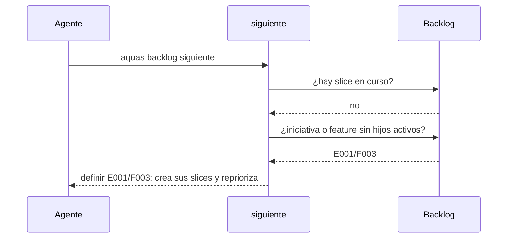

# S008 · Definir antes de ejecutar

[Inicio](../../README.md) › [E001](../README.md) › [F002](README.md) › S008

`aquas backlog siguiente` ya no entrega un [slice](../../glosario.md#slice) mientras haya algo sin definir. Primero pide definir la [iniciativa](../../glosario.md#iniciativa) o la [feature](../../glosario.md#feature) pendiente.

## En una frase

Lo nuevo se define y se prioriza antes de seguir ejecutando.

## Para qué existe

**El problema.** `siguiente` solo miraba slices. Una feature P1 sin slices, E000/F005, quedó escondida detrás de un slice P2.

**La regla (decisión humana, 2026-10-21).** El [backlog](../../glosario.md#backlog) siempre tiene todos sus ítems definidos. Lo único que puede quedar sin definir es lo que se ingresa mientras corre un slice. Al terminar ese slice, lo primero es definirlo y repriorizar.

Contrato del slice:

| Campo | Valor |
|---|---|
| Objetivo | `siguiente` exige definir iniciativas y features sin hijos antes de dar un slice |
| Incluye | `Siguiente`, el mensaje `definir …`, la regla en el canónico |
| Excluye | Crear los slices de cada feature: eso lo decide el humano |
| Prueba | `go test ./internal/backlog/ -run TestSiguienteExigeDefinirAntes` |

## Analogía

Piensa en una **cocina con comandas**.

- Llega un pedido nuevo mientras cocinas un plato.
- Terminas el plato, lees la comanda nueva y reordenas la fila antes de seguir.

Límite de la analogía: aquí nadie se salta la fila; el orden lo fija un programa.

## Diagrama

Secuencia de `siguiente` con una feature sin slices:

## Ejemplo de punta a punta

continúa: [EJ-E001-F002](README.md#EJ-E001-F002)

1. Corre un slice y el humano define la feature E001/F005.
2. El slice cierra.
3. `siguiente` responde `definir E001/F005: crea sus slices y reprioriza el backlog antes de seguir con slices`.
4. Definida la feature, `siguiente` vuelve a dar slices por prioridad.

## Paso a paso

Así ordena `siguiente`:

1. El slice en curso, que no se interrumpe.
2. Iniciativas sin features activas, por orden de ingreso.
3. Features sin slices activos, por orden de ingreso, aunque estén bloqueadas.
4. El primer slice libre, como antes.

## Cómo se usa

- Al cerrar cada slice, correr `aquas backlog siguiente`.
- Si responde `definir …`, crear los hijos con `aquas backlog nuevo`.
- Después, repriorizar con `aquas backlog prioridad`.

## Contrato y evidencia

<!-- GENERADO por aquas desde trabajo/: no editar a mano; `aquas compilar` lo rehace. -->

| Prueba | Valida | Rojo cuando | Verde cuando | Rojo | Verde |
|---|---|---|---|---|---|
| `TestSiguienteExigeDefinirAntes` | iniciativa o feature activa sin hijos pendientes sale antes que cualquier slice libre, iniciativas primero y por orden de creación, aunque esté bloqueada; el slice en curso va primero | — | — | 2026-10-22 | 2026-10-22 |

<!-- /GENERADO -->

Estado: hecho.

Límites:

- No revisa si los slices definidos bastan para cumplir la feature. Eso queda a criterio humano.
- El título de la ficha sigue siendo el original, porque `aquas backlog` no tiene comando para cambiarlo.

## Navegación

- ↑ Subir: [F002 · Turnos, backlog y sello](README.md)
