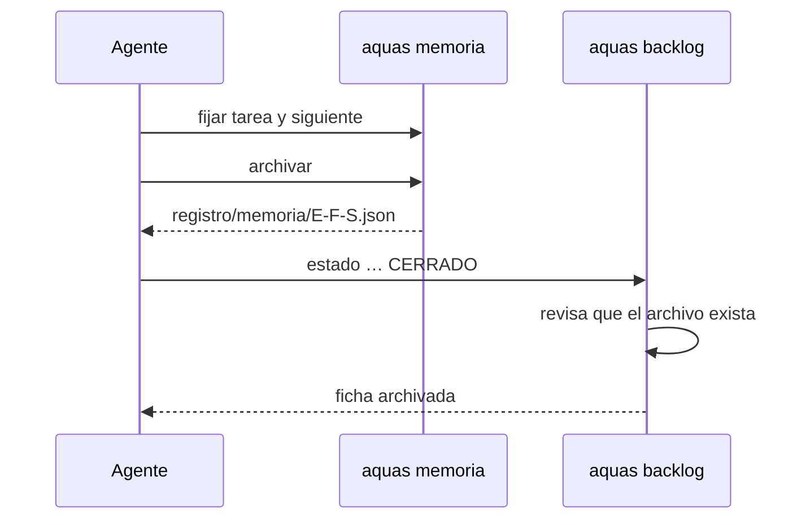
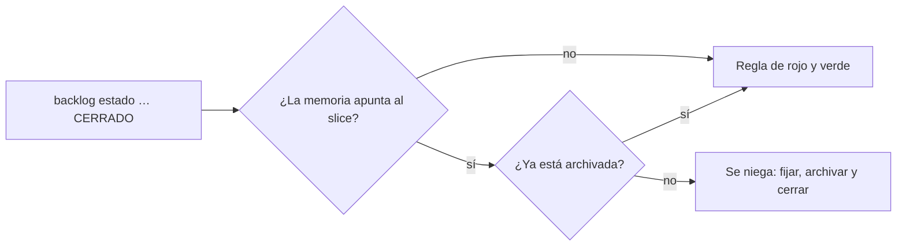
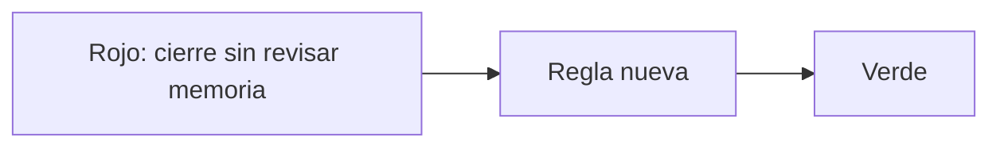

# S009 · Cerrar exige memoria archivada

[Inicio](../../README.md) › [E001](../README.md) › [F002](README.md) › S009

[Slice](../../glosario.md#slice) que impide cerrar un slice antes de archivar su memoria caliente.

## En una frase

Primero se guarda la memoria del slice; después se cierra.

## Para qué existe

**El problema.** Al cerrar E000/F005/S001, el [agente](../../glosario.md#agente) cerró la ficha antes de archivar la memoria. Luego hizo un [commit](../../glosario.md#commit), y la memoria quedó vieja. Pasó esto:

- `aquas memoria fijar` se negó: el slice ya no estaba en curso.
- `aquas memoria archivar` se negó: la memoria estaba vieja.

Cada comando mandaba al otro. La única salida fue vaciar el slice, y S001 quedó sin archivo de memoria.

**La solución.** `aquas backlog estado … CERRADO` revisa la memoria antes de cerrar. Si la memoria apunta a ese slice y no está archivada, se niega y dice el orden.

Contrato del slice:

| Campo | Valor |
|---|---|
| Objetivo | Ningún slice cierra con su memoria sin archivar |
| Incluye | Revisión en `aquas backlog estado … CERRADO` |
| Excluye | Cancelar: `CANCELADO` no exige memoria archivada |
| Prueba | `go test ./cmd/aquas/` |

## Analogía

Piensa en **cerrar una caja registradora** al final del turno.

- Primero se imprime el reporte del día.
- Después se cierra la caja.
- Si cierras primero, la máquina ya no imprime el reporte.

Límite de la analogía: la caja deja reimprimir con una clave. Aquí el archivo perdido no se recupera.

## Diagrama

Secuencia: cierre en el orden correcto.

Proceso del cierre:

## Ejemplo de punta a punta

continúa: [EJ-E001-F002](README.md#EJ-E001-F002)

En la [feature](../../glosario.md#feature), el slice ya vio su rojo y su verde. Ahora toca cerrarlo.

1. El agente corre `aquas backlog estado E001/F002/S009 CERRADO`.
2. La memoria apunta a S009 y no tiene archivo. El cierre se niega y dice el orden.
3. El agente fija el estado final y corre `aquas memoria archivar`.
4. Repite el cierre. Ahora pasa a la regla de rojo y verde, y la ficha se archiva.

## Paso a paso

1. [Prueba en rojo](../../glosario.md#prueba-en-rojo) real: la regla aún no existía.
2. Revisión de la memoria en el comando `estado`.
3. Verde y cierre del propio slice en el orden nuevo.

## Cómo se usa

Orden al cerrar un slice:

1. `aquas memoria fijar tarea=… siguiente=…`.
2. `aquas memoria archivar`.
3. `aquas backlog estado <id> CERRADO`.

## Contrato y evidencia

Estado: hecho.

Pruebas del slice, en `cmd/aquas/cierre_test.go`:

| Prueba | Qué demuestra |
|---|---|
| `TestCerrarExigeMemoriaArchivada` | Con la memoria sin archivar, cerrar se niega y pide archivar; archivada, con otro foco o al cancelar, no se bloquea por memoria |

Rojo visto: sí, el 2026-10-21, registrado por `aquas backlog rojo`. Rojo real, sin mutación: el cierre fallaba por otra causa («sin rojo»), no por la memoria. Verde: registrado por `aquas backlog verde`.

Decisión de Jesús (2026-10-21): bloquear el cierre de un slice con la memoria sin archivar. Solo para `CERRADO`; cancelar sigue libre.

## Navegación

- ↑ Subir: [F002 · Turnos, backlog y sello](README.md)
