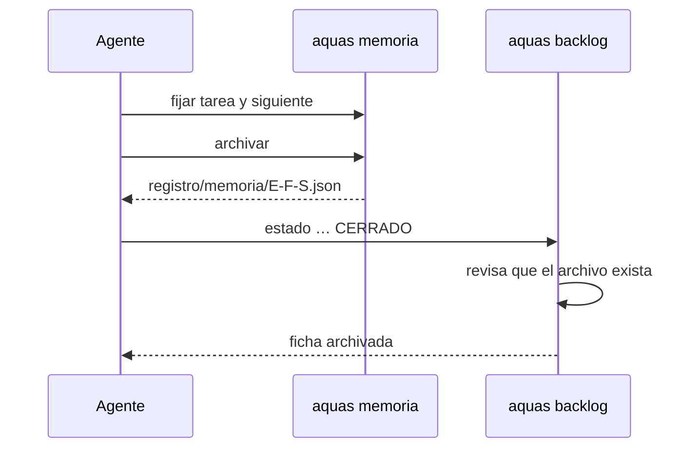
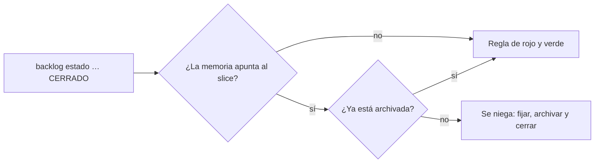
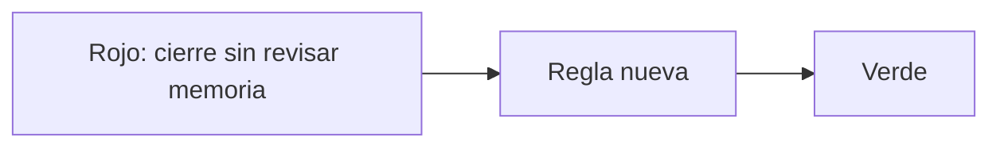

# S009 · Cerrar exige memoria archivada

[Inicio](../../README.md) › [E001](../README.md) › [F002](README.md) › S009

[Slice](../../glosario.md#slice) que impide cerrar un slice antes de archivar su memoria caliente.

## En una frase

Primero se guarda la memoria del slice; después se cierra.

## Para qué existe

**El problema.** Al cerrar E000/F005/S001, el [agente](../../glosario.md#agente) cerró la ficha antes de archivar la memoria. Luego hizo un [commit](../../glosario.md#commit), y la memoria quedó vieja. Pasó esto:

- `aquas memoria fijar` se negó: el slice ya no estaba en curso.
- `aquas memoria archivar` se negó: la memoria estaba vieja.

Cada comando mandaba al otro. La única salida fue vaciar el slice, y S001 quedó sin archivo de memoria.

**La solución.** `aquas backlog estado … CERRADO` revisa la memoria antes de cerrar. Si la memoria apunta a ese slice y no está archivada, se niega y dice el orden.

Contrato del slice:

| Campo | Valor |
|---|---|
| Objetivo | Ningún slice cierra con su memoria sin archivar |
| Incluye | Revisión en `aquas backlog estado … CERRADO` |
| Excluye | Cancelar: `CANCELADO` no exige memoria archivada |
| Prueba | `go test ./cmd/aquas/` |

## Analogía

Piensa en **cerrar una caja registradora** al final del turno.

- Primero se imprime el reporte del día.
- Después se cierra la caja.
- Si cierras primero, la máquina ya no imprime el reporte.

Límite de la analogía: la caja deja reimprimir con una clave. Aquí el archivo perdido no se recupera.

## Diagrama

Secuencia: cierre en el orden correcto.

Proceso del cierre:

## Ejemplo de punta a punta

continúa: [EJ-E001-F002](README.md#EJ-E001-F002)

En la [feature](../../glosario.md#feature), el slice ya vio su rojo y su verde. Ahora toca cerrarlo.

1. El agente corre `aquas backlog estado E001/F002/S009 CERRADO`.
2. La memoria apunta a S009 y no tiene archivo. El cierre se niega y dice el orden.
3. El agente fija el estado final y corre `aquas memoria archivar`.
4. Repite el cierre. Ahora pasa a la regla de rojo y verde, y la ficha se archiva.

## Paso a paso

1. [Prueba en rojo](../../glosario.md#prueba-en-rojo) real: la regla aún no existía.
2. Revisión de la memoria en el comando `estado`.
3. Verde y cierre del propio slice en el orden nuevo.

## Cómo se usa

Orden al cerrar un slice:

1. `aquas memoria fijar tarea=… siguiente=…`.
2. `aquas memoria archivar`.
3. `aquas backlog estado <id> CERRADO`.

## Contrato y evidencia

<!-- GENERADO por aquas desde trabajo/: no editar a mano; `aquas compilar` lo rehace. -->

| Prueba | Valida | Rojo cuando | Verde cuando | Rojo | Verde |
|---|---|---|---|---|---|
| `TestCerrarExigeMemoriaArchivada` | CERRADO se niega si el slice no tiene su memoria archivada, apunte o no la memoria a él, y dice cómo archivar | CERRADO acepta un slice sin archivo de memoria, con la memoria en él o en otro foco, o bloquea CANCELADO | sin archivo de memoria CERRADO da exit 1 y pide archivar; con archivo o al cancelar no se bloquea | 2026-10-21 | 2026-10-21 |

### Código

| Archivo | Función | Parámetros | Qué hace |
|---|---|---|---|
| [cmd/aquas/main.go](../../../cmd/aquas/main.go) | `main` | `()` | main despacha el subcomando de aquas (compilar, verificar, backlog, hooks…) y sale con su código. |
| [cmd/aquas/main.go](../../../cmd/aquas/main.go) | `hook` | `(raiz string)` | hook: exit 0 = nada que reportar; exit 2 = stderr se muestra a Claude. |
| [cmd/aquas/main.go](../../../cmd/aquas/main.go) | `compilarSettings` | `(w io.Writer)` | compilarSettings regenera .claude/settings.json; sin entorno declarado no inventa uno. |
| [cmd/aquas/main.go](../../../cmd/aquas/main.go) | `reportar` | `(w io.Writer, inf compilador.Informe)` | reportar imprime qué derivados escribió la compilación, o que todo estaba al día. |
| [cmd/aquas/main.go](../../../cmd/aquas/main.go) | `listar` | `(titulo string, problemas []string)` | listar imprime en stderr un título y cada problema en su viñeta. |
| [cmd/aquas/main.go](../../../cmd/aquas/main.go) | `lista` | `(xs []string) string` | lista une los textos con comas, o «—» si no hay ninguno. |
| [cmd/aquas/main.go](../../../cmd/aquas/main.go) | `fallar` | `(codigo int, err error)` | fallar imprime el error en stderr y termina con el código dado. |
| [cmd/aquas/main.go](../../../cmd/aquas/main.go) | `memoriaCLI` | `(raiz string, args []string)` | memoriaCLI: `ver` imprime la memoria; `fijar campo=valor…` la actualiza y la sella. |
| [cmd/aquas/main.go](../../../cmd/aquas/main.go) | `memoriaArchivada` | `(raiz, id string) error` | memoriaArchivada: CERRADO exige el archivo de memoria del slice, apunte o no la memoria a él (E001/F002/S009, X01). |
| [cmd/aquas/main.go](../../../cmd/aquas/main.go) | `focoEnBacklog` | `(raiz string, f memoria.Foco) error` | focoEnBacklog: la memoria solo fija el slice que el backlog tiene en curso (S003). |
| [cmd/aquas/main.go](../../../cmd/aquas/main.go) | `backlogCLI` | `(raiz string, args []string)` | backlogCLI: nuevo \\| ver [id] \\| prioridad \\| estado \\| siguiente \\| pruebas \\| rojo \\| verde. |
| [cmd/aquas/main.go](../../../cmd/aquas/main.go) | `turnoCLI` | `(raiz string, args []string)` | turnoCLI: auditoría de turnos (E001/F002/S001). Lee el JSON del hook por stdin. No imprime nada |
| [cmd/aquas/main.go](../../../cmd/aquas/main.go) | `defectoCLI` | `(raiz string, args []string) error` | defectoCLI: nuevo \\| ocurre \\| ver (E001/F004/S001). |
| [cmd/aquas/main.go](../../../cmd/aquas/main.go) | `versionBinario` | `() string` | versionBinario: versión del módulo con que se compiló el binario (= versión del gobierno embebido). |
| [cmd/aquas/main.go](../../../cmd/aquas/main.go) | `registrarCierre` | `(raiz, tipo, transcript, primera, resultado string)` | registrarCierre (E001/F004/S005, D000068) anota cada llamada del gancho cierre-agente en .tmp/hooks/cierre-agente.jsonl. |

### Arreglos

| Arreglo | Qué arregla | Por qué | Pruebas | Fecha | Rojo | Verde |
|---|---|---|---|---|---|---|
| X01 | CERRADO exige la memoria archivada aunque la memoria apunte a otro slice | D000010: S005 se cerró sin archivo de memoria porque el foco no apuntaba a él (2026-10-23) | — | 2026-10-23 | — | — |

<!-- /GENERADO -->

Estado: hecho.

Pruebas del slice, en `cmd/aquas/cierre_test.go`:

| Prueba | Qué demuestra |
|---|---|
| `TestCerrarExigeMemoriaArchivada` | Con la memoria sin archivar, cerrar se niega y pide archivar; archivada, con otro foco o al cancelar, no se bloquea por memoria |

Rojo visto: sí, el 2026-10-21, registrado por `aquas backlog rojo`. Rojo real, sin mutación: el cierre fallaba por otra causa («sin rojo»), no por la memoria. Verde: registrado por `aquas backlog verde`.

Decisión de Jesús (2026-10-21): bloquear el cierre de un slice con la memoria sin archivar. Solo para `CERRADO`; cancelar sigue libre.

## Navegación

- ↑ Subir: [F002 · Turnos, backlog y sello](README.md)
