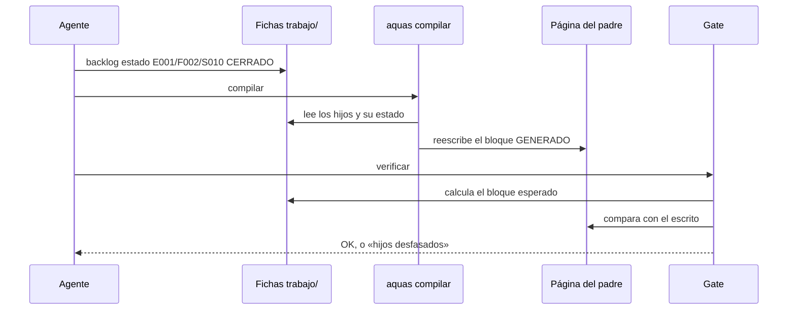

# S010 · Wiki por niveles

[Inicio](../../README.md) › [E001](../README.md) › [F002](README.md) › S010

[Slice](../../glosario.md#slice) que hace que cada página de la [wiki](../../glosario.md#wiki) muestre solo a sus hijos directos. Esa lista la escribe un programa.

## En una frase

Cada página muestra a sus hijos, y cuando un hijo cambia, su padre se entera solo.

## Para qué existe

**El problema.** El inicio mostraba todo: [iniciativas](../../glosario.md#iniciativa), [features](../../glosario.md#feature) y slices. Crecía sin fin. Además, las tablas se escribían a mano. Al cambiar un slice, nadie actualizaba la página de arriba.

Pasó de verdad. La página de E000 no mostraba dos de sus features. La de F002 no mostraba uno de sus slices. Ningún [gate](../../glosario.md#gate) lo vio, porque el gate no leía las fichas.

**La solución.** `aquas compilar` escribe en cada página un bloque marcado como GENERADO. Lo saca de las fichas del [backlog](../../glosario.md#backlog). El gate falla si el bloque falta o no coincide con las fichas.

Contrato del slice:

| Campo | Valor |
|---|---|
| Objetivo | Cada página lista solo a sus hijos directos, generados desde las fichas |
| Incluye | Generador, gate de desfase, enlaces que saltan niveles, página que falta |
| Excluye | La prosa y los diagramas explicativos: siguen siendo criterio humano |
| Prueba | `go test ./internal/wiki/ ./cmd/aquas/` |

## Analogía

Piensa en el **directorio de un edificio**, en la entrada.

- En la entrada ves los pisos. En cada piso ves sus oficinas.
- Si una oficina se muda, el letrero se cambia desde un registro central.

Límite de la analogía: aquí el registro central son las fichas. El letrero no se puede corregir a mano: el gate lo detecta.

## Diagrama

Secuencia de un cambio de estado:

## Ejemplo de punta a punta

continúa: [EJ-E001-F002](README.md#EJ-E001-F002)

Este mismo slice arrancó con su ficha en curso y sin página.

1. El gate falló: «falta la página de E001/F002/S010 (ficha EN_CURSO)».
2. Se escribió esta página.
3. `aquas compilar` agregó la fila de S010, con enlace, en la tabla de F002.
4. El gate pasó.

## Paso a paso

1. Escribir las cinco pruebas y verlas en rojo con un generador vacío.
2. Escribir el generador y el gate en `internal/wiki/hijos.go`.
3. Correr `aquas compilar` sobre la wiki real.
4. Corregir lo que el gate encontró: el inicio enlazaba 34 páginas de features y slices.
5. Quitar el estado escrito a mano en tablas y diagramas.

## Cómo se usa

- Regenerar las tablas: `go run ./cmd/aquas compilar`.
- Revisar: `go run ./cmd/aquas verificar`.
- Una página nace cuando su ficha pasa a en curso. Antes, su padre la muestra sin enlace.

## Contrato y evidencia

<!-- GENERADO por aquas desde trabajo/: no editar a mano; `aquas compilar` lo rehace. -->

| Prueba | Valida | Rojo cuando | Verde cuando | Rojo | Verde |
|---|---|---|---|---|---|
| `TestHijosGeneradosDesdeFichas` | inicio, E y F listan solo hijos directos con estado y S lista sus pruebas | falta un bloque GENERADO, hay más de uno, el gate cae tras generar o la segunda corrida escribe | primera corrida escribe 4 páginas; tras generar gate OK; segunda corrida no escribe nada | 2026-10-21 | 2026-10-21 |
| `TestHijosDesfasadosFallan` | un bloque GENERADO ausente o distinto de las fichas hace fallar el gate | el gate pasa con el bloque ausente o desfasado, o BLOQUEADO no se muestra como Bloqueado | sin bloque o desfasado el gate cae; al regenerar, la iniciativa bloqueada muestra Bloqueado | 2026-10-21 | 2026-10-21 |
| `TestInicioMuestraSoloIniciativas` | el inicio lista solo iniciativas y los niveles inferiores no saltan niveles | el bloque del inicio nombra features o slices, o subir/ir al hermano salta niveles | el inicio nombra solo iniciativas; el slice enlaza al inicio y a su hermano sin problemas | 2026-10-21 | 2026-10-21 |
| `TestEntidadArrancadaSinPagina` | una ficha EN_CURSO o CERRADO sin página hace fallar el gate; BORRADOR no | el gate pasa con una ficha arrancada sin página, o exige página a una no arrancada | EN_CURSO y CERRADO sin página caen; BORRADOR sin página no produce problemas | 2026-10-21 | 2026-10-21 |
| `TestCompilarRegeneraHijos` | aquas compilar reescribe el bloque del inicio tras cambiar una ficha y conserva lo manual | compilar no escribe el inicio, no refleja el cambio de ficha, pierde texto manual o toca sin cambios | el inicio sale Planeado sin enlace, tras cambiar la ficha En curso con lo manual intacto | 2026-10-21 | 2026-10-21 |

### Código

| Archivo | Función | Parámetros | Qué hace |
|---|---|---|---|
| [cmd/aquas/main.go](../../../cmd/aquas/main.go) | `main` | `()` | main despacha el subcomando de aquas (compilar, verificar, backlog, hooks…) y sale con su código. |
| [cmd/aquas/main.go](../../../cmd/aquas/main.go) | `hook` | `(raiz string)` | hook: exit 0 = nada que reportar; exit 2 = stderr se muestra a Claude. |
| [cmd/aquas/main.go](../../../cmd/aquas/main.go) | `compilarSettings` | `(w io.Writer)` | compilarSettings regenera .claude/settings.json; sin entorno declarado no inventa uno. |
| [cmd/aquas/main.go](../../../cmd/aquas/main.go) | `reportar` | `(w io.Writer, inf compilador.Informe)` | reportar imprime qué derivados escribió la compilación, o que todo estaba al día. |
| [cmd/aquas/main.go](../../../cmd/aquas/main.go) | `listar` | `(titulo string, problemas []string)` | listar imprime en stderr un título y cada problema en su viñeta. |
| [cmd/aquas/main.go](../../../cmd/aquas/main.go) | `lista` | `(xs []string) string` | lista une los textos con comas, o «—» si no hay ninguno. |
| [cmd/aquas/main.go](../../../cmd/aquas/main.go) | `fallar` | `(codigo int, err error)` | fallar imprime el error en stderr y termina con el código dado. |
| [cmd/aquas/main.go](../../../cmd/aquas/main.go) | `memoriaCLI` | `(raiz string, args []string)` | memoriaCLI: `ver` imprime la memoria; `fijar campo=valor…` la actualiza y la sella. |
| [cmd/aquas/main.go](../../../cmd/aquas/main.go) | `memoriaArchivada` | `(raiz, id string) error` | memoriaArchivada: CERRADO exige el archivo de memoria del slice, apunte o no la memoria a él (E001/F002/S009, X01). |
| [cmd/aquas/main.go](../../../cmd/aquas/main.go) | `focoEnBacklog` | `(raiz string, f memoria.Foco) error` | focoEnBacklog: la memoria solo fija el slice que el backlog tiene en curso (S003). |
| [cmd/aquas/main.go](../../../cmd/aquas/main.go) | `backlogCLI` | `(raiz string, args []string)` | backlogCLI: nuevo \\| ver [id] \\| prioridad \\| estado \\| siguiente \\| pruebas \\| rojo \\| verde. |
| [cmd/aquas/main.go](../../../cmd/aquas/main.go) | `turnoCLI` | `(raiz string, args []string)` | turnoCLI: auditoría de turnos (E001/F002/S001). Lee el JSON del hook por stdin. No imprime nada |
| [cmd/aquas/main.go](../../../cmd/aquas/main.go) | `defectoCLI` | `(raiz string, args []string) error` | defectoCLI: nuevo \\| ocurre \\| ver (E001/F004/S001). |
| [cmd/aquas/main.go](../../../cmd/aquas/main.go) | `versionBinario` | `() string` | versionBinario: versión del módulo con que se compiló el binario (= versión del gobierno embebido). |
| [internal/backlog/backlog.go](../../../internal/backlog/backlog.go) | `terminal` | `(estado string) bool` | terminal: el estado ya no cambia (CERRADO o CANCELADO). |
| [internal/backlog/backlog.go](../../../internal/backlog/backlog.go) | `esta` | `(xs []string, x string) bool` | esta: x figura en la lista. |
| [internal/backlog/backlog.go](../../../internal/backlog/backlog.go) | `tipoYPadre` | `(id string) (tipo, padre string)` | tipoYPadre deriva del id: E001 → iniciativa; E001/F002 → feature de E001; E001/F002/S002 → slice. |
| [internal/backlog/backlog.go](../../../internal/backlog/backlog.go) | `nombre` | `(id string) string` | nombre: archivo JSON de una ficha, con «/» del ID cambiadas por «-». |
| [internal/backlog/backlog.go](../../../internal/backlog/backlog.go) | `todas` | `(raiz string) (act, arc map[string]Ficha, err error)` | todas lee activo y archivo. Una ficha ilegible es error: Validar la detalla. |
| [internal/backlog/backlog.go](../../../internal/backlog/backlog.go) | `Todas` | `(raiz string) ([]Ficha, error)` | Todas: las fichas de activo y archivo, ordenadas por id. Para quien solo lee (wiki, E001/F002/S010). |
| [internal/backlog/backlog.go](../../../internal/backlog/backlog.go) | `leer` | `(ruta string) (Ficha, error)` | leer carga una ficha desde su archivo JSON. |
| [internal/backlog/backlog.go](../../../internal/backlog/backlog.go) | `escribir` | `(raiz, dir string, f Ficha) error` | escribir guarda la ficha como JSON en trabajo/<dir>/, con listas vacías en vez de null. |
| [internal/backlog/backlog.go](../../../internal/backlog/backlog.go) | `Nuevo` | `(raiz string, campos []string) (Ficha, error)` | Nuevo crea una ficha desde campos id=… titulo=… prioridad=… motivo=… relacion=… [bloqueado_por=A,B]. |
| [internal/backlog/backlog.go](../../../internal/backlog/backlog.go) | `Ver` | `(raiz, id string) (Ficha, bool, error)` | Ver busca la ficha en activo y luego en archivo. |
| [internal/backlog/backlog.go](../../../internal/backlog/backlog.go) | `activa` | `(raiz, id string) (Ficha, error)` | activa: la ficha a cambiar; una archivada no cambia. |
| [internal/backlog/backlog.go](../../../internal/backlog/backlog.go) | `Prioridad` | `(raiz, id, prioridad, motivo string) (Ficha, error)` | Prioridad cambia la prioridad; el motivo es obligatorio. |
| [internal/backlog/backlog.go](../../../internal/backlog/backlog.go) | `Estado` | `(raiz, id, estado string) (Ficha, error)` | Estado cambia el estado. CERRADO o CANCELADO mueve la ficha al archivo. |
| [internal/backlog/backlog.go](../../../internal/backlog/backlog.go) | `sinHijosActivos` | `(act map[string]Ficha, f Ficha) error` | sinHijosActivos: cerrar o cancelar una feature o iniciativa exige sus hijos directos ya archivados. |
| [internal/backlog/backlog.go](../../../internal/backlog/backlog.go) | `ordenar` | `(fs []Ficha, arc map[string]Ficha)` | orden de `siguiente`: en curso → desbloqueado → prioridad → secuencia → id. |
| [internal/backlog/backlog.go](../../../internal/backlog/backlog.go) | `Activas` | `(raiz string) ([]Ficha, error)` | Activas: slices en el orden de `siguiente`; después iniciativas y features por secuencia. |
| [internal/backlog/backlog.go](../../../internal/backlog/backlog.go) | `Siguiente` | `(raiz string) (Ficha, bool, error)` | Siguiente: el primer slice del orden fijo que esté en curso o desbloqueado. |
| [internal/backlog/backlog.go](../../../internal/backlog/backlog.go) | `sinDefinir` | `(act map[string]Ficha) (Ficha, bool)` | sinDefinir (E001/F002/S008, regla del humano 2026-10-21): iniciativa o feature activa sin hijos |
| [internal/backlog/backlog.go](../../../internal/backlog/backlog.go) | `Definir` | `(f Ficha) string` | Definir: qué hacer con lo que `siguiente` saca sin definir; "" para un slice. |
| [internal/backlog/backlog.go](../../../internal/backlog/backlog.go) | `libre` | `(f Ficha, arc map[string]Ficha) bool` | libre: no está BLOQUEADO y cada bloqueador ya terminó (archivado: CERRADO o CANCELADO). |
| [internal/backlog/backlog.go](../../../internal/backlog/backlog.go) | `Validar` | `(raiz string) []string` | Validar: problemas de las fichas en disco (gate). Sin carpeta trabajo/ no hay problemas. |
| [internal/backlog/backlog.go](../../../internal/backlog/backlog.go) | `Texto` | `(f Ficha) string` | Texto: una línea por ficha, para el agente. |
| [internal/wiki/hijos.go](../../../internal/wiki/hijos.go) | `paginaDe` | `(id string) string` | paginaDe: la página de la wiki que corresponde a un id de ficha. |
| [internal/wiki/hijos.go](../../../internal/wiki/hijos.go) | `celda` | `(s string) string` | celda escapa saltos de línea y «\\|» para una celda de tabla Markdown. |
| [internal/wiki/hijos.go](../../../internal/wiki/hijos.go) | `existe` | `(raiz, rel string) bool` | existe: la ruta relativa existe en disco. |
| [internal/wiki/hijos.go](../../../internal/wiki/hijos.go) | `tablaHijos` | `(raiz, padreRel string, hijos []backlog.Ficha) string` | tablaHijos: una fila por hijo directo; enlace solo si su página existe. |
| [internal/wiki/hijos.go](../../../internal/wiki/hijos.go) | `fecha` | `(r *backlog.Registro) string` | fecha: día AAAA-MM-DD de un registro, o «—» si no hay. |
| [internal/wiki/hijos.go](../../../internal/wiki/hijos.go) | `oGuion` | `(s string) string` | oGuion: el texto como celda, o «—» si está vacío (pruebas anteriores a E001/F008/S001). |
| [internal/wiki/hijos.go](../../../internal/wiki/hijos.go) | `tablaPruebas` | `(f backlog.Ficha) string` | tablaPruebas: las pruebas del slice: qué validan, cuándo quedan en rojo y en verde, y si se vieron en rojo y en verde. |
| [internal/wiki/hijos.go](../../../internal/wiki/hijos.go) | `esperados` | `(raiz string) (map[string]esperado, []backlog.Ficha, error)` | esperados: página existente → bloque que debe llevar. Vacío si no hay fichas. |
| [internal/wiki/hijos.go](../../../internal/wiki/hijos.go) | `bloqueActual` | `(c string) (ini, fin int)` | bloqueActual: posición del bloque en c; ini < 0 = no hay; fin < 0 = sin cierre. |
| [internal/wiki/hijos.go](../../../internal/wiki/hijos.go) | `Generar` | `(raiz string) ([]string, error)` | Generar reescribe el bloque GENERADO de cada página desde las fichas; devuelve lo escrito. |
| [internal/wiki/hijos.go](../../../internal/wiki/hijos.go) | `revisarHijos` | `(raiz string, paginas map[string]*pagina, orden []string) ([]string, error)` | revisarHijos: bloque presente y al día, enlaces sin saltar niveles, ficha arrancada con página. |
| [internal/wiki/hijos.go](../../../internal/wiki/hijos.go) | `tablaArreglos` | `(f backlog.Ficha) string` | tablaArreglos: sección «Arreglos» de la ficha; vacía si no tiene. |
| [internal/wiki/wiki.go](../../../internal/wiki/wiki.go) | `Verificar` | `(raiz string) ([]string, error)` | Verificar devuelve los problemas de la wiki bajo raiz/docs; vacío = gate OK. |
| [internal/wiki/wiki.go](../../../internal/wiki/wiki.go) | `relativa` | `(raiz, p string) string` | relativa: ruta de p respecto de la raíz, con barras «/». |
| [internal/wiki/wiki.go](../../../internal/wiki/wiki.go) | `clasificar` | `(rel string) *pagina` | clasificar asigna nivel, padre e id de ejemplo según la ruta; nil = fuera del árbol. |
| [internal/wiki/wiki.go](../../../internal/wiki/wiki.go) | `analizar` | `(raiz string, pg *pagina) error` | analizar lee la página: secciones H2, diagramas, anclas (id HTML y títulos) y enlaces fuera de código. |
| [internal/wiki/wiki.go](../../../internal/wiki/wiki.go) | `slug` | `(s string) string` | slug al estilo GitHub/VS Code: minúsculas, letras/dígitos/-/_ se conservan, espacio → guion. |
| [internal/wiki/wiki.go](../../../internal/wiki/wiki.go) | `pagina.seccion` | `(titulo string) *seccion` | seccion busca una sección de la página por su título; nil si no está. |
| [internal/wiki/wiki.go](../../../internal/wiki/wiki.go) | `revisarSecciones` | `(pg *pagina) []string` | revisarSecciones: faltan secciones fijas o están fuera de orden. |
| [internal/wiki/wiki.go](../../../internal/wiki/wiki.go) | `revisarDiagramas` | `(pg *pagina) []string` | revisarDiagramas: la sección Diagrama trae el Mermaid que pide su nivel. |
| [internal/wiki/wiki.go](../../../internal/wiki/wiki.go) | `revisarEjemplo` | `(pg *pagina, paginas map[string]*pagina) []string` | revisarEjemplo: el ejemplo lleva su ancla EJ- y encadena con el del padre. |
| [internal/wiki/wiki.go](../../../internal/wiki/wiki.go) | `revisarNavegacion` | `(pg *pagina, hijos []string) []string` | revisarNavegacion: hay ↑ Subir y un enlace Abajo a cada hija. |
| [internal/wiki/wiki.go](../../../internal/wiki/wiki.go) | `revisarEnlaces` | `(raiz string, pg *pagina, anclas map[string]map[string]bool) []string` | revisarEnlaces: cada enlace interno apunta a un archivo y ancla que existen. |
| [internal/wiki/wiki.go](../../../internal/wiki/wiki.go) | `revisarAlcance` | `(paginas map[string]*pagina, orden []string) []string` | revisarAlcance: toda página del árbol debe alcanzarse desde docs/README.md siguiendo enlaces. |
| [internal/wiki/wiki.go](../../../internal/wiki/wiki.go) | `resolver` | `(desde, destino string) (string, string)` | resolver convierte un destino relativo a la página en ruta relativa a la raíz + fragmento. |

<!-- /GENERADO -->

Estado: hecho.

Pruebas del slice:

| Prueba | Qué demuestra |
|---|---|
| `TestHijosGeneradosDesdeFichas` | El inicio, E y F listan sus hijos con estado; un slice lista sus pruebas |
| `TestHijosDesfasadosFallan` | Un bloque que falta, sin cierre o distinto de las fichas hace fallar el gate |
| `TestInicioMuestraSoloIniciativas` | Un enlace que salta un nivel hacia abajo hace fallar el gate |
| `TestEntidadArrancadaSinPagina` | Una ficha en curso o cerrada sin página hace fallar el gate |
| `TestCompilarRegeneraHijos` | `aquas compilar` reescribe el bloque tras cambiar una ficha |

Rojo visto: sí, el 2026-10-21, con un generador vacío. Las cinco fallaron porque faltaba el bloque.

Límite: sin fichas en `trabajo/` no se exige bloque. Un repositorio sin backlog no tiene de dónde sacarlo.

## Navegación

- ↑ Subir: [F002 · Turnos, backlog y sello](README.md)
