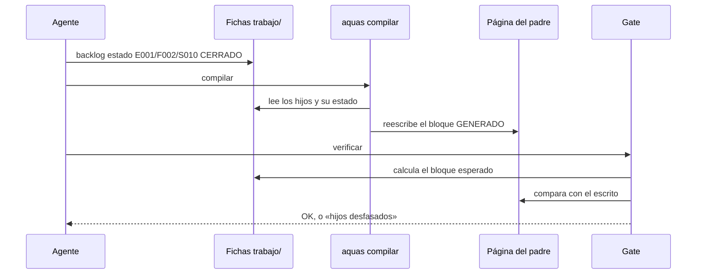

# S010 · Wiki por niveles

[Inicio](../../README.md) › [E001](../README.md) › [F002](README.md) › S010

[Slice](../../glosario.md#slice) que hace que cada página de la [wiki](../../glosario.md#wiki) muestre solo a sus hijos directos. Esa lista la escribe un programa.

## En una frase

Cada página muestra a sus hijos, y cuando un hijo cambia, su padre se entera solo.

## Para qué existe

**El problema.** El inicio mostraba todo: [iniciativas](../../glosario.md#iniciativa), [features](../../glosario.md#feature) y slices. Crecía sin fin. Además, las tablas se escribían a mano. Al cambiar un slice, nadie actualizaba la página de arriba.

Pasó de verdad. La página de E000 no mostraba dos de sus features. La de F002 no mostraba uno de sus slices. Ningún [gate](../../glosario.md#gate) lo vio, porque el gate no leía las fichas.

**La solución.** `aquas compilar` escribe en cada página un bloque marcado como GENERADO. Lo saca de las fichas del [backlog](../../glosario.md#backlog). El gate falla si el bloque falta o no coincide con las fichas.

Contrato del slice:

| Campo | Valor |
|---|---|
| Objetivo | Cada página lista solo a sus hijos directos, generados desde las fichas |
| Incluye | Generador, gate de desfase, enlaces que saltan niveles, página que falta |
| Excluye | La prosa y los diagramas explicativos: siguen siendo criterio humano |
| Prueba | `go test ./internal/wiki/ ./cmd/aquas/` |

## Analogía

Piensa en el **directorio de un edificio**, en la entrada.

- En la entrada ves los pisos. En cada piso ves sus oficinas.
- Si una oficina se muda, el letrero se cambia desde un registro central.

Límite de la analogía: aquí el registro central son las fichas. El letrero no se puede corregir a mano: el gate lo detecta.

## Diagrama

Secuencia de un cambio de estado:

## Ejemplo de punta a punta

continúa: [EJ-E001-F002](README.md#EJ-E001-F002)

Este mismo slice arrancó con su ficha en curso y sin página.

1. El gate falló: «falta la página de E001/F002/S010 (ficha EN_CURSO)».
2. Se escribió esta página.
3. `aquas compilar` agregó la fila de S010, con enlace, en la tabla de F002.
4. El gate pasó.

## Paso a paso

1. Escribir las cinco pruebas y verlas en rojo con un generador vacío.
2. Escribir el generador y el gate en `internal/wiki/hijos.go`.
3. Correr `aquas compilar` sobre la wiki real.
4. Corregir lo que el gate encontró: el inicio enlazaba 34 páginas de features y slices.
5. Quitar el estado escrito a mano en tablas y diagramas.

## Cómo se usa

- Regenerar las tablas: `go run ./cmd/aquas compilar`.
- Revisar: `go run ./cmd/aquas verificar`.
- Una página nace cuando su ficha pasa a en curso. Antes, su padre la muestra sin enlace.

## Contrato y evidencia

<!-- GENERADO por aquas desde trabajo/: no editar a mano; `aquas compilar` lo rehace. -->

| Prueba | Valida | Rojo cuando | Verde cuando | Rojo | Verde |
|---|---|---|---|---|---|
| `TestHijosGeneradosDesdeFichas` | inicio, E y F listan solo hijos directos con estado; S lista sus pruebas con rojo/verde | — | — | 2026-10-21 | 2026-10-21 |
| `TestHijosDesfasadosFallan` | bloque GENERADO ausente o distinto de las fichas hace fallar el gate | — | — | 2026-10-21 | 2026-10-21 |
| `TestInicioMuestraSoloIniciativas` | el inicio no enlaza features ni slices | — | — | 2026-10-21 | 2026-10-21 |
| `TestEntidadArrancadaSinPagina` | ficha EN_CURSO o CERRADO sin página hace fallar el gate; BORRADOR no | — | — | 2026-10-21 | 2026-10-21 |
| `TestCompilarRegeneraHijos` | aquas compilar reescribe el bloque tras cambiar una ficha | — | — | 2026-10-21 | 2026-10-21 |

<!-- /GENERADO -->

Estado: hecho.

Pruebas del slice:

| Prueba | Qué demuestra |
|---|---|
| `TestHijosGeneradosDesdeFichas` | El inicio, E y F listan sus hijos con estado; un slice lista sus pruebas |
| `TestHijosDesfasadosFallan` | Un bloque que falta, sin cierre o distinto de las fichas hace fallar el gate |
| `TestInicioMuestraSoloIniciativas` | Un enlace que salta un nivel hacia abajo hace fallar el gate |
| `TestEntidadArrancadaSinPagina` | Una ficha en curso o cerrada sin página hace fallar el gate |
| `TestCompilarRegeneraHijos` | `aquas compilar` reescribe el bloque tras cambiar una ficha |

Rojo visto: sí, el 2026-10-21, con un generador vacío. Las cinco fallaron porque faltaba el bloque.

Límite: sin fichas en `trabajo/` no se exige bloque. Un repositorio sin backlog no tiene de dónde sacarlo.

## Navegación

- ↑ Subir: [F002 · Turnos, backlog y sello](README.md)
