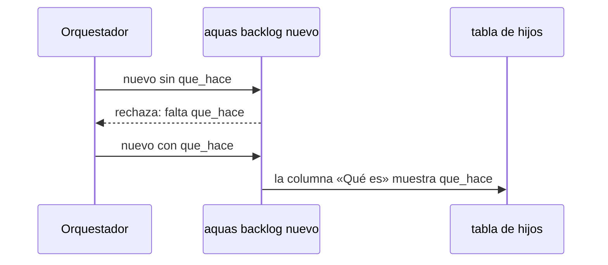

# S011 · La ficha dice qué hace

[Inicio](../../README.md) › [E001](../README.md) › [F002](README.md) › S011

Este [slice](../../glosario.md#slice) agrega a cada ficha una oración que dice qué hace. La tabla de hijos la muestra.

## En una frase

`aquas backlog nuevo` exige `que_hace=`, y la tabla de hijos lo muestra en la columna «Qué es».

## Para qué existe

**El problema.** La columna «Qué es» de la tabla de hijos muestra el título. Un título como «Stop frena pedido de dale sin plan» no explica qué hace.

**Por qué importa.** Esa tabla es lo primero que el humano lee de una [feature](../../glosario.md#feature) o una [iniciativa](../../glosario.md#iniciativa).

**La solución.** Un campo nuevo, `que_hace`, decidido por el humano el 2026-10-21; detalles acordados el 2026-10-29.

**Contrato.**

| Regla | Valor |
|---|---|
| Campo | `que_hace` en la ficha; `aquas backlog nuevo` lo exige para iniciativa, feature y slice |
| Largo | una oración de 20 palabras como máximo, el mismo tope de la wiki (`MaxPalabrasOracion`) |
| Falla | ausente, vacío o con más de 20 palabras: `nuevo` lo rechaza y no escribe la ficha |
| Tabla | la columna «Qué es» muestra `que_hace`; sin él, el título, como hoy |
| Ficha vieja | sin `que_hace` sigue legible; nadie la tiene que tocar |
| Fuera | llenar `que_hace` en fichas viejas con `editar`; cambiar el encabezado «Qué es» |
| Alcance | el de la ficha (`aquas backlog ver E001/F002/S011`): `backlog.go`, `hijos.go`, `main.go`, dos pruebas nuevas, las 14 pruebas que llaman a `nuevo` y esta página |

**Casos borde.**

| Categoría | Aplica | Prueba o motivo |
|---|---|---|
| cada tipo de ficha | sí | iniciativa, feature y slice exigen `que_hace` igual: `TestFichaGuardaQueHace` |
| cada estado de origen | no | `que_hace` se fija al crear la ficha; su estado no lo cambia |
| padre e hijo, activo y archivado | sí | la tabla muestra `que_hace` de hijos activos y archivados: `TestHijosMuestranQueHace` |
| entrada ausente, vacía, mal escrita o duplicada | sí | ausente, solo espacios, 21 palabras o repetido se rechazan; una barra queda escapada en la celda: `TestFichaGuardaQueHace`, `TestHijosMuestranQueHace` |
| choque con otro control | sí | el tope es igual al de la wiki; las llamadas a `nuevo` de las pruebas pasan `que_hace`: `TestHijosMuestranQueHace` |
| quién habla: humano, agente o herramienta | no | solo el comando `nuevo` crea fichas; quien lo llama no cambia la regla |
| fallo a mitad de camino | no | `nuevo` valida todo antes de escribir la ficha una sola vez |

## Analogía

Piensa en **el índice de un libro con una línea bajo cada capítulo**.

- El título dice el nombre; la línea dice de qué trata.

Límite de la analogía: aquí la línea es obligatoria para todo capítulo nuevo.

## Diagrama

## Ejemplo de punta a punta

continúa: [EJ-E001-F002](README.md#EJ-E001-F002)

1. `aquas backlog nuevo id=E001/F004/S006 titulo=… ` sin `que_hace` falla con «falta que_hace».
2. Con `que_hace="avisa cuando un gancho no anota el veredicto"`, la ficha se crea.
3. La página de F004 muestra esa oración en la fila de S006.

## Paso a paso

1. Rojo de las dos pruebas.
2. Campo, validación en `nuevo` y tabla de hijos; las llamadas de prueba pasan `que_hace`.
3. Verde y [GATE](../../glosario.md#gate) OK.

## Cómo se usa

- Al crear una ficha: `aquas backlog nuevo id=… titulo=… que_hace="una oración" …`.

## Contrato y evidencia

<!-- GENERADO por aquas desde trabajo/: no editar a mano; `aquas compilar` lo rehace. -->

| Prueba | Valida | Rojo cuando | Verde cuando | Rojo | Verde |
|---|---|---|---|---|---|
| `TestFichaGuardaQueHace` | nuevo exige que_hace y lo guarda; una ficha vieja sin ese campo sigue legible | nuevo acepta una ficha sin que_hace o la ficha vieja deja de leerse | nuevo guarda que_hace y la ficha sin el campo se lee bien | 2026-10-29 | 2026-10-29 |
| `TestHijosMuestranQueHace` | la tabla generada de hijos muestra el que_hace de cada hijo | la tabla de hijos omite el que_hace de un hijo o muestra otro texto | cada fila de la tabla generada trae el que_hace de su ficha | 2026-10-29 | 2026-10-29 |

### Código

| Archivo | Función | Parámetros | Qué hace |
|---|---|---|---|
| [cmd/aquas/main.go](../../../cmd/aquas/main.go) | `main` | `()` | main despacha el subcomando de aquas (compilar, verificar, backlog, hooks…) y sale con su código. |
| [cmd/aquas/main.go](../../../cmd/aquas/main.go) | `hook` | `(raiz string)` | hook: exit 0 = nada que reportar; exit 2 = stderr se muestra a Claude. |
| [cmd/aquas/main.go](../../../cmd/aquas/main.go) | `compilarSettings` | `(w io.Writer)` | compilarSettings regenera .claude/settings.json; sin entorno declarado no inventa uno. |
| [cmd/aquas/main.go](../../../cmd/aquas/main.go) | `reportar` | `(w io.Writer, inf compilador.Informe)` | reportar imprime qué derivados escribió la compilación, o que todo estaba al día. |
| [cmd/aquas/main.go](../../../cmd/aquas/main.go) | `listar` | `(titulo string, problemas []string)` | listar imprime en stderr un título y cada problema en su viñeta. |
| [cmd/aquas/main.go](../../../cmd/aquas/main.go) | `lista` | `(xs []string) string` | lista une los textos con comas, o «—» si no hay ninguno. |
| [cmd/aquas/main.go](../../../cmd/aquas/main.go) | `fallar` | `(codigo int, err error)` | fallar imprime el error en stderr y termina con el código dado. |
| [cmd/aquas/main.go](../../../cmd/aquas/main.go) | `memoriaCLI` | `(raiz string, args []string)` | memoriaCLI: `ver` imprime la memoria; `fijar campo=valor…` la actualiza y la sella. |
| [cmd/aquas/main.go](../../../cmd/aquas/main.go) | `memoriaArchivada` | `(raiz, id string) error` | memoriaArchivada: CERRADO exige el archivo de memoria del slice, apunte o no la memoria a él (E001/F002/S009, X01). |
| [cmd/aquas/main.go](../../../cmd/aquas/main.go) | `focoEnBacklog` | `(raiz string, f memoria.Foco) error` | focoEnBacklog: la memoria solo fija el slice que el backlog tiene en curso (S003). |
| [cmd/aquas/main.go](../../../cmd/aquas/main.go) | `backlogCLI` | `(raiz string, args []string)` | backlogCLI: nuevo \\| ver [id] \\| tabla \\| prioridad \\| estado \\| siguiente \\| pruebas \\| rojo \\| verde. |
| [cmd/aquas/main.go](../../../cmd/aquas/main.go) | `turnoCLI` | `(raiz string, args []string)` | turnoCLI: auditoría de turnos (E001/F002/S001). Lee el JSON del hook por stdin. No imprime nada |
| [cmd/aquas/main.go](../../../cmd/aquas/main.go) | `defectoCLI` | `(raiz string, args []string) error` | defectoCLI: nuevo \\| ocurre \\| ver (E001/F004/S001). |
| [cmd/aquas/main.go](../../../cmd/aquas/main.go) | `versionBinario` | `() string` | versionBinario: versión del módulo con que se compiló el binario (= versión del gobierno embebido). |
| [cmd/aquas/main.go](../../../cmd/aquas/main.go) | `registrarCierre` | `(raiz, tipo, transcript, primera, resultado string)` | registrarCierre (E001/F004/S005, D000068) anota cada llamada del gancho cierre-agente en .tmp/hooks/cierre-agente.jsonl. |
| [internal/backlog/backlog.go](../../../internal/backlog/backlog.go) | `terminal` | `(estado string) bool` | terminal: el estado ya no cambia (CERRADO o CANCELADO). |
| [internal/backlog/backlog.go](../../../internal/backlog/backlog.go) | `esta` | `(xs []string, x string) bool` | esta: x figura en la lista. |
| [internal/backlog/backlog.go](../../../internal/backlog/backlog.go) | `tipoYPadre` | `(id string) (tipo, padre string)` | tipoYPadre deriva del id: E001 → iniciativa; E001/F002 → feature de E001; E001/F002/S002 → slice. |
| [internal/backlog/backlog.go](../../../internal/backlog/backlog.go) | `nombre` | `(id string) string` | nombre: archivo JSON de una ficha, con «/» del ID cambiadas por «-». |
| [internal/backlog/backlog.go](../../../internal/backlog/backlog.go) | `todas` | `(raiz string) (act, arc map[string]Ficha, err error)` | todas lee activo y archivo. Una ficha ilegible es error: Validar la detalla. |
| [internal/backlog/backlog.go](../../../internal/backlog/backlog.go) | `Todas` | `(raiz string) ([]Ficha, error)` | Todas: las fichas de activo y archivo, ordenadas por id. Para quien solo lee (wiki, E001/F002/S010). |
| [internal/backlog/backlog.go](../../../internal/backlog/backlog.go) | `leer` | `(ruta string) (Ficha, error)` | leer carga una ficha desde su archivo JSON. |
| [internal/backlog/backlog.go](../../../internal/backlog/backlog.go) | `escribir` | `(raiz, dir string, f Ficha) error` | escribir guarda la ficha como JSON en trabajo/<dir>/, con listas vacías en vez de null. |
| [internal/backlog/backlog.go](../../../internal/backlog/backlog.go) | `Nuevo` | `(raiz string, campos []string) (Ficha, error)` | Nuevo crea una ficha desde campos id=… titulo=… que_hace=… prioridad=… motivo=… relacion=… [bloqueado_por=A,B]. |
| [internal/backlog/backlog.go](../../../internal/backlog/backlog.go) | `Ver` | `(raiz, id string) (Ficha, bool, error)` | Ver busca la ficha en activo y luego en archivo. |
| [internal/backlog/backlog.go](../../../internal/backlog/backlog.go) | `activa` | `(raiz, id string) (Ficha, error)` | activa: la ficha a cambiar; una archivada no cambia. |
| [internal/backlog/backlog.go](../../../internal/backlog/backlog.go) | `Prioridad` | `(raiz, id, prioridad, motivo string) (Ficha, error)` | Prioridad cambia la prioridad; el motivo es obligatorio. |
| [internal/backlog/backlog.go](../../../internal/backlog/backlog.go) | `Estado` | `(raiz, id, estado string) (Ficha, error)` | Estado cambia el estado. CERRADO o CANCELADO mueve la ficha al archivo. |
| [internal/backlog/backlog.go](../../../internal/backlog/backlog.go) | `sinHijosActivos` | `(act map[string]Ficha, f Ficha) error` | sinHijosActivos: cerrar o cancelar una feature o iniciativa exige sus hijos directos ya archivados. |
| [internal/backlog/backlog.go](../../../internal/backlog/backlog.go) | `ordenar` | `(fs []Ficha, arc map[string]Ficha)` | orden de `siguiente`: en curso → desbloqueado → prioridad → secuencia → id. |
| [internal/backlog/backlog.go](../../../internal/backlog/backlog.go) | `Activas` | `(raiz string) ([]Ficha, error)` | Activas: slices en el orden de `siguiente`; después iniciativas y features por secuencia. |
| [internal/backlog/backlog.go](../../../internal/backlog/backlog.go) | `Siguiente` | `(raiz string) (Ficha, bool, error)` | Siguiente: el primer slice del orden fijo que esté en curso o desbloqueado. |
| [internal/backlog/backlog.go](../../../internal/backlog/backlog.go) | `sinDefinir` | `(act map[string]Ficha) (Ficha, bool)` | sinDefinir (E001/F002/S008, regla del humano 2026-10-21): iniciativa o feature activa sin hijos |
| [internal/backlog/backlog.go](../../../internal/backlog/backlog.go) | `Definir` | `(raiz string, f Ficha) string` | Definir: qué hacer con lo que `siguiente` saca sin definir; "" para un slice. |
| [internal/backlog/backlog.go](../../../internal/backlog/backlog.go) | `libre` | `(f Ficha, arc map[string]Ficha) bool` | libre: no está BLOQUEADO y cada bloqueador ya terminó (archivado: CERRADO o CANCELADO). |
| [internal/backlog/backlog.go](../../../internal/backlog/backlog.go) | `Validar` | `(raiz string) []string` | Validar: problemas de las fichas en disco (gate). Sin carpeta trabajo/ no hay problemas. |
| [internal/backlog/backlog.go](../../../internal/backlog/backlog.go) | `Texto` | `(f Ficha) string` | Texto: una línea por ficha, para el agente. |
| [internal/wiki/hijos.go](../../../internal/wiki/hijos.go) | `paginaDe` | `(id string) string` | paginaDe: la página de la wiki que corresponde a un id de ficha. |
| [internal/wiki/hijos.go](../../../internal/wiki/hijos.go) | `celda` | `(s string) string` | celda escapa saltos de línea y «\\|» para una celda de tabla Markdown. |
| [internal/wiki/hijos.go](../../../internal/wiki/hijos.go) | `existe` | `(raiz, rel string) bool` | existe: la ruta relativa existe en disco. |
| [internal/wiki/hijos.go](../../../internal/wiki/hijos.go) | `tablaHijos` | `(raiz, padreRel string, hijos []backlog.Ficha) string` | tablaHijos: una fila por hijo directo; enlace solo si su página existe. |
| [internal/wiki/hijos.go](../../../internal/wiki/hijos.go) | `fecha` | `(r *backlog.Registro) string` | fecha: día AAAA-MM-DD de un registro, o «—» si no hay. |
| [internal/wiki/hijos.go](../../../internal/wiki/hijos.go) | `oGuion` | `(s string) string` | oGuion: el texto como celda, o «—» si está vacío (pruebas anteriores a E001/F008/S001). |
| [internal/wiki/hijos.go](../../../internal/wiki/hijos.go) | `tablaPruebas` | `(f backlog.Ficha) string` | tablaPruebas: las pruebas del slice: qué validan, cuándo quedan en rojo y en verde, y si se vieron en rojo y en verde. |
| [internal/wiki/hijos.go](../../../internal/wiki/hijos.go) | `esperados` | `(raiz string) (map[string]esperado, []backlog.Ficha, error)` | esperados: página existente → bloque que debe llevar. Vacío si no hay fichas. |
| [internal/wiki/hijos.go](../../../internal/wiki/hijos.go) | `bloqueActual` | `(c string) (ini, fin int)` | bloqueActual: posición del bloque en c; ini < 0 = no hay; fin < 0 = sin cierre. |
| [internal/wiki/hijos.go](../../../internal/wiki/hijos.go) | `Generar` | `(raiz string) ([]string, error)` | Generar reescribe el bloque GENERADO de cada página desde las fichas; devuelve lo escrito. |
| [internal/wiki/hijos.go](../../../internal/wiki/hijos.go) | `revisarHijos` | `(raiz string, paginas map[string]*pagina, orden []string) ([]string, error)` | revisarHijos: bloque presente y al día, enlaces sin saltar niveles, ficha arrancada con página. |
| [internal/wiki/hijos.go](../../../internal/wiki/hijos.go) | `tablaArreglos` | `(f backlog.Ficha) string` | tablaArreglos: sección «Arreglos» de la ficha; vacía si no tiene. |

<!-- /GENERADO -->

Pruebas: `TestFichaGuardaQueHace`, `TestHijosMuestranQueHace`.

## Navegación

- ↑ Subir: [F002](README.md)
