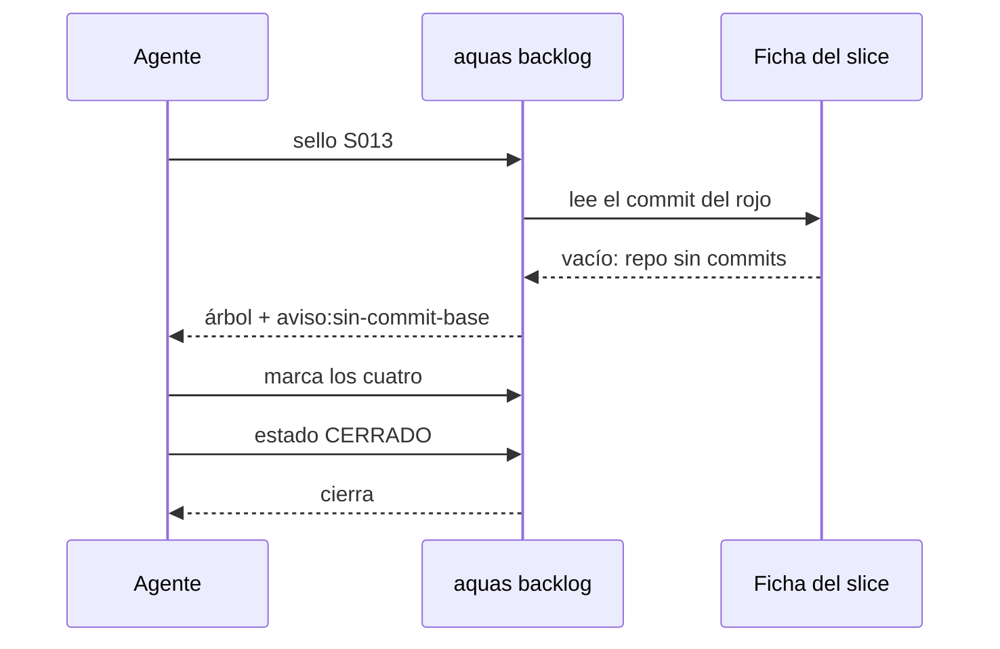

# S013 · Sello sin commit base

[Inicio](../../README.md) › [E001](../README.md) › [F002](README.md) › S013

[Slice](../../glosario.md#slice) que tapa un hueco de S004: sin [commit](../../glosario.md#commit) de partida, el [sello](../../glosario.md#sello) se apagaba entero.

## En una frase

Aunque el repo no tenga commits, cerrar un slice igual pide revisar su [feature](../../glosario.md#feature), su [iniciativa](../../glosario.md#iniciativa) y sus páginas.

## Para qué existe

**El problema.** El sello compara contra el commit que guardó el rojo. En un proyecto recién creado, sin commits, no hay nada que guardar. S004 decidía entonces no exigir nada, y el slice cerraba sin revisar.

Le pasaría justo al primer slice de cada proyecto hijo, que es cuando más fácil se deja algo viejo.

**La solución.** La mitad del sello no necesita Git: la feature, la iniciativa, los dependientes y las páginas salen de las fichas. Esa mitad se exige siempre. Solo se omite el nivel de archivos, y un aviso que también se marca lo deja a la vista.

Contrato del slice:

| Campo | Valor |
|---|---|
| Objetivo | Sin commit base, el sello exige el árbol y un aviso |
| Incluye | `internal/backlog/sello.go` y las pruebas viejas que cierran slices |
| Excluye | Calcular archivos tocados sin Git |
| Prueba | `go test ./internal/backlog/` |

## Analogía

Piensa en un **inventario** sin la foto del día anterior.

- No puedes decir qué cambió de lugar.
- Igual puedes revisar que las puertas y las luces estén bien.

Límite de la analogía: aquí el aviso queda escrito y alguien tiene que marcarlo.

## Diagrama

Secuencia de un cierre sin commit base:

## Ejemplo de punta a punta

continúa: [EJ-E001-F002](README.md#EJ-E001-F002)

Un proyecto hijo hace `git init` y nunca un commit.

1. El rojo de su primer slice queda sin commit.
2. Al cerrar, `aquas backlog seal` lista la feature, la iniciativa, las páginas y `aviso:sin-commit-base`.
3. El cierre se niega hasta marcar los cuatro.
4. Antes de S013 ese cierre pasaba sin revisar nada.

## Paso a paso

1. Escribir la prueba y ver el rojo: el cierre sin commit pasaba.
2. Quitar la excepción en `selloCompleto` y agregar el aviso.
3. Hacer que las pruebas viejas marquen el sello antes de cerrar, igual que el flujo real.

## Cómo se usa

- Igual que S004: `aquas backlog seal <id>` y marcar cada ítem.
- El aviso se marca como cualquier otro ítem, por ejemplo `sin_cambio motivo=repo sin commits todavía`.

## Contrato y evidencia

<!-- GENERADO por aquas desde trabajo/: no editar a mano; `aquas compile` lo rehace. -->

| Prueba | Valida | Rojo cuando | Verde cuando | Rojo | Verde |
|---|---|---|---|---|---|
| `TestSelloSinCommitBaseExigeArbol` | sin commit base el árbol se exige igual y un aviso marca lo omitido | sin commit base el sello omite el árbol, no avisa del nivel archivos o deja cerrar sin marcar | salen ficha, página y aviso sin-commit-base; cerrar exige marcarlos y con todo marcado cierra | 2026-10-21 | 2026-10-21 |

### Código

| Archivo | Función | Parámetros | Qué hace |
|---|---|---|---|
| [internal/backlog/sello.go](../../../internal/backlog/sello.go) | `excluida` | `(p string) bool` | excluida: la ruta cae bajo una carpeta que el sello no revisa. |
| [internal/backlog/sello.go](../../../internal/backlog/sello.go) | `gitLineas` | `(raiz string, args ...string) ([]string, error)` | gitLineas corre git en la raíz y devuelve su salida línea por línea. |
| [internal/backlog/sello.go](../../../internal/backlog/sello.go) | `pagina` | `(id string) string` | pagina: ruta de la página wiki de una ficha según su nivel en el ID. |
| [internal/backlog/sello.go](../../../internal/backlog/sello.go) | `arbol` | `(raiz string, f Ficha) ([]Item, error)` | arbol: padre, abuelo, dependientes abiertos y páginas. |
| [internal/backlog/sello.go](../../../internal/backlog/sello.go) | `moduloGo` | `(raiz string) string` | moduloGo: ruta del módulo declarada en go.mod, o vacío si no hay. |
| [internal/backlog/sello.go](../../../internal/backlog/sello.go) | `lineaCon` | `(c, s string) string` | lineaCon: primera línea de c que contiene s, recortada; sirve de evidencia en el sello. |
| [internal/backlog/sello.go](../../../internal/backlog/sello.go) | `derivados` | `(raiz string) map[string]bool` | derivados: salidas del compilador según su archivo de sellos, más ese archivo (S014). Ya los vigila |
| [internal/backlog/sello.go](../../../internal/backlog/sello.go) | `archivos` | `(raiz, head string) ([]Item, error)` | archivos: quién nombra o importa lo tocado desde el HEAD del rojo. |
| [internal/backlog/sello.go](../../../internal/backlog/sello.go) | `Sello` | `(raiz, id string) ([]Item, error)` | Sello arma la lista del slice y le pega las marcas guardadas en su ficha. |
| [internal/backlog/sello.go](../../../internal/backlog/sello.go) | `sello` | `(raiz string, f Ficha) ([]Item, error)` | sello arma la lista de piezas que el cambio de un slice obliga a revisar. |
| [internal/backlog/sello.go](../../../internal/backlog/sello.go) | `selloCompleto` | `(raiz string, f Ficha) error` | selloCompleto: CERRADO exige marca en cada ítem, haya o no commit base (S013). |
| [internal/backlog/sello.go](../../../internal/backlog/sello.go) | `Marcar` | `(raiz, id, clave, marca, motivo string) (Ficha, error)` | Marcar guarda la revisión de un ítem del sello de un slice activo. |
| [internal/backlog/sello.go](../../../internal/backlog/sello.go) | `TextoSello` | `(xs []Item) string` | TextoSello: una línea por ítem; [ ] pendiente, [x] marcado con su marca y motivo. |

<!-- /GENERADO -->

Estado: hecho.

## Navegación

- ↑ Subir: [F002 · Turnos, backlog y sello](README.md)
