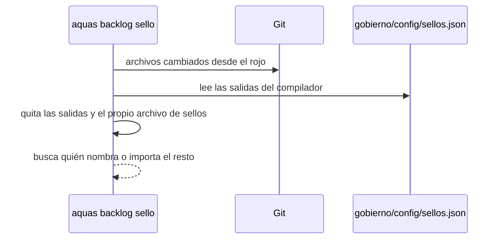

# S014 · Sello sin ruido de derivados

[Inicio](../../README.md) › [E001](../README.md) › [F002](README.md) › S014

[Slice](../../glosario.md#slice) que saca del [sello](../../glosario.md#sello) los archivos que genera el [compilador](../../glosario.md#compilador). Ya los vigila otro [gate](../../glosario.md#gate).

## En una frase

El sello deja de pedirte revisar archivos que se rehacen solos.

## Para qué existe

**El problema.** En S006 el sello listó 30 ítems, y cerca de la mitad eran ruido. Por ejemplo: «`CLAUDE.md` nombra `gobierno/config/sellos.json`». Ese archivo lo reescribe `aquas compilar` en cada cambio de reglas. Revisarlo a mano no aporta nada, y una lista con mucho ruido invita a marcar sin leer.

**La solución.** Al armar los archivos tocados, el sello salta las salidas del compilador. Las saca del propio archivo de sellos, y también salta ese archivo. Lo demás sigue igual.

Contrato del slice:

| Campo | Valor |
|---|---|
| Objetivo | Un derivado del compilador no cuenta como tocado |
| Incluye | `derivados()` en `internal/backlog/sello.go` |
| Excluye | Bloques generados dentro de páginas de la wiki: la página sigue siendo humana |
| Prueba | `go test ./internal/backlog/` |

## Analogía

Piensa en revisar una **casa después de una obra**.

- Revisas lo que tocó el albañil.
- No revisas el recibo de luz, que llega solo cada mes.

Límite de la analogía: aquí el recibo sí se vigila, pero lo hace otro control.

## Diagrama

Secuencia del filtro:

## Ejemplo de punta a punta

continúa: [EJ-E001-F002](README.md#EJ-E001-F002)

Un slice cambia una regla y toca `internal/a/a.go`.

1. `aquas compilar` rehace `CLAUDE.md` y `gobierno/config/sellos.json`.
2. Antes, el sello pedía revisar cada documento que nombra esos dos archivos.
3. Ahora esos ítems no aparecen.
4. Sigue apareciendo «`docs/ref.md` nombra `internal/a/a.go`», que sí hay que revisar.

## Paso a paso

1. Escribir la prueba y ver el rojo: un [derivado](../../glosario.md#derivado) contaba como tocado.
2. Agregar `derivados()`, que lee las salidas del archivo de sellos.
3. Saltar esos archivos al armar los tocados.

## Cómo se usa

- No cambia nada para quien usa el sello. La lista sale más corta.

## Contrato y evidencia

<!-- GENERADO por aquas desde trabajo/: no editar a mano; `aquas compilar` lo rehace. -->

| Prueba | Valida | Rojo cuando | Verde cuando | Rojo | Verde |
|---|---|---|---|---|---|
| `TestSelloIgnoraDerivados` | los derivados del compilador no cuentan como tocados; lo demás sigue en el sello | el sello lista CLAUDE.md o sellos.json como tocados, o pierde lo que sí cambió | no sobra ningún ítem de derivados y sigue el ítem de internal/a/a.go | 2026-10-22 | 2026-10-22 |

<!-- /GENERADO -->

Estado: hecho.

Límite: si el archivo de sellos falta o está roto, solo se salta ese archivo. Ese caso igual lo detecta el gate de derivados.

## Navegación

- ↑ Subir: [F002 · Turnos, backlog y sello](README.md)
