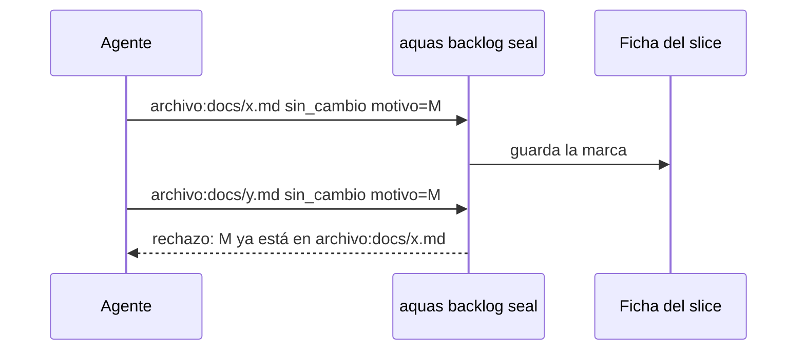

# S015 · Sello rechaza el mismo motivo repetido en lote

[Inicio](../../README.md) › [E001](../README.md) › [F002](README.md) › S015

Este [slice](../../glosario.md#slice) hace que el [sello](../../glosario.md#sello) pida una revisión real por archivo.

## En una frase

El sello muestra un ítem por archivo y rechaza un motivo que ya se usó en otro ítem.

## Para qué existe

**El problema.** El sello de E000/F006/S012 tenía 120 ítems. El [agente](../../glosario.md#agente) los marcó con un bucle y dos motivos repetidos (D000073). El sello quedó completo sin que nadie revisara nada.

**Por qué importa.** El sello existe para encontrar lo que un cambio dejó desfasado. Un motivo copiado en lote no prueba esa búsqueda.

**La solución.** Dos cambios. Primero, todo lo que un archivo nombra o importa va en un solo ítem: `archivo:<ruta>`. En S012 eso baja de 120 a 62 ítems. Segundo, marcar un ítem con un motivo que ya usa otro ítem del mismo slice se rechaza.

**Origen.** El humano lo pidió el 2026-10-22. El 2026-10-31 eligió la opción C: un ítem por archivo y un motivo distinto en cada uno.

**Límite.** Un motivo distinto no prueba la revisión: es un freno probabilístico. Pegar la ruta al final de un motivo genérico lo evade.

**Contrato.**

| Regla | Valor |
|---|---|
| Ítem por archivo | `archivo:<ruta>`: una línea por cada tocado que nombra y cada paquete que importa |
| Ítems del árbol | sin cambio: `ficha:` y `pagina:` |
| Motivo repetido | se rechaza si otro ítem del mismo slice ya lo tiene; se nombra ese ítem |
| Comparación | sin espacios a los lados y sin distinguir mayúsculas |
| Mismo ítem | volver a marcarlo con su propio motivo vale |
| Fichas cerradas | no cambian: su sello ya cerró con las claves viejas |
| Alcance | `internal/backlog/**`, `cmd/aquas/**`, `docs/**` |

**Casos borde.**

| Categoría | Aplica | Prueba o motivo |
|---|---|---|
| cada tipo de ficha | no | el sello solo existe en slices; una feature ya se rechaza antes |
| cada estado de origen | no | solo se marca un slice activo; las fichas cerradas no se vuelven a sellar |
| padre e hijo, activo y archivado | sí | el ítem del árbol (`ficha:`, `pagina:`) también exige motivo propio: `TestSelloRechazaMotivoEnLote` |
| entrada ausente, vacía, mal escrita o duplicada | sí | el mismo motivo con otras mayúsculas o espacios se rechaza; el mismo ítem con su motivo vale: `TestSelloRechazaMotivoEnLote` |
| choque con otro control | sí | el cierre sigue exigiendo marca en cada ítem, ahora uno por archivo: `TestSelloUnItemPorArchivo` |
| quién habla: humano, agente o herramienta | no | el sello no distingue quién marca; la regla vale igual para todos |
| fallo a mitad de camino | sí | un motivo rechazado no escribe la ficha: `TestSelloRechazaMotivoEnLote` |

## Analogía

Piensa en **una revisión de inventario**.

- Antes se firmaba cada tornillo con la misma frase.
- Ahora se firma cada caja, y cada firma dice qué se vio en ella.

Límite de la analogía: aquí nadie mira la caja; solo se exige que la nota sea distinta.

## Diagrama

## Ejemplo de punta a punta

continúa: [EJ-E001-F002](README.md#EJ-E001-F002)

1. Un slice toca `internal/backlog/sello.go` y `docs/E001/F002/S004.md`.
2. `docs/ref/codigo.md` cita los dos: el sello muestra un solo ítem `archivo:docs/ref/codigo.md`.
3. El agente marca otro ítem con «este slice no lo afecta» y luego intenta repetirlo aquí.
4. El sello lo rechaza; el agente escribe qué revisó en ese archivo.

## Paso a paso

1. Rojo de las dos pruebas.
2. Agrupar los ítems por archivo y rechazar el motivo repetido.

## Cómo se usa

- `aquas backlog seal <id>` lista un ítem por archivo.
- `aquas backlog seal <id> archivo:<ruta> sin_cambio|actualizado motivo=…` con un motivo propio.

## Contrato y evidencia

<!-- GENERADO por aquas desde trabajo/: no editar a mano; `aquas compile` lo rehace. -->

| Prueba | Valida | Rojo cuando | Verde cuando | Rojo | Verde |
|---|---|---|---|---|---|
| `TestSelloRechazaMotivoEnLote` | valida que el sello rechaza un motivo ya usado en otro ítem del mismo slice | rojo cuando dos ítems aceptan el mismo motivo | verde cuando el segundo se rechaza y nombra el ítem que ya lo usa | — | — |
| `TestSelloUnItemPorArchivo` | valida que el sello junta en un ítem todo lo que un archivo nombra o importa | rojo cuando un archivo que cita dos tocados da dos ítems | verde cuando da un ítem que lista los dos | — | — |

<!-- /GENERADO -->

## Navegación

- ↑ Subir: [F002](README.md)
