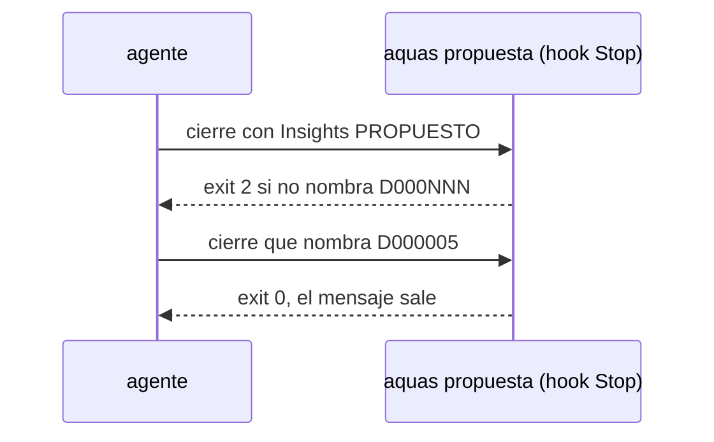

# S016 · Insight PROPUESTO exige defecto registrado

[Inicio](../../README.md) › [E001](../README.md) › [F002](README.md) › S016

El [hook](../../glosario.md#hook) de cierre frena un insight «PROPUESTO» que no nombra un defecto registrado.

## En una frase

Un aprendizaje sin implementar queda anotado como defecto, no perdido en el chat.

## Para qué existe

**El problema.** Los insights decían «Estado: PROPUESTO» y nadie los seguía. El freno de llamadas falló tres veces por la misma causa (D000002, D000003).

**La solución.** Si la línea del campo Insights dice «PROPUESTO» y no trae un número `D000NNN`, el mensaje no sale. El [agente](../../glosario.md#agente) registra el defecto con `aquas defecto nuevo` y lo nombra.

Contrato del [slice](../../glosario.md#slice):

| Campo | Valor |
|---|---|
| Objetivo | Ningún insight PROPUESTO sin defecto |
| Incluye | `RevisarInsight` en el hook Stop `aquas propuesta` |
| Excluye | Insights implementados; corregir los ganchos fuera del repo |
| Prueba | `go test ./internal/propuesta/ -run TestInsightPropuestoExigeDefecto` |

## Analogía

Piensa en **un reporte de falla en una planta**.

- Quien ve el problema llena una orden de trabajo con número.
- Sin número, nadie lo programa y la falla vuelve.

Límite de la analogía: aquí el número lo exige un programa antes de enviar el mensaje.

## Diagrama

## Ejemplo de punta a punta

continúa: [EJ-E001-F002](README.md#EJ-E001-F002)

1. El agente escribe «Estado: PROPUESTO; evidencia: pendiente» en Insights.
2. El hook responde con exit 2 y pide `aquas defecto nuevo`.
3. El agente registra D000005 y lo nombra; el mensaje sale.

## Paso a paso

1. Leer la respuesta completa del agente.
2. Buscar la línea con «Insights:».
3. Si dice PROPUESTO y no trae `D000NNN`, frenar.

## Cómo se usa

- Al proponer un control sin implementarlo: `aquas defecto nuevo …` y nombrar su número en Insights.

## Contrato y evidencia

<!-- GENERADO por aquas desde trabajo/: no editar a mano; `aquas compilar` lo rehace. -->

| Prueba | Valida | Rojo cuando | Verde cuando | Rojo | Verde |
|---|---|---|---|---|---|
| `TestInsightPropuestoExigeDefecto` | un insight PROPUESTO en el cierre nombra un defecto D000NNN | el freno deja pasar un insight PROPUESTO sin número de defecto, o frena uno que lo nombra o que está implementado | frena el PROPUESTO sin defecto y deja pasar el que nombra D000NNN y los implementados | 2026-10-23 | 2026-10-23 |

### Código

| Archivo | Función | Parámetros | Qué hace |
|---|---|---|---|
| [cmd/aquas/main.go](../../../cmd/aquas/main.go) | `main` | `()` | main despacha el subcomando de aquas (compilar, verificar, backlog, hooks…) y sale con su código. |
| [cmd/aquas/main.go](../../../cmd/aquas/main.go) | `hook` | `(raiz string)` | hook: exit 0 = nada que reportar; exit 2 = stderr se muestra a Claude. |
| [cmd/aquas/main.go](../../../cmd/aquas/main.go) | `compilarSettings` | `(w io.Writer)` | compilarSettings regenera .claude/settings.json; sin entorno declarado no inventa uno. |
| [cmd/aquas/main.go](../../../cmd/aquas/main.go) | `reportar` | `(w io.Writer, inf compilador.Informe)` | reportar imprime qué derivados escribió la compilación, o que todo estaba al día. |
| [cmd/aquas/main.go](../../../cmd/aquas/main.go) | `listar` | `(titulo string, problemas []string)` | listar imprime en stderr un título y cada problema en su viñeta. |
| [cmd/aquas/main.go](../../../cmd/aquas/main.go) | `lista` | `(xs []string) string` | lista une los textos con comas, o «—» si no hay ninguno. |
| [cmd/aquas/main.go](../../../cmd/aquas/main.go) | `fallar` | `(codigo int, err error)` | fallar imprime el error en stderr y termina con el código dado. |
| [cmd/aquas/main.go](../../../cmd/aquas/main.go) | `memoriaCLI` | `(raiz string, args []string)` | memoriaCLI: `ver` imprime la memoria; `fijar campo=valor…` la actualiza y la sella. |
| [cmd/aquas/main.go](../../../cmd/aquas/main.go) | `memoriaArchivada` | `(raiz, id string) error` | memoriaArchivada: CERRADO exige el archivo de memoria del slice, apunte o no la memoria a él (E001/F002/S009, X01). |
| [cmd/aquas/main.go](../../../cmd/aquas/main.go) | `focoEnBacklog` | `(raiz string, f memoria.Foco) error` | focoEnBacklog: la memoria solo fija el slice que el backlog tiene en curso (S003). |
| [cmd/aquas/main.go](../../../cmd/aquas/main.go) | `backlogCLI` | `(raiz string, args []string)` | backlogCLI: nuevo \\| ver [id] \\| prioridad \\| estado \\| siguiente \\| pruebas \\| rojo \\| verde. |
| [cmd/aquas/main.go](../../../cmd/aquas/main.go) | `turnoCLI` | `(raiz string, args []string)` | turnoCLI: auditoría de turnos (E001/F002/S001). Lee el JSON del hook por stdin. No imprime nada |
| [cmd/aquas/main.go](../../../cmd/aquas/main.go) | `defectoCLI` | `(raiz string, args []string) error` | defectoCLI: nuevo \\| ocurre \\| ver (E001/F004/S001). |
| [cmd/aquas/main.go](../../../cmd/aquas/main.go) | `versionBinario` | `() string` | versionBinario: versión del módulo con que se compiló el binario (= versión del gobierno embebido). |
| [cmd/aquas/main.go](../../../cmd/aquas/main.go) | `registrarCierre` | `(raiz, tipo, transcript, primera, resultado string)` | registrarCierre (E001/F004/S005, D000068) anota cada llamada del gancho cierre-agente en .tmp/hooks/cierre-agente.jsonl. |
| [internal/propuesta/insight.go](../../../internal/propuesta/insight.go) | `RevisarInsight` | `(msg string) string` | RevisarInsight devuelve "" si pasa; si no, el motivo del freno: insight PROPUESTO sin defecto registrado (E001/F002/S016). |

### Arreglos

| Arreglo | Qué arregla | Por qué | Pruebas | Fecha | Rojo | Verde |
|---|---|---|---|---|---|---|
| X01 | RevisarInsight lee el estado, no cualquier mención de PROPUESTO | D000009: frenó una línea con Estado IMPLEMENTADO Y PROBADO que solo citaba la palabra (2026-10-23) | — | 2026-10-23 | — | — |

<!-- /GENERADO -->

Estado: hecho.

## Navegación

- ↑ Subir: [F002 · Turnos, backlog y sello](README.md)
