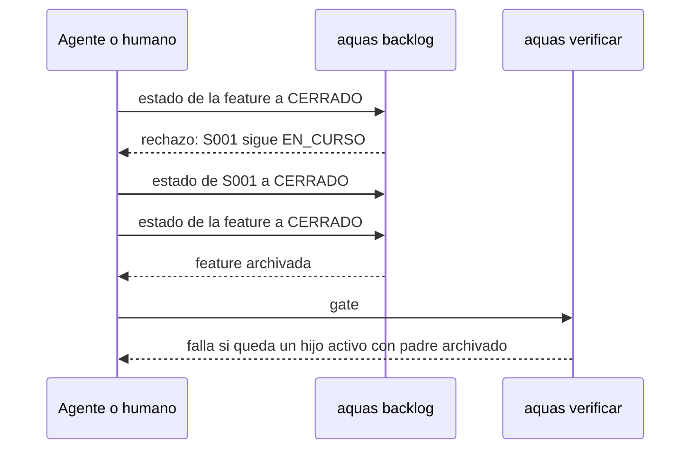

# S017 · Padre no cierra con hijos abiertos

[Inicio](../../README.md) › [E001](../README.md) › [F002](README.md) › S017

Este [slice](../../glosario.md#slice) impide que una [feature](../../glosario.md#feature) o una [iniciativa](../../glosario.md#iniciativa) se cierre mientras le queda un hijo sin terminar. Estado: en curso; el humano aprobó el contrato el 2026-10-24. Corrige el defecto D000030.

## En una frase

Ningún padre se cierra con un hijo vivo. El [gate](../../glosario.md#gate) falla si ya hay un huérfano.

## Para qué existe

**El problema.** El 2026-10-23 la feature E001/F010 pasó a CERRADO con su slice S001 todavía EN_CURSO. Antes, E001/F003 se archivó con S003, S004 y S005 en BORRADOR. El [backlog](../../glosario.md#backlog) quedó con hijos huérfanos y nadie lo detectó.

**La causa.** El cambio de estado de un padre solo mira sus propias pruebas, su rojo y su verde. El [sello](../../glosario.md#sello) de cierre ignora todo lo que no es slice. El gate no cruza un padre archivado con un hijo activo.

**La solución.** El cambio de estado de un padre a CERRADO o CANCELADO revisa antes a sus hijos activos. Si queda alguno, se rechaza y el mensaje los nombra. El gate agrega la revisión inversa: hijo activo con padre archivado es un problema.

Contrato del slice:

| Campo | Valor |
|---|---|
| Historia | Como humano, quiero que ningún padre se cierre con hijos abiertos, para que el backlog nunca diga «terminado» cuando falta trabajo |
| Objetivo | CERRADO y CANCELADO de feature o iniciativa exigen hijos terminales; el gate detecta los huérfanos que ya existen |
| Incluye | Revisión de hijos en el cambio de estado, revisión de huérfanos en el gate, resolución de los 3 huérfanos de E001/F003 antes del rojo, búsqueda de otras revisiones que solo miran slices |
| Excluye | Reabrir fichas archivadas; mover un hijo a otro padre; cambiar el sello de cierre de slices |
| Límite | Protege el árbol del backlog, no la calidad del trabajo cerrado: para eso están el auditor y el sello |
| Alcance | `internal/backlog/**`, `cmd/aquas/**`, `docs/E001/F002/**`, `registro/defectos/**` |
| Prueba integral | TestCerrarSliceDePuntaAPunta (la de E001/F002) |

Criterios de aceptación:

1. Dada una feature con un slice EN_CURSO, cuando se pide su CERRADO, entonces se rechaza. El mensaje nombra el slice y su estado.
2. Dada una iniciativa con una feature activa, cuando se pide su CERRADO o CANCELADO, entonces se rechaza igual.
3. Dado un padre cuyos hijos están todos CERRADO o CANCELADO, cuando se pide su cierre, entonces pasa como hoy.
4. Dado un hijo activo con padre archivado, cuando corre `aquas verificar`, entonces el gate falla y nombra hijo y padre.
5. Dados los huérfanos E001/F003/S003, S004 y S005, antes del rojo quedan resueltos según decida el humano.
6. Dadas las revisiones de `internal/backlog` que solo miran slices, cada una queda revisada y anotada aquí.

Estrategia:

1. La revisión de hijos va en `Estado`, antes de `cierre` y del sello, para que el mensaje nombre primero a los hijos.
2. Los hijos son las fichas activas cuyo campo `padre` es el id; una ficha en el archivo ya es terminal.
3. La revisión del gate va en `Validar`, junto a las demás revisiones del backlog.
4. Los huérfanos se resuelven antes del EN_CURSO, porque mientras un slice corre ningún otro cambia de estado.

Casos borde:

| Categoría | Caso | Qué debe pasar |
|---|---|---|
| Tipo de ficha | slice, feature o iniciativa | el slice no tiene hijos y cierra como hoy; feature e iniciativa revisan a sus hijos directos |
| Estado de origen | padre en BORRADOR, EN_CURSO o BLOQUEADO hacia CERRADO o CANCELADO | la misma regla en todos; cancelar con hijos vivos también deja huérfanos |
| Padre e hijo | hijo CERRADO o CANCELADO en el archivo; hijo activo BLOQUEADO o BORRADOR | el archivado no cuenta; cualquier activo rechaza |
| Entrada | padre sin hijos; ficha hija ilegible; campo `padre` hacia un id inexistente | sin hijos cierra; ilegible es error y no cierra; el id inexistente lo reporta el gate |
| Choque con otro control | regla de un solo slice en curso; sello y revisión de pruebas del cierre | los huérfanos se resuelven antes del EN_CURSO; la revisión de hijos corre primero |
| Quién habla | humano o agente por la CLI | la misma respuesta para los dos; no hay hook nuevo |
| Fallo a medias | rechazo del cierre; gate con huérfano | el rechazo ocurre antes de escribir nada; el gate solo reporta, no arregla |

## Analogía

Piensa en **cerrar una caja de mudanza**.

- No la sellas si todavía hay cosas fuera que van dentro.
- Si alguien encuentra una caja sellada con cosas sueltas al lado, avisa.

Límite de la analogía: aquí nadie mete las cosas por ti; el rechazo solo dice cuáles faltan.

## Diagrama

## Ejemplo de punta a punta

continúa: [EJ-E001-F002](README.md#EJ-E001-F002)

1. La feature tiene su slice S001 EN_CURSO.
2. El [agente](../../glosario.md#agente) pide `aquas backlog estado` de la feature a CERRADO.
3. aquas responde que no cierra porque S001 sigue EN_CURSO, y no escribe nada.
4. El slice cierra; el agente repite el pedido y la feature pasa al archivo.

## Paso a paso

1. Resolver los 3 huérfanos de E001/F003 según la decisión del humano.
2. Rojo de las pruebas, revisión de hijos, revisión del gate, verde.
3. Revisar las demás revisiones que solo miran slices y anotar el veredicto.

## Cómo se usa

- No hay comando nuevo: `aquas backlog estado` y `aquas verificar` hacen la revisión solos.

## Contrato y evidencia

<!-- GENERADO por aquas desde trabajo/: no editar a mano; `aquas compilar` lo rehace. -->

| Prueba | Valida | Rojo cuando | Verde cuando | Rojo | Verde |
|---|---|---|---|---|---|
| `TestPadreNoCierraConHijosAbiertos` | valida que cerrar o cancelar feature o iniciativa con hijo activo se rechaza nombrando al hijo | rojo cuando la feature cierra con un slice EN_CURSO | verde cuando el cierre se rechaza y pasa al cerrar todos los hijos | 2026-10-24 | 2026-10-24 |
| `TestGateDetectaHijoHuerfano` | valida que el gate falla con hijo activo y padre archivado | rojo cuando el gate da OK con un huérfano | verde cuando el gate nombra hijo y padre | — | 2026-10-24 |

### Código

| Archivo | Función | Parámetros | Qué hace |
|---|---|---|---|
| [internal/backlog/backlog.go](../../../internal/backlog/backlog.go) | `terminal` | `(estado string) bool` | terminal: el estado ya no cambia (CERRADO o CANCELADO). |
| [internal/backlog/backlog.go](../../../internal/backlog/backlog.go) | `esta` | `(xs []string, x string) bool` | esta: x figura en la lista. |
| [internal/backlog/backlog.go](../../../internal/backlog/backlog.go) | `tipoYPadre` | `(id string) (tipo, padre string)` | tipoYPadre deriva del id: E001 → iniciativa; E001/F002 → feature de E001; E001/F002/S002 → slice. |
| [internal/backlog/backlog.go](../../../internal/backlog/backlog.go) | `nombre` | `(id string) string` | nombre: archivo JSON de una ficha, con «/» del ID cambiadas por «-». |
| [internal/backlog/backlog.go](../../../internal/backlog/backlog.go) | `todas` | `(raiz string) (act, arc map[string]Ficha, err error)` | todas lee activo y archivo. Una ficha ilegible es error: Validar la detalla. |
| [internal/backlog/backlog.go](../../../internal/backlog/backlog.go) | `Todas` | `(raiz string) ([]Ficha, error)` | Todas: las fichas de activo y archivo, ordenadas por id. Para quien solo lee (wiki, E001/F002/S010). |
| [internal/backlog/backlog.go](../../../internal/backlog/backlog.go) | `leer` | `(ruta string) (Ficha, error)` | leer carga una ficha desde su archivo JSON. |
| [internal/backlog/backlog.go](../../../internal/backlog/backlog.go) | `escribir` | `(raiz, dir string, f Ficha) error` | escribir guarda la ficha como JSON en trabajo/<dir>/, con listas vacías en vez de null. |
| [internal/backlog/backlog.go](../../../internal/backlog/backlog.go) | `Nuevo` | `(raiz string, campos []string) (Ficha, error)` | Nuevo crea una ficha desde campos id=… titulo=… prioridad=… motivo=… relacion=… [bloqueado_por=A,B]. |
| [internal/backlog/backlog.go](../../../internal/backlog/backlog.go) | `Ver` | `(raiz, id string) (Ficha, bool, error)` | Ver busca la ficha en activo y luego en archivo. |
| [internal/backlog/backlog.go](../../../internal/backlog/backlog.go) | `activa` | `(raiz, id string) (Ficha, error)` | activa: la ficha a cambiar; una archivada no cambia. |
| [internal/backlog/backlog.go](../../../internal/backlog/backlog.go) | `Prioridad` | `(raiz, id, prioridad, motivo string) (Ficha, error)` | Prioridad cambia la prioridad; el motivo es obligatorio. |
| [internal/backlog/backlog.go](../../../internal/backlog/backlog.go) | `Estado` | `(raiz, id, estado string) (Ficha, error)` | Estado cambia el estado. CERRADO o CANCELADO mueve la ficha al archivo. |
| [internal/backlog/backlog.go](../../../internal/backlog/backlog.go) | `sinHijosActivos` | `(act map[string]Ficha, f Ficha) error` | sinHijosActivos: cerrar o cancelar una feature o iniciativa exige sus hijos directos ya archivados. |
| [internal/backlog/backlog.go](../../../internal/backlog/backlog.go) | `ordenar` | `(fs []Ficha, arc map[string]Ficha)` | orden de `siguiente`: en curso → desbloqueado → prioridad → secuencia → id. |
| [internal/backlog/backlog.go](../../../internal/backlog/backlog.go) | `Activas` | `(raiz string) ([]Ficha, error)` | Activas: slices en el orden de `siguiente`; después iniciativas y features por secuencia. |
| [internal/backlog/backlog.go](../../../internal/backlog/backlog.go) | `Siguiente` | `(raiz string) (Ficha, bool, error)` | Siguiente: el primer slice del orden fijo que esté en curso o desbloqueado. |
| [internal/backlog/backlog.go](../../../internal/backlog/backlog.go) | `sinDefinir` | `(act map[string]Ficha) (Ficha, bool)` | sinDefinir (E001/F002/S008, regla del humano 2026-10-21): iniciativa o feature activa sin hijos |
| [internal/backlog/backlog.go](../../../internal/backlog/backlog.go) | `Definir` | `(f Ficha) string` | Definir: qué hacer con lo que `siguiente` saca sin definir; "" para un slice. |
| [internal/backlog/backlog.go](../../../internal/backlog/backlog.go) | `libre` | `(f Ficha, arc map[string]Ficha) bool` | libre: no está BLOQUEADO y cada bloqueador ya terminó (archivado: CERRADO o CANCELADO). |
| [internal/backlog/backlog.go](../../../internal/backlog/backlog.go) | `Validar` | `(raiz string) []string` | Validar: problemas de las fichas en disco (gate). Sin carpeta trabajo/ no hay problemas. |
| [internal/backlog/backlog.go](../../../internal/backlog/backlog.go) | `Texto` | `(f Ficha) string` | Texto: una línea por ficha, para el agente. |

<!-- /GENERADO -->

**Pruebas.** `TestPadreNoCierraConHijosAbiertos` y `TestGateDetectaHijoHuerfano`, en `internal/backlog`.

## Revisión de comprobaciones solo de slice

Revisé cada comprobación de tipo slice en `internal/backlog`. Una fila deja un hueco menor, anotado sin arreglar.

| Función | Archivo:línea | Veredicto | Por qué |
|---|---|---|---|
| `Estado` (un slice en curso) | `backlog.go:291` | correcto | La regla es de un solo slice a la vez; feature e iniciativa no corren. |
| `Estado` (aprobación al arrancar) | `backlog.go:299` | correcto | Solo el slice tiene contrato aprobado. |
| `Estado` (rojo de la integral) | `backlog.go:304` | correcto | Solo el slice depende del rojo de su feature. |
| `Estado` (huella al cerrar) | `backlog.go:309` | correcto | La huella aprobada existe solo en slices. |
| `Estado` (código tocado) | `backlog.go:321` | correcto | El código tocado se congela solo en slices. |
| `Activas` | `backlog.go:393` | correcto | Solo ordena: slices primero, el resto por secuencia. |
| `Siguiente` | `backlog.go:419` | correcto | Elige trabajo ejecutable y eso es del slice. |
| `sinDefinir` | `backlog.go:443` | correcto | Un padre con hijos activos no necesita definición. |
| `Validar` (un slice en curso) | `backlog.go:517` | correcto | Misma regla de un solo slice que en `Estado`. |
| `sliceEnCurso` | `rojo.go:87` | correcto | Busca solo el slice que corre. |
| `corrible` | `rojo.go:131` | correcto | Solo el slice exige estar en curso; feature e iniciativa registran su rojo antes. |
| `rojoHeredado` | `rojo.go:175` | hueco menor | Hereda el rojo de cualquier slice archivado, también de uno CANCELADO. |
| `Alcance` | `alcance.go:36` | correcto | El alcance es declarado por slice. |
| `Aprobar` | `aprobacion.go:75` | correcto | La aprobación es del slice. |
| `aprobada` | `aprobacion.go:96` | correcto | Feature e iniciativa no tienen contrato aprobado. |
| `Arreglar` (tipo del padre) | `arreglo.go:50` | correcto | Acepta slice o feature a propósito. |
| `Arreglar` (absorbe) | `arreglo.go:60` | correcto | Solo se absorbe un slice CERRADO hermano. |
| `sello` | `sello.go:228` | correcto | El sello es de slices. |
| `selloCompleto` | `sello.go:259` | correcto | Feature e iniciativa no tienen sello; sus hijos se revisan en `Estado`. |

Hueco menor de `rojoHeredado`: un slice CANCELADO con rojo puede respaldar la integral de su feature. Queda fuera de este slice.

## Navegación

- ↑ Subir: [F002](README.md)
