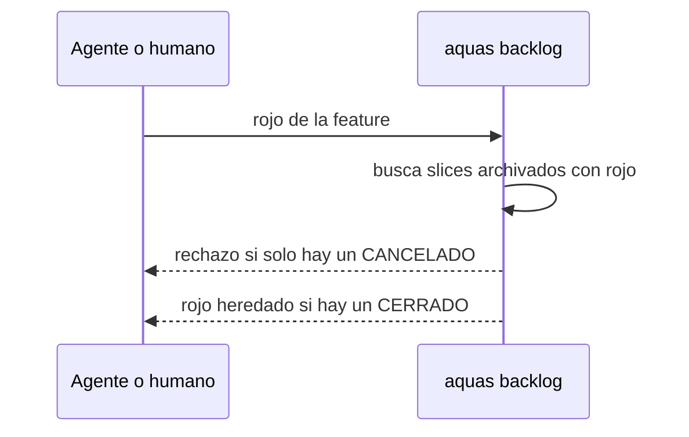

# S018 · Rojo heredado solo de slices cerrados

[Inicio](../../README.md) › [E001](../README.md) › [F002](README.md) › S018

Este [slice](../../glosario.md#slice) hace que una [feature](../../glosario.md#feature) herede el rojo solo de un slice CERRADO. Estado: borrador; el contrato espera la aprobación del humano. Corrige el defecto D000032.

## En una frase

El rojo de un slice cancelado ya no respalda la prueba integral de su feature.

## Para qué existe

**El problema.** Una feature cuya prueba integral ya pasa no puede registrar rojo propio. Por eso hereda el rojo que registró uno de sus slices archivados. Hoy acepta cualquier slice archivado, también uno CANCELADO.

**La causa.** La función `rojoHeredado` en `internal/backlog/rojo.go` filtra por tipo, padre y rojo. No mira el estado del slice.

**La solución.** `rojoHeredado` salta todo slice cuyo estado no sea CERRADO. Un slice cancelado es trabajo descartado y no prueba nada.

Contrato del slice:

| Campo | Valor |
|---|---|
| Historia | Como humano, quiero que la integral de una feature se respalde solo con trabajo cerrado, para no aceptar evidencia de trabajo descartado |
| Objetivo | `rojoHeredado` acepta solo slices CERRADO |
| Incluye | Filtro por estado en `rojoHeredado`; prueba con un slice CANCELADO y uno CERRADO |
| Excluye | Cambiar el rojo de slices; revisar rojos heredados ya registrados; el motivo vacío del rojo de subtest, que es S019 |
| Límite | Protege el origen del rojo heredado, no la calidad del slice cerrado: para eso están el auditor y el sello |
| Alcance | `internal/backlog/**`, `docs/E001/F002/**`, `registro/defectos/**` |
| Prueba integral | TestCerrarSliceDePuntaAPunta (la de E001/F002) |

Criterios de aceptación:

1. Dada una feature con un único slice CANCELADO con rojo, al pedir su rojo, se rechaza sin respaldo.
2. Dada una feature con un slice CERRADO con rojo, cuando se pide su rojo, entonces hereda ese rojo como hoy.
3. Dada una feature con uno CANCELADO y uno CERRADO, cuando se pide su rojo, entonces el origen es el CERRADO.

Estrategia:

1. Un `continue` más en el filtro de `rojoHeredado`, con la condición `s.Estado != "CERRADO"`.
2. La prueba arma las fichas en un repo temporal, como las demás pruebas del paquete.

Casos borde:

| Categoría | Caso | Qué debe pasar |
|---|---|---|
| Tipo de ficha | slice, feature o iniciativa | solo la feature hereda; nada cambia para los demás |
| Estado de origen | slice archivado CERRADO o CANCELADO | CERRADO respalda; CANCELADO no |
| Padre e hijo | slice CERRADO de otra feature | no respalda, como hoy |
| Entrada | slice CERRADO sin rojo; rojo que cubre solo parte de las integrales | no respalda, como hoy |
| Choque con otro control | rojo propio de la feature | si existe, se usa y no se hereda nada |
| Quién habla | humano o agente por la CLI | la misma respuesta para los dos |
| Fallo a medias | rechazo del rojo | no escribe nada en la ficha |

## Analogía

Piensa en **una factura anulada**.

- Sirvió de comprobante hasta que se anuló.
- Después nadie la acepta como prueba de pago.

Límite de la analogía: aquí no hay que marcar nada; el estado CANCELADO ya la anula.

## Diagrama

## Ejemplo de punta a punta

continúa: [EJ-E001-F002](README.md#EJ-E001-F002)

1. Una feature tiene un slice CANCELADO que registró rojo de su integral.
2. El [agente](../../glosario.md#agente) pide `aquas backlog rojo` de la feature.
3. aquas lo rechaza: ningún slice cerrado respalda la integral.
4. Otro slice cierra con rojo de la integral; el pedido ahora pasa.

## Paso a paso

1. Rojo de la prueba, filtro por estado, verde.

## Cómo se usa

- No hay comando nuevo: `aquas backlog rojo` aplica el filtro solo.

## Contrato y evidencia

<!-- GENERADO por aquas desde trabajo/: no editar a mano; `aquas compilar` lo rehace. -->

| Prueba | Valida | Rojo cuando | Verde cuando | Rojo | Verde |
|---|---|---|---|---|---|
| `TestRojoNoHeredaDeCancelado` | valida que solo un slice CERRADO respalda el rojo heredado | rojo cuando un slice CANCELADO con rojo respalda la integral | verde cuando CANCELADO no respalda y CERRADO sí | — | — |

<!-- /GENERADO -->

## Navegación

- ↑ Subir: [F002](README.md)
