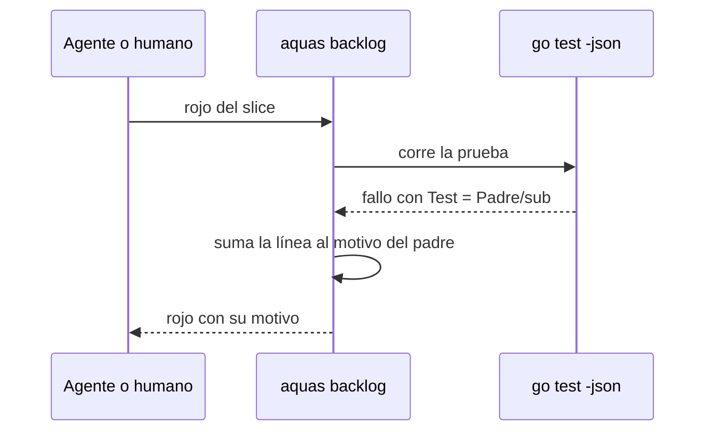

# S019 · Rojo de subtest guarda su motivo

[Inicio](../../README.md) › [E001](../README.md) › [F002](README.md) › S019

Este [slice](../../glosario.md#slice) hace que el rojo guarde el motivo cuando falla un subtest. Estado: cerrado; el humano aprobó el contrato el 2026-10-25. Corrige el defecto D000033.

## En una frase

Si una prueba falla dentro de un subtest, el rojo guarda la línea que la hizo fallar.

## Para qué existe

**El problema.** Cuando una prueba falla solo dentro de un subtest, `aquas backlog rojo` guarda un motivo vacío. La [wiki](../../glosario.md#wiki) pinta «—», como si la prueba nunca hubiera estado en rojo. Se pierde la evidencia de por qué falló.

**La causa.** La función `correr` en `internal/backlog/rojo.go` lee la salida de `go test -json`. Solo junta las líneas cuyo campo `Test` es igual a la prueba padre. Un subtest reporta su fallo con `Test` igual a `Padre/sub`, y esas líneas se descartan. Verificado al leer `rojo.go:276`.

**La solución.** Las líneas de salida de `Padre/sub` se suman a las de `Padre`. Los eventos de pasa o falla del subtest no tocan el resultado del padre.

Contrato del slice:

| Campo | Valor |
|---|---|
| Historia | Como humano, quiero ver por qué falló una prueba aunque falle en un subtest, para confiar en el rojo registrado |
| Objetivo | El motivo del rojo trae la línea del fallo del subtest |
| Incluye | Juntar la salida de `Padre/*` en `correr`; prueba con un módulo de juguete que falla solo en un subtest |
| Excluye | Corregir los rojos ya registrados con motivo vacío; cambiar cómo se elige la línea del motivo |
| Límite | Arregla el motivo, no el resultado: pasa o falla lo sigue diciendo el evento del padre |
| Alcance | `internal/backlog/**`, `docs/E001/F002/**`, `registro/defectos/**` |
| Prueba integral | TestCerrarSliceDePuntaAPunta (la de E001/F002) |

Criterios de aceptación:

1. Dada una prueba que falla solo en un subtest, al correr su rojo, el motivo trae esa línea.
2. Dada una prueba que falla en el padre, al correr su rojo, el motivo es el de hoy.
3. Dado un subtest que pasa y un padre que falla, cuando se corre, entonces el resultado sigue siendo falla.

Estrategia:

1. En `correr`, si no hay resultado para `e.Test`, buscar el del nombre antes de la primera `/`.
2. Ese atajo solo suma líneas de salida; los eventos pasa, falla y salta siguen siendo del padre.
3. La prueba arma un módulo de juguete en un repo temporal, como `modulo` en `rojo_test.go`.

Casos borde:

| Categoría | Caso | Qué debe pasar |
|---|---|---|
| Tipo de ficha | slice, feature o iniciativa | el motivo se arregla igual para todas |
| Estado de origen | prueba sin subtests | nada cambia |
| Padre e hijo | subtest anidado `Padre/a/b` | sus líneas también van al padre |
| Entrada | dos subtests fallan | el motivo es la última línea de fallo, como hoy |
| Choque con otro control | subtest falla y padre registra pasa | imposible en Go: el padre falla si falla un hijo |
| Quién habla | humano o agente por la CLI | la misma respuesta para los dos |
| Fallo a medias | el paquete no compila | sigue saliendo «no compila», como hoy |

## Analogía

Piensa en **un reclamo que llega a una sucursal**.

- La casa matriz solo leía los reclamos con su propio nombre.
- Los de la sucursal se archivaban sin leer.

Límite de la analogía: aquí la sucursal no decide nada; solo aporta el texto del reclamo.

## Diagrama

## Ejemplo de punta a punta

continúa: [EJ-E001-F002](README.md#EJ-E001-F002)

1. Una prueba `TestPadre` falla solo en su subtest `sub`.
2. El [agente](../../glosario.md#agente) pide `aquas backlog rojo` del slice.
3. aquas guarda como motivo la línea `p_test.go:N: …` del subtest.
4. La wiki muestra ese motivo en vez de «—».

## Paso a paso

1. Rojo de la prueba, cambio en `correr`, verde.

## Cómo se usa

- No hay comando nuevo: `aquas backlog rojo` guarda el motivo solo.

## Contrato y evidencia

<!-- GENERADO por aquas desde trabajo/: no editar a mano; `aquas compilar` lo rehace. -->

| Prueba | Valida | Rojo cuando | Verde cuando | Rojo | Verde |
|---|---|---|---|---|---|
| `TestRojoSubtestGuardaMotivo` | valida que el motivo junta la salida de Padre/sub | rojo cuando un fallo solo en subtest deja motivo vacío | verde cuando el motivo trae la salida del subtest | 2026-10-25 | 2026-10-25 |

### Código

| Archivo | Función | Parámetros | Qué hace |
|---|---|---|---|
| [internal/backlog/rojo.go](../../../internal/backlog/rojo.go) | `problemaPrueba` | `(p Prueba) string` | problemaPrueba: por qué una prueba de la ficha está mal escrita ("" si está bien). |
| [internal/backlog/rojo.go](../../../internal/backlog/rojo.go) | `listaPruebas` | `(xs []string) ([]Prueba, error)` | listaPruebas convierte "./paquete:TestNombre=intención" en pruebas válidas, sin repetidas. |
| [internal/backlog/rojo.go](../../../internal/backlog/rojo.go) | `corriendo` | `(f Ficha) bool` | corriendo: la ficha está EN_CURSO o VERIFICANDO. |
| [internal/backlog/rojo.go](../../../internal/backlog/rojo.go) | `sliceEnCurso` | `(act map[string]Ficha) (string, bool)` | sliceEnCurso: el primer slice EN_CURSO o VERIFICANDO entre las activas, por id. |
| [internal/backlog/rojo.go](../../../internal/backlog/rojo.go) | `SliceEnCurso` | `(raiz string) (string, bool, error)` | SliceEnCurso: el único slice EN_CURSO o VERIFICANDO, si hay. |
| [internal/backlog/rojo.go](../../../internal/backlog/rojo.go) | `Pruebas` | `(raiz, id string, lista []string) (Ficha, error)` | Pruebas fija las pruebas de la ficha; cambiarlas borra rojo y verde. |
| [internal/backlog/rojo.go](../../../internal/backlog/rojo.go) | `corrible` | `(raiz, id string) (Ficha, error)` | corrible: ficha activa con pruebas; un slice además debe estar en curso. |
| [internal/backlog/rojo.go](../../../internal/backlog/rojo.go) | `Rojo` | `(raiz, id string, ahora time.Time) (Ficha, error)` | Rojo corre cada prueba sola con `go test -json`; exige que cada una falle por sí misma. |
| [internal/backlog/rojo.go](../../../internal/backlog/rojo.go) | `rojoHeredado` | `(raiz string, f Ficha) *Registro` | rojoHeredado (X02): rojo que un slice cerrado de la feature registró para todas sus pruebas |
| [internal/backlog/rojo.go](../../../internal/backlog/rojo.go) | `Verde` | `(raiz, id string, ahora time.Time) (Ficha, error)` | Verde corre las pruebas juntas tras el rojo; exige que todas pasen. |
| [internal/backlog/rojo.go](../../../internal/backlog/rojo.go) | `resultado.motivo` | `(siPasa string) string` | motivo: texto que explica el resultado de una prueba; siPasa se usa cuando pasó. |
| [internal/backlog/rojo.go](../../../internal/backlog/rojo.go) | `correr` | `(raiz string, ps []Prueba) (map[string]resultado, error)` | correr: `go test -json -count=1 -run ^(A\\|B)$ ./paquete` por paquete; resultado por prueba. |
| [internal/backlog/rojo.go](../../../internal/backlog/rojo.go) | `motivoDelFallo` | `(ls []string) string` | motivoDelFallo: la última línea «archivo.go:N: …» (la que hizo fallar); si no hay, la primera. |
| [internal/backlog/rojo.go](../../../internal/backlog/rojo.go) | `head` | `(raiz string) string` | head: commit actual del repo, o "" fuera de Git. |
| [internal/backlog/rojo.go](../../../internal/backlog/rojo.go) | `cierre` | `(raiz string, f Ficha) error` | cierre: CERRADO exige pruebas, rojo, verde y, si el verde trae huella, el mismo código Go. |
| [internal/backlog/rojo.go](../../../internal/backlog/rojo.go) | `problemasRojoVerde` | `(rel string, f Ficha) []string` | problemasRojoVerde: chequeos del gate sobre pruebas, rojo y verde de una ficha. |
| [internal/backlog/rojo.go](../../../internal/backlog/rojo.go) | `Detalle` | `(f Ficha) string` | Detalle: pruebas con su intención, y rojo y verde, para `ver <id>`, `pruebas`, `rojo` y `verde`. |

<!-- /GENERADO -->

## Navegación

- ↑ Subir: [F002](README.md)
