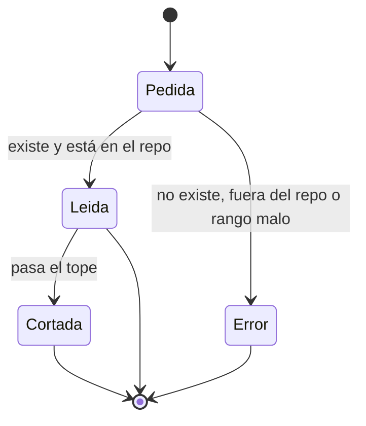
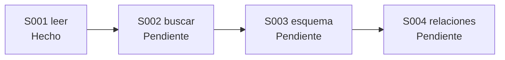

# F003 · Bibliotecario

[Inicio](../../README.md) › [E001](../README.md) › F003

[Feature](../../glosario.md#feature) que da a los [agentes](../../glosario.md#agente) una herramienta propia para leer el repo. Piden varias cosas de una vez y reciben solo lo útil.

## En una frase

En vez de traer la biblioteca entera, le pides al bibliotecario las tres páginas que necesitas.

## Para qué existe

**El problema.** Cada lectura de un archivo cuesta [tokens](../../glosario.md#token), y el texto leído se queda en el contexto. Leer archivos enteros para mirar diez líneas es gasto puro.

**La solución.** Un comando de `aquas` en [Go](../../glosario.md#go), sin piezas ajenas:

- Recibe un arreglo de rutas, cada una con su rango de líneas si hace falta.
- Responde en una sola llamada, con líneas numeradas.
- Cierra con la cuenta: cuántos caracteres devolvió de cuántos tenía la lectura completa.

Jesús decidió hacerlo propio: no confía en un índice de código de terceros.

## Analogía

Piensa en el **mostrador de una biblioteca**.

- Entregas una ficha con tres libros y las páginas que quieres.
- El bibliotecario te trae fotocopias solo de esas páginas.
- Al final te dice cuántas páginas te ahorraste.

Límite de la analogía: el bibliotecario de verdad sabe dónde buscar un tema. Este, por ahora, solo trae lo que le nombras. Buscar llega en S002.

## Diagrama

Proceso: cómo lee un agente.

Estados de una ruta pedida:

[Slices](../../glosario.md#slice) de esta feature:

| Slice | Qué entrega | Estado |
|---|---|---|
| [S001 Leer un lote de rutas](S001.md) | Varias rutas y rangos en una llamada, con tope y cuenta | Hecho |
| S002 Buscar | Expresión regular sobre rutas; responde archivo y línea | Pendiente |
| S003 Esquema | Firmas de Go y títulos de Markdown | Pendiente |
| S004 Relaciones | Quién usa qué, conectado al sello | Pendiente |

## Ejemplo de punta a punta

continúa: [EJ-E001](../README.md#EJ-E001)

En la [iniciativa](../../glosario.md#iniciativa), el pedido de Jesús llegó al trabajo. Ahora el agente necesita mirar código antes de cambiarlo.

1. El agente pide tres rangos de tres archivos en una sola llamada.
2. El bibliotecario devuelve esas líneas, numeradas.
3. La última línea dice: «devueltos 785 de 5379 caracteres».
4. El agente trabaja con eso, sin cargar los archivos enteros.

## Paso a paso

1. S001: leer un lote de rutas, con rangos, tope y cuenta.
2. S002: buscar por expresión regular.
3. S003: esquema de Go y [Markdown](../../glosario.md#markdown), semilla del plugin.
4. S004: relaciones entre código y conexión con el [sello](../../glosario.md#sello).

## Cómo se usa

- Un pedido en JSON por la entrada estándar: `{"rutas":["a.go:10-40","b.md"]}`.
- Sin rango, trae el archivo entero.
- Solo rutas relativas a la raíz del repo.

## Contrato y evidencia

Estado: en curso. S001 hecho; S002 a S004 pendientes.

Objetivo: que leer el repo cueste lo mínimo, medido en caracteres.

Por qué cuatro slices: cada uno se usa solo. Leer no necesita buscar, y el esquema no necesita las relaciones.

Decisiones de Jesús (2026-10-21):

- Herramienta propia en Go, sin codebase-memory-mcp.
- Comando por Bash con el pedido en JSON.
- El esquema va en S003.
- El ahorro se prueba comparando caracteres con la lectura completa.

Prueba integral de la feature: todavía no existe. Llega cuando haya algo que integrar, con S002.

## Navegación

- ↑ Subir: [E001 · Gobierno del trabajo](../README.md)
- Abajo: [S001 · Leer un lote de rutas](S001.md)
