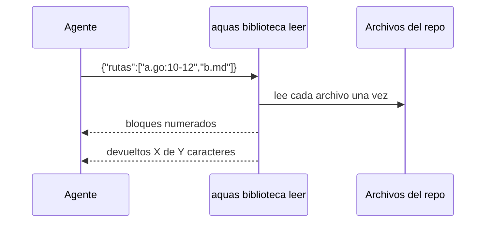
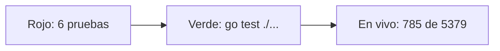

# S001 · Leer un lote de rutas

[Inicio](../../README.md) › [E001](../README.md) › [F003](README.md) › S001

[Slice](../../glosario.md#slice) que crea `aquas biblioteca leer`: varias rutas y rangos en una llamada, con tope y cuenta.

## En una frase

Una ficha con varias páginas pedidas, y una sola entrega con solo esas páginas.

## Para qué existe

**El problema.** Mirar diez líneas de tres archivos costaba tres llamadas. Si el [agente](../../glosario.md#agente) no pedía rango, traía los archivos enteros al contexto.

**La solución.** El paquete `internal/biblioteca` y su comando:

- Pedido en JSON: `{"rutas":["largo.txt:1-10","a.go"]}`.
- Cada bloque abre con `== ruta · desde-hasta de total`, y cada línea va numerada.
- Un error en una ruta se informa en su bloque y no frena las demás.
- Un tope de 200.000 caracteres frena un desborde extremo y lo avisa.
- La última línea dice cuántos caracteres devolvió de cuántos tenía la lectura completa.

Contrato del slice:

| Campo | Valor |
|---|---|
| Objetivo | Leer un lote de rutas en una llamada, devolviendo solo lo pedido |
| Incluye | Paquete `internal/biblioteca`, comando `aquas biblioteca leer`, rangos, errores por ruta, tope, cuenta, uso en el worker y el orquestador |
| Excluye | Buscar (S002), esquema (S003), rutas fuera del repo |
| Prueba | `go test ./internal/biblioteca/ ./cmd/aquas/` |

## Analogía

Piensa en una **fotocopiadora con lista**.

- Le pasas una lista de páginas.
- Saca una copia por cada una, con su número.
- Si una página no existe, te deja una nota en su lugar y sigue con las demás.

Límite de la analogía: la fotocopiadora no sabe qué páginas te sirven. Este comando tampoco: el agente elige qué pedir.

## Diagrama

Secuencia: una lectura de punta a punta.

## Ejemplo de punta a punta

continúa: [EJ-E001-F003](README.md#EJ-E001-F003)

En la [feature](../../glosario.md#feature), el agente pidió tres rangos de una vez. Así se vio en vivo sobre este repo.

1. Pidió `archivar.go:24-30`, `CLAUDE.md:1-3` y `no.go`.
2. Recibió siete líneas de un archivo y tres del otro.
3. Para `no.go`, recibió «error: no existe».
4. Cerró con «devueltos 785 de 5379 caracteres».

## Paso a paso

1. Seis pruebas en rojo con un esqueleto vacío.
2. Paquete `internal/biblioteca`.
3. Comando `aquas biblioteca leer` y su prueba.
4. Regla de uso en el worker y el [orquestador](../../glosario.md#orquestador).
5. Prueba en vivo sobre el repo.

## Cómo se usa

- `echo '{"rutas":["a.go:10-40","b.md"]}' | go run ./cmd/aquas biblioteca leer`.
- Rango `desde-hasta`: si pasa el final, se corta en la última línea.
- `"tope": N` baja el tope para un pedido; si no, vale 200.000.
- Ruta absoluta o con `..`: error, solo rutas del repo.

## Contrato y evidencia

Estado: hecho.

Pruebas del slice, en `internal/biblioteca/biblioteca_test.go` y `cmd/aquas/biblioteca_test.go`:

| Prueba | Qué demuestra |
|---|---|
| `TestLeerLoteNumerado` | Varias rutas en una llamada, numeradas, con CRLF pasado a LF |
| `TestLeerRango` | Un rango trae solo esas líneas y se corta al final del archivo |
| `TestLeerCasosBorde` | Archivo vacío, carpeta y la misma ruta escrita distinto; sin ruta absoluta en errores |
| `TestLeerErroresPorRutaNoFrenanElLote` | No existe, fuera del repo o rango malo se informan sin frenar las demás |
| `TestTopeCortaYLoDice` | El tope corta lo devuelto y lo avisa |
| `TestCuentaDeAhorro` | La última línea dice devueltos de completos |
| `TestAhorroFrenteALecturaCompleta` | La misma tarea gasta menos de un cuarto que la lectura completa |
| `TestBibliotecaCLI` | El comando real lee el pedido por stdin; uno ilegible da exit 64 |

Rojo visto: sí. Las seis del paquete fallaron con el esqueleto vacío.

El auditor halló siete puntos. Se corrigieron cinco, cada uno con su [prueba en rojo](../../glosario.md#prueba-en-rojo). Eran el archivo vacío, la carpeta y la grafía repetida. También los mensajes del comando y una prueba que escribía fuera de su carpeta.

Ahorro medido: mirar diez líneas de tres archivos dio 435 caracteres frente a 10.472 de la lectura completa. Es un 96 % menos.

Ojo con esa cifra, como señaló el auditor. Read también acepta rangos. Frente a tres Read con rango, el ahorro real es menor: dos llamadas menos y una numeración más corta. El 96 % vale solo frente a leer archivos enteros.

Decisiones de Jesús (2026-10-21): según la feature.

Límite: el ahorro depende de que el agente pida rangos. Si pide archivos enteros, solo ahorra el viaje de varias llamadas.

Otro límite: la ruta se valida por texto. Un enlace simbólico dentro del repo que apunte afuera se leería. Hoy no hay ninguno.

## Navegación

- ↑ Subir: [F003 · Bibliotecario](README.md)
