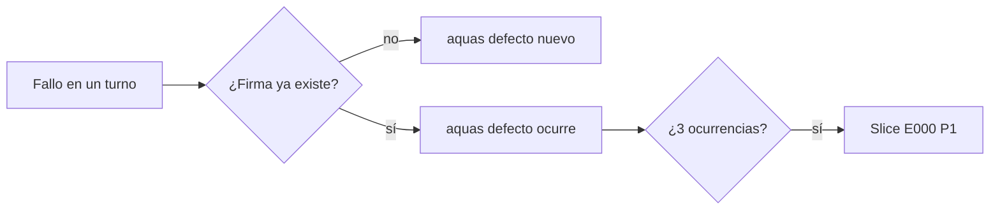
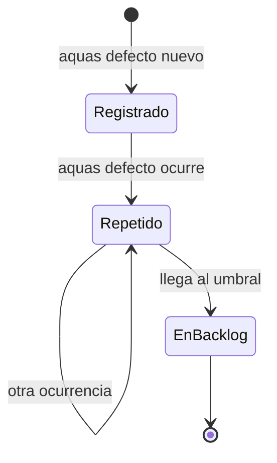

# F004 · Defectos y reincidencia

[Inicio](../../README.md) › [E001](../README.md) › F004

[Feature](../../glosario.md#feature) que guarda cada fallo del [agente](../../glosario.md#agente) con su causa y su arreglo. Si un fallo se repite, lo convierte en trabajo.

## En una frase

Un fallo que se repite deja de ser un accidente y se vuelve una tarea.

## Para qué existe

**El problema.** El agente explicaba sus fallos en el chat y luego se olvidaban. El mismo error volvía días después.

Ejemplo real: un [hook](../../glosario.md#hook) corrido con `go run` perdía su exit 2. Pasó muchas veces antes de quedar escrito.

**La solución.** Tres [slices](../../glosario.md#slice):

- S001 crea el registro `registro/defectos/`, en Git.
- S002 hace que el cierre del turno frene si hubo un fallo sin registrar.
- S003 crea un slice de mantenimiento cuando un defecto se repite tres veces.

Decisión de Jesús, 2026-10-22: el registro va en Git porque es conocimiento que evita repetir.

## Analogía

Piensa en la **libreta de fallas de un taller mecánico**.

- Cada falla se anota con su causa y su arreglo.
- Si la misma falla vuelve tres veces, se revisa el proceso, no solo el carro.

Límite de la analogía: aquí la libreta la exige un programa, no el jefe del taller.

## Diagrama

Estados de un defecto:

| Slice | Qué entrega |
|---|---|
| [S001 Registro de defectos](S001.md) | `aquas defecto nuevo`, `ocurre` y `ver` |
| S002 Stop frena fallo sin defecto | Cierre que exige registrar el fallo |
| S003 Reincidencia crea slice E000 | Trabajo automático al repetirse |

## Ejemplo de punta a punta

continúa: [EJ-E001](../README.md#EJ-E001)

1. Un hook pierde su exit 2 por `go run`.
2. Se registra D000001 `hook-exit-go-run`.
3. Vuelve a pasar: `aquas defecto ocurre D000001 T000120`.
4. A la tercera, nace un slice de mantenimiento en la [iniciativa](../../glosario.md#iniciativa) E000.

## Paso a paso

1. Registro de defectos (S001).
2. Freno en el cierre del turno (S002).
3. Reincidencia que crea trabajo (S003).

## Cómo se usa

- Ver el registro: `aquas defecto ver`.
- Ver las fichas: `aquas backlog ver E001/F004`.

## Contrato y evidencia

**Objetivo.** Ningún fallo repetido queda sin registro ni sin tarea.

Prueba de S001: `TestRegistroDeDefectos`.

## Navegación

<!-- GENERADO por aquas desde trabajo/: no editar a mano; `aquas compilar` lo rehace. -->

| Hijo | Qué es | Estado |
|---|---|---|
| [S001](S001.md) | Registro de defectos | Hecho |
| S002 | Stop frena fallo sin defecto | Planeado |
| S003 | Reincidencia crea slice E000 | Planeado |
| S004 | Stop frena pedido de dale sin plan | Planeado |

<!-- /GENERADO -->

- ↑ Subir: [E001 · Gobierno del trabajo](../README.md)
- Abajo: [S001 · Registro de defectos](S001.md)
