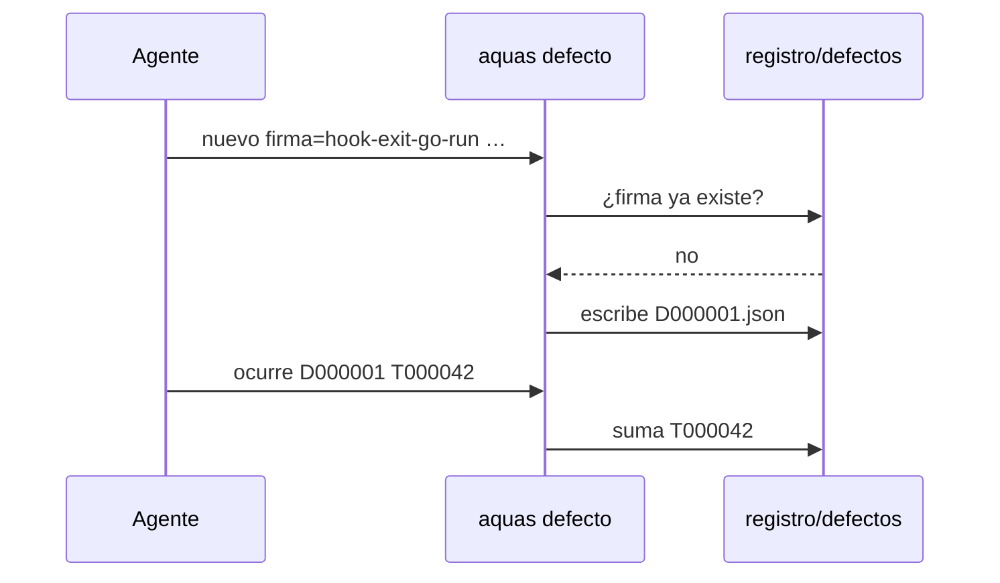

# S001 · Registro de defectos

[Inicio](../../README.md) › [E001](../README.md) › [F004](README.md) › S001

`aquas defecto` guarda cada fallo en `registro/defectos/D000001.json`. Cada defecto tiene una firma única y los turnos en que ocurrió.

## En una frase

Escribir el fallo una vez y contar cada vez que vuelve.

## Para qué existe

**El problema.** Los fallos se explicaban en el chat y se perdían. No había forma de saber si uno ya había pasado.

**La solución.** Este [slice](../../glosario.md#slice) crea el registro en Git, con campos cortos y firma estable.

Contrato del slice:

| Campo | Valor |
|---|---|
| Objetivo | Registrar defectos y sumar sus ocurrencias por turno |
| Incluye | `internal/defecto`, `aquas defecto nuevo`, `ocurre` y `ver`, semilla D000001 |
| Excluye | Frenar el cierre (S002) y crear slices por reincidencia (S003) |
| Prueba | `go test ./internal/defecto/ -run TestRegistroDeDefectos` |

## Analogía

Piensa en una **historia clínica**.

- Cada diagnóstico se anota una vez.
- Cada consulta por lo mismo suma una fecha.

Límite de la analogía: aquí el diagnóstico lo pone el [agente](../../glosario.md#agente), y puede equivocarse al elegir la firma.

## Diagrama

## Ejemplo de punta a punta

continúa: [EJ-E001-F004](README.md#EJ-E001-F004)

1. Se registra `hook-exit-go-run` y nace D000001.
2. Se intenta registrarlo otra vez: falla y sugiere `ocurre`.
3. `aquas defecto ocurre D000001 T000042` suma el turno.

## Paso a paso

1. `nuevo` exige los cinco campos: firma, qué, causa, arreglo y cómo me cercioro.
2. La firma va en minúsculas con guiones y no se repite.
3. El ID es el siguiente libre: D000001, D000002…
4. `ocurre` suma un turno `T000001`; el mismo turno no cuenta dos veces.

## Cómo se usa

- Registrar: `aquas defecto nuevo firma=… que=… causa=… arreglo=… cercioro=…`.
- Sumar: `aquas defecto ocurre D000001 T000042`.
- Ver: `aquas defecto ver` o `aquas defecto ver D000001`.

## Contrato y evidencia

<!-- GENERADO por aquas desde trabajo/: no editar a mano; `aquas compilar` lo rehace. -->

| Prueba | Valida | Rojo cuando | Verde cuando | Rojo | Verde |
|---|---|---|---|---|---|
| `TestRegistroDeDefectos` | el registro crea defectos con firma única y campos válidos | acepta firma repetida, campo vacío, firma no kebab o extra | crea D000001 y D000002; los cuatro casos malos se rechazan | 2026-10-22 | 2026-10-22 |

### Código

| Archivo | Función | Parámetros | Qué hace |
|---|---|---|---|
| [cmd/aquas/main.go](../../../cmd/aquas/main.go) | `main` | `()` | main despacha el subcomando de aquas (compilar, verificar, backlog, hooks…) y sale con su código. |
| [cmd/aquas/main.go](../../../cmd/aquas/main.go) | `hook` | `(raiz string)` | hook: exit 0 = nada que reportar; exit 2 = stderr se muestra a Claude. |
| [cmd/aquas/main.go](../../../cmd/aquas/main.go) | `compilarSettings` | `(w io.Writer)` | compilarSettings regenera .claude/settings.json; sin entorno declarado no inventa uno. |
| [cmd/aquas/main.go](../../../cmd/aquas/main.go) | `reportar` | `(w io.Writer, inf compilador.Informe)` | reportar imprime qué derivados escribió la compilación, o que todo estaba al día. |
| [cmd/aquas/main.go](../../../cmd/aquas/main.go) | `listar` | `(titulo string, problemas []string)` | listar imprime en stderr un título y cada problema en su viñeta. |
| [cmd/aquas/main.go](../../../cmd/aquas/main.go) | `lista` | `(xs []string) string` | lista une los textos con comas, o «—» si no hay ninguno. |
| [cmd/aquas/main.go](../../../cmd/aquas/main.go) | `fallar` | `(codigo int, err error)` | fallar imprime el error en stderr y termina con el código dado. |
| [cmd/aquas/main.go](../../../cmd/aquas/main.go) | `memoriaCLI` | `(raiz string, args []string)` | memoriaCLI: `ver` imprime la memoria; `fijar campo=valor…` la actualiza y la sella. |
| [cmd/aquas/main.go](../../../cmd/aquas/main.go) | `memoriaArchivada` | `(raiz, id string) error` | memoriaArchivada: CERRADO exige que la memoria que apunta al slice ya esté archivada (E001/F002/S009). |
| [cmd/aquas/main.go](../../../cmd/aquas/main.go) | `focoEnBacklog` | `(raiz string, f memoria.Foco) error` | focoEnBacklog: la memoria solo fija el slice que el backlog tiene en curso (S003). |
| [cmd/aquas/main.go](../../../cmd/aquas/main.go) | `backlogCLI` | `(raiz string, args []string)` | backlogCLI: nuevo \\| ver [id] \\| prioridad \\| estado \\| siguiente \\| pruebas \\| rojo \\| verde. |
| [cmd/aquas/main.go](../../../cmd/aquas/main.go) | `turnoCLI` | `(raiz string, args []string)` | turnoCLI: auditoría de turnos (E001/F002/S001). Lee el JSON del hook por stdin. No imprime nada |
| [cmd/aquas/main.go](../../../cmd/aquas/main.go) | `defectoCLI` | `(raiz string, args []string) error` | defectoCLI: nuevo \\| ocurre \\| ver (E001/F004/S001). |
| [cmd/aquas/main.go](../../../cmd/aquas/main.go) | `versionBinario` | `() string` | versionBinario: versión del módulo con que se compiló el binario (= versión del gobierno embebido). |
| [internal/defecto/defecto.go](../../../internal/defecto/defecto.go) | `Nuevo` | `(raiz string, c map[string]string) (Defecto, error)` | Nuevo crea el siguiente D000NNN. Todos los campos son obligatorios; la firma es kebab-case y única. |
| [internal/defecto/defecto.go](../../../internal/defecto/defecto.go) | `Ocurre` | `(raiz, id, turno string) (Defecto, error)` | Ocurre suma un turno T000NNN al defecto; el mismo turno no se cuenta dos veces. |
| [internal/defecto/defecto.go](../../../internal/defecto/defecto.go) | `Leer` | `(raiz string) ([]Defecto, error)` | Leer devuelve todos los defectos, ordenados por ID. Sin carpeta = registro vacío. |
| [internal/defecto/defecto.go](../../../internal/defecto/defecto.go) | `leerUno` | `(raiz, id string) (Defecto, error)` | leerUno carga el defecto con ese ID; valida el formato D000001. |
| [internal/defecto/defecto.go](../../../internal/defecto/defecto.go) | `escribir` | `(raiz string, d Defecto) error` | escribir guarda el defecto como JSON en su carpeta. |
| [internal/defecto/defecto.go](../../../internal/defecto/defecto.go) | `Texto` | `(d Defecto) string` | Texto: una línea por defecto para `aquas defecto ver`. |

<!-- /GENERADO -->

Estado: hecho.

Límites:

- Elegir entre una firma existente y una nueva es juicio del agente: es probabilístico.
- D000001 nace sin ocurrencias, porque las previas no tienen turno anotado.

## Navegación

- ↑ Subir: [F004 · Defectos y reincidencia](README.md)
