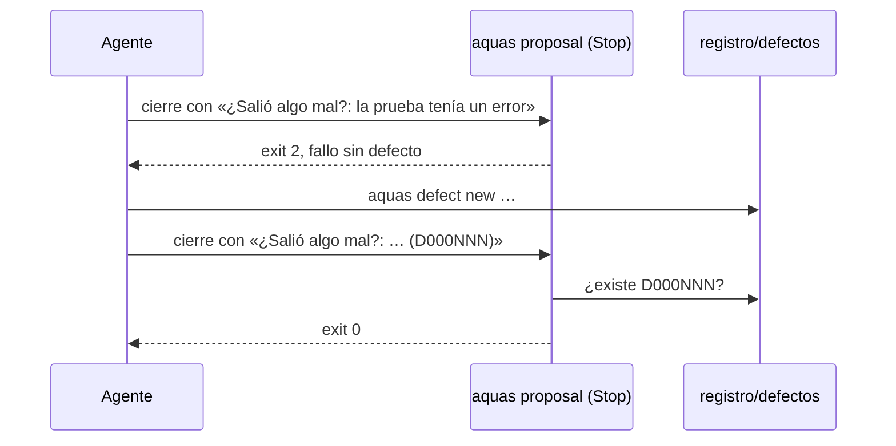

# S002 · Stop frena fallo sin defecto

[Inicio](../../README.md) › [E001](../README.md) › [F004](README.md) › S002

Este [slice](../../glosario.md#slice) hace que el cierre del turno frene cuando cuenta un fallo sin número de defecto registrado.

## En una frase

Si el campo «¿Salió algo mal?» no dice «No», debe nombrar un defecto que exista en `registro/defectos/`.

## Para qué existe

**El problema.** El cierre de cada turno tiene el campo «🤦‍♂️ ¿Salió algo mal?». El [agente](../../glosario.md#agente) puede contar ahí un fallo y no registrarlo. Ese fallo se olvida, y si se repite nadie lo nota.

Ejemplo real del 2026-10-30, en el tramo E001/F004/S006: el agente contó dos fallos en el chat. Ninguno quedó registrado.

**La solución.** Decidida por el humano el 2026-10-30: todo fallo exige defecto, y el número debe existir.

**Contrato.**

| Regla | Valor |
|---|---|
| Dónde | gancho Stop, `aquas proposal`, junto al freno de insights |
| Qué línea mira | línea que empieza (tras viñeta, emoji o negrita) con `¿Salió algo mal?` y `:`; una cita en el cuerpo o una mención sin `:` no cuenta |
| Pasa | valor `No` o `—`, con o sin punto final; o valor que nombra al menos un `D000NNN` y todos los nombrados existen en `registro/defectos/` |
| Frena | cualquier otro valor, incluido el vacío: exit 2 con «Fallo sin defecto…» y el comando `aquas defect new` u `ocurre` |
| Defecto inexistente | frena y nombra el número que no existe |
| Sin campo | pasa: este freno no exige el cierre, solo revisa el campo si está |
| Alcance | `internal/defecto/fallo.go`, `internal/defecto/fallo_test.go`, `cmd/aquas/main.go`, `cmd/aquas/fallo_defecto_test.go`, `docs/E001/F004/S002.md`, `docs/E001/F004/README.md`, y los canónicos `gobierno/canonico/comunicacion/01_COMUNICACION_HUMANO.md` y `gobierno/canonico/metodologias/E001_GOBIERNO_DEL_TRABAJO.md` (hallazgo A1.4) |

**Casos borde.**

| Categoría | Aplica | Prueba o motivo |
|---|---|---|
| cada tipo de ficha | no | no lee fichas; solo el mensaje y el registro de defectos |
| cada estado de origen | sí | registro vacío o sin carpeta: un `D000NNN` cualquiera frena: `TestStopFrenaFalloSinDefecto` |
| padre e hijo, activo y archivado | no | los defectos no tienen jerarquía ni archivo |
| entrada ausente, vacía, mal escrita o duplicada | sí | sin campo, valor vacío, «No.», «—», «No hubo» (frena), mención sin `:`, cita del campo en el cuerpo (pasa), dos campos, `D12` y `D0000012` mal formados, dos números con uno inexistente: `TestStopFrenaFalloSinDefecto` |
| choque con otro control | sí | el freno de insights y el de PROPUESTA siguen igual; un mensaje que pasa los tres sale 0: `TestHookFrenaFalloSinDefecto` |
| quién habla: humano, agente o herramienta | no | el gancho Stop solo revisa el mensaje del agente al humano |
| fallo a mitad de camino | sí | carpeta `registro/defectos` ilegible, o una carpeta con nombre de defecto: no cuenta como registrado y frena: `TestStopFrenaFalloSinDefecto` |

## Analogía

Piensa en **un parte de accidente en una obra**.

- Si el capataz dice «hubo un accidente», debe dar el número del parte.
- Si no hubo, basta con decir «No».

Límite de la analogía: aquí nadie juzga la gravedad; todo accidente lleva parte.

## Diagrama

## Ejemplo de punta a punta

continúa: [EJ-E001-F004](README.md#EJ-E001-F004)

1. El agente cierra con «🤦‍♂️ ¿Salió algo mal?: mi prueba tenía un `\n` crudo».
2. El gancho Stop sale con exit 2: «Fallo sin defecto».
3. El agente corre `aquas defect new firma=json-salto-crudo …` y recibe su número, por ejemplo D000NNN.
4. Reescribe el campo con «(D000NNN)». El gancho comprueba que existe y deja cerrar.

## Paso a paso

1. Rojo de las dos pruebas, `RevisarFallo` en `internal/defecto`, conexión en `cmd/aquas/main.go`, verde.

## Cómo se usa

- Sin fallo: «🤦‍♂️ ¿Salió algo mal?: No».
- Con fallo nuevo: `aquas defect new …` y nombrar su número en el campo.
- Con fallo repetido: `aquas defect occur D000NNN T000NNN` y nombrar ese número.

## Contrato y evidencia

<!-- GENERADO por aquas desde trabajo/: no editar a mano; `aquas compile` lo rehace. -->

| Prueba | Valida | Rojo cuando | Verde cuando | Rojo | Verde |
|---|---|---|---|---|---|
| `TestStopFrenaFalloSinDefecto` | valida que un fallo contado en el cierre trae un defecto que existe | rojo cuando un ¿Salió algo mal? sin defecto no frena el cierre | verde cuando sin defecto o con uno inexistente frena; con No, con — o con un defecto que existe pasa | 2026-10-30 | 2026-10-30 |
| `TestHookFrenaFalloSinDefecto` | valida que el gancho Stop aplica el freno de fallo sin defecto | rojo cuando aquas propuesta sale 0 con un fallo sin defecto | verde cuando sale 2 con el aviso y sale 0 con No o con un defecto que existe | 2026-10-30 | 2026-10-30 |

### Código

| Archivo | Función | Parámetros | Qué hace |
|---|---|---|---|
| [cmd/aquas/main.go](../../../cmd/aquas/main.go) | `main` | `()` | main despacha el subcomando de aquas (compilar, verificar, backlog, hooks…) y sale con su código. |
| [cmd/aquas/main.go](../../../cmd/aquas/main.go) | `hook` | `(raiz string)` | hook: exit 0 = nada que reportar; exit 2 = stderr se muestra a Claude. |
| [cmd/aquas/main.go](../../../cmd/aquas/main.go) | `compilarSettings` | `(w io.Writer)` | compilarSettings regenera .claude/settings.json; sin entorno declarado no inventa uno. |
| [cmd/aquas/main.go](../../../cmd/aquas/main.go) | `reportar` | `(w io.Writer, inf compilador.Informe)` | reportar imprime qué derivados escribió la compilación, o que todo estaba al día. |
| [cmd/aquas/main.go](../../../cmd/aquas/main.go) | `listar` | `(titulo string, problemas []string)` | listar imprime en stderr un título y cada problema en su viñeta. |
| [cmd/aquas/main.go](../../../cmd/aquas/main.go) | `lista` | `(xs []string) string` | lista une los textos con comas, o «—» si no hay ninguno. |
| [cmd/aquas/main.go](../../../cmd/aquas/main.go) | `fallar` | `(codigo int, err error)` | fallar imprime el error en stderr y termina con el código dado. |
| [cmd/aquas/main.go](../../../cmd/aquas/main.go) | `memoriaCLI` | `(raiz string, args []string)` | memoriaCLI: `ver` imprime la memoria; `fijar campo=valor…` la actualiza y la sella. |
| [cmd/aquas/main.go](../../../cmd/aquas/main.go) | `memoriaArchivada` | `(raiz, id string) error` | memoriaArchivada: CERRADO exige el archivo de memoria del slice, apunte o no la memoria a él (E001/F002/S009, X01). |
| [cmd/aquas/main.go](../../../cmd/aquas/main.go) | `focoEnBacklog` | `(raiz string, f memoria.Foco) error` | focoEnBacklog: la memoria solo fija el slice que el backlog tiene en curso (S003). |
| [cmd/aquas/main.go](../../../cmd/aquas/main.go) | `backlogCLI` | `(raiz string, args []string)` | backlogCLI: nuevo \\| ver [id] \\| tabla \\| prioridad \\| estado \\| siguiente \\| pruebas \\| rojo \\| verde. |
| [cmd/aquas/main.go](../../../cmd/aquas/main.go) | `turnoCLI` | `(raiz string, args []string)` | turnoCLI: auditoría de turnos (E001/F002/S001). Lee el JSON del hook por stdin. No imprime nada |
| [cmd/aquas/main.go](../../../cmd/aquas/main.go) | `defectoCLI` | `(raiz string, args []string) error` | defectoCLI: nuevo \\| ocurre \\| ver (E001/F004/S001). |
| [cmd/aquas/main.go](../../../cmd/aquas/main.go) | `versionBinario` | `() string` | versionBinario: versión del módulo con que se compiló el binario (= versión del gobierno embebido). |
| [cmd/aquas/main.go](../../../cmd/aquas/main.go) | `registrarCierre` | `(raiz, tipo, transcript, primera, resultado string)` | registrarCierre (E001/F004/S005, D000068) anota cada llamada del gancho cierre-agente en .tmp/hooks/cierre-agente.jsonl. |
| [internal/defecto/fallo.go](../../../internal/defecto/fallo.go) | `RevisarFallo` | `(raiz, msg string) string` | RevisarFallo (E001/F004/S002) devuelve "" si pasa; si no, el motivo del freno. El campo «¿Salió algo mal?» |
| [internal/defecto/fallo.go](../../../internal/defecto/fallo.go) | `registrados` | `(raiz string) map[string]bool` | registrados: números con archivo en el registro. Registro ausente o ilegible = ninguno (hallazgo A1.2). |

<!-- /GENERADO -->

Pruebas: `TestStopFrenaFalloSinDefecto`, `TestHookFrenaFalloSinDefecto`.

## Navegación

- ↑ Subir: [F004](README.md)
