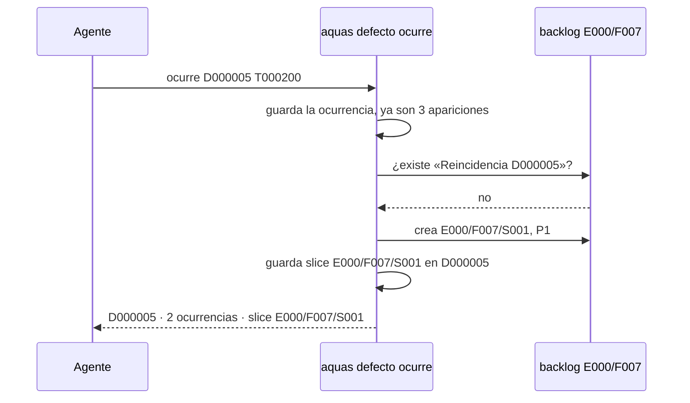

# S003 · Reincidencia crea slice E000

[Inicio](../../README.md) › [E001](../README.md) › [F004](README.md) › S003

Este [slice](../../glosario.md#slice) convierte un defecto que se repite en trabajo del [backlog](../../glosario.md#backlog), sin que nadie lo pida.

## En una frase

A la tercera aparición de un defecto, `aquas defecto ocurre` crea un slice P1 en E000/F007.

## Para qué existe

**El problema.** Un defecto puede repetirse muchas veces. Cada vez se suma una ocurrencia, pero nadie se encarga de arreglar la causa.

Ejemplo real: D000001 `hook-exit-go-run` volvió varias veces antes de tener arreglo de fondo.

**La solución.** Decidida por el humano el 2026-10-30: la tercera aparición crea el trabajo. Cuenta el registro más dos `ocurre`.

**Contrato.**

| Regla | Valor |
|---|---|
| Dónde | `defecto.Ocurre`, que usa `aquas defecto ocurre D000NNN T000NNN` |
| Umbral | `Umbral = 3` apariciones: el registro cuenta como una, cada `ocurre` suma otra |
| Qué crea | `E000/F007/SNNN` con el número siguiente al mayor existente (no llena huecos), en BORRADOR y P1 |
| Título | `Reincidencia D000NNN: <firma>` |
| Prueba del slice | marcador `./internal/defecto:TestReincidenciaD000NNN`; quien tome el slice la reemplaza |
| Sin repetir | el defecto guarda el id del slice en su campo `slice`; si ya lo tiene, no crea otro |
| Fallo a mitad | la ocurrencia se guarda primero; si el slice no nace, `ocurre` falla y repetir el mismo turno reintenta sin sumar ocurrencia |
| Reintento | antes de crear, busca un slice con el mismo título; si existe, activo o archivado, lo reutiliza. Id nuevo = siguiente al mayor |
| Feature archivada | se niega: un slice activo bajo un padre archivado rompe el gate |
| Alcance | `internal/defecto/defecto.go`, `internal/defecto/reincidencia_test.go`, `docs/E001/F004/S003.md`, `docs/E001/F004/README.md`, `gobierno/canonico/metodologias/E001_GOBIERNO_DEL_TRABAJO.md` (hallazgo A1.2) |

**Casos borde.**

| Categoría | Aplica | Prueba o motivo |
|---|---|---|
| cada tipo de ficha | sí | solo crea slices; el padre es la feature E000/F007: `TestReincidenciaCreaSlice` |
| cada estado de origen | sí | debajo del umbral no crea; en el umbral crea; encima, aunque el slice cambie de título, no crea otro: `TestReincidenciaCreaSlice` |
| padre e hijo, activo y archivado | sí | E000/F007 ausente: falla y guarda la ocurrencia. E000/F007 archivada: se niega sin crear hijo y el backlog sigue válido. Slice previo archivado: se reutiliza: `TestReincidenciaCreaSlice` |
| entrada ausente, vacía, mal escrita o duplicada | sí | turno repetido o mal escrito sigue fallando sin crear nada: `TestReincidenciaCreaSlice` |
| choque con otro control | sí | la regla del gate «hijo activo con padre archivado»: se niega antes de crear; `backlog.Validar` queda limpio: `TestReincidenciaCreaSlice` |
| quién habla: humano, agente o herramienta | no | solo lo dispara `aquas defecto ocurre`; da igual quién lo corra |
| fallo a mitad de camino | sí | ocurrencia guardada y slice no creado: repetir el mismo turno lo crea una sola vez, sin sumar ocurrencia: `TestReincidenciaCreaSlice` |

## Analogía

Piensa en **un semáforo que se daña en la misma esquina**.

- La primera y la segunda vez, se repara y se anota.
- La tercera, se abre una orden de trabajo para revisar la instalación.

Límite de la analogía: aquí la orden se abre sola, por programa.

## Diagrama

## Ejemplo de punta a punta

continúa: [EJ-E001-F004](README.md#EJ-E001-F004)

1. Se registra D000005 `json-salto-crudo`: primera aparición.
2. Vuelve a pasar: `aquas defecto ocurre D000005 T000150`. Van dos.
3. Pasa otra vez: `aquas defecto ocurre D000005 T000200`. Van tres.
4. Nace E000/F007/S001 «Reincidencia D000005: json-salto-crudo», P1.
5. Una cuarta aparición suma la ocurrencia y no crea otro slice.

## Paso a paso

1. Rojo de `TestReincidenciaCreaSlice`, umbral y campo `slice` en `internal/defecto`, verde.

## Cómo se usa

- Igual que antes: `aquas defecto ocurre D000NNN T000NNN`.
- Si nace un slice, la salida lo nombra. Verlo: `aquas backlog ver E000/F007`.

## Contrato y evidencia

<!-- GENERADO por aquas desde trabajo/: no editar a mano; `aquas compilar` lo rehace. -->

| Prueba | Valida | Rojo cuando | Verde cuando | Rojo | Verde |
|---|---|---|---|---|---|
| `TestReincidenciaCreaSlice` | la reincidencia crea un slice P1 una sola vez | al llegar al umbral no crea el slice, o lo crea repetido | crea un slice P1 en el umbral; debajo no crea nada | 2026-10-30 | 2026-10-30 |

### Código

| Archivo | Función | Parámetros | Qué hace |
|---|---|---|---|
| [internal/defecto/defecto.go](../../../internal/defecto/defecto.go) | `Nuevo` | `(raiz string, c map[string]string) (Defecto, error)` | Nuevo crea el siguiente D000NNN. Todos los campos son obligatorios; la firma es kebab-case y única. |
| [internal/defecto/defecto.go](../../../internal/defecto/defecto.go) | `Ocurre` | `(raiz, id, turno string) (Defecto, error)` | Ocurre suma un turno T000NNN al defecto; el mismo turno no se cuenta dos veces. |
| [internal/defecto/defecto.go](../../../internal/defecto/defecto.go) | `sliceReincidencia` | `(raiz string, d Defecto) (string, error)` | sliceReincidencia devuelve el slice del defecto: el que ya lleve su título o uno nuevo P1 en Feature. |
| [internal/defecto/defecto.go](../../../internal/defecto/defecto.go) | `Leer` | `(raiz string) ([]Defecto, error)` | Leer devuelve todos los defectos, ordenados por ID. Sin carpeta = registro vacío. |
| [internal/defecto/defecto.go](../../../internal/defecto/defecto.go) | `leerUno` | `(raiz, id string) (Defecto, error)` | leerUno carga el defecto con ese ID; valida el formato D000001. |
| [internal/defecto/defecto.go](../../../internal/defecto/defecto.go) | `escribir` | `(raiz string, d Defecto) error` | escribir guarda el defecto como JSON en su carpeta. |
| [internal/defecto/defecto.go](../../../internal/defecto/defecto.go) | `Texto` | `(d Defecto) string` | Texto: una línea por defecto para `aquas defecto ver`. |
| [internal/defecto/defecto.go](../../../internal/defecto/defecto.go) | `revisarRelacion` | `(raiz, rel, que string, todos []Defecto) error` | revisarRelacion (E001/F009/S002): relacion=nuevo o el id de una ficha; sin ella, lista defectos y fichas parecidos. |

<!-- /GENERADO -->

Pruebas: `TestReincidenciaCreaSlice`.

## Navegación

- ↑ Subir: [F004](README.md)
