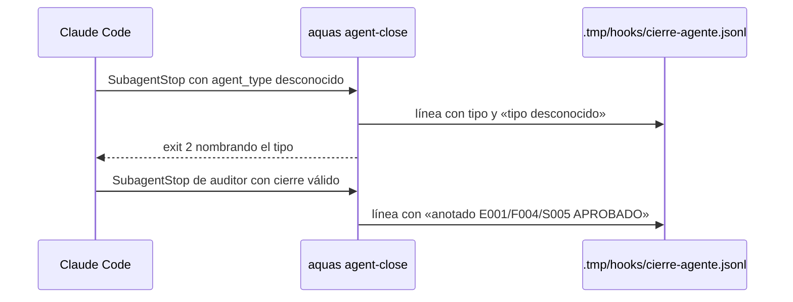

# S005 · El gancho del veredicto no falla en silencio

[Inicio](../../README.md) › [E001](../README.md) › [F004](README.md) › S005

Este [slice](../../glosario.md#slice) da rastro al gancho `aquas agent-close`. Además, el gancho frena ante un tipo de [agente](../../glosario.md#agente) que no conoce.

## En una frase

Cada llamada del gancho queda anotada en `.tmp/hooks/cierre-agente.jsonl`, y un tipo de agente desconocido ya no pasa callado.

## Para qué existe

**El problema.** El 2026-10-29 dos auditores aprobaron E001/F012/S001 y la ficha quedó sin veredicto. El gancho no dijo nada (D000068).

**Por qué importa.** Cada cierre de tramo depende de ese veredicto. Sin rastro, no se sabe si el gancho no corrió, no halló el cierre o no reconoció al agente.

**La solución.** Dos piezas, elegidas por el humano el 2026-10-29.

1. Registro: cada llamada deja una línea con fecha, tipo, transcript, primera línea del cierre y resultado.
2. Freno: un tipo de agente que el gancho no conoce sale con exit 2 y nombra el tipo.

**Contrato.**

| Regla | Valor |
|---|---|
| Dónde | `aquas agent-close`, el gancho `SubagentStop` |
| Registro | una línea JSON por llamada en `.tmp/hooks/cierre-agente.jsonl`, también con entrada ilegible |
| Campos | `fecha`, `tipo`, `transcript`, `primera` (primera línea del cierre), `resultado` |
| Resultado | uno de: `aceptado`, `anotado <id> <veredicto>`, `sin anotar: <motivo>` (auditor sin veredicto anotable), `rechazado: <motivo>`, `tipo desconocido`, `entrada ilegible` |
| Tipo desconocido | exit 2 con «tipo de agente desconocido «X»»; con `stop_hook_active` deja pasar y lo registra |
| Registro que no se puede escribir | no frena al agente: el gancho sigue igual |
| Sin cambio | la revisión del cierre y la anotación del veredicto quedan como están |
| Límite | si Claude Code no invoca el gancho, no hay línea: la ausencia de línea es la evidencia |
| Alcance | `cmd/aquas/main.go`, `cmd/aquas/cierre_agente_test.go`, `docs/E001/F004/S005.md`, `docs/E001/F004/README.md` |

**Casos borde.**

| Categoría | Aplica | Prueba o motivo |
|---|---|---|
| cada tipo de ficha | no | el gancho no lee fichas para registrar; la anotación del veredicto no cambia |
| cada estado de origen | sí | veredicto de un tramo sin ficha en curso: una sola línea `rechazado` con el motivo y exit 2: `TestCierreAgenteRegistra` |
| padre e hijo, activo y archivado | no | sin cambio en cómo se anota; S002 lo cubre |
| entrada ausente, vacía, mal escrita o duplicada | sí | entrada ilegible, tipo vacío o desconocido y cierre vacío dejan línea: `TestCierreAgenteRegistra`, `TestCierreAgenteTipoDesconocido` |
| choque con otro control | sí | el freno de tipo desconocido no toca a los tres tipos conocidos ni a `stop_hook_active`: `TestCierreAgenteTipoDesconocido`, `TestCierreAgenteCLI` |
| quién habla: humano, agente o herramienta | sí | la entrada la manda Claude Code; un agente de otro tipo se registra y frena: `TestCierreAgenteTipoDesconocido` |
| fallo a mitad de camino | sí | si `.tmp/hooks` no se puede escribir, el gancho responde igual: `TestCierreAgenteRegistra` |

## Analogía

Piensa en **el libro de guardia de una portería**.

- Cada visita se anota, entre o no entre.
- Si llega alguien que no está en la lista, el portero lo detiene y dice su nombre.

Límite de la analogía: si nadie toca el timbre, el libro queda vacío; esa ausencia también informa.

## Diagrama

## Ejemplo de punta a punta

continúa: [EJ-E001-F004](README.md#EJ-E001-F004)

1. Un auditor termina y su tipo llega como `otro:auditor`.
2. El gancho sale con exit 2: «tipo de agente desconocido «otro:auditor»».
3. `.tmp/hooks/cierre-agente.jsonl` gana la línea con ese tipo y el resultado `tipo desconocido`.
4. El [orquestador](../../glosario.md#orquestador) lee la línea y sabe la causa, sin adivinar.

## Paso a paso

1. Rojo de las dos pruebas, registro y freno en `cmd/aquas/main.go`, verde.
2. La auditoría de este tramo usa el gancho real. Su línea en el registro es la primera evidencia de campo.

## Cómo se usa

- Si CERRADO dice que no hay veredicto, mira `.tmp/hooks/cierre-agente.jsonl`: la última línea dice qué pasó.

## Contrato y evidencia

<!-- GENERADO por aquas desde trabajo/: no editar a mano; `aquas compile` lo rehace. -->

| Prueba | Valida | Rojo cuando | Verde cuando | Rojo | Verde |
|---|---|---|---|---|---|
| `TestCierreAgenteTipoDesconocido` | valida que un tipo de agente desconocido frena el gancho | rojo cuando el gancho sale 0 con agent_type desconocido | verde cuando sale 2 y nombra el tipo | 2026-10-29 | 2026-10-29 |
| `TestCierreAgenteRegistra` | valida que el gancho guarda en .tmp lo recibido y lo hecho | rojo cuando no queda registro en .tmp | verde cuando cada llamada deja una línea con tipo, ruta y resultado | 2026-10-29 | 2026-10-29 |

### Código

| Archivo | Función | Parámetros | Qué hace |
|---|---|---|---|
| [cmd/aquas/main.go](../../../cmd/aquas/main.go) | `main` | `()` | main despacha el subcomando de aquas (compilar, verificar, backlog, hooks…) y sale con su código. |
| [cmd/aquas/main.go](../../../cmd/aquas/main.go) | `hook` | `(raiz string)` | hook: exit 0 = nada que reportar; exit 2 = stderr se muestra a Claude. |
| [cmd/aquas/main.go](../../../cmd/aquas/main.go) | `compilarSettings` | `(w io.Writer)` | compilarSettings regenera .claude/settings.json; sin entorno declarado no inventa uno. |
| [cmd/aquas/main.go](../../../cmd/aquas/main.go) | `reportar` | `(w io.Writer, inf compilador.Informe)` | reportar imprime qué derivados escribió la compilación, o que todo estaba al día. |
| [cmd/aquas/main.go](../../../cmd/aquas/main.go) | `listar` | `(titulo string, problemas []string)` | listar imprime en stderr un título y cada problema en su viñeta. |
| [cmd/aquas/main.go](../../../cmd/aquas/main.go) | `lista` | `(xs []string) string` | lista une los textos con comas, o «—» si no hay ninguno. |
| [cmd/aquas/main.go](../../../cmd/aquas/main.go) | `fallar` | `(codigo int, err error)` | fallar imprime el error en stderr y termina con el código dado. |
| [cmd/aquas/main.go](../../../cmd/aquas/main.go) | `memoriaCLI` | `(raiz string, args []string)` | memoriaCLI: `ver` imprime la memoria; `fijar campo=valor…` la actualiza y la sella. |
| [cmd/aquas/main.go](../../../cmd/aquas/main.go) | `memoriaArchivada` | `(raiz, id string) error` | memoriaArchivada: CERRADO exige el archivo de memoria del slice, apunte o no la memoria a él (E001/F002/S009, X01). |
| [cmd/aquas/main.go](../../../cmd/aquas/main.go) | `focoEnBacklog` | `(raiz string, f memoria.Foco) error` | focoEnBacklog: la memoria solo fija el slice que el backlog tiene en curso (S003). |
| [cmd/aquas/main.go](../../../cmd/aquas/main.go) | `backlogCLI` | `(raiz string, args []string)` | backlogCLI: nuevo \\| ver [id] \\| tabla \\| prioridad \\| estado \\| siguiente \\| pruebas \\| rojo \\| verde. |
| [cmd/aquas/main.go](../../../cmd/aquas/main.go) | `turnoCLI` | `(raiz string, args []string)` | turnoCLI: auditoría de turnos (E001/F002/S001). Lee el JSON del hook por stdin. No imprime nada |
| [cmd/aquas/main.go](../../../cmd/aquas/main.go) | `defectoCLI` | `(raiz string, args []string) error` | defectoCLI: nuevo \\| ocurre \\| ver (E001/F004/S001). |
| [cmd/aquas/main.go](../../../cmd/aquas/main.go) | `versionBinario` | `() string` | versionBinario: versión del módulo con que se compiló el binario (= versión del gobierno embebido). |
| [cmd/aquas/main.go](../../../cmd/aquas/main.go) | `registrarCierre` | `(raiz, tipo, transcript, primera, resultado string)` | registrarCierre (E001/F004/S005, D000068) anota cada llamada del gancho cierre-agente en .tmp/hooks/cierre-agente.jsonl. |

<!-- /GENERADO -->

Pruebas: `TestCierreAgenteTipoDesconocido`, `TestCierreAgenteRegistra`.

## Navegación

- ↑ Subir: [F004](README.md)
