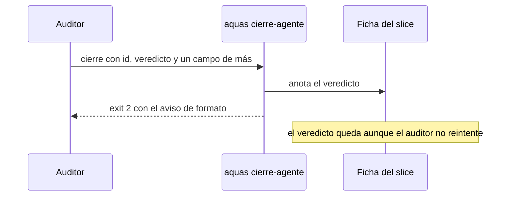

# S006 · El veredicto se anota aunque sobre texto

[Inicio](../../README.md) › [E001](../README.md) › [F004](README.md) › S006

Este [slice](../../glosario.md#slice) hace que el gancho `aquas cierre-agente` anote primero el veredicto del auditor. Revisa el formato del cierre después.

## En una frase

Un cierre con `id` y `veredicto` válidos deja su veredicto en la ficha, aunque traiga texto de más.

## Para qué existe

**El problema.** El 2026-10-29 el gancho rechazó dos cierres del auditor de E001/F002/S011. Cada uno traía un campo `evidencia:` de más (D000068).

**Qué pasó después.** El auditor no reintentó: el registro `.tmp/hooks/cierre-agente.jsonl` no tiene otra línea tras cada rechazo. Los dos veredictos se perdieron sin aviso.

**Por qué importa.** CERRADO exige el veredicto en la ficha. Sin él, el [orquestador](../../glosario.md#orquestador) relanza la auditoría y gasta otra ronda entera.

**La solución.** Elegida por el humano el 2026-10-29 (arreglo A): anotar primero, quejarse después.

**Contrato.**

| Regla | Valor |
|---|---|
| Dónde | `aquas cierre-agente`, rama del auditor |
| Orden | 1) si las dos primeras líneas traen `id` y `veredicto` válidos, anota; 2) luego revisa el formato completo |
| Formato inválido con veredicto anotado | exit 2 con el aviso de formato de siempre; registro `anotado <id> <veredicto> · cierre inválido: <motivo>` |
| Formato válido | sin cambio: exit 0 y registro `anotado <id> <veredicto>` |
| Sin `id` o `veredicto` válidos | sin cambio: no anota; formato inválido sale 2 con `rechazado: <motivo>` |
| Anotación que falla | sin cambio: exit 2 y `rechazado: <motivo>`; con `stop_hook_active`, exit 0 |
| Reintento | si el auditor reintenta, gana el último veredicto, como hoy |
| Otros tipos de agente | sin cambio |
| Alcance | `cmd/aquas/main.go`, `cmd/aquas/cierre_agente_test.go`, `docs/E001/F004/S006.md`, `docs/E001/F004/README.md` |

**Casos borde.**

| Categoría | Aplica | Prueba o motivo |
|---|---|---|
| cada tipo de ficha | no | solo un slice EN_CURSO recibe veredicto; `AnotarAuditoria` ya lo exige y no cambia |
| cada estado de origen | sí | slice sin ficha en curso con texto de más: no anota, exit 2, una línea `rechazado`: `TestCierreAgenteAnotaConTextoDeMas` |
| padre e hijo, activo y archivado | no | la anotación no cambia; E001/F014/S002 lo cubre |
| entrada ausente, vacía, mal escrita o duplicada | sí | campo de más, prosa antes del `id` (no anota) y veredicto inválido (no anota): `TestCierreAgenteAnotaConTextoDeMas` |
| choque con otro control | sí | el aviso de formato sigue saliendo con exit 2; los casos de `TestCierreAgenteRegistra` y `TestCierreAgenteCLI` siguen igual |
| quién habla: humano, agente o herramienta | sí | un worker cuyo cierre trae líneas `id` y `veredicto` nunca anota; solo el auditor: `TestCierreAgenteAnotaConTextoDeMas` |
| fallo a mitad de camino | sí | anotación que falla con texto de más: `rechazado`, sin `anotado`, y el aviso lleva también el motivo de formato: `TestCierreAgenteAnotaConTextoDeMas` |

## Analogía

Piensa en **un examen entregado con la hoja mal engrapada**.

- El profesor anota la nota primero.
- Después le dice al alumno que engrape bien la próxima vez.

Límite de la analogía: aquí la «nota» solo cuenta si el encabezado (`id` y `veredicto`) está bien escrito.

## Diagrama

## Ejemplo de punta a punta

continúa: [EJ-E001-F004](README.md#EJ-E001-F004)

1. El auditor cierra con `id: E001-F002-S011-A1`, `veredicto: CON_HALLAZGOS` y un `evidencia:` de más.
2. El gancho anota CON_HALLAZGOS en la ficha de E001/F002/S011.
3. Sale con exit 2 y el aviso «texto fuera del cierre».
4. El registro dice `anotado E001/F002/S011 CON_HALLAZGOS · cierre inválido: …`.
5. El orquestador ve el veredicto en la ficha sin relanzar la auditoría.

## Paso a paso

1. Rojo de la prueba, cambio de orden en `cmd/aquas/main.go`, verde.
2. La auditoría de este tramo usa el gancho real; su línea en el registro es la evidencia de campo.

## Cómo se usa

- Nada nuevo: el auditor cierra como siempre.
- Si sobra texto, `.tmp/hooks/cierre-agente.jsonl` lo dice, pero el veredicto ya está en la ficha.

## Contrato y evidencia

<!-- GENERADO por aquas desde trabajo/: no editar a mano; `aquas compilar` lo rehace. -->

| Prueba | Valida | Rojo cuando | Verde cuando | Rojo | Verde |
|---|---|---|---|---|---|
| `TestCierreAgenteAnotaConTextoDeMas` | valida que el veredicto se anota aunque el cierre traiga texto de más | rojo cuando un cierre con id y veredicto válidos y un campo de más no deja veredicto en la ficha | verde cuando la ficha tiene el veredicto, el gancho sale 2 con el aviso de formato y el registro dice anotado | 2026-10-30 | 2026-10-30 |

### Código

| Archivo | Función | Parámetros | Qué hace |
|---|---|---|---|
| [cmd/aquas/main.go](../../../cmd/aquas/main.go) | `main` | `()` | main despacha el subcomando de aquas (compilar, verificar, backlog, hooks…) y sale con su código. |
| [cmd/aquas/main.go](../../../cmd/aquas/main.go) | `hook` | `(raiz string)` | hook: exit 0 = nada que reportar; exit 2 = stderr se muestra a Claude. |
| [cmd/aquas/main.go](../../../cmd/aquas/main.go) | `compilarSettings` | `(w io.Writer)` | compilarSettings regenera .claude/settings.json; sin entorno declarado no inventa uno. |
| [cmd/aquas/main.go](../../../cmd/aquas/main.go) | `reportar` | `(w io.Writer, inf compilador.Informe)` | reportar imprime qué derivados escribió la compilación, o que todo estaba al día. |
| [cmd/aquas/main.go](../../../cmd/aquas/main.go) | `listar` | `(titulo string, problemas []string)` | listar imprime en stderr un título y cada problema en su viñeta. |
| [cmd/aquas/main.go](../../../cmd/aquas/main.go) | `lista` | `(xs []string) string` | lista une los textos con comas, o «—» si no hay ninguno. |
| [cmd/aquas/main.go](../../../cmd/aquas/main.go) | `fallar` | `(codigo int, err error)` | fallar imprime el error en stderr y termina con el código dado. |
| [cmd/aquas/main.go](../../../cmd/aquas/main.go) | `memoriaCLI` | `(raiz string, args []string)` | memoriaCLI: `ver` imprime la memoria; `fijar campo=valor…` la actualiza y la sella. |
| [cmd/aquas/main.go](../../../cmd/aquas/main.go) | `memoriaArchivada` | `(raiz, id string) error` | memoriaArchivada: CERRADO exige el archivo de memoria del slice, apunte o no la memoria a él (E001/F002/S009, X01). |
| [cmd/aquas/main.go](../../../cmd/aquas/main.go) | `focoEnBacklog` | `(raiz string, f memoria.Foco) error` | focoEnBacklog: la memoria solo fija el slice que el backlog tiene en curso (S003). |
| [cmd/aquas/main.go](../../../cmd/aquas/main.go) | `backlogCLI` | `(raiz string, args []string)` | backlogCLI: nuevo \\| ver [id] \\| prioridad \\| estado \\| siguiente \\| pruebas \\| rojo \\| verde. |
| [cmd/aquas/main.go](../../../cmd/aquas/main.go) | `turnoCLI` | `(raiz string, args []string)` | turnoCLI: auditoría de turnos (E001/F002/S001). Lee el JSON del hook por stdin. No imprime nada |
| [cmd/aquas/main.go](../../../cmd/aquas/main.go) | `defectoCLI` | `(raiz string, args []string) error` | defectoCLI: nuevo \\| ocurre \\| ver (E001/F004/S001). |
| [cmd/aquas/main.go](../../../cmd/aquas/main.go) | `versionBinario` | `() string` | versionBinario: versión del módulo con que se compiló el binario (= versión del gobierno embebido). |
| [cmd/aquas/main.go](../../../cmd/aquas/main.go) | `registrarCierre` | `(raiz, tipo, transcript, primera, resultado string)` | registrarCierre (E001/F004/S005, D000068) anota cada llamada del gancho cierre-agente en .tmp/hooks/cierre-agente.jsonl. |

<!-- /GENERADO -->

Prueba: `TestCierreAgenteAnotaConTextoDeMas`.

## Navegación

- ↑ Subir: [F004](README.md)
