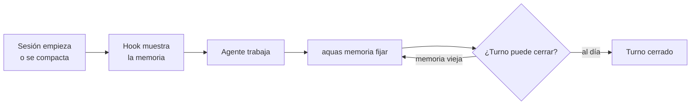
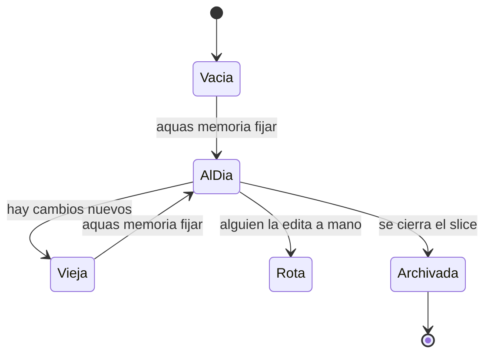
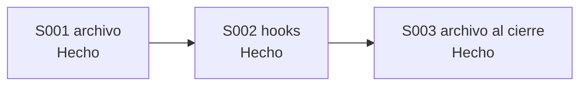

# F005 · Memoria caliente

[Inicio](../../README.md) › [E001](../README.md) › F005

[Feature](../../glosario.md#feature) que guarda en un archivo en qué va el [agente](../../glosario.md#agente). Así no pierde el hilo al compactar o al abrir otra sesión.

## En una frase

El agente apunta en una libreta qué está haciendo y qué sigue, y la relee al volver.

## Para qué existe

**El problema.** El chat tiene un límite de memoria. Cuando se llena, Claude Code lo resume y se pierden detalles. En una sesión nueva, el agente arranca sin saber en qué iba.

**La solución.** Un archivo con campos fijos: foco, tarea, siguiente paso, pendientes y decisiones abiertas. Tres reglas lo cuidan:

- Solo lo escribe `aquas memoria fijar`. La guardia frena cualquier edición a mano.
- Un [hook](../../glosario.md#hook) lo muestra al empezar la sesión y después de compactar.
- Otro hook no deja cerrar el turno si hubo cambios y la memoria quedó vieja.

Al cerrar un [slice](../../glosario.md#slice), la memoria se archiva en el repositorio.

## Analogía

Piensa en la **libreta de relevo de una enfermera**.

- Al terminar su turno, anota qué paciente atiende y qué falta.
- La enfermera que llega lee la libreta antes de hacer nada.
- Nadie arranca hojas: solo se escribe con el formato de la planta.

Límite de la analogía: la libreta la lee una persona con criterio. Aquí la lectura la fuerza un programa, no la buena voluntad.

## Diagrama

Proceso: cómo se usa la memoria en cada sesión.

Estados de la memoria:

Slices de esta feature:

| Slice | Qué entrega |
|---|---|
| [S001 Archivo, sello y guardia](S001.md) | Memoria con campos fijos que solo escribe `aquas` |
| [S002 Hooks de inicio y cierre](S002.md) | Se muestra al empezar y se exige al cerrar |
| [S003 Archivo y arranque en frío](S003.md) | Se archiva al cerrar el slice; prueba de sesión nueva |

## Ejemplo de punta a punta

continúa: [EJ-E001](../README.md#EJ-E001)

En la [iniciativa](../../glosario.md#iniciativa), el pedido de Jesús avanzó hasta su slice. Ahora se compacta el chat a mitad del trabajo.

1. Antes de compactar, el agente fijó: foco E001 › F001 › S001, siguiente «probar enlaces rotos».
2. Claude Code resume el chat y se pierden detalles.
3. El hook de inicio muestra la memoria tal como quedó.
4. El agente lee «siguiente: probar enlaces rotos» y sigue sin preguntar.

## Paso a paso

1. S001: el archivo, el comando `aquas memoria` y el bloqueo de la guardia.
2. S002: los hooks que la muestran y la exigen.
3. S003: el archivo al cerrar el slice y la prueba de arranque en frío.

## Cómo se usa

- Ver la memoria: `aquas memoria ver`.
- Cambiarla: `aquas memoria fijar tarea=… siguiente=… pendiente=…`.
- No se edita el archivo `.aquas/memoria.json` a mano. La guardia lo frena y el [sello](../../glosario.md#sello) lo delata.

## Contrato y evidencia

Estado: hecha. S001, S002 y S003 hechos.

Objetivo: el agente recupera su foco tras compactar o abrir sesión, sin depender del resumen del chat.

Por qué tres slices: cada parte se prueba sola. El archivo funciona sin hooks. Los hooks necesitan el archivo. El archivo al cierre necesita los dos.

Decisiones de Jesús (2026-10-20):

- Vive en `.aquas/memoria.json`, fuera de Git. Se archiva en `registro/memoria/` al cerrar el slice.
- «Épica» es lo mismo que iniciativa. No hay un nivel nuevo.
- El cierre de turno exige actualizarla si cambió el estado de Git.
- Tres slices, en este orden.

Prueba integral de la feature: `TestArranqueEnFrio`, en `cmd/aquas/arranque_test.go`. Pasa en verde.

## Navegación

<!-- GENERADO por aquas desde trabajo/: no editar a mano; `aquas compilar` lo rehace. -->

| Hijo | Qué es | Estado |
|---|---|---|
| [S001](S001.md) | Archivo, sello y guardia | Hecho |
| [S002](S002.md) | Hooks de inicio y cierre | Hecho |
| [S003](S003.md) | Archivo y arranque en frío | Hecho |

<!-- /GENERADO -->

- ↑ Subir: [E001 · Gobierno del trabajo](../README.md)
- Abajo: [S001 · Archivo, sello y guardia](S001.md)
- Abajo: [S002 · Hooks de inicio y cierre](S002.md)
- Abajo: [S003 · Archivo y arranque en frío](S003.md)
