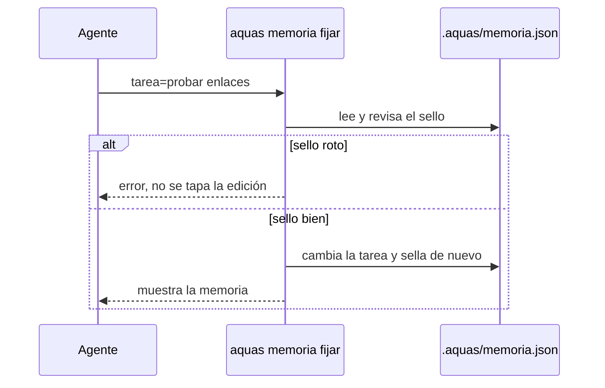
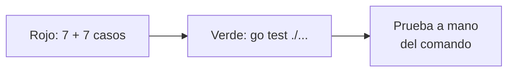

# S001 · Archivo, sello y guardia

[Inicio](../../README.md) › [E001](../README.md) › [F005](README.md) › S001

[Slice](../../glosario.md#slice) que crea la memoria caliente: un archivo con campos fijos que solo escribe `aquas`.

## En una frase

La libreta existe, tiene casillas fijas y nadie puede escribir en ella a mano.

## Para qué existe

**El problema.** Si el [agente](../../glosario.md#agente) escribe su memoria como quiera, cada vez queda distinta. Puede olvidar un campo o borrar uno sin darse cuenta.

**La solución.** Un paquete en [Go](../../glosario.md#go), `internal/memoria`, y un comando:

- `aquas memoria fijar campo=valor` cambia solo los campos nombrados y conserva el resto.
- `aquas memoria ver` la muestra junto con las rutas de la [wiki](../../glosario.md#wiki) y del [backlog](../../glosario.md#backlog).
- Cada escritura lleva un [sello](../../glosario.md#sello) [SHA-256](../../glosario.md#sha-256). Si alguien la cambia por otra vía, el sello no cuadra.
- La guardia frena Write, Edit y Bash hacia la carpeta `.aquas/`.

Contrato del slice:

| Campo | Valor |
|---|---|
| Objetivo | Memoria con campos fijos que solo escribe `aquas` |
| Incluye | Paquete `internal/memoria`, comando `aquas memoria ver` y `fijar`, sello, bloqueo en la guardia |
| Excluye | Hooks de inicio y cierre (S002); archivo al cerrar el slice (S003) |
| Prueba | `go test ./internal/memoria/ ./internal/guardia/` |

## Analogía

Piensa en un **formulario de papel con casillas**.

- Cada casilla tiene su nombre: foco, tarea, siguiente.
- Para cambiar una casilla no hace falta reescribir el formulario.
- El sello de la oficina prueba que nadie lo alteró después.

Límite de la analogía: un sello de goma se puede falsificar. Aquí el sello es una cuenta que depende de cada letra del archivo.

## Diagrama

Secuencia: qué pasa al fijar un campo.

## Ejemplo de punta a punta

continúa: [EJ-E001-F005](README.md#EJ-E001-F005)

En la [feature](../../glosario.md#feature), el agente fijó su foco antes de compactar. Así se ve en este slice.

1. El agente corre `aquas memoria fijar iniciativa=E001 feature=F001 slice=S001 siguiente="probar enlaces rotos"`.
2. El comando escribe el archivo y lo sella.
3. Por error, el agente intenta editar el archivo con Edit. La guardia lo frena.
4. Un script lo cambia por otra vía. `aquas memoria ver` responde: «editada fuera de aquas: el sello no coincide».

## Paso a paso

1. Pruebas en rojo: siete de memoria con un esqueleto vacío; siete casos de la guardia.
2. Paquete `internal/memoria`: campos fijos, formatos E, F y S, sello y escritura segura.
3. Bloqueo de `.aquas/` en la guardia.
4. Comando `aquas memoria ver` y `fijar`.
5. Prueba a mano del comando en una carpeta temporal.

## Cómo se usa

- Campos válidos: `iniciativa`, `feature`, `slice`, `tarea`, `siguiente`, `pendiente`, `decision`.
- `pendiente` y `decision` se pueden repetir. Los valores nombrados reemplazan la lista entera.
- `pendiente=` sin valor vacía la lista.
- [Iniciativa](../../glosario.md#iniciativa), feature y slice llevan su letra y tres dígitos, como `E001`.
- Si sale «el sello no coincide», alguien la editó a mano. Revisa qué cambió antes de rehacerla.

## Contrato y evidencia

<!-- GENERADO por aquas desde trabajo/: no editar a mano; `aquas compilar` lo rehace. -->

| Prueba | Qué demuestra | Rojo | Verde |
|---|---|---|---|
| — | ficha anterior al registro de pruebas | — | — |

<!-- /GENERADO -->

Estado: hecho.

Pruebas del slice, en `internal/memoria/memoria_test.go` e `internal/guardia/memoria_test.go`:

| Prueba | Qué demuestra |
|---|---|
| `TestFijarYLeer` | Lo fijado se lee igual, con fecha y sello |
| `TestFijarConservaLoNoTocado` | Un campo no nombrado se conserva; una lista nombrada se reemplaza |
| `TestFijarRechaza` | Campo desconocido, par sin «=» o formato malo dan error y no escriben |
| `TestSelloDetectaEdicionAMano` | Una edición por otra vía rompe el sello, y fijar no la tapa |
| `TestSinMemoria` | Sin archivo, el aviso dice cómo empezar |
| `TestRutasDelFoco` | Las rutas salen del foco y no se inventan si falta un nivel |
| `TestVerMuestraFocoYRutas` | `ver` muestra foco, tarea, siguiente, pendientes y rutas |
| `TestMemoriaSoloPorAquas` | La guardia frena Write, Edit y Bash hacia `.aquas/`; leer y usar `aquas` pasa |

Rojo visto: sí.

- Las siete pruebas de memoria fallaron con un esqueleto vacío, antes del código real.
- En la guardia, los siete casos de bloqueo fallaron; los tres que deben pasar ya pasaban.
- El verde destapó un error propio: el mensaje decía «I y 3 dígitos» en vez de «E». Se corrigió.

Decisiones de Jesús (2026-10-20): ruta, campos fijos, sello y bloqueo en la guardia, según la feature.

Límite: un programa que escribe por su cuenta no pasa por la guardia. El sello lo delata después, no lo impide.

## Navegación

- ↑ Subir: [F005 · Memoria caliente](README.md)
