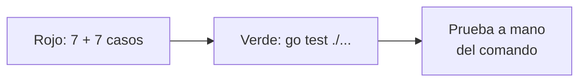

# S001 · Archivo, sello y guardia

[Inicio](../../README.md) › [E001](../README.md) › [F005](README.md) › S001

[Slice](../../glosario.md#slice) que crea la memoria caliente: un archivo con campos fijos que solo escribe `aquas`.

## En una frase

La libreta existe, tiene casillas fijas y nadie puede escribir en ella a mano.

## Para qué existe

**El problema.** Si el [agente](../../glosario.md#agente) escribe su memoria como quiera, cada vez queda distinta. Puede olvidar un campo o borrar uno sin darse cuenta.

**La solución.** Un paquete en [Go](../../glosario.md#go), `internal/memoria`, y un comando:

- `aquas memory set campo=valor` cambia solo los campos nombrados y conserva el resto.
- `aquas memory show` la muestra junto con las rutas de la [wiki](../../glosario.md#wiki) y del [backlog](../../glosario.md#backlog).
- Cada escritura lleva un [sello](../../glosario.md#sello) [SHA-256](../../glosario.md#sha-256). Si alguien la cambia por otra vía, el sello no cuadra.
- La guardia frena Write, Edit y Bash hacia la carpeta `.aquas/`.

Contrato del slice:

| Campo | Valor |
|---|---|
| Objetivo | Memoria con campos fijos que solo escribe `aquas` |
| Incluye | Paquete `internal/memoria`, comando `aquas memory show` y `fijar`, sello, bloqueo en la guardia |
| Excluye | Hooks de inicio y cierre (S002); archivo al cerrar el slice (S003) |
| Prueba | `go test ./internal/memoria/ ./internal/guardia/` |

## Analogía

Piensa en un **formulario de papel con casillas**.

- Cada casilla tiene su nombre: foco, tarea, siguiente.
- Para cambiar una casilla no hace falta reescribir el formulario.
- El sello de la oficina prueba que nadie lo alteró después.

Límite de la analogía: un sello de goma se puede falsificar. Aquí el sello es una cuenta que depende de cada letra del archivo.

## Diagrama

Secuencia: qué pasa al fijar un campo.

## Ejemplo de punta a punta

continúa: [EJ-E001-F005](README.md#EJ-E001-F005)

En la [feature](../../glosario.md#feature), el agente fijó su foco antes de compactar. Así se ve en este slice.

1. El agente corre `aquas memory set iniciativa=E001 feature=F001 slice=S001 siguiente="probar enlaces rotos"`.
2. El comando escribe el archivo y lo sella.
3. Por error, el agente intenta editar el archivo con Edit. La guardia lo frena.
4. Un script lo cambia por otra vía. `aquas memory show` responde: «editada fuera de aquas: el sello no coincide».

## Paso a paso

1. Pruebas en rojo: siete de memoria con un esqueleto vacío; siete casos de la guardia.
2. Paquete `internal/memoria`: campos fijos, formatos E, F y S, sello y escritura segura.
3. Bloqueo de `.aquas/` en la guardia.
4. Comando `aquas memory show` y `fijar`.
5. Prueba a mano del comando en una carpeta temporal.

## Cómo se usa

- Campos válidos: `iniciativa`, `feature`, `slice`, `tarea`, `siguiente`, `pendiente`, `decision`.
- `pendiente` y `decision` se pueden repetir. Los valores nombrados reemplazan la lista entera.
- `pendiente=` sin valor vacía la lista.
- [Iniciativa](../../glosario.md#iniciativa), feature y slice llevan su letra y tres dígitos, como `E001`.
- Si sale «el sello no coincide», alguien la editó a mano. Revisa qué cambió antes de rehacerla.

## Contrato y evidencia

<!-- GENERADO por aquas desde trabajo/: no editar a mano; `aquas compile` lo rehace. -->

| Prueba | Valida | Rojo cuando | Verde cuando | Rojo | Verde |
|---|---|---|---|---|---|
| — | ficha anterior al registro de pruebas | — | — | — | — |

### Código

| Archivo | Función | Parámetros | Qué hace |
|---|---|---|---|
| [cmd/aquas/main.go](../../../cmd/aquas/main.go) | `main` | `()` | main despacha el subcomando de aquas (compilar, verificar, backlog, hooks…) y sale con su código. |
| [cmd/aquas/main.go](../../../cmd/aquas/main.go) | `hook` | `(raiz string)` | hook: exit 0 = nada que reportar; exit 2 = stderr se muestra a Claude. |
| [cmd/aquas/main.go](../../../cmd/aquas/main.go) | `compilarSettings` | `(w io.Writer)` | compilarSettings regenera .claude/settings.json; sin entorno declarado no inventa uno. |
| [cmd/aquas/main.go](../../../cmd/aquas/main.go) | `reportar` | `(w io.Writer, inf compilador.Informe)` | reportar imprime qué derivados escribió la compilación, o que todo estaba al día. |
| [cmd/aquas/main.go](../../../cmd/aquas/main.go) | `listar` | `(titulo string, problemas []string)` | listar imprime en stderr un título y cada problema en su viñeta. |
| [cmd/aquas/main.go](../../../cmd/aquas/main.go) | `lista` | `(xs []string) string` | lista une los textos con comas, o «—» si no hay ninguno. |
| [cmd/aquas/main.go](../../../cmd/aquas/main.go) | `fallar` | `(codigo int, err error)` | fallar imprime el error en stderr y termina con el código dado. |
| [cmd/aquas/main.go](../../../cmd/aquas/main.go) | `memoriaCLI` | `(raiz string, args []string)` | memoriaCLI: `ver` imprime la memoria; `fijar campo=valor…` la actualiza y la sella. |
| [cmd/aquas/main.go](../../../cmd/aquas/main.go) | `memoriaArchivada` | `(raiz, id string) error` | memoriaArchivada: CERRADO exige el archivo de memoria del slice, apunte o no la memoria a él (E001/F002/S009, X01). |
| [cmd/aquas/main.go](../../../cmd/aquas/main.go) | `focoEnBacklog` | `(raiz string, f memoria.Foco) error` | focoEnBacklog: la memoria solo fija el slice que el backlog tiene en curso (S003). |
| [cmd/aquas/main.go](../../../cmd/aquas/main.go) | `backlogCLI` | `(raiz string, args []string)` | backlogCLI: nuevo \\| ver [id] \\| tabla \\| prioridad \\| estado \\| siguiente \\| pruebas \\| rojo \\| verde. |
| [cmd/aquas/main.go](../../../cmd/aquas/main.go) | `turnoCLI` | `(raiz string, args []string)` | turnoCLI: auditoría de turnos (E001/F002/S001). Lee el JSON del hook por stdin. No imprime nada |
| [cmd/aquas/main.go](../../../cmd/aquas/main.go) | `defectoCLI` | `(raiz string, args []string) error` | defectoCLI: nuevo \\| ocurre \\| ver (E001/F004/S001). |
| [cmd/aquas/main.go](../../../cmd/aquas/main.go) | `versionBinario` | `() string` | versionBinario: versión del módulo con que se compiló el binario (= versión del gobierno embebido). |
| [cmd/aquas/main.go](../../../cmd/aquas/main.go) | `registrarCierre` | `(raiz, tipo, transcript, primera, resultado string)` | registrarCierre (E001/F004/S005, D000068) anota cada llamada del gancho cierre-agente en .tmp/hooks/cierre-agente.jsonl. |
| [internal/guardia/guardia.go](../../../internal/guardia/guardia.go) | `Revisar` | `(raiz string, entrada []byte) string` | Revisar recibe el JSON del hook PreToolUse; "" = permitido, si no, el motivo del bloqueo. |
| [internal/guardia/guardia.go](../../../internal/guardia/guardia.go) | `RevisarArchivo` | `(raiz, p string) string` | RevisarArchivo valida una ruta de Write/Edit (absoluta o relativa a la raíz). |
| [internal/guardia/guardia.go](../../../internal/guardia/guardia.go) | `protegida` | `(raiz, abs, p string) string` | protegida: carpetas que solo escribe `aquas` (E001/F005, E001/F002). Las rutas salen de los |
| [internal/guardia/guardia.go](../../../internal/guardia/guardia.go) | `resolver` | `(base, p string) (string, bool)` | resolver lleva p a ruta absoluta del sistema. Entiende ~, /c/… (Git Bash) y relativas a base. |
| [internal/guardia/guardia.go](../../../internal/guardia/guardia.go) | `dentro` | `(raiz, abs string) bool` | dentro: la ruta absoluta queda dentro de la raíz del repo. |
| [internal/guardia/guardia.go](../../../internal/guardia/guardia.go) | `sinHeredocs` | `(c string) string` | sinHeredocs quita el cuerpo de cada heredoc: su contenido es texto, no comandos. |
| [internal/guardia/guardia.go](../../../internal/guardia/guardia.go) | `lexear` | `(c string) []palabra` | lexear parte un comando de shell en palabras, respetando comillas y operadores. |
| [internal/guardia/guardia.go](../../../internal/guardia/guardia.go) | `variable` | `(r []rune, i int) (string, int)` | variable reconoce $NOMBRE, ${NOMBRE}, $(…), `…` y %NOMBRE%; devuelve nombre ("?" = desconocida) y largo. |
| [internal/guardia/guardia.go](../../../internal/guardia/guardia.go) | `esNombre` | `(c rune) bool` | esNombre: el carácter vale en un nombre de variable de shell. |
| [internal/guardia/guardia.go](../../../internal/guardia/guardia.go) | `RevisarBash` | `(raiz, cwd, comando string) string` | RevisarBash analiza un comando de Bash; cwd es el directorio donde arranca. |
| [internal/guardia/guardia.go](../../../internal/guardia/guardia.go) | `segmento` | `(raiz string, cwd *string, cwdOK *bool, vars map[string]string, ps []palabra) string` | segmento revisa un comando simple: sigue cd y variables y devuelve el primer destino fuera del repo. |
| [internal/guardia/guardia.go](../../../internal/guardia/guardia.go) | `posicionales` | `(args []string) []string` | posicionales: argumentos que no son opciones (los que empiezan con «-», salvo «-» solo). |
| [internal/guardia/guardia.go](../../../internal/guardia/guardia.go) | `revisarDestino` | `(raiz, cwd string, cwdOK bool, vars map[string]string, d string) string` | revisarDestino: motivo de bloqueo si la ruta no se resuelve o cae fuera del repo; vacío si vale. |
| [internal/guardia/guardia.go](../../../internal/guardia/guardia.go) | `expandir` | `(s string, vars map[string]string, cwd string) (string, bool)` | expandir sustituye variables conocidas; HOME/USERPROFILE/TEMP/TMP salen del entorno real. |
| [internal/guardia/guardia.go](../../../internal/guardia/guardia.go) | `legible` | `(s string) string` | legible muestra las variables internas como $NOMBRE en los mensajes. |
| [internal/memoria/memoria.go](../../../internal/memoria/memoria.go) | `Fijar` | `(raiz string, pares []string, ahora time.Time) (Memoria, error)` | Fijar aplica pares campo=valor sobre la memoria actual y la sella. |
| [internal/memoria/memoria.go](../../../internal/memoria/memoria.go) | `FijarCon` | `(raiz string, pares []string, ahora time.Time, validar func(Foco) error) (Memoria, error)` | FijarCon: como Fijar, pero validar (si no es nil) revisa el foco resultante antes de escribir. |
| [internal/memoria/memoria.go](../../../internal/memoria/memoria.go) | `Leer` | `(raiz string) (Memoria, error)` | Leer carga la memoria y comprueba su sello. |
| [internal/memoria/memoria.go](../../../internal/memoria/memoria.go) | `decodificar` | `(b []byte) (Memoria, error)` | decodificar: campos fijos y sello sobre los bytes tal como se escribieron. |
| [internal/memoria/memoria.go](../../../internal/memoria/memoria.go) | `Rutas` | `(f Foco) Mapa` | Rutas: páginas wiki de la iniciativa, feature y slice del foco, más el backlog. |
| [internal/memoria/memoria.go](../../../internal/memoria/memoria.go) | `Texto` | `(m Memoria) string` | Texto: lo que imprime `aquas memory show` (y, en S002, el hook de inicio de sesión). |
| [internal/memoria/memoria.go](../../../internal/memoria/memoria.go) | `guion` | `(s string) string` | guion devuelve «—» si el texto está vacío. |
| [internal/memoria/memoria.go](../../../internal/memoria/memoria.go) | `lista` | `(b *strings.Builder, titulo string, xs []string)` | lista escribe un título y sus viñetas, o «—» si no hay ninguna. |
| [internal/memoria/memoria.go](../../../internal/memoria/memoria.go) | `codificar` | `(m Memoria) []byte` | codificar serializa la memoria como JSON indentado con salto final. |
| [internal/memoria/memoria.go](../../../internal/memoria/memoria.go) | `huella` | `(m Memoria) string` | huella: SHA-256 de la memoria codificada; detecta cambios. |
| [internal/memoria/memoria.go](../../../internal/memoria/memoria.go) | `escribir` | `(raiz string, m Memoria) error` | escribir: archivo temporal + rename, para no dejar una memoria a medias. |
| [internal/memoria/memoria.go](../../../internal/memoria/memoria.go) | `HuellaGit` | `(raiz string) string` | HuellaGit resume el estado del repo: HEAD + cada ruta de `git status` con el contenido de su |
| [internal/memoria/memoria.go](../../../internal/memoria/memoria.go) | `mismaCarpeta` | `(a, b string) bool` | mismaCarpeta: las dos rutas apuntan a la misma carpeta en disco. |
| [internal/memoria/memoria.go](../../../internal/memoria/memoria.go) | `Cierre` | `(raiz string, stopHookActive bool) string` | Cierre decide el hook Stop: "" deja cerrar el turno; si no, el motivo para seguir. |
| [internal/memoria/memoria.go](../../../internal/memoria/memoria.go) | `Inicio` | `(raiz string) string` | Inicio: texto que el hook SessionStart agrega al contexto. Nunca bloquea. |

<!-- /GENERADO -->

Estado: hecho.

Pruebas del slice, en `internal/memoria/memoria_test.go` e `internal/guardia/memoria_test.go`:

| Prueba | Qué demuestra |
|---|---|
| `TestFijarYLeer` | Lo fijado se lee igual, con fecha y sello |
| `TestFijarConservaLoNoTocado` | Un campo no nombrado se conserva; una lista nombrada se reemplaza |
| `TestFijarRechaza` | Campo desconocido, par sin «=» o formato malo dan error y no escriben |
| `TestSelloDetectaEdicionAMano` | Una edición por otra vía rompe el sello, y fijar no la tapa |
| `TestSinMemoria` | Sin archivo, el aviso dice cómo empezar |
| `TestRutasDelFoco` | Las rutas salen del foco y no se inventan si falta un nivel |
| `TestVerMuestraFocoYRutas` | `ver` muestra foco, tarea, siguiente, pendientes y rutas |
| `TestMemoriaSoloPorAquas` | La guardia frena Write, Edit y Bash hacia `.aquas/`; leer y usar `aquas` pasa |

Rojo visto: sí.

- Las siete pruebas de memoria fallaron con un esqueleto vacío, antes del código real.
- En la guardia, los siete casos de bloqueo fallaron; los tres que deben pasar ya pasaban.
- El verde destapó un error propio: el mensaje decía «I y 3 dígitos» en vez de «E». Se corrigió.

Decisiones de Jesús (2026-10-20): ruta, campos fijos, sello y bloqueo en la guardia, según la feature.

Límite: un programa que escribe por su cuenta no pasa por la guardia. El sello lo delata después, no lo impide.

## Navegación

- ↑ Subir: [F005 · Memoria caliente](README.md)
