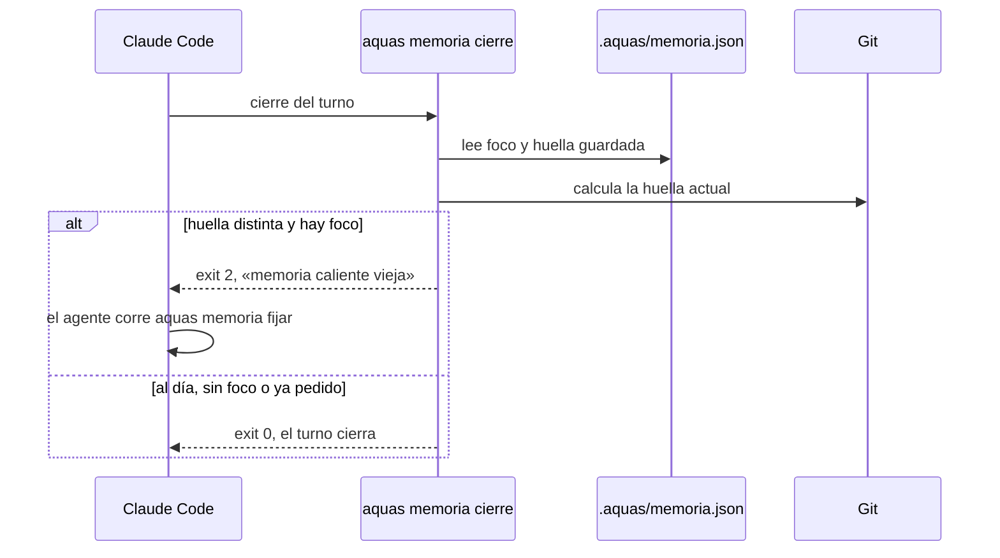
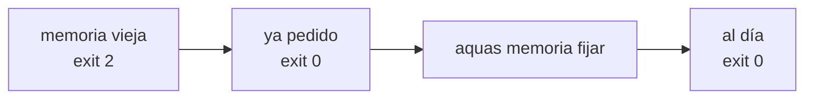

# S002 · Hooks de inicio y cierre

[Inicio](../../README.md) › [E001](../README.md) › [F005](README.md) › S002

[Slice](../../glosario.md#slice) que conecta la memoria caliente con Claude Code: se muestra al empezar y se exige al cerrar.

## En una frase

La libreta se abre sola al llegar, y no te dejan irte si no anotaste lo que cambió.

## Para qué existe

**El problema.** En S001 la memoria ya existía, pero dependía de que el [agente](../../glosario.md#agente) se acordara de leerla y de escribirla. Justo lo que se olvida al compactar.

**La solución.** Dos [hooks](../../glosario.md#hook):

- Al empezar la sesión, al reanudar, tras `/clear` y tras compactar, `aquas memoria inicio` muestra la memoria.
- Al cerrar el turno, `aquas memoria cierre` revisa si el repositorio cambió desde la última actualización. Si cambió, el turno sigue hasta actualizarla.

La memoria guarda una huella del repositorio: el último [commit](../../glosario.md#commit) más cada archivo con cambios y su contenido. La carpeta `.aquas/` no cuenta.

Contrato del slice:

| Campo | Valor |
|---|---|
| Objetivo | La memoria se muestra sola al empezar y se exige al día al cerrar |
| Incluye | Huella de Git, `aquas memoria inicio` y `cierre`, hooks en la plantilla de settings, sello sobre los bytes |
| Excluye | Archivo al cerrar el slice y prueba de arranque en frío (S003) |
| Prueba | `go test ./internal/memoria/ ./internal/entorno/` |

## Analogía

Piensa en el **torniquete de salida de una fábrica**.

- Al entrar, el turno anterior te deja su nota en el casillero.
- Al salir, el torniquete revisa si tocaste máquinas.
- Si tocaste algo y no lo anotaste, no gira.

Límite de la analogía: el torniquete solo ve máquinas tocadas, es decir, archivos. Una decisión tomada en la conversación no deja huella, así que no la exige.

## Diagrama

Secuencia: qué pasa al cerrar un turno.

## Ejemplo de punta a punta

continúa: [EJ-E001-F005](README.md#EJ-E001-F005)

En la [feature](../../glosario.md#feature), el hook de inicio mostró la memoria tras compactar. Así lo hizo este slice, y así actúa al cerrar.

1. Claude Code compacta el chat y dispara el hook de inicio.
2. `aquas memoria inicio` imprime el foco, la tarea y el siguiente paso. Eso entra al contexto.
3. El agente cambia `wiki.go` y quiere cerrar el turno.
4. `aquas memoria cierre` ve que la huella cambió. Responde: «memoria caliente vieja».
5. El agente corre `aquas memoria fijar siguiente=…` y el turno cierra.

## Paso a paso

1. Pruebas en rojo con un esqueleto vacío.
2. Huella de Git y su guardado al fijar.
3. Decisión del cierre e inicio, con sus casos.
4. [Sello](../../glosario.md#sello) sobre los bytes escritos, para que un campo nuevo no rompa una memoria vieja.
5. `matcher` propio en la plantilla de settings, y los dos hooks en `gobierno/config/claude_settings.json`.
6. Prueba en vivo del cierre sobre el repositorio real.

## Cómo se usa

- No hay que hacer nada para verla: aparece sola al empezar.
- Si el turno no cierra por «memoria caliente vieja», corre `aquas memoria fijar` con la tarea y el siguiente paso al día.
- Si el aviso es «el sello no coincide», no la rehagas: avisa al humano para que revise el archivo.
- El cierre bloquea una sola vez seguida. Si ya lo pidió, deja cerrar para no entrar en bucle.

## Contrato y evidencia

<!-- GENERADO por aquas desde trabajo/: no editar a mano; `aquas compilar` lo rehace. -->

| Prueba | Valida | Rojo cuando | Verde cuando | Rojo | Verde |
|---|---|---|---|---|---|
| — | ficha anterior al registro de pruebas | — | — | — | — |

### Código

| Archivo | Función | Parámetros | Qué hace |
|---|---|---|---|
| [cmd/aquas/main.go](../../../cmd/aquas/main.go) | `main` | `()` | main despacha el subcomando de aquas (compilar, verificar, backlog, hooks…) y sale con su código. |
| [cmd/aquas/main.go](../../../cmd/aquas/main.go) | `hook` | `(raiz string)` | hook: exit 0 = nada que reportar; exit 2 = stderr se muestra a Claude. |
| [cmd/aquas/main.go](../../../cmd/aquas/main.go) | `compilarSettings` | `(w io.Writer)` | compilarSettings regenera .claude/settings.json; sin entorno declarado no inventa uno. |
| [cmd/aquas/main.go](../../../cmd/aquas/main.go) | `reportar` | `(w io.Writer, inf compilador.Informe)` | reportar imprime qué derivados escribió la compilación, o que todo estaba al día. |
| [cmd/aquas/main.go](../../../cmd/aquas/main.go) | `listar` | `(titulo string, problemas []string)` | listar imprime en stderr un título y cada problema en su viñeta. |
| [cmd/aquas/main.go](../../../cmd/aquas/main.go) | `lista` | `(xs []string) string` | lista une los textos con comas, o «—» si no hay ninguno. |
| [cmd/aquas/main.go](../../../cmd/aquas/main.go) | `fallar` | `(codigo int, err error)` | fallar imprime el error en stderr y termina con el código dado. |
| [cmd/aquas/main.go](../../../cmd/aquas/main.go) | `memoriaCLI` | `(raiz string, args []string)` | memoriaCLI: `ver` imprime la memoria; `fijar campo=valor…` la actualiza y la sella. |
| [cmd/aquas/main.go](../../../cmd/aquas/main.go) | `memoriaArchivada` | `(raiz, id string) error` | memoriaArchivada: CERRADO exige el archivo de memoria del slice, apunte o no la memoria a él (E001/F002/S009, X01). |
| [cmd/aquas/main.go](../../../cmd/aquas/main.go) | `focoEnBacklog` | `(raiz string, f memoria.Foco) error` | focoEnBacklog: la memoria solo fija el slice que el backlog tiene en curso (S003). |
| [cmd/aquas/main.go](../../../cmd/aquas/main.go) | `backlogCLI` | `(raiz string, args []string)` | backlogCLI: nuevo \\| ver [id] \\| prioridad \\| estado \\| siguiente \\| pruebas \\| rojo \\| verde. |
| [cmd/aquas/main.go](../../../cmd/aquas/main.go) | `turnoCLI` | `(raiz string, args []string)` | turnoCLI: auditoría de turnos (E001/F002/S001). Lee el JSON del hook por stdin. No imprime nada |
| [cmd/aquas/main.go](../../../cmd/aquas/main.go) | `defectoCLI` | `(raiz string, args []string) error` | defectoCLI: nuevo \\| ocurre \\| ver (E001/F004/S001). |
| [cmd/aquas/main.go](../../../cmd/aquas/main.go) | `versionBinario` | `() string` | versionBinario: versión del módulo con que se compiló el binario (= versión del gobierno embebido). |
| [gobierno/config/claude_settings.json](../../../gobierno/config/claude_settings.json) | — | — | — |
| [internal/entorno/entorno.go](../../../internal/entorno/entorno.go) | `Leer` | `(raiz string) (Entorno, error)` | Leer carga el entorno declarado. |
| [internal/entorno/entorno.go](../../../internal/entorno/entorno.go) | `Validar` | `(raiz string) string` | Validar compara el entorno declarado con el real; "" = coincide, si no, el motivo del bloqueo. |
| [internal/entorno/entorno.go](../../../internal/entorno/entorno.go) | `Iniciar` | `(raiz string) (Entorno, error)` | Iniciar detecta SO y raíz (git) y escribe entorno.local.json; exige correr desde la raíz. |
| [internal/entorno/entorno.go](../../../internal/entorno/entorno.go) | `mismaRuta` | `(a, b string) bool` | mismaRuta compara dos rutas limpias; en Windows sin distinguir mayúsculas. |
| [internal/entorno/entorno.go](../../../internal/entorno/entorno.go) | `generarSettings` | `(fuente []byte, so string) ([]byte, error)` | generarSettings arma settings.json para un SO desde la plantilla canónica. Bytes estables. |
| [internal/entorno/entorno.go](../../../internal/entorno/entorno.go) | `Settings` | `(raiz string) ([]byte, error)` | Settings genera el settings.json esperado para el entorno declarado. |
| [internal/entorno/entorno.go](../../../internal/entorno/entorno.go) | `CompilarSettings` | `(raiz string) (bool, error)` | CompilarSettings escribe .claude/settings.json; devuelve true si cambió. |
| [internal/entorno/entorno.go](../../../internal/entorno/entorno.go) | `VerificarSettings` | `(raiz string) string` | VerificarSettings: "" si .claude/settings.json coincide con lo regenerado. |
| [internal/memoria/memoria.go](../../../internal/memoria/memoria.go) | `Fijar` | `(raiz string, pares []string, ahora time.Time) (Memoria, error)` | Fijar aplica pares campo=valor sobre la memoria actual y la sella. |
| [internal/memoria/memoria.go](../../../internal/memoria/memoria.go) | `FijarCon` | `(raiz string, pares []string, ahora time.Time, validar func(Foco) error) (Memoria, error)` | FijarCon: como Fijar, pero validar (si no es nil) revisa el foco resultante antes de escribir. |
| [internal/memoria/memoria.go](../../../internal/memoria/memoria.go) | `Leer` | `(raiz string) (Memoria, error)` | Leer carga la memoria y comprueba su sello. |
| [internal/memoria/memoria.go](../../../internal/memoria/memoria.go) | `decodificar` | `(b []byte) (Memoria, error)` | decodificar: campos fijos y sello sobre los bytes tal como se escribieron. |
| [internal/memoria/memoria.go](../../../internal/memoria/memoria.go) | `Rutas` | `(f Foco) Mapa` | Rutas: páginas wiki de la iniciativa, feature y slice del foco, más el backlog. |
| [internal/memoria/memoria.go](../../../internal/memoria/memoria.go) | `Texto` | `(m Memoria) string` | Texto: lo que imprime `aquas memoria ver` (y, en S002, el hook de inicio de sesión). |
| [internal/memoria/memoria.go](../../../internal/memoria/memoria.go) | `guion` | `(s string) string` | guion devuelve «—» si el texto está vacío. |
| [internal/memoria/memoria.go](../../../internal/memoria/memoria.go) | `lista` | `(b *strings.Builder, titulo string, xs []string)` | lista escribe un título y sus viñetas, o «—» si no hay ninguna. |
| [internal/memoria/memoria.go](../../../internal/memoria/memoria.go) | `codificar` | `(m Memoria) []byte` | codificar serializa la memoria como JSON indentado con salto final. |
| [internal/memoria/memoria.go](../../../internal/memoria/memoria.go) | `huella` | `(m Memoria) string` | huella: SHA-256 de la memoria codificada; detecta cambios. |
| [internal/memoria/memoria.go](../../../internal/memoria/memoria.go) | `escribir` | `(raiz string, m Memoria) error` | escribir: archivo temporal + rename, para no dejar una memoria a medias. |
| [internal/memoria/memoria.go](../../../internal/memoria/memoria.go) | `HuellaGit` | `(raiz string) string` | HuellaGit resume el estado del repo: HEAD + cada ruta de `git status` con el contenido de su |
| [internal/memoria/memoria.go](../../../internal/memoria/memoria.go) | `mismaCarpeta` | `(a, b string) bool` | mismaCarpeta: las dos rutas apuntan a la misma carpeta en disco. |
| [internal/memoria/memoria.go](../../../internal/memoria/memoria.go) | `Cierre` | `(raiz string, stopHookActive bool) string` | Cierre decide el hook Stop: "" deja cerrar el turno; si no, el motivo para seguir. |
| [internal/memoria/memoria.go](../../../internal/memoria/memoria.go) | `Inicio` | `(raiz string) string` | Inicio: texto que el hook SessionStart agrega al contexto. Nunca bloquea. |

<!-- /GENERADO -->

Estado: hecho.

Pruebas del slice, en `internal/memoria/hooks_test.go` e `internal/entorno/hooks_test.go`:

| Prueba | Qué demuestra |
|---|---|
| `TestHuellaCambiaConElEstadoDeGit` | Un cambio, otro cambio al mismo archivo o un commit mueven la huella; escribir la memoria no |
| `TestHuellaFueraDeGitVacia` | Fuera de la raíz de un repo, la huella va vacía |
| `TestFijarGuardaLaHuella` | Fijar guarda la huella actual |
| `TestCierre` | Bloquea si está vieja o con sello roto; deja cerrar sin memoria, sin foco, al día o si ya pidió |
| `TestCierreDiceComoArreglar` | El bloqueo dice qué comando lo resuelve |
| `TestInicio` | Muestra la memoria; sin ella o con sello roto, avisa |
| `TestSelloSobreviveCampoNuevo` | Una memoria escrita antes de un campo nuevo se sigue leyendo |
| `TestSettingsEventoConMatcherPropio` | Un evento sin herramienta lleva su propio `matcher`, o ninguno |
| `TestSettingsRealTraeHooksDeMemoria` | La plantilla real declara los dos hooks |

Rojo visto: sí.

- Con el esqueleto vacío fallaron nueve pruebas; los casos que deben dejar cerrar ya pasaban.
- `TestSelloSobreviveCampoNuevo` reprodujo un fallo real de S001: agregar `huella_git` hizo pasar la memoria del repo por editada a mano.
- Tras el arreglo, esa misma memoria volvió a leerse sin tocarla.

En vivo, sobre el repositorio real:

Decisión de Jesús (2026-10-20): exigir la memoria si cambió el estado de Git. Si el cierre ya lo pidió, deja cerrar.

Límite: un turno que solo decide algo en la conversación no cambia archivos, así que el cierre no lo exige. Es criterio humano.

## Navegación

- ↑ Subir: [F005 · Memoria caliente](README.md)
