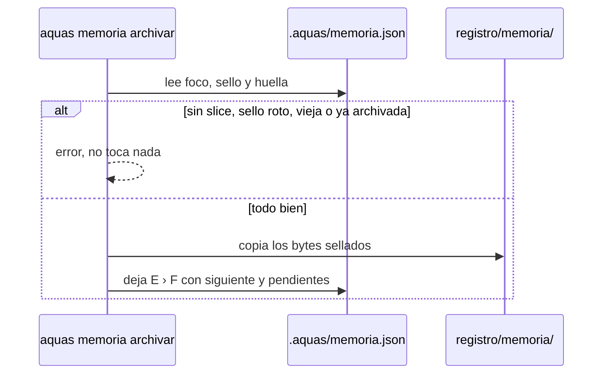
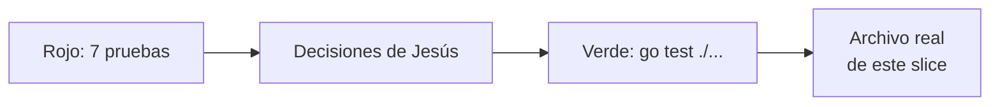

# S003 · Archivo y arranque en frío

[Inicio](../../README.md) › [E001](../README.md) › [F005](README.md) › S003

[Slice](../../glosario.md#slice) que cierra la memoria caliente. Al terminar un slice se archiva, y una sesión nueva recupera el foco.

## En una frase

Al cerrar el turno largo, la libreta se guarda en el archivo, y quien llega mañana sabe dónde seguir.

## Para qué existe

**El problema.** La memoria caliente vive fuera de Git. Al cerrar un slice no queda rastro de en qué terminó. Además, nadie probó todavía que una sesión nueva, sin chat, recupere el foco.

**La solución.** Dos piezas:

- `aquas memoria archivar` copia la memoria sellada a `registro/memoria/<E>-<F>-<S>.json`, que sí va a Git.
- Una prueba de arranque en frío recorre la [feature](../../glosario.md#feature) entera con el comando real, como lo haría una sesión nueva.

Contrato del slice:

| Campo | Valor |
|---|---|
| Objetivo | La memoria del slice queda archivada y una sesión nueva recupera el foco |
| Incluye | `aquas memoria archivar`, lectura del archivo con su sello, bloqueo en la guardia, prueba de arranque en frío |
| Excluye | Un gate que exija el archivo al marcar un slice como hecho |
| Prueba | `go test ./internal/memoria/ ./internal/guardia/ ./cmd/aquas/` |

## Analogía

Piensa en el **archivo de historias clínicas de un hospital**.

- Al dar de alta, la libreta del turno pasa a la carpeta del paciente.
- La carpeta se guarda tal cual, sin pasarla en limpio.
- La libreta nueva arranca en la misma planta, sin el paciente que se fue.

Límite de la analogía: en el hospital la carpeta se puede corregir a mano. Aquí el [sello](../../glosario.md#sello) delata cualquier cambio.

## Diagrama

Proceso: qué hace `aquas memoria archivar`.

## Ejemplo de punta a punta

continúa: [EJ-E001-F005](README.md#EJ-E001-F005)

En la feature, el [agente](../../glosario.md#agente) siguió tras compactar. Ahora termina el slice y al día siguiente abre otra sesión.

1. El agente corre `aquas memoria fijar` con el estado final del slice.
2. Corre `aquas memoria archivar`. Queda `registro/memoria/E001-F001-S001.json`.
3. Hace el [commit](../../glosario.md#commit) del slice junto con ese archivo.
4. Al otro día abre una sesión nueva. El [hook](../../glosario.md#hook) de inicio muestra «foco: E001 › F001».
5. El agente sabe que toca elegir el slice siguiente de esa feature.

## Paso a paso

1. Contrato y pruebas en rojo con un esqueleto vacío.
2. `aquas memoria archivar` y la lectura del archivo con su sello.
3. Bloqueo de `registro/memoria/` en la guardia.
4. Prueba de arranque en frío con el comando real.
5. Archivo real de este mismo slice al cerrarlo.

## Cómo se usa

- Al cerrar un slice: primero `aquas memoria fijar`, luego `aquas memoria archivar`, luego `aquas backlog estado … CERRADO` y el commit. Desde [E001/F002/S009](../F002/S009.md), cerrar se niega si la memoria del slice no está archivada.
- Si responde «memoria caliente vieja», fija primero el estado final.
- Si responde «ya existe», ese slice ya se archivó. No se pisa.
- El archivo no se edita a mano. La guardia lo frena y el sello lo delata.

## Contrato y evidencia

<!-- GENERADO por aquas desde trabajo/: no editar a mano; `aquas compilar` lo rehace. -->

| Prueba | Qué demuestra | Rojo | Verde |
|---|---|---|---|
| — | ficha anterior al registro de pruebas | — | — |

<!-- /GENERADO -->

Estado: hecho.

Pruebas del slice, en `internal/memoria/archivar_test.go`, `internal/guardia/archivo_test.go` y `cmd/aquas/arranque_test.go`:

| Prueba | Qué demuestra |
|---|---|
| `TestRutaArchivo` | La ruta sale del foco; sin slice no hay ruta |
| `TestArchivarCopiaSellada` | El archivo guarda los mismos bytes sellados y se lee con su sello |
| `TestArchivarDejaFocoParaElSiguiente` | Tras archivar quedan iniciativa, feature, siguiente, pendientes y decisiones |
| `TestArchivarRechaza` | Sin memoria, sin slice, sello roto, memoria vieja o archivo existente dan error y no tocan nada |
| `TestArchivoDetectaEdicion` | Un archivo editado a mano da sello roto |
| `TestArchivoMemoriaSoloPorAquas` | La guardia frena Write, Edit y Bash hacia `registro/memoria/` |
| `TestMain` | El binario de prueba hace de `aquas` para correr el comando real |
| `TestArranqueEnFrio` | Una sesión nueva recupera el foco solo con la orden del hook de inicio |

Rojo visto: sí.

- Con el esqueleto vacío fallaron las siete pruebas.
- En el arranque en frío, la parte de S001 y S002 ya pasaba. Falló al llegar a `archivar`.
- Tras programar el comando y la guardia, pasan las siete y `go test ./...` completo.
- El primer archivo real vació «siguiente» y la memoria quedó sin saber qué venía. Ahora se conserva; lo exigen dos pruebas.

Decisiones de Jesús (2026-10-21): aceptó las cuatro recomendaciones. Qué queda tras archivar, cuándo se niega, guardia sobre `registro/memoria/` y un solo commit con el verde. Se revisan según lo que muestre el uso.

Límite: la prueba de arranque en frío corre el comando, no Claude Code. Que la app ejecute el hook se vio en vivo tras compactar, no en una prueba.

## Navegación

- ↑ Subir: [F005 · Memoria caliente](README.md)
