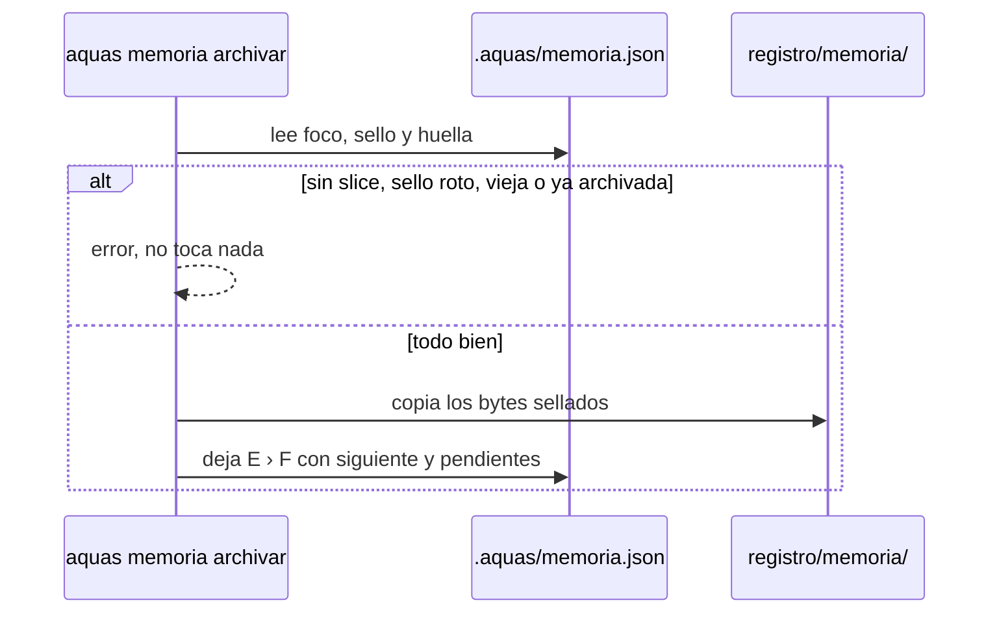
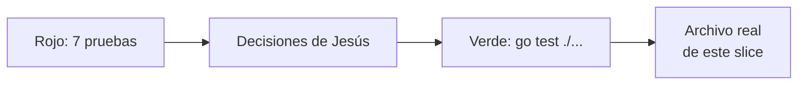

# S003 · Archivo y arranque en frío

[Inicio](../../README.md) › [E001](../README.md) › [F005](README.md) › S003

[Slice](../../glosario.md#slice) que cierra la memoria caliente. Al terminar un slice se archiva, y una sesión nueva recupera el foco.

## En una frase

Al cerrar el turno largo, la libreta se guarda en el archivo, y quien llega mañana sabe dónde seguir.

## Para qué existe

**El problema.** La memoria caliente vive fuera de Git. Al cerrar un slice no queda rastro de en qué terminó. Además, nadie probó todavía que una sesión nueva, sin chat, recupere el foco.

**La solución.** Dos piezas:

- `aquas memoria archivar` copia la memoria sellada a `registro/memoria/<E>-<F>-<S>.json`, que sí va a Git.
- Una prueba de arranque en frío recorre la [feature](../../glosario.md#feature) entera con el comando real, como lo haría una sesión nueva.

Contrato del slice:

| Campo | Valor |
|---|---|
| Objetivo | La memoria del slice queda archivada y una sesión nueva recupera el foco |
| Incluye | `aquas memoria archivar`, lectura del archivo con su sello, bloqueo en la guardia, prueba de arranque en frío |
| Excluye | Un gate que exija el archivo al marcar un slice como hecho |
| Prueba | `go test ./internal/memoria/ ./internal/guardia/ ./cmd/aquas/` |

## Analogía

Piensa en el **archivo de historias clínicas de un hospital**.

- Al dar de alta, la libreta del turno pasa a la carpeta del paciente.
- La carpeta se guarda tal cual, sin pasarla en limpio.
- La libreta nueva arranca en la misma planta, sin el paciente que se fue.

Límite de la analogía: en el hospital la carpeta se puede corregir a mano. Aquí el [sello](../../glosario.md#sello) delata cualquier cambio.

## Diagrama

Proceso: qué hace `aquas memoria archivar`.

## Ejemplo de punta a punta

continúa: [EJ-E001-F005](README.md#EJ-E001-F005)

En la feature, el [agente](../../glosario.md#agente) siguió tras compactar. Ahora termina el slice y al día siguiente abre otra sesión.

1. El agente corre `aquas memoria fijar` con el estado final del slice.
2. Corre `aquas memoria archivar`. Queda `registro/memoria/E001-F001-S001.json`.
3. Hace el [commit](../../glosario.md#commit) del slice junto con ese archivo.
4. Al otro día abre una sesión nueva. El [hook](../../glosario.md#hook) de inicio muestra «foco: E001 › F001».
5. El agente sabe que toca elegir el slice siguiente de esa feature.

## Paso a paso

1. Contrato y pruebas en rojo con un esqueleto vacío.
2. `aquas memoria archivar` y la lectura del archivo con su sello.
3. Bloqueo de `registro/memoria/` en la guardia.
4. Prueba de arranque en frío con el comando real.
5. Archivo real de este mismo slice al cerrarlo.

## Cómo se usa

- Al cerrar un slice: primero `aquas memoria fijar`, luego `aquas memoria archivar`, luego `aquas backlog estado … CERRADO` y el commit. Desde [E001/F002/S009](../F002/S009.md), cerrar se niega si la memoria del slice no está archivada.
- Si responde «memoria caliente vieja», fija primero el estado final.
- Si responde «ya existe», ese slice ya se archivó. No se pisa.
- El archivo no se edita a mano. La guardia lo frena y el sello lo delata.

## Contrato y evidencia

<!-- GENERADO por aquas desde trabajo/: no editar a mano; `aquas compilar` lo rehace. -->

| Prueba | Valida | Rojo cuando | Verde cuando | Rojo | Verde |
|---|---|---|---|---|---|
| — | ficha anterior al registro de pruebas | — | — | — | — |

### Código

| Archivo | Función | Parámetros | Qué hace |
|---|---|---|---|
| [cmd/aquas/main.go](../../../cmd/aquas/main.go) | `main` | `()` | main despacha el subcomando de aquas (compilar, verificar, backlog, hooks…) y sale con su código. |
| [cmd/aquas/main.go](../../../cmd/aquas/main.go) | `hook` | `(raiz string)` | hook: exit 0 = nada que reportar; exit 2 = stderr se muestra a Claude. |
| [cmd/aquas/main.go](../../../cmd/aquas/main.go) | `compilarSettings` | `(w io.Writer)` | compilarSettings regenera .claude/settings.json; sin entorno declarado no inventa uno. |
| [cmd/aquas/main.go](../../../cmd/aquas/main.go) | `reportar` | `(w io.Writer, inf compilador.Informe)` | reportar imprime qué derivados escribió la compilación, o que todo estaba al día. |
| [cmd/aquas/main.go](../../../cmd/aquas/main.go) | `listar` | `(titulo string, problemas []string)` | listar imprime en stderr un título y cada problema en su viñeta. |
| [cmd/aquas/main.go](../../../cmd/aquas/main.go) | `lista` | `(xs []string) string` | lista une los textos con comas, o «—» si no hay ninguno. |
| [cmd/aquas/main.go](../../../cmd/aquas/main.go) | `fallar` | `(codigo int, err error)` | fallar imprime el error en stderr y termina con el código dado. |
| [cmd/aquas/main.go](../../../cmd/aquas/main.go) | `memoriaCLI` | `(raiz string, args []string)` | memoriaCLI: `ver` imprime la memoria; `fijar campo=valor…` la actualiza y la sella. |
| [cmd/aquas/main.go](../../../cmd/aquas/main.go) | `memoriaArchivada` | `(raiz, id string) error` | memoriaArchivada: CERRADO exige el archivo de memoria del slice, apunte o no la memoria a él (E001/F002/S009, X01). |
| [cmd/aquas/main.go](../../../cmd/aquas/main.go) | `focoEnBacklog` | `(raiz string, f memoria.Foco) error` | focoEnBacklog: la memoria solo fija el slice que el backlog tiene en curso (S003). |
| [cmd/aquas/main.go](../../../cmd/aquas/main.go) | `backlogCLI` | `(raiz string, args []string)` | backlogCLI: nuevo \\| ver [id] \\| prioridad \\| estado \\| siguiente \\| pruebas \\| rojo \\| verde. |
| [cmd/aquas/main.go](../../../cmd/aquas/main.go) | `turnoCLI` | `(raiz string, args []string)` | turnoCLI: auditoría de turnos (E001/F002/S001). Lee el JSON del hook por stdin. No imprime nada |
| [cmd/aquas/main.go](../../../cmd/aquas/main.go) | `defectoCLI` | `(raiz string, args []string) error` | defectoCLI: nuevo \\| ocurre \\| ver (E001/F004/S001). |
| [cmd/aquas/main.go](../../../cmd/aquas/main.go) | `versionBinario` | `() string` | versionBinario: versión del módulo con que se compiló el binario (= versión del gobierno embebido). |
| [internal/guardia/guardia.go](../../../internal/guardia/guardia.go) | `Revisar` | `(raiz string, entrada []byte) string` | Revisar recibe el JSON del hook PreToolUse; "" = permitido, si no, el motivo del bloqueo. |
| [internal/guardia/guardia.go](../../../internal/guardia/guardia.go) | `RevisarArchivo` | `(raiz, p string) string` | RevisarArchivo valida una ruta de Write/Edit (absoluta o relativa a la raíz). |
| [internal/guardia/guardia.go](../../../internal/guardia/guardia.go) | `protegida` | `(raiz, abs, p string) string` | protegida: carpetas que solo escribe `aquas` (E001/F005, E001/F002). Las rutas salen de los |
| [internal/guardia/guardia.go](../../../internal/guardia/guardia.go) | `resolver` | `(base, p string) (string, bool)` | resolver lleva p a ruta absoluta del sistema. Entiende ~, /c/… (Git Bash) y relativas a base. |
| [internal/guardia/guardia.go](../../../internal/guardia/guardia.go) | `dentro` | `(raiz, abs string) bool` | dentro: la ruta absoluta queda dentro de la raíz del repo. |
| [internal/guardia/guardia.go](../../../internal/guardia/guardia.go) | `sinHeredocs` | `(c string) string` | sinHeredocs quita el cuerpo de cada heredoc: su contenido es texto, no comandos. |
| [internal/guardia/guardia.go](../../../internal/guardia/guardia.go) | `lexear` | `(c string) []palabra` | lexear parte un comando de shell en palabras, respetando comillas y operadores. |
| [internal/guardia/guardia.go](../../../internal/guardia/guardia.go) | `variable` | `(r []rune, i int) (string, int)` | variable reconoce $NOMBRE, ${NOMBRE}, $(…), `…` y %NOMBRE%; devuelve nombre ("?" = desconocida) y largo. |
| [internal/guardia/guardia.go](../../../internal/guardia/guardia.go) | `esNombre` | `(c rune) bool` | esNombre: el carácter vale en un nombre de variable de shell. |
| [internal/guardia/guardia.go](../../../internal/guardia/guardia.go) | `RevisarBash` | `(raiz, cwd, comando string) string` | RevisarBash analiza un comando de Bash; cwd es el directorio donde arranca. |
| [internal/guardia/guardia.go](../../../internal/guardia/guardia.go) | `segmento` | `(raiz string, cwd *string, cwdOK *bool, vars map[string]string, ps []palabra) string` | segmento revisa un comando simple: sigue cd y variables y devuelve el primer destino fuera del repo. |
| [internal/guardia/guardia.go](../../../internal/guardia/guardia.go) | `posicionales` | `(args []string) []string` | posicionales: argumentos que no son opciones (los que empiezan con «-», salvo «-» solo). |
| [internal/guardia/guardia.go](../../../internal/guardia/guardia.go) | `revisarDestino` | `(raiz, cwd string, cwdOK bool, vars map[string]string, d string) string` | revisarDestino: motivo de bloqueo si la ruta no se resuelve o cae fuera del repo; vacío si vale. |
| [internal/guardia/guardia.go](../../../internal/guardia/guardia.go) | `expandir` | `(s string, vars map[string]string, cwd string) (string, bool)` | expandir sustituye variables conocidas; HOME/USERPROFILE/TEMP/TMP salen del entorno real. |
| [internal/guardia/guardia.go](../../../internal/guardia/guardia.go) | `legible` | `(s string) string` | legible muestra las variables internas como $NOMBRE en los mensajes. |
| [internal/memoria/archivar.go](../../../internal/memoria/archivar.go) | `RutaArchivo` | `(f Foco) string` | RutaArchivo: registro/memoria/<E>-<F>-<S>.json; "" si el foco no llega a slice. |
| [internal/memoria/archivar.go](../../../internal/memoria/archivar.go) | `Archivar` | `(raiz string, ahora time.Time) (string, error)` | Archivar copia los bytes sellados de la memoria a registro/memoria/<E>-<F>-<S>.json y deja |
| [internal/memoria/archivar.go](../../../internal/memoria/archivar.go) | `LeerArchivo` | `(ruta string) (Memoria, error)` | LeerArchivo carga una memoria archivada y comprueba su sello. |
| [internal/memoria/memoria.go](../../../internal/memoria/memoria.go) | `Fijar` | `(raiz string, pares []string, ahora time.Time) (Memoria, error)` | Fijar aplica pares campo=valor sobre la memoria actual y la sella. |
| [internal/memoria/memoria.go](../../../internal/memoria/memoria.go) | `FijarCon` | `(raiz string, pares []string, ahora time.Time, validar func(Foco) error) (Memoria, error)` | FijarCon: como Fijar, pero validar (si no es nil) revisa el foco resultante antes de escribir. |
| [internal/memoria/memoria.go](../../../internal/memoria/memoria.go) | `Leer` | `(raiz string) (Memoria, error)` | Leer carga la memoria y comprueba su sello. |
| [internal/memoria/memoria.go](../../../internal/memoria/memoria.go) | `decodificar` | `(b []byte) (Memoria, error)` | decodificar: campos fijos y sello sobre los bytes tal como se escribieron. |
| [internal/memoria/memoria.go](../../../internal/memoria/memoria.go) | `Rutas` | `(f Foco) Mapa` | Rutas: páginas wiki de la iniciativa, feature y slice del foco, más el backlog. |
| [internal/memoria/memoria.go](../../../internal/memoria/memoria.go) | `Texto` | `(m Memoria) string` | Texto: lo que imprime `aquas memoria ver` (y, en S002, el hook de inicio de sesión). |
| [internal/memoria/memoria.go](../../../internal/memoria/memoria.go) | `guion` | `(s string) string` | guion devuelve «—» si el texto está vacío. |
| [internal/memoria/memoria.go](../../../internal/memoria/memoria.go) | `lista` | `(b *strings.Builder, titulo string, xs []string)` | lista escribe un título y sus viñetas, o «—» si no hay ninguna. |
| [internal/memoria/memoria.go](../../../internal/memoria/memoria.go) | `codificar` | `(m Memoria) []byte` | codificar serializa la memoria como JSON indentado con salto final. |
| [internal/memoria/memoria.go](../../../internal/memoria/memoria.go) | `huella` | `(m Memoria) string` | huella: SHA-256 de la memoria codificada; detecta cambios. |
| [internal/memoria/memoria.go](../../../internal/memoria/memoria.go) | `escribir` | `(raiz string, m Memoria) error` | escribir: archivo temporal + rename, para no dejar una memoria a medias. |
| [internal/memoria/memoria.go](../../../internal/memoria/memoria.go) | `HuellaGit` | `(raiz string) string` | HuellaGit resume el estado del repo: HEAD + cada ruta de `git status` con el contenido de su |
| [internal/memoria/memoria.go](../../../internal/memoria/memoria.go) | `mismaCarpeta` | `(a, b string) bool` | mismaCarpeta: las dos rutas apuntan a la misma carpeta en disco. |
| [internal/memoria/memoria.go](../../../internal/memoria/memoria.go) | `Cierre` | `(raiz string, stopHookActive bool) string` | Cierre decide el hook Stop: "" deja cerrar el turno; si no, el motivo para seguir. |
| [internal/memoria/memoria.go](../../../internal/memoria/memoria.go) | `Inicio` | `(raiz string) string` | Inicio: texto que el hook SessionStart agrega al contexto. Nunca bloquea. |

<!-- /GENERADO -->

Estado: hecho.

Pruebas del slice, en `internal/memoria/archivar_test.go`, `internal/guardia/archivo_test.go` y `cmd/aquas/arranque_test.go`:

| Prueba | Qué demuestra |
|---|---|
| `TestRutaArchivo` | La ruta sale del foco; sin slice no hay ruta |
| `TestArchivarCopiaSellada` | El archivo guarda los mismos bytes sellados y se lee con su sello |
| `TestArchivarDejaFocoParaElSiguiente` | Tras archivar quedan iniciativa, feature, siguiente, pendientes y decisiones |
| `TestArchivarRechaza` | Sin memoria, sin slice, sello roto, memoria vieja o archivo existente dan error y no tocan nada |
| `TestArchivoDetectaEdicion` | Un archivo editado a mano da sello roto |
| `TestArchivoMemoriaSoloPorAquas` | La guardia frena Write, Edit y Bash hacia `registro/memoria/` |
| `TestMain` | El binario de prueba hace de `aquas` para correr el comando real |
| `TestArranqueEnFrio` | Una sesión nueva recupera el foco solo con la orden del hook de inicio |

Rojo visto: sí.

- Con el esqueleto vacío fallaron las siete pruebas.
- En el arranque en frío, la parte de S001 y S002 ya pasaba. Falló al llegar a `archivar`.
- Tras programar el comando y la guardia, pasan las siete y `go test ./...` completo.
- El primer archivo real vació «siguiente» y la memoria quedó sin saber qué venía. Ahora se conserva; lo exigen dos pruebas.

Decisiones de Jesús (2026-10-21): aceptó las cuatro recomendaciones. Qué queda tras archivar, cuándo se niega, guardia sobre `registro/memoria/` y un solo commit con el verde. Se revisan según lo que muestre el uso.

Límite: la prueba de arranque en frío corre el comando, no Claude Code. Que la app ejecute el hook se vio en vivo tras compactar, no en una prueba.

## Navegación

- ↑ Subir: [F005 · Memoria caliente](README.md)
