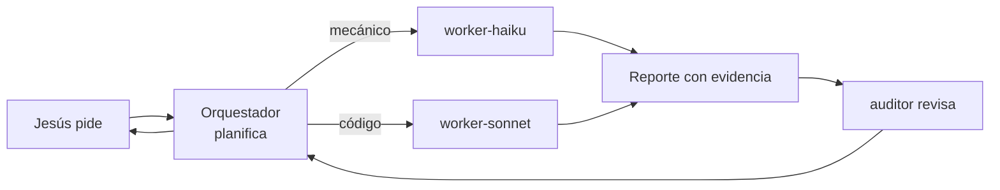
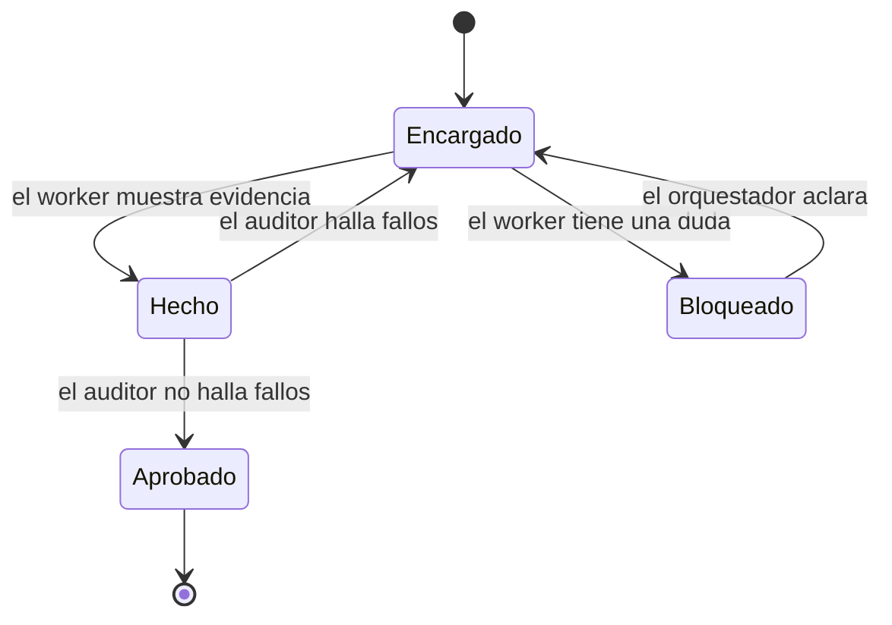
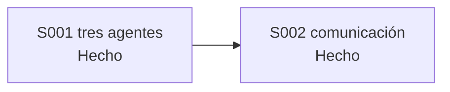

# F006 · Workers y auditor

[Inicio](../../README.md) › [E001](../README.md) › F006

[Feature](../../glosario.md#feature) que suma tres [agentes](../../glosario.md#agente) al [orquestador](../../glosario.md#orquestador): dos que ejecutan y uno que revisa.

## En una frase

El jefe de obra ya no pone ladrillos: tiene dos albañiles y un inspector.

## Para qué existe

**El problema.** Todo lo hacía el orquestador, en el modelo más caro. Leer un archivo o cambiar un formato costaba lo mismo que diseñar.

**La solución.** Tres agentes con su modelo justo:

- `worker-haiku`: tareas mecánicas, como leer, buscar o dar formato. Es el más barato.
- `worker-sonnet`: escribir código o cambios con criterio.
- `auditor`: revisa un [slice](../../glosario.md#slice) terminado. Usa Opus con esfuerzo alto y solo lee.

Ninguno habla con Jesús. Solo el orquestador conversa con él.

## Analogía

Piensa en una **obra de construcción**.

- El jefe de obra habla con el cliente y reparte el trabajo.
- Un ayudante carga y ordena; un albañil levanta paredes.
- El inspector revisa la obra, pero no pone un ladrillo.

Límite de la analogía: en la obra el inspector puede romper una pared mal hecha. Aquí el auditor no toca nada: solo informa.

## Diagrama

Proceso: cómo se reparte un encargo.

Estados de un encargo:

Slices de esta feature:

| Slice | Qué entrega | Estado |
|---|---|---|
| [S001 Tres agentes y sus herramientas](S001.md) | Los tres agentes compilados; el auditor sin herramientas de edición | Hecho |
| [S002 Comunicación entre agentes](S002.md) | Encargo y cierre con campos fijos; un hook rechaza el cierre incompleto | Hecho |

## Ejemplo de punta a punta

continúa: [EJ-E001](../README.md#EJ-E001)

En la [iniciativa](../../glosario.md#iniciativa), el pedido de Jesús llegó a su slice. Ahora el orquestador reparte el trabajo.

1. El orquestador pide a `worker-haiku` las firmas de tres archivos.
2. Con eso, encarga a `worker-sonnet` el cambio y sus pruebas.
3. El worker responde «HECHO» con los comandos y su salida.
4. El `auditor` corre las pruebas y el [gate](../../glosario.md#gate). Responde «APROBADO».
5. Recién ahí el orquestador le dice a Jesús que está hecho.

## Paso a paso

1. S001: campo de herramientas en el [compilador](../../glosario.md#compilador), los tres cuerpos y su config.
2. S002: encargo y cierre fijos, y el [hook](../../glosario.md#hook) que los exige.

## Cómo se usa

- El orquestador elige el agente según la tarea. Jesús no tiene que hacer nada.
- Cambiar un cuerpo: se edita su [canónico](../../glosario.md#canónico) en `gobierno/canonico/agentes/` y se recompila.
- Los dos workers comparten cuerpo: `worker.md`. Solo cambia el modelo.

## Contrato y evidencia

Estado: hecha.

Objetivo: delegar en el modelo justo para cada tarea y revisar antes de declarar algo hecho.

Por qué dos slices: primero los agentes existen; después se fija cómo se hablan. Cada parte se prueba sola.

Decisiones de Jesús (2026-10-21):

- Worker en Sonnet, worker en Haiku y auditor en Opus con esfuerzo alto.
- Un solo cuerpo para los dos workers.
- El auditor solo lee.

Prueba integral de la feature: `TestAgentesRealesWorkersYAuditor` revisa la configuración real.

Límite: el auditor tiene Bash para correr pruebas, y Bash puede escribir. Su cuerpo se lo prohíbe, pero eso es criterio, no un bloqueo.

## Navegación

<!-- GENERADO por aquas desde trabajo/: no editar a mano; `aquas compilar` lo rehace. -->

| Hijo | Qué es | Estado |
|---|---|---|
| [S001](S001.md) | Tres agentes y sus herramientas | Hecho |
| [S002](S002.md) | Comunicación entre agentes | Hecho |

<!-- /GENERADO -->

- ↑ Subir: [E001 · Gobierno del trabajo](../README.md)
- Abajo: [S001 · Tres agentes y sus herramientas](S001.md)
- Abajo: [S002 · Comunicación entre agentes](S002.md)
