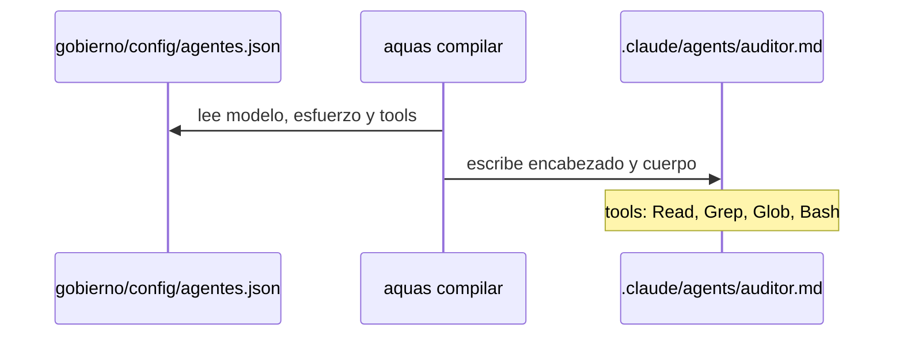
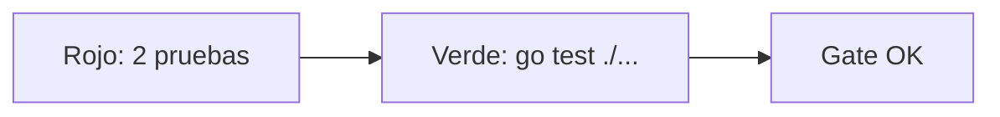

# S001 · Tres agentes y sus herramientas

[Inicio](../../README.md) › [E001](../README.md) › [F006](README.md) › S001

[Slice](../../glosario.md#slice) que crea los dos workers y el auditor, y le enseña al [compilador](../../glosario.md#compilador) a limitar herramientas.

## En una frase

Se contratan tres ayudantes, y al inspector se le quitan las herramientas de construir.

## Para qué existe

**El problema.** El compilador no sabía decir qué herramientas usa un [agente](../../glosario.md#agente). Sin eso, el auditor podría editar archivos.

**La solución.**

- Campo `tools` en `gobierno/config/agentes.json`. Si está, va al encabezado del agente; si no, hereda todas.
- Cuerpo `worker.md`, compartido por `worker-sonnet` y `worker-haiku`.
- Cuerpo `auditor.md`, con `tools: Read, Grep, Glob, Bash`. Sin Edit ni Write.
- El [orquestador](../../glosario.md#orquestador) sabe cuándo usar cada uno.

Contrato del slice:

| Campo | Valor |
|---|---|
| Objetivo | Tres agentes compilados; el auditor sin herramientas de edición |
| Incluye | Campo `tools`, dos cuerpos, tres entradas de config, regla de elección en el orquestador |
| Excluye | Bloqueo real de escritura por Bash del auditor; uso medido de los workers |
| Prueba | `go test ./internal/compilador/` |

## Analogía

Piensa en la **credencial de una obra**.

- Cada credencial dice a qué zonas entra su dueño.
- La del inspector abre todas las puertas, pero no el depósito de herramientas.

Límite de la analogía: Bash es una llave maestra. El auditor la tiene para correr pruebas, y solo su cuerpo le prohíbe escribir.

## Diagrama

Secuencia: cómo sale el archivo de un agente.

## Ejemplo de punta a punta

continúa: [EJ-E001-F006](README.md#EJ-E001-F006)

En la [feature](../../glosario.md#feature), el auditor revisó un cambio. Así se preparó en este slice.

1. La config del auditor dice `"tools": ["Read","Grep","Glob","Bash"]`.
2. `aquas compilar` escribe esa lista en `.claude/agents/auditor.md`.
3. Claude Code le da al auditor solo esas herramientas.
4. No tiene Edit ni Write. Bash sí podría escribir; solo su cuerpo se lo prohíbe.

## Paso a paso

1. Dos pruebas en rojo: el campo nuevo y la config real.
2. Campo `tools` en el compilador.
3. Cuerpos `worker.md` y `auditor.md` en `gobierno/canonico/agentes/`.
4. Tres entradas nuevas en la config y recompilación.
5. Regla de elección en el cuerpo del orquestador.

## Cómo se usa

- Para cambiar las herramientas de un agente: se edita `tools` en la config y se recompila.
- Sin `tools`, el agente hereda todas. Así quedan los workers.
- Los modelos van por alias: `sonnet`, `haiku` y `opus`. Siempre apuntan al modelo vigente.

## Contrato y evidencia

<!-- GENERADO por aquas desde trabajo/: no editar a mano; `aquas compilar` lo rehace. -->

| Prueba | Valida | Rojo cuando | Verde cuando | Rojo | Verde |
|---|---|---|---|---|---|
| — | ficha anterior al registro de pruebas | — | — | — | — |

<!-- /GENERADO -->

Estado: hecho.

Pruebas del slice, en `internal/compilador/herramientas_test.go`:

| Prueba | Qué demuestra |
|---|---|
| `TestAgenteConHerramientas` | Con `tools`, el encabezado las lista; sin `tools`, no escribe la línea |
| `TestAgentesRealesWorkersYAuditor` | La config real trae los tres agentes con su modelo, el auditor en esfuerzo alto y sin Edit ni Write |

Rojo visto: sí.

- Fallaron las dos: faltaba la línea `tools` y faltaban los tres agentes.
- Con el cambio, pasan, igual que `go test ./...` completo.

Decisiones de Jesús (2026-10-21): un cuerpo para los dos workers y un auditor que solo lee. Los alias de modelo y `effort` se verificaron en la documentación oficial de subagentes ese mismo día.

## Navegación

- ↑ Subir: [F006 · Workers y auditor](README.md)
