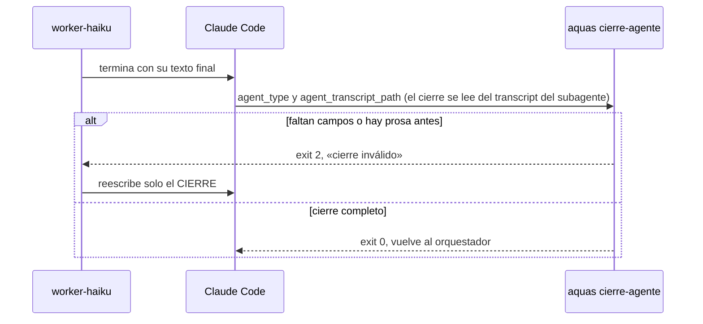
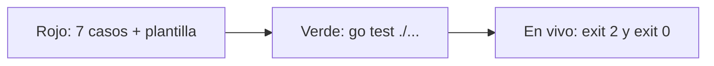

# S002 · Comunicación entre agentes

[Inicio](../../README.md) › [E001](../README.md) › [F006](README.md) › S002

[Slice](../../glosario.md#slice) que fija cómo se hablan los [agentes](../../glosario.md#agente): un encargo de campos fijos y un cierre de campos fijos.

## En una frase

El jefe entrega una orden de trabajo impresa, y el ayudante devuelve un parte con casillas, no un cuento.

## Para qué existe

**El problema.** Cada encargo a un worker iba en texto libre. El agente respondía con prosa larga, y esa prosa se reenviaba en cada turno siguiente. Gastaba [tokens](../../glosario.md#token) y no se podía revisar con un programa.

**La solución.** Una regla [canónica](../../glosario.md#canónico) nueva, `02_COMUNICACION_ENTRE_AGENTES.md`, que cargan los cuatro agentes:

- ENCARGO: id, contrato, objetivo, rutas, incluye, excluye, prueba y terminado.
- CIERRE del worker: estado, archivos, evidencia, bloqueo y fuera de alcance.
- CIERRE del auditor: veredicto, hallazgos y lo no revisado.
- Registro caveman: hechos, sin cortesía ni narración.

Un [hook](../../glosario.md#hook) `SubagentStop` corre `aquas cierre-agente`. Si el cierre no trae sus campos, el agente tiene que reescribirlo.

Contrato del slice:

| Campo | Valor |
|---|---|
| Objetivo | Encargo y cierre con campos fijos; un programa rechaza un cierre incompleto |
| Incluye | Regla canónica, paquete `internal/encargo`, comando `aquas cierre-agente`, hook en la plantilla de settings |
| Excluye | Revisar el encargo del orquestador; medir el ahorro de tokens |
| Prueba | `go test ./internal/encargo/ ./internal/entorno/` |

## Analogía

Piensa en un **formulario de parte diario** en una obra.

- El ayudante marca casillas: hecho, a medias o trancado.
- Al lado escribe qué tocó y cómo lo comprobó.
- Si entrega una carta en vez del parte, se la devuelven.

Límite de la analogía: el portero solo revisa que estén las casillas. No sabe si lo escrito es verdad; eso lo revisa el auditor.

## Diagrama

Secuencia: qué pasa cuando un worker termina.

## Ejemplo de punta a punta

continúa: [EJ-E001-F006](README.md#EJ-E001-F006)

En la [feature](../../glosario.md#feature), el [orquestador](../../glosario.md#orquestador) repartió el trabajo. Así viaja cada encargo.

1. El orquestador manda un ENCARGO a `worker-haiku`: leer una sección de la documentación.
2. El worker termina con «Listo, terminé».
3. El hook responde: «la primera línea debe ser estado».
4. El worker reescribe: `estado: HECHO`, con evidencia y bloqueo.
5. El orquestador recibe solo esas líneas.

## Paso a paso

1. Regla canónica con los dos contratos.
2. Pruebas del validador que fallan con un esqueleto vacío.
3. Validador en `internal/encargo` y comando `aquas cierre-agente`.
4. Hook en `gobierno/config/claude_settings.json`, con su [prueba en rojo](../../glosario.md#prueba-en-rojo).
5. Los cuatro agentes cargan la regla. Los cuerpos ya no repiten el formato del reporte.
6. Prueba en vivo del comando con un cierre malo y uno bueno.

## Cómo se usa

- El orquestador escribe cada encargo con los campos fijos, en ese orden.
- Un campo que no aplica lleva «—». Nunca se omite.
- El cierre es el único texto del agente. Nada antes de la primera línea.
- Si el hook ya pidió una vez, deja cerrar, para no entrar en bucle.
- Archivos temporales propios en `.tmp/<id>/`. Nunca se borra `.tmp` entero.

## Contrato y evidencia

<!-- GENERADO por aquas desde trabajo/: no editar a mano; `aquas compilar` lo rehace. -->

| Prueba | Valida | Rojo cuando | Verde cuando | Rojo | Verde |
|---|---|---|---|---|---|
| — | ficha anterior al registro de pruebas | — | — | — | — |

### Código

| Archivo | Función | Parámetros | Qué hace |
|---|---|---|---|
| [cmd/aquas/main.go](../../../cmd/aquas/main.go) | `main` | `()` | main despacha el subcomando de aquas (compilar, verificar, backlog, hooks…) y sale con su código. |
| [cmd/aquas/main.go](../../../cmd/aquas/main.go) | `hook` | `(raiz string)` | hook: exit 0 = nada que reportar; exit 2 = stderr se muestra a Claude. |
| [cmd/aquas/main.go](../../../cmd/aquas/main.go) | `compilarSettings` | `(w io.Writer)` | compilarSettings regenera .claude/settings.json; sin entorno declarado no inventa uno. |
| [cmd/aquas/main.go](../../../cmd/aquas/main.go) | `reportar` | `(w io.Writer, inf compilador.Informe)` | reportar imprime qué derivados escribió la compilación, o que todo estaba al día. |
| [cmd/aquas/main.go](../../../cmd/aquas/main.go) | `listar` | `(titulo string, problemas []string)` | listar imprime en stderr un título y cada problema en su viñeta. |
| [cmd/aquas/main.go](../../../cmd/aquas/main.go) | `lista` | `(xs []string) string` | lista une los textos con comas, o «—» si no hay ninguno. |
| [cmd/aquas/main.go](../../../cmd/aquas/main.go) | `fallar` | `(codigo int, err error)` | fallar imprime el error en stderr y termina con el código dado. |
| [cmd/aquas/main.go](../../../cmd/aquas/main.go) | `memoriaCLI` | `(raiz string, args []string)` | memoriaCLI: `ver` imprime la memoria; `fijar campo=valor…` la actualiza y la sella. |
| [cmd/aquas/main.go](../../../cmd/aquas/main.go) | `memoriaArchivada` | `(raiz, id string) error` | memoriaArchivada: CERRADO exige el archivo de memoria del slice, apunte o no la memoria a él (E001/F002/S009, X01). |
| [cmd/aquas/main.go](../../../cmd/aquas/main.go) | `focoEnBacklog` | `(raiz string, f memoria.Foco) error` | focoEnBacklog: la memoria solo fija el slice que el backlog tiene en curso (S003). |
| [cmd/aquas/main.go](../../../cmd/aquas/main.go) | `backlogCLI` | `(raiz string, args []string)` | backlogCLI: nuevo \\| ver [id] \\| prioridad \\| estado \\| siguiente \\| pruebas \\| rojo \\| verde. |
| [cmd/aquas/main.go](../../../cmd/aquas/main.go) | `turnoCLI` | `(raiz string, args []string)` | turnoCLI: auditoría de turnos (E001/F002/S001). Lee el JSON del hook por stdin. No imprime nada |
| [cmd/aquas/main.go](../../../cmd/aquas/main.go) | `defectoCLI` | `(raiz string, args []string) error` | defectoCLI: nuevo \\| ocurre \\| ver (E001/F004/S001). |
| [cmd/aquas/main.go](../../../cmd/aquas/main.go) | `versionBinario` | `() string` | versionBinario: versión del módulo con que se compiló el binario (= versión del gobierno embebido). |
| [gobierno/config/agentes.json](../../../gobierno/config/agentes.json) | — | — | — |
| [gobierno/config/claude_settings.json](../../../gobierno/config/claude_settings.json) | — | — | — |
| [internal/encargo/encargo.go](../../../internal/encargo/encargo.go) | `Revisar` | `(tipo, mensaje string, stopHookActive bool) string` | Revisar decide el hook SubagentStop: "" deja cerrar; si no, qué falta en el cierre. |
| [internal/encargo/encargo.go](../../../internal/encargo/encargo.go) | `Veredicto` | `(mensaje string) (id, veredicto string, ok bool)` | Veredicto extrae del cierre de un auditor ya válido el id del tramo («E001/F014/S002») y su veredicto. |
| [internal/encargo/encargo.go](../../../internal/encargo/encargo.go) | `falla` | `(motivo string) string` | falla: mensaje de cierre inválido que pide reescribirlo según el canónico. |

<!-- /GENERADO -->

Estado: hecho.

Pruebas del slice, en `internal/encargo/encargo_test.go` e `internal/entorno/hooks_test.go`:

| Prueba | Qué demuestra |
|---|---|
| `TestCierreValidoPasa` | Cierres completos pasan, también con cerca de código, sangría, listas o CRLF |
| `TestCierreInvalidoBloquea` | Prosa antes o después, estado inventado, campo faltante o vacío bloquean y nombran el canónico |
| `TestCierreNoBloqueaEnBucleNiAOtros` | Si ya se pidió, deja cerrar; otros agentes no se revisan |
| `TestCierreAgenteCLI` | El comando real lee los campos JSON de la documentación; JSON ilegible deja cerrar |
| `TestSettingsRealTraeHookDeCierreDeAgente` | La plantilla real declara el hook con sus tres agentes |

Rojo visto: sí.

- Con el esqueleto vacío, los siete casos inválidos dejaban cerrar.
- La plantilla real no tenía el hook.
- En vivo, el comando dio exit 2 con «Listo, terminé» y exit 0 con un cierre completo.
- El auditor halló cinco huecos. Pasaban texto después del cierre y campos vacíos, y fallaban cierres con cerca de código o sangría.
- Los tres primeros tuvieron prueba en rojo antes del arreglo.
- `TestCierreAgenteCLI` cubre lo que ya funcionaba, así que no tuvo rojo. La página de referencia desactualizada se corrigió.

Decisiones de Jesús (2026-10-21): el encargo va en el mensaje y se borran solo los temporales propios. La brevedad va sin cifra inventada, y un hook exige el cierre.

Fuente: la documentación oficial de hooks dice que el exit 2 de `SubagentStop` le entrega el aviso al propio subagente. Se consultó el 2026-10-21.

Límite: el hook revisa la forma, no la verdad del contenido. Que la evidencia sea real lo revisa el auditor.

## Navegación

- ↑ Subir: [F006 · Workers y auditor](README.md)
