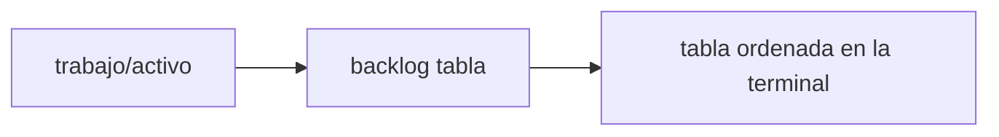
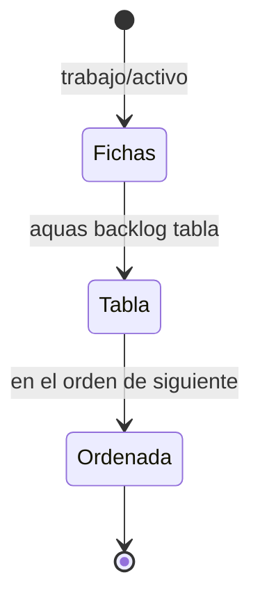

# F007 · Tabla del backlog en la terminal

[Inicio](../../README.md) › [E001](../README.md) › F007

[Feature](../../glosario.md#feature) que muestra el [backlog](../../glosario.md#backlog) entero en una tabla, sin abrir archivos.

## En una frase

El comando «backlog tabla» pone cada ficha activa en una fila con su [iniciativa](../../glosario.md#iniciativa), feature, [slice](../../glosario.md#slice) y descripción.

## Para qué existe

**El problema.** Para ver qué falta hay que recorrer carpetas y fichas una por una.

**La solución.** Un [slice](../../glosario.md#slice) agrega `backlog tabla`, ordenable por prioridad, iniciativa o feature.

## Analogía

Piensa en la **pizarra de un taller**.

- Cada carro ocupa una fila con su dueño, su falla y su estado.
- El jefe ve todo de un vistazo, sin abrir cada orden.

Límite de la analogía: aquí la pizarra se arma sola desde `trabajo/`.

## Diagrama

## Ejemplo de punta a punta

continúa: [EJ-E001](../README.md#EJ-E001)

1. Hay una iniciativa E009 con su feature F001 y su slice S001.
2. El comando «backlog tabla» imprime un encabezado y una fila por ficha.
3. La fila del slice trae E009, F001, S001 y su título juntos.

## Paso a paso

1. Tabla ordenable con histórico (S001): cancelada el 2026-10-30; el humano eligió el orden de `siguiente`.
2. [Tabla del backlog y comando /backlog](S002.md) (S002).
3. Comando /backlog en los hijos (S003).

## Cómo se usa

- En el chat: `/backlog`.
- En la terminal: `aquas backlog tabla`.

## Contrato y evidencia

**Objetivo.** El backlog se lee en una sola tabla. La prueba integral es `TestTablaBacklog`.

## Navegación

<!-- GENERADO por aquas desde trabajo/: no editar a mano; `aquas compilar` lo rehace. -->

| Hijo | Qué es | Estado |
|---|---|---|
| S001 | Tabla de pendientes ordenable, con histórico opcional | Cancelado |
| [S002](S002.md) | aquas backlog tabla imprime las fichas activas en columnas, en el orden de siguiente; /backlog la muestra | Hecho |
| S003 | aquas build escribe el skill /backlog en el hijo para mostrar el backlog de ese repo | Planeado |

<!-- /GENERADO -->

- ↑ Subir: [E001](../README.md)
