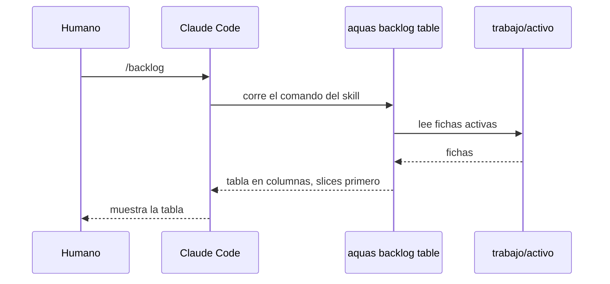

# S002 · Tabla del backlog y comando /backlog

[Inicio](../../README.md) › [E001](../README.md) › [F007](README.md) › S002

Este [slice](../../glosario.md#slice) muestra el [backlog](../../glosario.md#backlog) del repo en una tabla, desde la terminal o con `/backlog` en el chat.

## En una frase

`aquas backlog table` imprime las fichas activas en columnas: primero los slices, en el orden en que se trabajarán.

## Para qué existe

**El problema.** Para saber qué falta hay que abrir fichas una por una. `aquas backlog show` da una línea larga por ficha, difícil de escanear.

Ejemplo real: el humano pidió el backlog en columnas el 2026-10-22. El 2026-10-30 pidió `/backlog`.

**La solución.** Decidida por el humano el 2026-10-30. Una tabla con columnas fijas y un comando del chat que la muestra.

**Contrato.**

| Regla | Valor |
|---|---|
| Comando | `aquas backlog table`, sobre el repo donde corre |
| Columnas | `Iniciativa`, `Feature`, `Slice`, `Estado`, `Prior.`, `Descripción`, alineadas |
| Filas | solo fichas activas; las archivadas no salen |
| Orden | el de `backlog.Activas`: primero los slices, en el orden en que se trabajarán; luego features e iniciativas por secuencia. Una feature sin slices, que `siguiente` puede elegir antes, sale abajo |
| Celda vacía | `—`; una feature no tiene slice y una iniciativa no tiene feature ni slice |
| Descripción | el título de la ficha |
| `/backlog` | [skill](https://code.claude.com/docs/en/skills) `.claude/skills/backlog/SKILL.md`, compilado desde `gobierno/canonico/skills/backlog.md` |
| Solo humano | `disable-model-invocation: true`: el modelo no lo dispara solo |
| Qué corre | `sh .claude/hooks/aquas.sh backlog table` desde `${CLAUDE_PROJECT_DIR}` |
| Compilador | si el canónico empieza con frontmatter `---`, va primero y la marca GENERADO después |
| Alcance | constitución (`gobierno/canonico/constitucion.md`, `CLAUDE.md`) por el hallazgo A1.4; `internal/backlog/tabla.go`, `internal/backlog/tabla_test.go`, `cmd/aquas/main.go`, `internal/compilador/compilador.go`, `internal/compilador/skill_test.go`, `gobierno/canonico/skills/backlog.md`, `gobierno/config/documentos.json`, `gobierno/config/sellos.json`, `.claude/skills/backlog/SKILL.md`, esta página, `docs/E001/F007/README.md` |

Fuera de este tramo: `/backlog` en los hijos, que entrega S003.

**Casos borde.**

| Categoría | Aplica | Prueba o motivo |
|---|---|---|
| cada tipo de ficha | sí | iniciativa, feature y slice salen con sus celdas `—` correctas: `TestTablaEnOrden` |
| cada estado de origen | sí | BORRADOR sale; EN_CURSO sale y va primero; CANCELADO, archivado, no sale: `TestTablaEnOrden` |
| padre e hijo, activo y archivado | sí | slice archivado de una feature activa no sale; su feature sí: `TestTablaEnOrden` |
| entrada ausente, vacía, mal escrita o duplicada | sí | backlog vacío: solo el encabezado: `TestTablaEnOrden` |
| choque con otro control | sí | el compilador sella el skill y el gate detecta un SKILL.md editado a mano, igual que con `CLAUDE.md`: `TestSkillBacklog` |
| quién habla: humano, agente o herramienta | sí | solo el humano invoca `/backlog`: `TestSkillBacklog` revisa `disable-model-invocation: true` |
| fallo a mitad de camino | no | solo lee fichas e imprime; no escribe nada que pueda quedar a medias |

## Analogía

Piensa en **la pizarra de un taller**.

- Cada carro ocupa una fila con su dueño, su falla y su estado.
- El jefe la ve de un vistazo, sin abrir cada orden.

Límite de la analogía: aquí la pizarra se arma sola desde `trabajo/`.

## Diagrama

## Ejemplo de punta a punta

continúa: [EJ-E001-F007](README.md#EJ-E001-F007)

1. El humano escribe `/backlog` en el chat del gobierno central.
2. Claude Code corre `aquas backlog table` en ese repo.
3. Sale la fila `E001  F007  S002  EN_CURSO  P1  Tabla del backlog y comando /backlog`.
4. Debajo siguen los demás slices, en el orden en que se trabajarán.

## Paso a paso

1. Rojo de `TestTablaEnOrden` y `TestSkillBacklog`.
2. `backlog.Tabla`, el comando `backlog table`, el [canónico](../../glosario.md#canónico) del skill y su compilación; verde.

## Cómo se usa

- En el chat: `/backlog`.
- En la terminal: `aquas backlog table`.

## Contrato y evidencia

<!-- GENERADO por aquas desde trabajo/: no editar a mano; `aquas compile` lo rehace. -->

| Prueba | Valida | Rojo cuando | Verde cuando | Rojo | Verde |
|---|---|---|---|---|---|
| `TestTablaEnOrden` | valida que la tabla trae columnas fijas y sigue el orden de siguiente con solo fichas activas | rojo cuando falta una columna, aparece una archivada o el orden difiere de siguiente | verde cuando encabezado y filas salen alineados en el orden de siguiente | 2026-10-30 | 2026-10-30 |
| `TestSkillBacklog` | valida que /backlog existe, solo lo invoca el humano y corre aquas backlog tabla | rojo cuando falta el skill o no corre la tabla o el modelo puede invocarlo | verde cuando el skill compilado corre la tabla con disable-model-invocation | 2026-10-30 | 2026-10-30 |

### Código

| Archivo | Función | Parámetros | Qué hace |
|---|---|---|---|
| [cmd/aquas/main.go](../../../cmd/aquas/main.go) | `main` | `()` | main despacha el subcomando de aquas (compilar, verificar, backlog, hooks…) y sale con su código. |
| [cmd/aquas/main.go](../../../cmd/aquas/main.go) | `hook` | `(raiz string)` | hook: exit 0 = nada que reportar; exit 2 = stderr se muestra a Claude. |
| [cmd/aquas/main.go](../../../cmd/aquas/main.go) | `compilarSettings` | `(w io.Writer)` | compilarSettings regenera .claude/settings.json; sin entorno declarado no inventa uno. |
| [cmd/aquas/main.go](../../../cmd/aquas/main.go) | `reportar` | `(w io.Writer, inf compilador.Informe)` | reportar imprime qué derivados escribió la compilación, o que todo estaba al día. |
| [cmd/aquas/main.go](../../../cmd/aquas/main.go) | `listar` | `(titulo string, problemas []string)` | listar imprime en stderr un título y cada problema en su viñeta. |
| [cmd/aquas/main.go](../../../cmd/aquas/main.go) | `lista` | `(xs []string) string` | lista une los textos con comas, o «—» si no hay ninguno. |
| [cmd/aquas/main.go](../../../cmd/aquas/main.go) | `fallar` | `(codigo int, err error)` | fallar imprime el error en stderr y termina con el código dado. |
| [cmd/aquas/main.go](../../../cmd/aquas/main.go) | `memoriaCLI` | `(raiz string, args []string)` | memoriaCLI: `ver` imprime la memoria; `fijar campo=valor…` la actualiza y la sella. |
| [cmd/aquas/main.go](../../../cmd/aquas/main.go) | `memoriaArchivada` | `(raiz, id string) error` | memoriaArchivada: CERRADO exige el archivo de memoria del slice, apunte o no la memoria a él (E001/F002/S009, X01). |
| [cmd/aquas/main.go](../../../cmd/aquas/main.go) | `focoEnBacklog` | `(raiz string, f memoria.Foco) error` | focoEnBacklog: la memoria solo fija el slice que el backlog tiene en curso (S003). |
| [cmd/aquas/main.go](../../../cmd/aquas/main.go) | `backlogCLI` | `(raiz string, args []string)` | backlogCLI: nuevo \\| ver [id] \\| tabla \\| prioridad \\| estado \\| siguiente \\| pruebas \\| rojo \\| verde. |
| [cmd/aquas/main.go](../../../cmd/aquas/main.go) | `turnoCLI` | `(raiz string, args []string)` | turnoCLI: auditoría de turnos (E001/F002/S001). Lee el JSON del hook por stdin. No imprime nada |
| [cmd/aquas/main.go](../../../cmd/aquas/main.go) | `defectoCLI` | `(raiz string, args []string) error` | defectoCLI: nuevo \\| ocurre \\| ver (E001/F004/S001). |
| [cmd/aquas/main.go](../../../cmd/aquas/main.go) | `versionBinario` | `() string` | versionBinario: versión del módulo con que se compiló el binario (= versión del gobierno embebido). |
| [cmd/aquas/main.go](../../../cmd/aquas/main.go) | `registrarCierre` | `(raiz, tipo, transcript, primera, resultado string)` | registrarCierre (E001/F004/S005, D000068) anota cada llamada del gancho cierre-agente en .tmp/hooks/cierre-agente.jsonl. |
| [gobierno/config/documentos.json](../../../gobierno/config/documentos.json) | — | — | — |
| [internal/backlog/tabla.go](../../../internal/backlog/tabla.go) | `Tabla` | `(fs []Ficha) string` | Tabla (E001/F007/S002): las fichas en columnas alineadas, en el orden recibido (el de Activas). |
| [internal/compilador/compilador.go](../../../internal/compilador/compilador.go) | `marca` | `(config string) string` | marca: comentario «GENERADO» que encabeza cada derivado y nombra su config. |
| [internal/compilador/compilador.go](../../../internal/compilador/compilador.go) | `Planificar` | `(raiz string) ([]Salida, error)` | Planificar lee la config y calcula todas las salidas sin tocar el disco. |
| [internal/compilador/compilador.go](../../../internal/compilador/compilador.go) | `compilarAgente` | `(raiz string, a Agente) (Salida, error)` | compilarAgente arma el .md de un agente desde su config y sus canónicos, y valida campos y tope. |
| [internal/compilador/compilador.go](../../../internal/compilador/compilador.go) | `Compilar` | `(raiz string) (Informe, error)` | Compilar escribe las salidas que cambiaron y actualiza el sello. |
| [internal/compilador/compilador.go](../../../internal/compilador/compilador.go) | `Verificar` | `(raiz string) ([]string, error)` | Verificar es el gate: devuelve un problema por cada salida o sello desfasado. |
| [internal/compilador/compilador.go](../../../internal/compilador/compilador.go) | `EsGobernado` | `(rel string) bool` | EsGobernado indica si una ruta relativa (con /) afecta la compilación. |
| [internal/compilador/compilador.go](../../../internal/compilador/compilador.go) | `EsSalida` | `(raiz, rel string) bool` | EsSalida indica si una ruta relativa es un archivo compilado. |
| [internal/compilador/compilador.go](../../../internal/compilador/compilador.go) | `sellar` | `(raiz string, salidas []Salida) (Sello, error)` | sellar calcula la huella SHA-256 de cada salida y de sus fuentes. |
| [internal/compilador/compilador.go](../../../internal/compilador/compilador.go) | `diferencias` | `(anterior, nuevo Sello) []string` | diferencias: rutas cuya huella cambió o que aparecen o desaparecen entre dos sellos. |
| [internal/compilador/compilador.go](../../../internal/compilador/compilador.go) | `leerCanonicos` | `(raiz string, rutas []string) ([]string, error)` | leerCanonicos lee las fuentes pedidas; rechaza las que no están bajo gobierno/canonico/. |
| [internal/compilador/compilador.go](../../../internal/compilador/compilador.go) | `leerJSON` | `(raiz, rel string, v any) error` | leerJSON lee y decodifica un JSON relativo a la raíz. |
| [internal/compilador/compilador.go](../../../internal/compilador/compilador.go) | `leerSello` | `(raiz string) (Sello, error)` | leerSello carga gobierno/config/sellos.json. |
| [internal/compilador/compilador.go](../../../internal/compilador/compilador.go) | `codificarSello` | `(s Sello) ([]byte, error)` | codificarSello serializa el sello como JSON indentado con salto final. |
| [internal/compilador/compilador.go](../../../internal/compilador/compilador.go) | `citarYAML` | `(s string) string` | citarYAML produce un escalar YAML entre comillas dobles (JSON es YAML válido). |
| [internal/compilador/compilador.go](../../../internal/compilador/compilador.go) | `normalizar` | `(b []byte) []byte` | normalizar cambia CRLF por LF para que la huella no dependa del sistema. |
| [internal/compilador/compilador.go](../../../internal/compilador/compilador.go) | `huella` | `(b []byte) string` | huella: SHA-256 en hexadecimal. |
| [internal/compilador/compilador.go](../../../internal/compilador/compilador.go) | `escribir` | `(raiz, rel string, datos []byte) error` | escribir guarda datos en la ruta relativa, creando sus carpetas. |

<!-- /GENERADO -->

Pruebas: `TestTablaEnOrden`, `TestSkillBacklog`.

En la ficha, «orden de siguiente» vale para los slices; [features](../../glosario.md#feature) e [iniciativas](../../glosario.md#iniciativa) van abajo (ver «Orden» en el contrato). El texto de la ficha queda así porque la aprobación de la feature lo sella.

## Navegación

- ↑ Subir: [F007](README.md)
