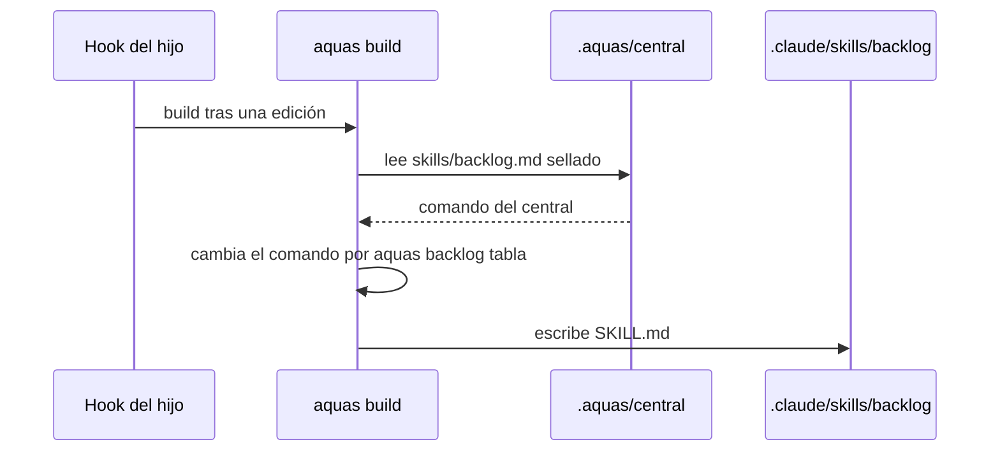

# S003 · Comando /backlog en los hijos

[Inicio](../../README.md) › [E001](../README.md) › [F007](README.md) › S003

Este [slice](../../glosario.md#slice) lleva `/backlog` a cada proyecto hijo, con el [backlog](../../glosario.md#backlog) de ese hijo.

## En una frase

`aquas build` escribe `.claude/skills/backlog/SKILL.md` en el hijo, sacado de la central sellada y apuntando al `aquas` instalado.

## Para qué existe

**El problema.** `/backlog` solo existe en el gobierno central. En un hijo, como la landing page, no hay forma de ver su backlog desde el chat.

Ejemplo real: el humano pidió el 2026-10-30 que `/backlog` esté siempre, también en los hijos.

**La solución.** Decidida por el humano el 2026-10-30. `aquas build` del hijo genera el skill desde la misma fuente que el central.

**Contrato.**

| Regla | Valor |
|---|---|
| Fuente | `.aquas/central/gobierno/canonico/skills/backlog.md`, la copia sellada del canónico central |
| Cambio | `sh .claude/hooks/aquas.sh ` pasa a `aquas `: el hijo no tiene el código de aquas, usa el binario instalado |
| Salida | `.claude/skills/backlog/SKILL.md` del hijo, con frontmatter primero y marca GENERADO después |
| Cuándo | cada `aquas build`, que ya corre tras `install`, `update` y cada edición (hook del hijo) |
| Fuente ausente | un hijo con central anterior a este tramo: build sigue sin skill y sin error; aparece tras `aquas update` |
| Fuente sin el comando | build falla y no escribe nada: la central cambió el comando y hay que ajustar aquas |
| /backlog propio | un `SKILL.md` sin la marca de aquas es propio: install falla sin escribir nada, build falla sin pisarlo y el gate pide renombrarlo. Un generado editado a mano que conserva la marca: el gate avisa y el siguiente build lo rehace |
| Gate del hijo | `hijo.Verificar` avisa si el SKILL.md no coincide, igual que con `CLAUDE.md` |
| Página de la feature | al terminar este tramo se corrige la línea «ordenable por prioridad, iniciativa o feature» de [F007](README.md) (hallazgo A2.3 de S002) |
| Alcance | por los hallazgos A1.2 y A1.5: `cmd/aquas/main.go` (mensajes), `cmd/aquas/ciclo_hijo_test.go` (install por la CLI), `gobierno/canonico/constitucion.md` y `CLAUDE.md`; `internal/hijo/hijo.go` (hallazgo A2.1), `internal/hijo/build.go`, `internal/hijo/skill.go`, `internal/hijo/skill_test.go`, esta página, `docs/E001/F007/README.md` |

**Casos borde.**

| Categoría | Aplica | Prueba o motivo |
|---|---|---|
| cada tipo de ficha | no | no lee fichas; la tabla de cada tipo la prueba S002 |
| cada estado de origen | sí | hijo recién instalado, hijo con skill viejo tras `update`, hijo con central sin skill: `TestBuildEscribeSkillBacklog` |
| padre e hijo, activo y archivado | no | aquí padre es la central e hijo el proyecto; no hay fichas activas ni archivadas en juego |
| entrada ausente, vacía, mal escrita o duplicada | sí | fuente ausente: sin skill; tras update aparece. Fuente sin el comando o sin frontmatter: build falla sin escribir. Fuente CRLF: se normaliza. `/backlog` propio del hijo: no se pisa: `TestBuildEscribeSkillBacklog`; install por la CLI: `TestCicloDeVidaDelHijo` |
| choque con otro control | sí | un skill sellado alterado frena build por el sello; `Verificar` detecta un SKILL.md cambiado; install respeta su lista de conflictos: `TestBuildEscribeSkillBacklog` |
| quién habla: humano, agente o herramienta | sí | el skill del hijo conserva `disable-model-invocation: true`: `TestBuildEscribeSkillBacklog` |
| fallo a mitad de camino | sí | build arma todo antes de escribir; si falla, no deja un SKILL.md a medias, y repetir build lo rehace: `TestBuildEscribeSkillBacklog` |

## Analogía

Piensa en **una franquicia que recibe el manual de la casa matriz**.

- El manual es el mismo para todas las sucursales.
- Cada sucursal cambia solo la dirección donde se piden los repuestos.

Límite de la analogía: aquí el cambio lo hace `aquas build`, no una persona.

## Diagrama

## Ejemplo de punta a punta

continúa: [EJ-E001-F007](README.md#EJ-E001-F007)

1. La landing page corre `aquas update` y recibe la central nueva.
2. Su [hook](../../glosario.md#hook) corre `aquas build`, que escribe `.claude/skills/backlog/SKILL.md`.
3. El humano escribe `/backlog` en el chat de la landing page.
4. Sale la tabla con el backlog de la landing page, no la del central.

## Paso a paso

1. Rojo de `TestBuildEscribeSkillBacklog`.
2. `armarSkill` en `internal/hijo`, `Build` y `Verificar` lo usan; verde.
3. Corregir la línea vieja de la página de la [feature](../../glosario.md#feature).

## Cómo se usa

- En un hijo: `aquas update` y luego `/backlog` en su chat.

## Contrato y evidencia

<!-- GENERADO por aquas desde trabajo/: no editar a mano; `aquas compilar` lo rehace. -->

| Prueba | Valida | Rojo cuando | Verde cuando | Rojo | Verde |
|---|---|---|---|---|---|
| `TestBuildEscribeSkillBacklog` | valida que build deja /backlog en el hijo apuntando al aquas instalado | rojo cuando el hijo queda sin /backlog o el skill apunta al código de la central | verde cuando build escribe el skill y update lo mantiene | 2026-10-30 | 2026-10-30 |

### Código

| Archivo | Función | Parámetros | Qué hace |
|---|---|---|---|
| [cmd/aquas/main.go](../../../cmd/aquas/main.go) | `main` | `()` | main despacha el subcomando de aquas (compilar, verificar, backlog, hooks…) y sale con su código. |
| [cmd/aquas/main.go](../../../cmd/aquas/main.go) | `hook` | `(raiz string)` | hook: exit 0 = nada que reportar; exit 2 = stderr se muestra a Claude. |
| [cmd/aquas/main.go](../../../cmd/aquas/main.go) | `compilarSettings` | `(w io.Writer)` | compilarSettings regenera .claude/settings.json; sin entorno declarado no inventa uno. |
| [cmd/aquas/main.go](../../../cmd/aquas/main.go) | `reportar` | `(w io.Writer, inf compilador.Informe)` | reportar imprime qué derivados escribió la compilación, o que todo estaba al día. |
| [cmd/aquas/main.go](../../../cmd/aquas/main.go) | `listar` | `(titulo string, problemas []string)` | listar imprime en stderr un título y cada problema en su viñeta. |
| [cmd/aquas/main.go](../../../cmd/aquas/main.go) | `lista` | `(xs []string) string` | lista une los textos con comas, o «—» si no hay ninguno. |
| [cmd/aquas/main.go](../../../cmd/aquas/main.go) | `fallar` | `(codigo int, err error)` | fallar imprime el error en stderr y termina con el código dado. |
| [cmd/aquas/main.go](../../../cmd/aquas/main.go) | `memoriaCLI` | `(raiz string, args []string)` | memoriaCLI: `ver` imprime la memoria; `fijar campo=valor…` la actualiza y la sella. |
| [cmd/aquas/main.go](../../../cmd/aquas/main.go) | `memoriaArchivada` | `(raiz, id string) error` | memoriaArchivada: CERRADO exige el archivo de memoria del slice, apunte o no la memoria a él (E001/F002/S009, X01). |
| [cmd/aquas/main.go](../../../cmd/aquas/main.go) | `focoEnBacklog` | `(raiz string, f memoria.Foco) error` | focoEnBacklog: la memoria solo fija el slice que el backlog tiene en curso (S003). |
| [cmd/aquas/main.go](../../../cmd/aquas/main.go) | `backlogCLI` | `(raiz string, args []string)` | backlogCLI: nuevo \\| ver [id] \\| tabla \\| prioridad \\| estado \\| siguiente \\| pruebas \\| rojo \\| verde. |
| [cmd/aquas/main.go](../../../cmd/aquas/main.go) | `turnoCLI` | `(raiz string, args []string)` | turnoCLI: auditoría de turnos (E001/F002/S001). Lee el JSON del hook por stdin. No imprime nada |
| [cmd/aquas/main.go](../../../cmd/aquas/main.go) | `defectoCLI` | `(raiz string, args []string) error` | defectoCLI: nuevo \\| ocurre \\| ver (E001/F004/S001). |
| [cmd/aquas/main.go](../../../cmd/aquas/main.go) | `versionBinario` | `() string` | versionBinario: versión del módulo con que se compiló el binario (= versión del gobierno embebido). |
| [cmd/aquas/main.go](../../../cmd/aquas/main.go) | `registrarCierre` | `(raiz, tipo, transcript, primera, resultado string)` | registrarCierre (E001/F004/S005, D000068) anota cada llamada del gancho cierre-agente en .tmp/hooks/cierre-agente.jsonl. |
| [internal/hijo/build.go](../../../internal/hijo/build.go) | `Build` | `(dir string) error` | Build arma el CLAUDE.md del hijo: central sellada + huecos locales. |
| [internal/hijo/build.go](../../../internal/hijo/build.go) | `armar` | `(dir string) (string, error)` | armar devuelve el CLAUDE.md que Build escribiría, sin escribirlo. |
| [internal/hijo/build.go](../../../internal/hijo/build.go) | `verificarSello` | `(dir, central string) error` | verificarSello compara cada archivo de la central con su hash del lock. |
| [internal/hijo/build.go](../../../internal/hijo/build.go) | `leerHuecos` | `(dir string) (map[string]string, error)` | leerHuecos devuelve nombre → contenido de cada <nombre>.md local. |
| [internal/hijo/build.go](../../../internal/hijo/build.go) | `Verificar` | `(dir string) []string` | Verificar (X02, E002/F002/S004): gate del hijo; nil si su central sellada, sus huecos sin PENDIENTE y su CLAUDE.md están al día. |
| [internal/hijo/build.go](../../../internal/hijo/build.go) | `EsHijo` | `(dir string) bool` | EsHijo: dir tiene un gobierno central instalado (lock.json de aquas install). |
| [internal/hijo/build.go](../../../internal/hijo/build.go) | `pendientes` | `(dir string) ([]string, error)` | pendientes (E002/F002/S004): un problema por hueco que conserva la marca de relleno, en orden. |
| [internal/hijo/hijo.go](../../../internal/hijo/hijo.go) | `Install` | `(dest string, central fs.FS, version string) error` | Install copia la central sellada en dest/.aquas/central y escribe dest/.aquas/lock.json. |
| [internal/hijo/hijo.go](../../../internal/hijo/hijo.go) | `copiarCentral` | `(dest string, central fs.FS, version string) error` | copiarCentral escribe la central como solo lectura y su lock con versión y hashes. |
| [internal/hijo/hijo.go](../../../internal/hijo/hijo.go) | `AMedias` | `(err error) error` | AMedias (E002/F002/S002): error de install cuando la central ya quedó copiada y falló lo siguiente. |
| [internal/hijo/skill.go](../../../internal/hijo/skill.go) | `skillPropio` | `(dir string) error` | skillPropio (hallazgo A1.1): error si el hijo ya tiene un SKILL.md de /backlog que no generó aquas; build no lo pisa. |
| [internal/hijo/skill.go](../../../internal/hijo/skill.go) | `armarSkill` | `(dir string) (txt string, hay bool, err error)` | armarSkill devuelve el SKILL.md del hijo. hay=false si la central sellada no trae el skill (central anterior |

<!-- /GENERADO -->

Pruebas: `TestBuildEscribeSkillBacklog`; la CLI la cubre `TestCicloDeVidaDelHijo`.

Fuera de este tramo quedan dos hallazgos leves de la auditoría A1. La regla «frontmatter primero» vive en el [compilador](../../glosario.md#compilador) y en `internal/hijo`. Si una central futura quita el skill, el `SKILL.md` viejo del hijo queda sin aviso. Hoy ninguno de los dos ocurre. La ampliación a `cmd/aquas/skill_hijo_test.go` quedó en la ficha sin uso: ese archivo no se creó.

## Navegación

- ↑ Subir: [F007](README.md)
