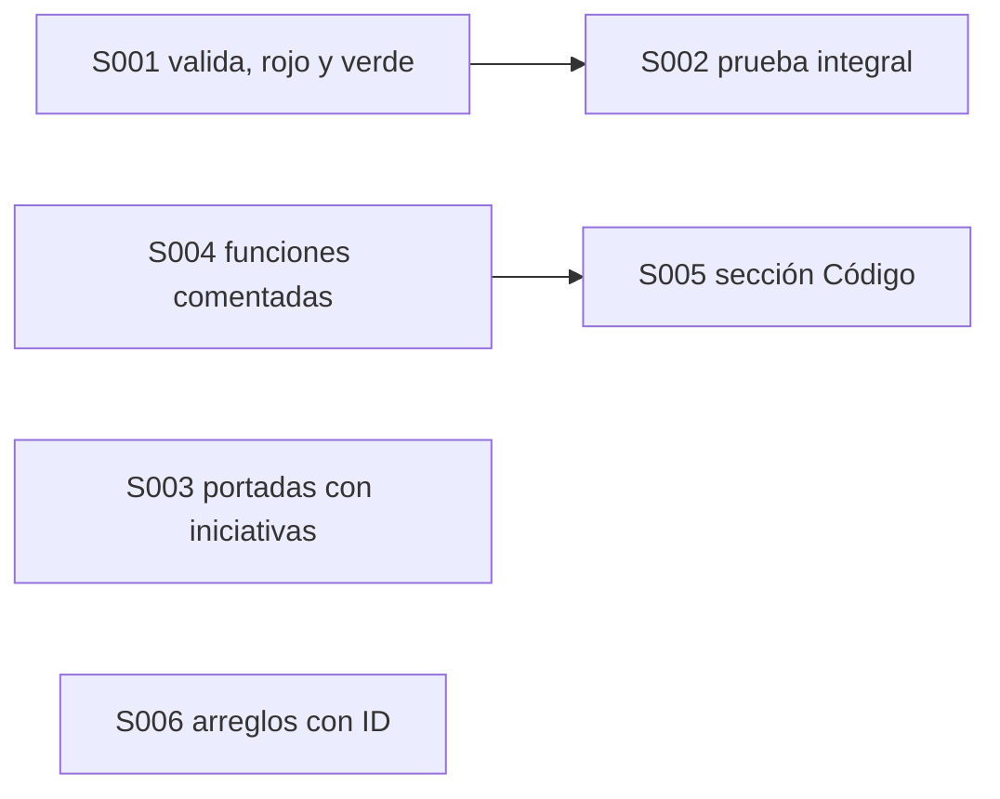
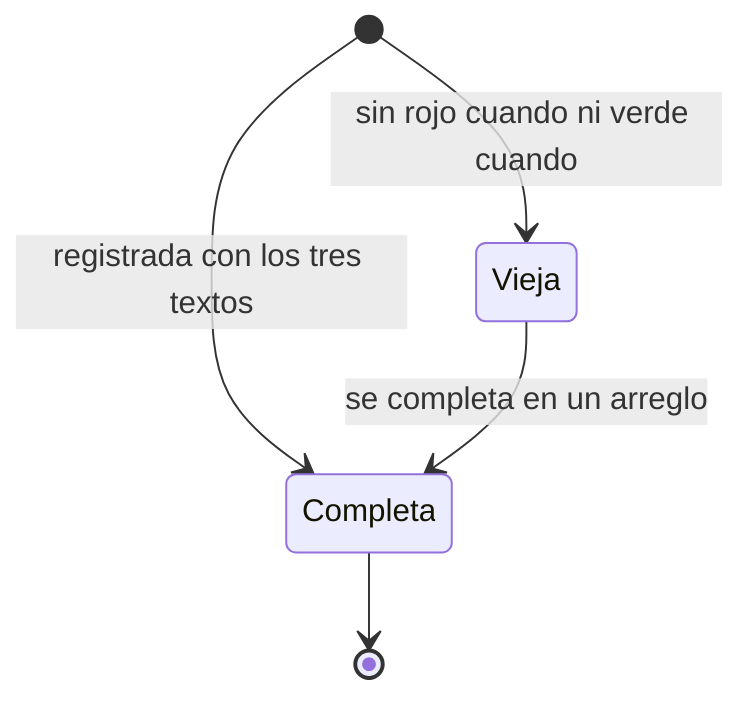

# F008 · Documentación verificable de pruebas, código y arreglos

[Inicio](../../README.md) › [E001](../README.md) › F008

[Feature](../../glosario.md#feature) que vuelve la [wiki](../../glosario.md#wiki) un mapa fiel de lo que hay y de cómo se prueba.

## En una frase

Cada prueba, función y arreglo queda escrito donde el humano lo lee.

## Para qué existe

**El problema.** Una prueba que dice solo «archivo dentro pasa» no explica qué protege. El humano no sabe qué hay en el repo sin leer código.

**La solución.** Seis [slices](../../glosario.md#slice). Las pruebas dicen qué validan y cuándo quedan en rojo o en verde. El feature exige su prueba integral. Las portadas listan las [iniciativas](../../glosario.md#iniciativa). Las funciones llevan comentario y cada slice enlaza su código y sus arreglos.

## Analogía

Piensa en el **manual de un equipo médico**.

- Cada alarma dice qué vigila, cuándo suena y cuándo se apaga.
- Cada reparación queda anotada en la ficha del equipo.

Límite de la analogía: aquí un [gate](../../glosario.md#gate) revisa el manual; nadie lo firma a mano.

## Diagrama

Estados de una prueba en la wiki:

| Slice | Qué entrega |
|---|---|
| [S001 Cada prueba con valida, rojo cuando y verde cuando](S001.md) | Tres campos por prueba, en el backlog y en la wiki |
| [S003 Portadas con todas las iniciativas](S003.md) | El gate exige enlace a cada iniciativa en las dos portadas |
| [S007 Completar la documentación vieja](S007.md) | Documentar pruebas viejas, también en arreglos; el gate exige los textos a todas |
| [S006 Arreglos con ID bajo su slice](S006.md) | Correcciones con ID propio, sin slices nuevos |

## Ejemplo de punta a punta

continúa: [EJ-E001](../README.md#EJ-E001)

1. Un slice nuevo registra su prueba con qué valida, cuándo cae y cuándo pasa.
2. La página del slice muestra esos tres textos en su tabla.
3. El humano entiende la prueba sin abrir el código.

## Paso a paso

1. Detalle de cada prueba (S001).
2. Prueba integral obligatoria para cerrar el feature (S002).
3. Portadas con todas las iniciativas (S003).
4. Funciones comentadas e índice de código (S004).
5. Sección «Código» en cada slice (S005).
6. Arreglos con ID bajo su slice (S006).

## Cómo se usa

- `aquas backlog pruebas <id> "./paquete:TestNombre=valida|rojo cuando|verde cuando"`.

## Contrato y evidencia

**Objetivo.** La wiki de un slice muestra sus pruebas, su código y sus arreglos.

Prueba integral: `TestDocumentacionVerificable` (pendiente).

## Navegación

<!-- GENERADO por aquas desde trabajo/: no editar a mano; `aquas compilar` lo rehace. -->

| Hijo | Qué es | Estado |
|---|---|---|
| [S001](S001.md) | Cada prueba con valida, rojo cuando y verde cuando, en backlog y wiki | Hecho |
| S002 | Prueba integral del feature obligatoria para cerrarlo | Planeado |
| [S003](S003.md) | Portadas listan todas las iniciativas con enlace | Hecho |
| S004 | Toda función comentada e índice docs/codigo generado | Planeado |
| S005 | Sección Código en cada slice con enlaces a lo tocado | Planeado |
| [S006](S006.md) | Arreglos con ID bajo su slice y sección Arreglos | Hecho |
| [S007](S007.md) | Completar la documentación vieja de pruebas y arreglos | Hecho |

<!-- /GENERADO -->

- ↑ Subir: [E001 · Gobierno del trabajo](../README.md)
- Abajo: [S001 · Cada prueba con valida, rojo cuando y verde cuando](S001.md)
- Abajo: [S006 · Arreglos con ID bajo su slice y sección Arreglos](S006.md)
- Abajo: [S003 · Portadas listan todas las iniciativas con enlace](S003.md)
- Abajo: [S007 · Completar la documentación vieja de pruebas y arreglos](S007.md)
