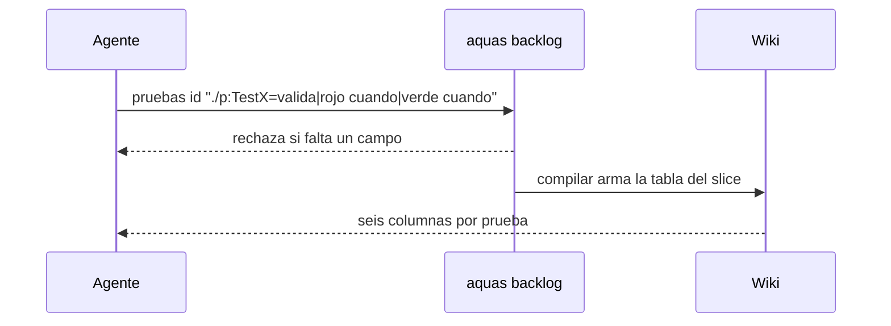

# S001 · Cada prueba con valida, rojo cuando y verde cuando

[Inicio](../../README.md) › [E001](../README.md) › [F008](README.md) › S001

Cada prueba del [backlog](../../glosario.md#backlog) dice qué valida, cuándo queda en rojo y cuándo en verde. La [wiki](../../glosario.md#wiki) lo muestra.

## En una frase

Una prueba se entiende leyendo su tabla, sin abrir el código.

## Para qué existe

**El problema.** La ficha guardaba solo una intención corta, como «deja pasar». El humano no sabía qué fallo atrapa la prueba ni qué la pone en verde.

**La solución.** Al registrar una prueba se exigen tres textos: valida, rojo cuando y verde cuando. La tabla del [slice](../../glosario.md#slice) los muestra en columnas. Las pruebas viejas muestran «—» y no rompen el [gate](../../glosario.md#gate).

Contrato del [slice](../../glosario.md#slice):

| Campo | Valor |
|---|---|
| Objetivo | Tres campos por prueba, en el backlog y en la wiki |
| Incluye | Formato `valida\|rojo cuando\|verde cuando`, chequeo del gate, tabla de seis columnas |
| Excluye | Completar las pruebas viejas; prueba integral del feature (S002) |
| Prueba | `go test ./internal/backlog/ ./internal/wiki/ -run 'TestPruebaExigeValidaRojoVerde\|TestTablaPruebasMuestraCuando'` |

## Analogía

Piensa en una **alarma de humo con su etiqueta**.

- La etiqueta dice qué vigila, cuándo suena y cuándo calla.
- Sin etiqueta, nadie sabe si el silencio es bueno.

Límite de la analogía: aquí la etiqueta es obligatoria; el comando rechaza la prueba sin ella.

## Diagrama

## Ejemplo de punta a punta

continúa: [EJ-E001-F008](README.md#EJ-E001-F008)

1. Este slice registró sus dos pruebas con los tres textos.
2. Un registro con solo «valida» falló con «sin rojo cuando o verde cuando».
3. La tabla de abajo muestra los tres textos de cada prueba.

## Paso a paso

1. Partir el texto tras el `=` en tres por la barra `|`.
2. Rechazar si falta «rojo cuando» o «verde cuando».
3. En el gate, señalar la prueba que trae uno solo de los dos.
4. En la wiki, mostrar seis columnas; «—» si el campo falta.

## Cómo se usa

- `aquas backlog pruebas <id> "./paquete:TestNombre=valida|rojo cuando|verde cuando"`.
- `aquas backlog ver <id>` muestra los tres textos.

## Contrato y evidencia

<!-- GENERADO por aquas desde trabajo/: no editar a mano; `aquas compilar` lo rehace. -->

| Prueba | Valida | Rojo cuando | Verde cuando | Rojo | Verde |
|---|---|---|---|---|---|
| `TestPruebaExigeValidaRojoVerde` | una prueba sin valida, rojo cuando o verde cuando cae al registrarla | listaPruebas o el gate aceptan una prueba con algún campo vacío | las malas dan error, la completa guarda sus tres campos y falta verde cuando se señala | 2026-10-22 | 2026-10-22 |
| `TestTablaPruebasMuestraCuando` | la tabla del slice muestra valida, rojo cuando y verde cuando de cada prueba | a la tabla le falta alguna de las tres columnas o su texto | la página generada del slice contiene los tres textos de la prueba en su tabla | 2026-10-22 | 2026-10-22 |

<!-- /GENERADO -->

Estado: hecho.

## Navegación

- ↑ Subir: [F008 · Documentación verificable de pruebas, código y arreglos](README.md)
