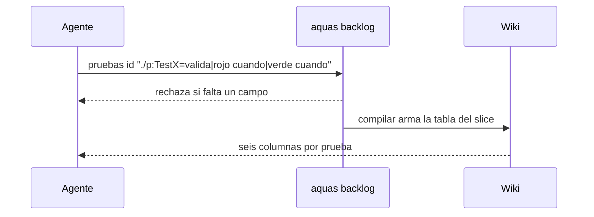

# S001 · Cada prueba con valida, rojo cuando y verde cuando

[Inicio](../../README.md) › [E001](../README.md) › [F008](README.md) › S001

Cada prueba del [backlog](../../glosario.md#backlog) dice qué valida, cuándo queda en rojo y cuándo en verde. La [wiki](../../glosario.md#wiki) lo muestra.

## En una frase

Una prueba se entiende leyendo su tabla, sin abrir el código.

## Para qué existe

**El problema.** La ficha guardaba solo una intención corta, como «deja pasar». El humano no sabía qué fallo atrapa la prueba ni qué la pone en verde.

**La solución.** Al registrar una prueba se exigen tres textos: valida, rojo cuando y verde cuando. La tabla del [slice](../../glosario.md#slice) los muestra en columnas. Las pruebas viejas muestran «—» y no rompen el [gate](../../glosario.md#gate).

Contrato del [slice](../../glosario.md#slice):

| Campo | Valor |
|---|---|
| Objetivo | Tres campos por prueba, en el backlog y en la wiki |
| Incluye | Formato `valida\|rojo cuando\|verde cuando`, chequeo del gate, tabla de seis columnas |
| Excluye | Completar las pruebas viejas; prueba integral del feature (S002) |
| Prueba | `go test ./internal/backlog/ ./internal/wiki/ -run 'TestPruebaExigeValidaRojoVerde\|TestTablaPruebasMuestraCuando'` |

## Analogía

Piensa en una **alarma de humo con su etiqueta**.

- La etiqueta dice qué vigila, cuándo suena y cuándo calla.
- Sin etiqueta, nadie sabe si el silencio es bueno.

Límite de la analogía: aquí la etiqueta es obligatoria; el comando rechaza la prueba sin ella.

## Diagrama

## Ejemplo de punta a punta

continúa: [EJ-E001-F008](README.md#EJ-E001-F008)

1. Este slice registró sus dos pruebas con los tres textos.
2. Un registro con solo «valida» falló con «sin rojo cuando o verde cuando».
3. La tabla de abajo muestra los tres textos de cada prueba.

## Paso a paso

1. Partir el texto tras el `=` en tres por la barra `|`.
2. Rechazar si falta «rojo cuando» o «verde cuando».
3. En el gate, señalar la prueba que trae uno solo de los dos.
4. En la wiki, mostrar seis columnas; «—» si el campo falta.

## Cómo se usa

- `aquas backlog pruebas <id> "./paquete:TestNombre=valida|rojo cuando|verde cuando"`.
- `aquas backlog ver <id>` muestra los tres textos.

## Contrato y evidencia

<!-- GENERADO por aquas desde trabajo/: no editar a mano; `aquas compilar` lo rehace. -->

| Prueba | Valida | Rojo cuando | Verde cuando | Rojo | Verde |
|---|---|---|---|---|---|
| `TestPruebaExigeValidaRojoVerde` | una prueba sin valida, rojo cuando o verde cuando cae al registrarla | listaPruebas o el gate aceptan una prueba con algún campo vacío | las malas dan error, la completa guarda sus tres campos y falta verde cuando se señala | 2026-10-22 | 2026-10-22 |
| `TestTablaPruebasMuestraCuando` | la tabla del slice muestra valida, rojo cuando y verde cuando de cada prueba | a la tabla le falta alguna de las tres columnas o su texto | la página generada del slice contiene los tres textos de la prueba en su tabla | 2026-10-22 | 2026-10-22 |

### Código

| Archivo | Función | Parámetros | Qué hace |
|---|---|---|---|
| [cmd/aquas/main.go](../../../cmd/aquas/main.go) | `main` | `()` | main despacha el subcomando de aquas (compilar, verificar, backlog, hooks…) y sale con su código. |
| [cmd/aquas/main.go](../../../cmd/aquas/main.go) | `hook` | `(raiz string)` | hook: exit 0 = nada que reportar; exit 2 = stderr se muestra a Claude. |
| [cmd/aquas/main.go](../../../cmd/aquas/main.go) | `compilarSettings` | `(w io.Writer)` | compilarSettings regenera .claude/settings.json; sin entorno declarado no inventa uno. |
| [cmd/aquas/main.go](../../../cmd/aquas/main.go) | `reportar` | `(w io.Writer, inf compilador.Informe)` | reportar imprime qué derivados escribió la compilación, o que todo estaba al día. |
| [cmd/aquas/main.go](../../../cmd/aquas/main.go) | `listar` | `(titulo string, problemas []string)` | listar imprime en stderr un título y cada problema en su viñeta. |
| [cmd/aquas/main.go](../../../cmd/aquas/main.go) | `lista` | `(xs []string) string` | lista une los textos con comas, o «—» si no hay ninguno. |
| [cmd/aquas/main.go](../../../cmd/aquas/main.go) | `fallar` | `(codigo int, err error)` | fallar imprime el error en stderr y termina con el código dado. |
| [cmd/aquas/main.go](../../../cmd/aquas/main.go) | `memoriaCLI` | `(raiz string, args []string)` | memoriaCLI: `ver` imprime la memoria; `fijar campo=valor…` la actualiza y la sella. |
| [cmd/aquas/main.go](../../../cmd/aquas/main.go) | `memoriaArchivada` | `(raiz, id string) error` | memoriaArchivada: CERRADO exige que la memoria que apunta al slice ya esté archivada (E001/F002/S009). |
| [cmd/aquas/main.go](../../../cmd/aquas/main.go) | `focoEnBacklog` | `(raiz string, f memoria.Foco) error` | focoEnBacklog: la memoria solo fija el slice que el backlog tiene en curso (S003). |
| [cmd/aquas/main.go](../../../cmd/aquas/main.go) | `backlogCLI` | `(raiz string, args []string)` | backlogCLI: nuevo \\| ver [id] \\| prioridad \\| estado \\| siguiente \\| pruebas \\| rojo \\| verde. |
| [cmd/aquas/main.go](../../../cmd/aquas/main.go) | `turnoCLI` | `(raiz string, args []string)` | turnoCLI: auditoría de turnos (E001/F002/S001). Lee el JSON del hook por stdin. No imprime nada |
| [cmd/aquas/main.go](../../../cmd/aquas/main.go) | `defectoCLI` | `(raiz string, args []string) error` | defectoCLI: nuevo \\| ocurre \\| ver (E001/F004/S001). |
| [cmd/aquas/main.go](../../../cmd/aquas/main.go) | `versionBinario` | `() string` | versionBinario: versión del módulo con que se compiló el binario (= versión del gobierno embebido). |
| [internal/backlog/rojo.go](../../../internal/backlog/rojo.go) | `problemaPrueba` | `(p Prueba) string` | problemaPrueba: por qué una prueba de la ficha está mal escrita ("" si está bien). |
| [internal/backlog/rojo.go](../../../internal/backlog/rojo.go) | `listaPruebas` | `(xs []string) ([]Prueba, error)` | listaPruebas convierte "./paquete:TestNombre=intención" en pruebas válidas, sin repetidas. |
| [internal/backlog/rojo.go](../../../internal/backlog/rojo.go) | `corriendo` | `(f Ficha) bool` | corriendo: la ficha está EN_CURSO o VERIFICANDO. |
| [internal/backlog/rojo.go](../../../internal/backlog/rojo.go) | `sliceEnCurso` | `(act map[string]Ficha) (string, bool)` | sliceEnCurso: el primer slice EN_CURSO o VERIFICANDO entre las activas, por id. |
| [internal/backlog/rojo.go](../../../internal/backlog/rojo.go) | `SliceEnCurso` | `(raiz string) (string, bool, error)` | SliceEnCurso: el único slice EN_CURSO o VERIFICANDO, si hay. |
| [internal/backlog/rojo.go](../../../internal/backlog/rojo.go) | `Pruebas` | `(raiz, id string, lista []string) (Ficha, error)` | Pruebas fija las pruebas de la ficha; cambiarlas borra rojo y verde. |
| [internal/backlog/rojo.go](../../../internal/backlog/rojo.go) | `corrible` | `(raiz, id string) (Ficha, error)` | corrible: ficha activa con pruebas; un slice además debe estar en curso. |
| [internal/backlog/rojo.go](../../../internal/backlog/rojo.go) | `Rojo` | `(raiz, id string, ahora time.Time) (Ficha, error)` | Rojo corre cada prueba sola con `go test -json`; exige que cada una falle por sí misma. |
| [internal/backlog/rojo.go](../../../internal/backlog/rojo.go) | `Verde` | `(raiz, id string, ahora time.Time) (Ficha, error)` | Verde corre las pruebas juntas tras el rojo; exige que todas pasen. |
| [internal/backlog/rojo.go](../../../internal/backlog/rojo.go) | `resultado.motivo` | `(siPasa string) string` | motivo: texto que explica el resultado de una prueba; siPasa se usa cuando pasó. |
| [internal/backlog/rojo.go](../../../internal/backlog/rojo.go) | `correr` | `(raiz string, ps []Prueba) (map[string]resultado, error)` | correr: `go test -json -count=1 -run ^(A\\|B)$ ./paquete` por paquete; resultado por prueba. |
| [internal/backlog/rojo.go](../../../internal/backlog/rojo.go) | `motivoDelFallo` | `(ls []string) string` | motivoDelFallo: la última línea «archivo.go:N: …» (la que hizo fallar); si no hay, la primera. |
| [internal/backlog/rojo.go](../../../internal/backlog/rojo.go) | `head` | `(raiz string) string` | head: commit actual del repo, o "" fuera de Git. |
| [internal/backlog/rojo.go](../../../internal/backlog/rojo.go) | `cierre` | `(f Ficha) error` | cierre: CERRADO exige pruebas, rojo y verde. |
| [internal/backlog/rojo.go](../../../internal/backlog/rojo.go) | `problemasRojoVerde` | `(rel string, f Ficha) []string` | problemasRojoVerde: chequeos del gate sobre pruebas, rojo y verde de una ficha. |
| [internal/backlog/rojo.go](../../../internal/backlog/rojo.go) | `Detalle` | `(f Ficha) string` | Detalle: pruebas con su intención, y rojo y verde, para `ver <id>`, `pruebas`, `rojo` y `verde`. |
| [internal/wiki/hijos.go](../../../internal/wiki/hijos.go) | `paginaDe` | `(id string) string` | paginaDe: la página de la wiki que corresponde a un id de ficha. |
| [internal/wiki/hijos.go](../../../internal/wiki/hijos.go) | `celda` | `(s string) string` | celda escapa saltos de línea y «\\|» para una celda de tabla Markdown. |
| [internal/wiki/hijos.go](../../../internal/wiki/hijos.go) | `existe` | `(raiz, rel string) bool` | existe: la ruta relativa existe en disco. |
| [internal/wiki/hijos.go](../../../internal/wiki/hijos.go) | `tablaHijos` | `(raiz, padreRel string, hijos []backlog.Ficha) string` | tablaHijos: una fila por hijo directo; enlace solo si su página existe. |
| [internal/wiki/hijos.go](../../../internal/wiki/hijos.go) | `fecha` | `(r *backlog.Registro) string` | fecha: día AAAA-MM-DD de un registro, o «—» si no hay. |
| [internal/wiki/hijos.go](../../../internal/wiki/hijos.go) | `oGuion` | `(s string) string` | oGuion: el texto como celda, o «—» si está vacío (pruebas anteriores a E001/F008/S001). |
| [internal/wiki/hijos.go](../../../internal/wiki/hijos.go) | `tablaPruebas` | `(f backlog.Ficha) string` | tablaPruebas: las pruebas del slice: qué validan, cuándo quedan en rojo y en verde, y si se vieron en rojo y en verde. |
| [internal/wiki/hijos.go](../../../internal/wiki/hijos.go) | `esperados` | `(raiz string) (map[string]esperado, []backlog.Ficha, error)` | esperados: página existente → bloque que debe llevar. Vacío si no hay fichas. |
| [internal/wiki/hijos.go](../../../internal/wiki/hijos.go) | `bloqueActual` | `(c string) (ini, fin int)` | bloqueActual: posición del bloque en c; ini < 0 = no hay; fin < 0 = sin cierre. |
| [internal/wiki/hijos.go](../../../internal/wiki/hijos.go) | `Generar` | `(raiz string) ([]string, error)` | Generar reescribe el bloque GENERADO de cada página desde las fichas; devuelve lo escrito. |
| [internal/wiki/hijos.go](../../../internal/wiki/hijos.go) | `revisarHijos` | `(raiz string, paginas map[string]*pagina, orden []string) ([]string, error)` | revisarHijos: bloque presente y al día, enlaces sin saltar niveles, ficha arrancada con página. |
| [internal/wiki/hijos.go](../../../internal/wiki/hijos.go) | `tablaArreglos` | `(f backlog.Ficha) string` | tablaArreglos: sección «Arreglos» de la ficha; vacía si no tiene. |

<!-- /GENERADO -->

Estado: hecho.

## Navegación

- ↑ Subir: [F008 · Documentación verificable de pruebas, código y arreglos](README.md)
