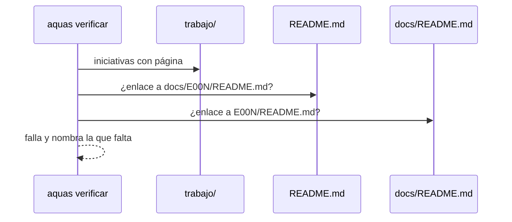

# S003 · Portadas listan todas las iniciativas con enlace

[Inicio](../../README.md) › [E001](../README.md) › [F008](README.md) › S003

El [gate](../../glosario.md#gate) exige que `README.md` y `docs/README.md` enlacen cada [iniciativa](../../glosario.md#iniciativa) que ya tiene página.

## En una frase

Quien abre el repo ve todas las iniciativas y entra a cada una con un clic.

## Para qué existe

**El problema.** El `README.md` de la raíz nombraba E002 solo como texto y no enlazaba ninguna iniciativa. Una iniciativa nueva podía quedar invisible desde la portada.

**La solución.** El gate lee las iniciativas del [backlog](../../glosario.md#backlog). Si una tiene página y falta su enlace en una portada, falla y nombra cuál. `docs/README.md` ya los trae en su bloque generado; `README.md` los lleva a mano, en inglés.

Contrato del [slice](../../glosario.md#slice):

| Campo | Valor |
|---|---|
| Objetivo | Ninguna iniciativa con página queda fuera de las portadas |
| Incluye | `revisarPortadas` en el [gate](../../glosario.md#gate), sección «Initiatives» en `README.md` |
| Excluye | Iniciativas sin página todavía; el mapa interno de cada iniciativa |
| Prueba | `go test ./internal/wiki/ -run TestPortadasListanIniciativas` |

## Analogía

Piensa en el **directorio de la entrada de un edificio**.

- Cada oficina abierta aparece en el directorio, con su piso.
- Una oficina sin placa no existe para el visitante.

Límite de la analogía: aquí un programa revisa el directorio en cada [commit](../../glosario.md#commit).

## Diagrama

## Ejemplo de punta a punta

continúa: [EJ-E001-F008](README.md#EJ-E001-F008)

1. Con el gate nuevo, `aquas verificar` falló: `README.md` no enlazaba E000, E001 ni E002.
2. Se agregó la sección «Initiatives» al `README.md` con los tres enlaces.
3. El gate volvió a pasar.

## Paso a paso

1. Tomar las iniciativas no canceladas que tienen página.
2. Buscar en `README.md` el enlace `docs/<id>/README.md`.
3. Buscar en `docs/README.md` el enlace `<id>/README.md`.
4. Reportar cada falta con portada e iniciativa.

## Cómo se usa

- Al crear la página de una iniciativa nueva, agregar su línea en «Initiatives» del `README.md`.
- `aquas verificar` avisa si se olvidó.

## Contrato y evidencia

<!-- GENERADO por aquas desde trabajo/: no editar a mano; `aquas compilar` lo rehace. -->

| Prueba | Valida | Rojo cuando | Verde cuando | Rojo | Verde |
|---|---|---|---|---|---|
| `TestPortadasListanIniciativas` | cada iniciativa tiene enlace en README.md y docs/README.md | falta una iniciativa o sale sin enlace y el gate calla | el gate nombra portada e iniciativa faltantes y calla si están todas | 2026-10-22 | 2026-10-22 |

### Código

| Archivo | Función | Parámetros | Qué hace |
|---|---|---|---|
| [internal/wiki/portadas.go](../../../internal/wiki/portadas.go) | `faltanIniciativas` | `(ids []string, readme, inicioWiki string) []string` | faltanIniciativas: problemas del gate si alguna iniciativa no está enlazada en una portada. |
| [internal/wiki/portadas.go](../../../internal/wiki/portadas.go) | `revisarPortadas` | `(raiz string) ([]string, error)` | revisarPortadas: lee las iniciativas del backlog y las dos portadas; solo exige las iniciativas que ya tienen página. |
| [internal/wiki/wiki.go](../../../internal/wiki/wiki.go) | `Verificar` | `(raiz string) ([]string, error)` | Verificar devuelve los problemas de la wiki bajo raiz/docs; vacío = gate OK. |
| [internal/wiki/wiki.go](../../../internal/wiki/wiki.go) | `relativa` | `(raiz, p string) string` | relativa: ruta de p respecto de la raíz, con barras «/». |
| [internal/wiki/wiki.go](../../../internal/wiki/wiki.go) | `clasificar` | `(rel string) *pagina` | clasificar asigna nivel, padre e id de ejemplo según la ruta; nil = fuera del árbol. |
| [internal/wiki/wiki.go](../../../internal/wiki/wiki.go) | `pagina.agregarProsa` | `(texto string, linea int)` | agregarProsa suma una entrada de prosa con su línea en el archivo (E000/F006/S004). |
| [internal/wiki/wiki.go](../../../internal/wiki/wiki.go) | `analizar` | `(raiz string, pg *pagina) error` | analizar lee la página: secciones H2, diagramas, anclas (id HTML y títulos) y enlaces fuera de código. |
| [internal/wiki/wiki.go](../../../internal/wiki/wiki.go) | `slug` | `(s string) string` | slug al estilo GitHub/VS Code: minúsculas, letras/dígitos/-/_ se conservan, espacio → guion. |
| [internal/wiki/wiki.go](../../../internal/wiki/wiki.go) | `pagina.seccion` | `(titulo string) *seccion` | seccion busca una sección de la página por su título; nil si no está. |
| [internal/wiki/wiki.go](../../../internal/wiki/wiki.go) | `revisarSecciones` | `(pg *pagina) []string` | revisarSecciones: faltan secciones fijas o están fuera de orden. |
| [internal/wiki/wiki.go](../../../internal/wiki/wiki.go) | `revisarDiagramas` | `(pg *pagina) []string` | revisarDiagramas: la sección Diagrama trae el Mermaid que pide su nivel. |
| [internal/wiki/wiki.go](../../../internal/wiki/wiki.go) | `revisarEjemplo` | `(pg *pagina, paginas map[string]*pagina) []string` | revisarEjemplo: el ejemplo lleva su ancla EJ- y encadena con el del padre. |
| [internal/wiki/wiki.go](../../../internal/wiki/wiki.go) | `revisarNavegacion` | `(pg *pagina, hijos []string) []string` | revisarNavegacion: hay ↑ Subir y un enlace Abajo a cada hija. |
| [internal/wiki/wiki.go](../../../internal/wiki/wiki.go) | `revisarEnlaces` | `(raiz string, pg *pagina, anclas map[string]map[string]bool) []string` | revisarEnlaces: cada enlace interno apunta a un archivo y ancla que existen. |
| [internal/wiki/wiki.go](../../../internal/wiki/wiki.go) | `revisarAlcance` | `(paginas map[string]*pagina, orden []string) []string` | revisarAlcance: toda página del árbol debe alcanzarse desde docs/README.md siguiendo enlaces. |
| [internal/wiki/wiki.go](../../../internal/wiki/wiki.go) | `resolver` | `(desde, destino string) (string, string)` | resolver convierte un destino relativo a la página en ruta relativa a la raíz + fragmento. |

<!-- /GENERADO -->

Estado: hecho.

## Navegación

- ↑ Subir: [F008 · Documentación verificable de pruebas, código y arreglos](README.md)
