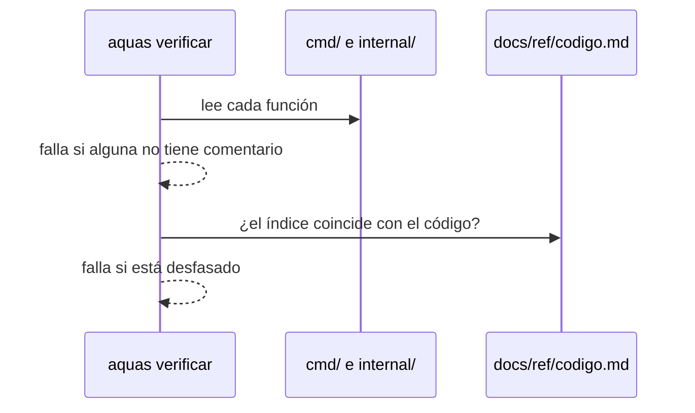

# S004 · Toda función comentada e índice del código

[Inicio](../../README.md) › [E001](../README.md) › [F008](README.md) › S004

El [gate](../../glosario.md#gate) exige un comentario en cada función de `cmd/` e `internal/`. La página [Código](../../ref/codigo.md) las lista todas.

## En una frase

El humano sabe qué hace cada pieza del repo sin leer [Go](../../glosario.md#go).

## Para qué existe

**El problema.** 69 de 219 funciones no tenían comentario. Para saber qué hacían había que leer el código.

**La solución.** El gate falla por cada función sin comentario y nombra archivo, línea y función. `aquas compilar` genera el índice con la primera línea de cada comentario.

Contrato del [slice](../../glosario.md#slice):

| Campo | Valor |
|---|---|
| Objetivo | Ninguna función sin comentario; índice al día |
| Incluye | `revisarCodigo` en el gate, `indiceCodigo` en `docs/ref/codigo.md`, comentario a las 69 funciones |
| Excluye | Funciones de prueba; la sección «Código» de cada slice (S005) |
| Prueba | `go test ./internal/wiki/ -run TestFuncionSinComentarioCae` |

## Analogía

Piensa en **las etiquetas de un tablero eléctrico**.

- Cada interruptor dice qué circuito corta.
- Uno sin etiqueta obliga a probar a ciegas.

Límite de la analogía: aquí un programa rechaza el interruptor sin etiqueta.

## Diagrama

## Ejemplo de punta a punta

continúa: [EJ-E001-F008](README.md#EJ-E001-F008)

1. Con el gate nuevo, `aquas verificar` nombró 69 funciones sin comentario.
2. Cada una recibió una línea que dice qué hace.
3. El índice muestra, por ejemplo, `celda`: escapa saltos de línea y «|» para una celda de tabla.

## Paso a paso

1. Recorrer el código de producción, sin pruebas.
2. Avisar cada función sin comentario.
3. Generar la tabla archivo, función y comentario.

## Cómo se usa

- Al escribir una función, ponle encima una línea que diga qué hace.
- `aquas compilar` actualiza [Código](../../ref/codigo.md).

## Contrato y evidencia

<!-- GENERADO por aquas desde trabajo/: no editar a mano; `aquas compilar` lo rehace. -->

| Prueba | Valida | Rojo cuando | Verde cuando | Rojo | Verde |
|---|---|---|---|---|---|
| `TestFuncionSinComentarioCae` | una función sin comentario hace caer el gate y el índice lista cada función con su comentario | una función sin comentario no hace caer el gate, o el índice omite una función o su comentario | la función sin comentario cae nombrada; con comentario el gate pasa y el índice la lista | 2026-10-23 | 2026-10-23 |

<!-- /GENERADO -->

Estado: hecho.

## Navegación

- ↑ Subir: [F008 · Documentación verificable de pruebas, código y arreglos](README.md)
