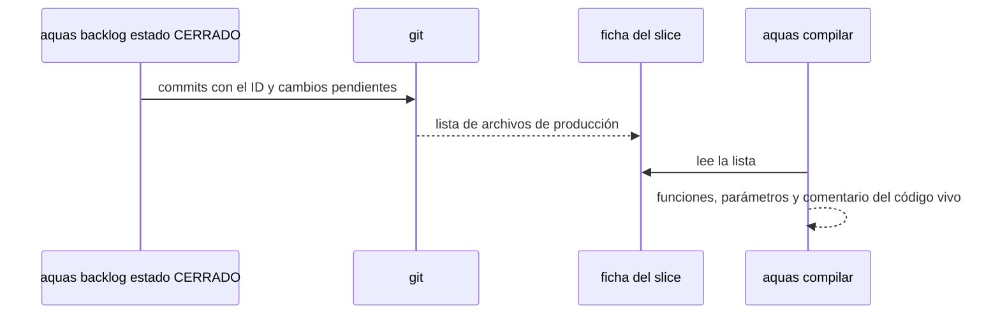

# S005 · Sección Código en cada slice

[Inicio](../../README.md) › [E001](../README.md) › [F008](README.md) › S005

La página de cada [slice](../../glosario.md#slice) lista el código que tocó: archivo, funciones, parámetros y qué hace cada una.

## En una frase

El humano ve qué piezas cambió un slice sin abrir git ni el código.

## Para qué existe

**El problema.** La página de un slice decía qué pruebas tenía, pero no qué archivos cambió. Para saberlo había que revisar los [commits](../../glosario.md#commit).

**La solución.** Al cerrar, el slice guarda la lista de archivos de producción que tocaron sus commits y sus cambios pendientes. `aquas compilar` arma la sección con las funciones de esos archivos, leídas del código vivo.

Contrato del slice:

| Campo | Valor |
|---|---|
| Objetivo | Cada slice cerrado enlaza su código con funciones, parámetros y comentario |
| Incluye | Lista congelada al cerrar, `aquas backlog codigo <id>` para slices viejos, columna Parámetros en el índice |
| Excluye | Pruebas y docs; describir el cambio en sí |
| Prueba | `go test ./internal/wiki/ -run TestSliceEnlazaSuCodigo` y `go test ./internal/backlog/ -run TestCerrarGuardaCodigo` |

## Analogía

Piensa en **la hoja de una reparación de carro**.

- Dice qué piezas se cambiaron, no cada tornillo que se apretó.
- Cada pieza remite a su ficha técnica.

Límite de la analogía: aquí la ficha técnica se lee del código, así que no envejece.

## Diagrama

## Ejemplo de punta a punta

continúa: [EJ-E001-F008](README.md#EJ-E001-F008)

1. El slice 4 se cerró con commits que tocaron `internal/wiki/codigo.go`, entre otros.
2. `aquas backlog codigo E001/F008/S004` guardó esa lista en su ficha.
3. Su página muestra, por ejemplo, `revisarCodigo` con parámetros `(raiz string) ([]string, error)` y su comentario.
4. Si alguien corrige un punto dentro de esa función, la página queda igual: firma y comentario no cambian.

## Paso a paso

1. Al cerrar, juntar archivos de los commits del slice y de los cambios pendientes.
2. Quedarse con los `.go` de `cmd/` e `internal/`, sin pruebas.
3. Guardar la lista en la ficha.
4. En cada compilación, listar funciones, parámetros y comentario de esos archivos.

## Cómo se usa

- Al cerrar un slice no hay que hacer nada: la lista se guarda sola.
- Para un slice ya cerrado: `aquas backlog codigo <id>`.

## Contrato y evidencia

<!-- GENERADO por aquas desde trabajo/: no editar a mano; `aquas compilar` lo rehace. -->

| Prueba | Valida | Rojo cuando | Verde cuando | Rojo | Verde |
|---|---|---|---|---|---|
| `TestSliceEnlazaSuCodigo` | la página del slice lista su código: archivo enlazado, función, parámetros y qué hace | falta la sección Código, el enlace, una función, sus parámetros o su comentario, o un archivo borrado queda como enlace roto | cada archivo del slice aparece enlazado con sus funciones, parámetros y comentario; el borrado aparece sin enlace | 2026-10-23 | 2026-10-23 |
| `TestCerrarGuardaCodigo` | el código tocado de un slice sale de sus commits y de los cambios sin commit | omite un archivo de producción tocado, o incluye pruebas, docs o archivos de commits ajenos | devuelve solo los .go de producción de cmd/ e internal/ tocados por el slice, ordenados | 2026-10-23 | 2026-10-23 |

### Código

| Archivo | Función | Parámetros | Qué hace |
|---|---|---|---|
| [cmd/aquas/main.go](../../../cmd/aquas/main.go) | `main` | `()` | main despacha el subcomando de aquas (compilar, verificar, backlog, hooks…) y sale con su código. |
| [cmd/aquas/main.go](../../../cmd/aquas/main.go) | `hook` | `(raiz string)` | hook: exit 0 = nada que reportar; exit 2 = stderr se muestra a Claude. |
| [cmd/aquas/main.go](../../../cmd/aquas/main.go) | `compilarSettings` | `(w io.Writer)` | compilarSettings regenera .claude/settings.json; sin entorno declarado no inventa uno. |
| [cmd/aquas/main.go](../../../cmd/aquas/main.go) | `reportar` | `(w io.Writer, inf compilador.Informe)` | reportar imprime qué derivados escribió la compilación, o que todo estaba al día. |
| [cmd/aquas/main.go](../../../cmd/aquas/main.go) | `listar` | `(titulo string, problemas []string)` | listar imprime en stderr un título y cada problema en su viñeta. |
| [cmd/aquas/main.go](../../../cmd/aquas/main.go) | `lista` | `(xs []string) string` | lista une los textos con comas, o «—» si no hay ninguno. |
| [cmd/aquas/main.go](../../../cmd/aquas/main.go) | `fallar` | `(codigo int, err error)` | fallar imprime el error en stderr y termina con el código dado. |
| [cmd/aquas/main.go](../../../cmd/aquas/main.go) | `memoriaCLI` | `(raiz string, args []string)` | memoriaCLI: `ver` imprime la memoria; `fijar campo=valor…` la actualiza y la sella. |
| [cmd/aquas/main.go](../../../cmd/aquas/main.go) | `memoriaArchivada` | `(raiz, id string) error` | memoriaArchivada: CERRADO exige que la memoria que apunta al slice ya esté archivada (E001/F002/S009). |
| [cmd/aquas/main.go](../../../cmd/aquas/main.go) | `focoEnBacklog` | `(raiz string, f memoria.Foco) error` | focoEnBacklog: la memoria solo fija el slice que el backlog tiene en curso (S003). |
| [cmd/aquas/main.go](../../../cmd/aquas/main.go) | `backlogCLI` | `(raiz string, args []string)` | backlogCLI: nuevo \\| ver [id] \\| prioridad \\| estado \\| siguiente \\| pruebas \\| rojo \\| verde. |
| [cmd/aquas/main.go](../../../cmd/aquas/main.go) | `turnoCLI` | `(raiz string, args []string)` | turnoCLI: auditoría de turnos (E001/F002/S001). Lee el JSON del hook por stdin. No imprime nada |
| [cmd/aquas/main.go](../../../cmd/aquas/main.go) | `defectoCLI` | `(raiz string, args []string) error` | defectoCLI: nuevo \\| ocurre \\| ver (E001/F004/S001). |
| [cmd/aquas/main.go](../../../cmd/aquas/main.go) | `versionBinario` | `() string` | versionBinario: versión del módulo con que se compiló el binario (= versión del gobierno embebido). |
| [internal/backlog/backlog.go](../../../internal/backlog/backlog.go) | `terminal` | `(estado string) bool` | terminal: el estado ya no cambia (CERRADO o CANCELADO). |
| [internal/backlog/backlog.go](../../../internal/backlog/backlog.go) | `esta` | `(xs []string, x string) bool` | esta: x figura en la lista. |
| [internal/backlog/backlog.go](../../../internal/backlog/backlog.go) | `tipoYPadre` | `(id string) (tipo, padre string)` | tipoYPadre deriva del id: E001 → iniciativa; E001/F002 → feature de E001; E001/F002/S002 → slice. |
| [internal/backlog/backlog.go](../../../internal/backlog/backlog.go) | `nombre` | `(id string) string` | nombre: archivo JSON de una ficha, con «/» del ID cambiadas por «-». |
| [internal/backlog/backlog.go](../../../internal/backlog/backlog.go) | `todas` | `(raiz string) (act, arc map[string]Ficha, err error)` | todas lee activo y archivo. Una ficha ilegible es error: Validar la detalla. |
| [internal/backlog/backlog.go](../../../internal/backlog/backlog.go) | `Todas` | `(raiz string) ([]Ficha, error)` | Todas: las fichas de activo y archivo, ordenadas por id. Para quien solo lee (wiki, E001/F002/S010). |
| [internal/backlog/backlog.go](../../../internal/backlog/backlog.go) | `leer` | `(ruta string) (Ficha, error)` | leer carga una ficha desde su archivo JSON. |
| [internal/backlog/backlog.go](../../../internal/backlog/backlog.go) | `escribir` | `(raiz, dir string, f Ficha) error` | escribir guarda la ficha como JSON en trabajo/<dir>/, con listas vacías en vez de null. |
| [internal/backlog/backlog.go](../../../internal/backlog/backlog.go) | `Nuevo` | `(raiz string, campos []string) (Ficha, error)` | Nuevo crea una ficha desde campos id=… titulo=… prioridad=… motivo=… [bloqueado_por=A,B]. |
| [internal/backlog/backlog.go](../../../internal/backlog/backlog.go) | `Ver` | `(raiz, id string) (Ficha, bool, error)` | Ver busca la ficha en activo y luego en archivo. |
| [internal/backlog/backlog.go](../../../internal/backlog/backlog.go) | `activa` | `(raiz, id string) (Ficha, error)` | activa: la ficha a cambiar; una archivada no cambia. |
| [internal/backlog/backlog.go](../../../internal/backlog/backlog.go) | `Prioridad` | `(raiz, id, prioridad, motivo string) (Ficha, error)` | Prioridad cambia la prioridad; el motivo es obligatorio. |
| [internal/backlog/backlog.go](../../../internal/backlog/backlog.go) | `Estado` | `(raiz, id, estado string) (Ficha, error)` | Estado cambia el estado. CERRADO o CANCELADO mueve la ficha al archivo. |
| [internal/backlog/backlog.go](../../../internal/backlog/backlog.go) | `ordenar` | `(fs []Ficha, arc map[string]Ficha)` | orden de `siguiente`: en curso → desbloqueado → prioridad → secuencia → id. |
| [internal/backlog/backlog.go](../../../internal/backlog/backlog.go) | `Activas` | `(raiz string) ([]Ficha, error)` | Activas: slices en el orden de `siguiente`; después iniciativas y features por secuencia. |
| [internal/backlog/backlog.go](../../../internal/backlog/backlog.go) | `Siguiente` | `(raiz string) (Ficha, bool, error)` | Siguiente: el primer slice del orden fijo que esté en curso o desbloqueado. |
| [internal/backlog/backlog.go](../../../internal/backlog/backlog.go) | `sinDefinir` | `(act map[string]Ficha) (Ficha, bool)` | sinDefinir (E001/F002/S008, regla del humano 2026-10-21): iniciativa o feature activa sin hijos |
| [internal/backlog/backlog.go](../../../internal/backlog/backlog.go) | `Definir` | `(f Ficha) string` | Definir: qué hacer con lo que `siguiente` saca sin definir; "" para un slice. |
| [internal/backlog/backlog.go](../../../internal/backlog/backlog.go) | `libre` | `(f Ficha, arc map[string]Ficha) bool` | libre: no está BLOQUEADO y cada bloqueador ya terminó (archivado: CERRADO o CANCELADO). |
| [internal/backlog/backlog.go](../../../internal/backlog/backlog.go) | `Validar` | `(raiz string) []string` | Validar: problemas de las fichas en disco (gate). Sin carpeta trabajo/ no hay problemas. |
| [internal/backlog/backlog.go](../../../internal/backlog/backlog.go) | `Texto` | `(f Ficha) string` | Texto: una línea por ficha, para el agente. |
| [internal/backlog/codigo.go](../../../internal/backlog/codigo.go) | `codigoTocado` | `(raiz, id string, sinCommit bool) ([]string, error)` | codigoTocado: .go de producción en cmd/ e internal/ que tocaron los commits del slice y, si sinCommit, los cambios pendientes (E001/F008/S005). |
| [internal/backlog/codigo.go](../../../internal/backlog/codigo.go) | `Codigo` | `(raiz, id string) (Ficha, error)` | Codigo recalcula y guarda el código tocado de un slice desde sus commits; sirve para slices ya cerrados. |
| [internal/wiki/codigo.go](../../../internal/wiki/codigo.go) | `funcionesGo` | `(raiz string) ([]funcion, error)` | funcionesGo recorre cmd/ e internal/ (sin _test.go) y devuelve sus funciones en orden de archivo y línea. |
| [internal/wiki/codigo.go](../../../internal/wiki/codigo.go) | `revisarCodigo` | `(raiz string) ([]string, error)` | revisarCodigo: avisos por cada función sin comentario. |
| [internal/wiki/codigo.go](../../../internal/wiki/codigo.go) | `indiceCodigo` | `(raiz string) (string, error)` | indiceCodigo: tabla archivo → función → primera línea de su comentario. |
| [internal/wiki/codigo.go](../../../internal/wiki/codigo.go) | `tablaCodigo` | `(raiz string, f backlog.Ficha) (string, error)` | tablaCodigo: sección «Código» de un slice: cada archivo tocado con sus funciones, parámetros y qué hacen. |
| [internal/wiki/hijos.go](../../../internal/wiki/hijos.go) | `paginaDe` | `(id string) string` | paginaDe: la página de la wiki que corresponde a un id de ficha. |
| [internal/wiki/hijos.go](../../../internal/wiki/hijos.go) | `celda` | `(s string) string` | celda escapa saltos de línea y «\\|» para una celda de tabla Markdown. |
| [internal/wiki/hijos.go](../../../internal/wiki/hijos.go) | `existe` | `(raiz, rel string) bool` | existe: la ruta relativa existe en disco. |
| [internal/wiki/hijos.go](../../../internal/wiki/hijos.go) | `tablaHijos` | `(raiz, padreRel string, hijos []backlog.Ficha) string` | tablaHijos: una fila por hijo directo; enlace solo si su página existe. |
| [internal/wiki/hijos.go](../../../internal/wiki/hijos.go) | `fecha` | `(r *backlog.Registro) string` | fecha: día AAAA-MM-DD de un registro, o «—» si no hay. |
| [internal/wiki/hijos.go](../../../internal/wiki/hijos.go) | `oGuion` | `(s string) string` | oGuion: el texto como celda, o «—» si está vacío (pruebas anteriores a E001/F008/S001). |
| [internal/wiki/hijos.go](../../../internal/wiki/hijos.go) | `tablaPruebas` | `(f backlog.Ficha) string` | tablaPruebas: las pruebas del slice: qué validan, cuándo quedan en rojo y en verde, y si se vieron en rojo y en verde. |
| [internal/wiki/hijos.go](../../../internal/wiki/hijos.go) | `esperados` | `(raiz string) (map[string]esperado, []backlog.Ficha, error)` | esperados: página existente → bloque que debe llevar. Vacío si no hay fichas. |
| [internal/wiki/hijos.go](../../../internal/wiki/hijos.go) | `bloqueActual` | `(c string) (ini, fin int)` | bloqueActual: posición del bloque en c; ini < 0 = no hay; fin < 0 = sin cierre. |
| [internal/wiki/hijos.go](../../../internal/wiki/hijos.go) | `Generar` | `(raiz string) ([]string, error)` | Generar reescribe el bloque GENERADO de cada página desde las fichas; devuelve lo escrito. |
| [internal/wiki/hijos.go](../../../internal/wiki/hijos.go) | `revisarHijos` | `(raiz string, paginas map[string]*pagina, orden []string) ([]string, error)` | revisarHijos: bloque presente y al día, enlaces sin saltar niveles, ficha arrancada con página. |
| [internal/wiki/hijos.go](../../../internal/wiki/hijos.go) | `tablaArreglos` | `(f backlog.Ficha) string` | tablaArreglos: sección «Arreglos» de la ficha; vacía si no tiene. |

<!-- /GENERADO -->

Estado: hecho.

## Navegación

- ↑ Subir: [F008 · Documentación verificable de pruebas, código y arreglos](README.md)
