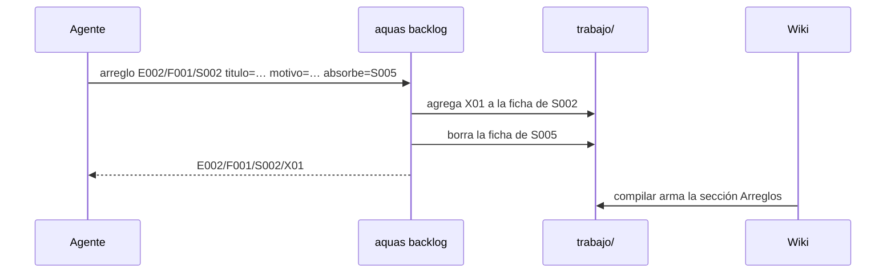

# S006 · Arreglos con ID bajo su slice y sección Arreglos

[Inicio](../../README.md) › [E001](../README.md) › [F008](README.md) › S006

`aquas backlog arreglo <slice|feature> titulo=… motivo=…` anota una corrección bajo su [slice](../../glosario.md#slice), con ID propio. No crea un slice nuevo.

## En una frase

Un arreglo cuelga de lo que arregla, y su página lo muestra.

## Para qué existe

**El problema.** Un defecto de un slice cerrado se registraba como slice nuevo. Así, «Título del hijo» (E002/F001/S005) parecía trabajo nuevo, y era un defecto de «Huecos y build» (S002).

**La solución.** El arreglo vive en la ficha de su slice con ID `E002/F001/S002/X01`, X02… Si no encaja en un slice, cuelga del [feature](../../glosario.md#feature). La página muestra la sección «Arreglos» dentro del bloque generado. Con `absorbe=` un slice cerrado pasa a ser arreglo de su hermano: hereda sus pruebas y la ficha vieja desaparece.

Contrato del [slice](../../glosario.md#slice):

| Campo | Valor |
|---|---|
| Objetivo | Arreglos con ID bajo su slice o feature, visibles en la wiki |
| Incluye | `backlog.Arreglar`, comando `aquas backlog arreglo`, chequeo de secuencia en el [gate](../../glosario.md#gate), tabla «Arreglos», S005 → S002/X01 |
| Excluye | Completar las pruebas viejas sin valida, rojo y verde |
| Prueba | `go test ./internal/backlog/ ./internal/wiki/ -run 'TestArregloCuelgaDeSlice\|TestTablaArreglos'` |

## Analogía

Piensa en la **hoja de servicio de un carro**.

- Cada reparación se anota en la hoja de ese carro, con número.
- No se le asigna un carro nuevo por cada reparación.

Límite de la analogía: aquí el número lo pone `aquas` y el [gate](../../glosario.md#gate) revisa que siga en orden.

## Diagrama

## Ejemplo de punta a punta

continúa: [EJ-E001-F008](README.md#EJ-E001-F008)

1. Se corrió `aquas backlog arreglo E002/F001/S002` con `absorbe=E002/F001/S005`.
2. Salió `E002/F001/S002/X01` y la ficha de S005 desapareció.
3. La página de [S002](../../E002/F001/S002.md) ahora lista el arreglo con su prueba.
4. Un arreglo sin título, o colgado de un slice inexistente, falla.

## Paso a paso

1. Exigir título y motivo; el padre debe ser slice o feature.
2. Numerar el arreglo después del último: X01, X02…
3. Con `absorbe=`, aceptar solo un slice cerrado hermano; heredar sus pruebas y borrarlo.
4. En el gate, señalar IDs fuera de secuencia o sin título.

## Cómo se usa

- `aquas backlog arreglo <slice|feature> titulo=… motivo=…`.
- `aquas backlog arreglo <slice> titulo=… motivo=… absorbe=<slice cerrado hermano>`.

## Contrato y evidencia

<!-- GENERADO por aquas desde trabajo/: no editar a mano; `aquas compilar` lo rehace. -->

| Prueba | Valida | Rojo cuando | Verde cuando | Rojo | Verde |
|---|---|---|---|---|---|
| `TestArregloCuelgaDeSlice` | el arreglo vive bajo su slice con ID padre/X01 | se acepta sin padre o título, el ID no sigue X01, X02 o el slice absorbido sigue vivo | queda en la ficha del slice con su ID y el absorbido desaparece | 2026-10-22 | 2026-10-22 |
| `TestTablaArreglos` | la página del slice lista sus arreglos | falta la sección, una columna o el slice absorbido | la tabla sale completa y sin arreglos no hay sección | 2026-10-22 | 2026-10-22 |

<!-- /GENERADO -->

Estado: hecho.

## Navegación

- ↑ Subir: [F008 · Documentación verificable de pruebas, código y arreglos](README.md)
