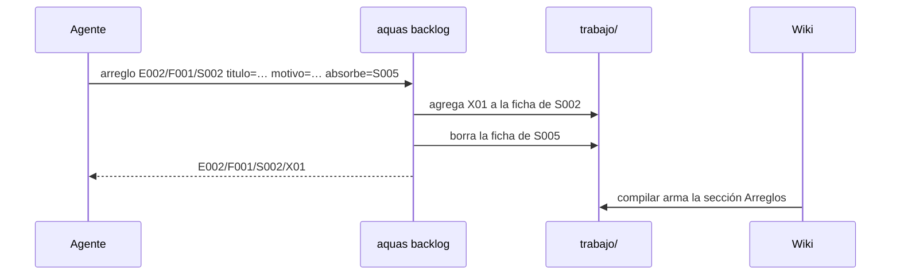

# S006 · Arreglos con ID bajo su slice y sección Arreglos

[Inicio](../../README.md) › [E001](../README.md) › [F008](README.md) › S006

`aquas backlog arreglo <slice|feature> titulo=… motivo=…` anota una corrección bajo su [slice](../../glosario.md#slice), con ID propio. No crea un slice nuevo.

## En una frase

Un arreglo cuelga de lo que arregla, y su página lo muestra.

## Para qué existe

**El problema.** Un defecto de un slice cerrado se registraba como slice nuevo. Así, «Título del hijo» (E002/F001/S005) parecía trabajo nuevo, y era un defecto de «Huecos y build» (S002).

**La solución.** El arreglo vive en la ficha de su slice con ID `E002/F001/S002/X01`, X02… Si no encaja en un slice, cuelga del [feature](../../glosario.md#feature). La página muestra la sección «Arreglos» dentro del bloque generado. Con `absorbe=` un slice cerrado pasa a ser arreglo de su hermano: hereda sus pruebas y la ficha vieja desaparece.

Contrato del [slice](../../glosario.md#slice):

| Campo | Valor |
|---|---|
| Objetivo | Arreglos con ID bajo su slice o feature, visibles en la wiki |
| Incluye | `backlog.Arreglar`, comando `aquas backlog arreglo`, chequeo de secuencia en el [gate](../../glosario.md#gate), tabla «Arreglos», S005 → S002/X01 |
| Excluye | Completar las pruebas viejas sin valida, rojo y verde |
| Prueba | `go test ./internal/backlog/ ./internal/wiki/ -run 'TestArregloCuelgaDeSlice\|TestTablaArreglos'` |

## Analogía

Piensa en la **hoja de servicio de un carro**.

- Cada reparación se anota en la hoja de ese carro, con número.
- No se le asigna un carro nuevo por cada reparación.

Límite de la analogía: aquí el número lo pone `aquas` y el [gate](../../glosario.md#gate) revisa que siga en orden.

## Diagrama

## Ejemplo de punta a punta

continúa: [EJ-E001-F008](README.md#EJ-E001-F008)

1. Se corrió `aquas backlog arreglo E002/F001/S002` con `absorbe=E002/F001/S005`.
2. Salió `E002/F001/S002/X01` y la ficha de S005 desapareció.
3. La página de [S002](../../E002/F001/S002.md) ahora lista el arreglo con su prueba.
4. Un arreglo sin título, o colgado de un slice inexistente, falla.

## Paso a paso

1. Exigir título y motivo; el padre debe ser slice o feature.
2. Numerar el arreglo después del último: X01, X02…
3. Con `absorbe=`, aceptar solo un slice cerrado hermano; heredar sus pruebas y borrarlo.
4. En el gate, señalar IDs fuera de secuencia o sin título.

## Cómo se usa

- `aquas backlog arreglo <slice|feature> titulo=… motivo=…`.
- `aquas backlog arreglo <slice> titulo=… motivo=… absorbe=<slice cerrado hermano>`.

## Contrato y evidencia

<!-- GENERADO por aquas desde trabajo/: no editar a mano; `aquas compilar` lo rehace. -->

| Prueba | Valida | Rojo cuando | Verde cuando | Rojo | Verde |
|---|---|---|---|---|---|
| `TestArregloCuelgaDeSlice` | el arreglo vive bajo su slice con ID padre/X01 | se acepta sin padre o título, el ID no sigue X01, X02 o el slice absorbido sigue vivo | queda en la ficha del slice con su ID y el absorbido desaparece | 2026-10-22 | 2026-10-22 |
| `TestTablaArreglos` | la página del slice lista sus arreglos | falta la sección, una columna o el slice absorbido | la tabla sale completa y sin arreglos no hay sección | 2026-10-22 | 2026-10-22 |

### Código

| Archivo | Función | Parámetros | Qué hace |
|---|---|---|---|
| [cmd/aquas/main.go](../../../cmd/aquas/main.go) | `main` | `()` | main despacha el subcomando de aquas (compilar, verificar, backlog, hooks…) y sale con su código. |
| [cmd/aquas/main.go](../../../cmd/aquas/main.go) | `hook` | `(raiz string)` | hook: exit 0 = nada que reportar; exit 2 = stderr se muestra a Claude. |
| [cmd/aquas/main.go](../../../cmd/aquas/main.go) | `compilarSettings` | `(w io.Writer)` | compilarSettings regenera .claude/settings.json; sin entorno declarado no inventa uno. |
| [cmd/aquas/main.go](../../../cmd/aquas/main.go) | `reportar` | `(w io.Writer, inf compilador.Informe)` | reportar imprime qué derivados escribió la compilación, o que todo estaba al día. |
| [cmd/aquas/main.go](../../../cmd/aquas/main.go) | `listar` | `(titulo string, problemas []string)` | listar imprime en stderr un título y cada problema en su viñeta. |
| [cmd/aquas/main.go](../../../cmd/aquas/main.go) | `lista` | `(xs []string) string` | lista une los textos con comas, o «—» si no hay ninguno. |
| [cmd/aquas/main.go](../../../cmd/aquas/main.go) | `fallar` | `(codigo int, err error)` | fallar imprime el error en stderr y termina con el código dado. |
| [cmd/aquas/main.go](../../../cmd/aquas/main.go) | `memoriaCLI` | `(raiz string, args []string)` | memoriaCLI: `ver` imprime la memoria; `fijar campo=valor…` la actualiza y la sella. |
| [cmd/aquas/main.go](../../../cmd/aquas/main.go) | `memoriaArchivada` | `(raiz, id string) error` | memoriaArchivada: CERRADO exige el archivo de memoria del slice, apunte o no la memoria a él (E001/F002/S009, X01). |
| [cmd/aquas/main.go](../../../cmd/aquas/main.go) | `focoEnBacklog` | `(raiz string, f memoria.Foco) error` | focoEnBacklog: la memoria solo fija el slice que el backlog tiene en curso (S003). |
| [cmd/aquas/main.go](../../../cmd/aquas/main.go) | `backlogCLI` | `(raiz string, args []string)` | backlogCLI: nuevo \\| ver [id] \\| prioridad \\| estado \\| siguiente \\| pruebas \\| rojo \\| verde. |
| [cmd/aquas/main.go](../../../cmd/aquas/main.go) | `turnoCLI` | `(raiz string, args []string)` | turnoCLI: auditoría de turnos (E001/F002/S001). Lee el JSON del hook por stdin. No imprime nada |
| [cmd/aquas/main.go](../../../cmd/aquas/main.go) | `defectoCLI` | `(raiz string, args []string) error` | defectoCLI: nuevo \\| ocurre \\| ver (E001/F004/S001). |
| [cmd/aquas/main.go](../../../cmd/aquas/main.go) | `versionBinario` | `() string` | versionBinario: versión del módulo con que se compiló el binario (= versión del gobierno embebido). |
| [internal/backlog/arreglo.go](../../../internal/backlog/arreglo.go) | `idArreglo` | `(padre string, n int) string` | idArreglo: ID del n-ésimo arreglo (1, 2…) de padre: padre/X01. |
| [internal/backlog/arreglo.go](../../../internal/backlog/arreglo.go) | `dirDe` | `(archivada bool) string` | dirDe: carpeta de trabajo/ donde vive la ficha, según esté archivada o no. |
| [internal/backlog/arreglo.go](../../../internal/backlog/arreglo.go) | `Arreglar` | `(raiz, padre, titulo, motivo, absorbe string, ahora time.Time) (Arreglo, error)` | Arreglar anota un arreglo en la ficha de su slice o feature, abierta o archivada. |
| [internal/backlog/arreglo.go](../../../internal/backlog/arreglo.go) | `problemasArreglos` | `(rel string, f Ficha) []string` | problemasArreglos: chequeo del gate: IDs en secuencia bajo su ficha, con título y motivo. |
| [internal/backlog/arreglo_pruebas.go](../../../internal/backlog/arreglo_pruebas.go) | `padreDeArreglo` | `(id string) (string, bool)` | padreDeArreglo: el ID del slice o feature dueño, si id es de un arreglo (padre/Xnn). |
| [internal/backlog/arreglo_pruebas.go](../../../internal/backlog/arreglo_pruebas.go) | `cambiarArreglo` | `(raiz, id string, cambio func(a *Arreglo) error) (Ficha, error)` | cambiarArreglo carga la ficha dueña, aplica cambio al arreglo id y la guarda donde vive (activa o archivada). |
| [internal/backlog/arreglo_pruebas.go](../../../internal/backlog/arreglo_pruebas.go) | `rojoDe` | `(raiz string, ps []Prueba, ahora time.Time) (*Registro, error)` | rojoDe corre cada prueba sola; exige que cada una falle por sí misma. |
| [internal/backlog/arreglo_pruebas.go](../../../internal/backlog/arreglo_pruebas.go) | `verdeDe` | `(raiz, id string, ps []Prueba, rojo *Registro, ahora time.Time) (*Registro, error)` | verdeDe corre las pruebas juntas tras el rojo; exige que todas pasen. |
| [internal/backlog/arreglo_pruebas.go](../../../internal/backlog/arreglo_pruebas.go) | `pruebasArreglo` | `(raiz, id string, ps []Prueba) (Ficha, error)` | pruebasArreglo fija las pruebas del arreglo; cambiarlas borra su rojo y su verde. |
| [internal/backlog/arreglo_pruebas.go](../../../internal/backlog/arreglo_pruebas.go) | `rojoArreglo` | `(raiz, id string, ahora time.Time) (Ficha, error)` | rojoArreglo registra el rojo del arreglo. |
| [internal/backlog/arreglo_pruebas.go](../../../internal/backlog/arreglo_pruebas.go) | `verdeArreglo` | `(raiz, id string, ahora time.Time) (Ficha, error)` | verdeArreglo registra el verde del arreglo. |
| [internal/backlog/backlog.go](../../../internal/backlog/backlog.go) | `terminal` | `(estado string) bool` | terminal: el estado ya no cambia (CERRADO o CANCELADO). |
| [internal/backlog/backlog.go](../../../internal/backlog/backlog.go) | `esta` | `(xs []string, x string) bool` | esta: x figura en la lista. |
| [internal/backlog/backlog.go](../../../internal/backlog/backlog.go) | `tipoYPadre` | `(id string) (tipo, padre string)` | tipoYPadre deriva del id: E001 → iniciativa; E001/F002 → feature de E001; E001/F002/S002 → slice. |
| [internal/backlog/backlog.go](../../../internal/backlog/backlog.go) | `nombre` | `(id string) string` | nombre: archivo JSON de una ficha, con «/» del ID cambiadas por «-». |
| [internal/backlog/backlog.go](../../../internal/backlog/backlog.go) | `todas` | `(raiz string) (act, arc map[string]Ficha, err error)` | todas lee activo y archivo. Una ficha ilegible es error: Validar la detalla. |
| [internal/backlog/backlog.go](../../../internal/backlog/backlog.go) | `Todas` | `(raiz string) ([]Ficha, error)` | Todas: las fichas de activo y archivo, ordenadas por id. Para quien solo lee (wiki, E001/F002/S010). |
| [internal/backlog/backlog.go](../../../internal/backlog/backlog.go) | `leer` | `(ruta string) (Ficha, error)` | leer carga una ficha desde su archivo JSON. |
| [internal/backlog/backlog.go](../../../internal/backlog/backlog.go) | `escribir` | `(raiz, dir string, f Ficha) error` | escribir guarda la ficha como JSON en trabajo/<dir>/, con listas vacías en vez de null. |
| [internal/backlog/backlog.go](../../../internal/backlog/backlog.go) | `Nuevo` | `(raiz string, campos []string) (Ficha, error)` | Nuevo crea una ficha desde campos id=… titulo=… prioridad=… motivo=… [bloqueado_por=A,B]. |
| [internal/backlog/backlog.go](../../../internal/backlog/backlog.go) | `Ver` | `(raiz, id string) (Ficha, bool, error)` | Ver busca la ficha en activo y luego en archivo. |
| [internal/backlog/backlog.go](../../../internal/backlog/backlog.go) | `activa` | `(raiz, id string) (Ficha, error)` | activa: la ficha a cambiar; una archivada no cambia. |
| [internal/backlog/backlog.go](../../../internal/backlog/backlog.go) | `Prioridad` | `(raiz, id, prioridad, motivo string) (Ficha, error)` | Prioridad cambia la prioridad; el motivo es obligatorio. |
| [internal/backlog/backlog.go](../../../internal/backlog/backlog.go) | `Estado` | `(raiz, id, estado string) (Ficha, error)` | Estado cambia el estado. CERRADO o CANCELADO mueve la ficha al archivo. |
| [internal/backlog/backlog.go](../../../internal/backlog/backlog.go) | `ordenar` | `(fs []Ficha, arc map[string]Ficha)` | orden de `siguiente`: en curso → desbloqueado → prioridad → secuencia → id. |
| [internal/backlog/backlog.go](../../../internal/backlog/backlog.go) | `Activas` | `(raiz string) ([]Ficha, error)` | Activas: slices en el orden de `siguiente`; después iniciativas y features por secuencia. |
| [internal/backlog/backlog.go](../../../internal/backlog/backlog.go) | `Siguiente` | `(raiz string) (Ficha, bool, error)` | Siguiente: el primer slice del orden fijo que esté en curso o desbloqueado. |
| [internal/backlog/backlog.go](../../../internal/backlog/backlog.go) | `sinDefinir` | `(act map[string]Ficha) (Ficha, bool)` | sinDefinir (E001/F002/S008, regla del humano 2026-10-21): iniciativa o feature activa sin hijos |
| [internal/backlog/backlog.go](../../../internal/backlog/backlog.go) | `Definir` | `(f Ficha) string` | Definir: qué hacer con lo que `siguiente` saca sin definir; "" para un slice. |
| [internal/backlog/backlog.go](../../../internal/backlog/backlog.go) | `libre` | `(f Ficha, arc map[string]Ficha) bool` | libre: no está BLOQUEADO y cada bloqueador ya terminó (archivado: CERRADO o CANCELADO). |
| [internal/backlog/backlog.go](../../../internal/backlog/backlog.go) | `Validar` | `(raiz string) []string` | Validar: problemas de las fichas en disco (gate). Sin carpeta trabajo/ no hay problemas. |
| [internal/backlog/backlog.go](../../../internal/backlog/backlog.go) | `Texto` | `(f Ficha) string` | Texto: una línea por ficha, para el agente. |
| [internal/backlog/rojo.go](../../../internal/backlog/rojo.go) | `problemaPrueba` | `(p Prueba) string` | problemaPrueba: por qué una prueba de la ficha está mal escrita ("" si está bien). |
| [internal/backlog/rojo.go](../../../internal/backlog/rojo.go) | `listaPruebas` | `(xs []string) ([]Prueba, error)` | listaPruebas convierte "./paquete:TestNombre=intención" en pruebas válidas, sin repetidas. |
| [internal/backlog/rojo.go](../../../internal/backlog/rojo.go) | `corriendo` | `(f Ficha) bool` | corriendo: la ficha está EN_CURSO o VERIFICANDO. |
| [internal/backlog/rojo.go](../../../internal/backlog/rojo.go) | `sliceEnCurso` | `(act map[string]Ficha) (string, bool)` | sliceEnCurso: el primer slice EN_CURSO o VERIFICANDO entre las activas, por id. |
| [internal/backlog/rojo.go](../../../internal/backlog/rojo.go) | `SliceEnCurso` | `(raiz string) (string, bool, error)` | SliceEnCurso: el único slice EN_CURSO o VERIFICANDO, si hay. |
| [internal/backlog/rojo.go](../../../internal/backlog/rojo.go) | `Pruebas` | `(raiz, id string, lista []string) (Ficha, error)` | Pruebas fija las pruebas de la ficha; cambiarlas borra rojo y verde. |
| [internal/backlog/rojo.go](../../../internal/backlog/rojo.go) | `corrible` | `(raiz, id string) (Ficha, error)` | corrible: ficha activa con pruebas; un slice además debe estar en curso. |
| [internal/backlog/rojo.go](../../../internal/backlog/rojo.go) | `Rojo` | `(raiz, id string, ahora time.Time) (Ficha, error)` | Rojo corre cada prueba sola con `go test -json`; exige que cada una falle por sí misma. |
| [internal/backlog/rojo.go](../../../internal/backlog/rojo.go) | `Verde` | `(raiz, id string, ahora time.Time) (Ficha, error)` | Verde corre las pruebas juntas tras el rojo; exige que todas pasen. |
| [internal/backlog/rojo.go](../../../internal/backlog/rojo.go) | `resultado.motivo` | `(siPasa string) string` | motivo: texto que explica el resultado de una prueba; siPasa se usa cuando pasó. |
| [internal/backlog/rojo.go](../../../internal/backlog/rojo.go) | `correr` | `(raiz string, ps []Prueba) (map[string]resultado, error)` | correr: `go test -json -count=1 -run ^(A\\|B)$ ./paquete` por paquete; resultado por prueba. |
| [internal/backlog/rojo.go](../../../internal/backlog/rojo.go) | `motivoDelFallo` | `(ls []string) string` | motivoDelFallo: la última línea «archivo.go:N: …» (la que hizo fallar); si no hay, la primera. |
| [internal/backlog/rojo.go](../../../internal/backlog/rojo.go) | `head` | `(raiz string) string` | head: commit actual del repo, o "" fuera de Git. |
| [internal/backlog/rojo.go](../../../internal/backlog/rojo.go) | `cierre` | `(f Ficha) error` | cierre: CERRADO exige pruebas, rojo y verde. |
| [internal/backlog/rojo.go](../../../internal/backlog/rojo.go) | `problemasRojoVerde` | `(rel string, f Ficha) []string` | problemasRojoVerde: chequeos del gate sobre pruebas, rojo y verde de una ficha. |
| [internal/backlog/rojo.go](../../../internal/backlog/rojo.go) | `Detalle` | `(f Ficha) string` | Detalle: pruebas con su intención, y rojo y verde, para `ver <id>`, `pruebas`, `rojo` y `verde`. |
| [internal/wiki/hijos.go](../../../internal/wiki/hijos.go) | `paginaDe` | `(id string) string` | paginaDe: la página de la wiki que corresponde a un id de ficha. |
| [internal/wiki/hijos.go](../../../internal/wiki/hijos.go) | `celda` | `(s string) string` | celda escapa saltos de línea y «\\|» para una celda de tabla Markdown. |
| [internal/wiki/hijos.go](../../../internal/wiki/hijos.go) | `existe` | `(raiz, rel string) bool` | existe: la ruta relativa existe en disco. |
| [internal/wiki/hijos.go](../../../internal/wiki/hijos.go) | `tablaHijos` | `(raiz, padreRel string, hijos []backlog.Ficha) string` | tablaHijos: una fila por hijo directo; enlace solo si su página existe. |
| [internal/wiki/hijos.go](../../../internal/wiki/hijos.go) | `fecha` | `(r *backlog.Registro) string` | fecha: día AAAA-MM-DD de un registro, o «—» si no hay. |
| [internal/wiki/hijos.go](../../../internal/wiki/hijos.go) | `oGuion` | `(s string) string` | oGuion: el texto como celda, o «—» si está vacío (pruebas anteriores a E001/F008/S001). |
| [internal/wiki/hijos.go](../../../internal/wiki/hijos.go) | `tablaPruebas` | `(f backlog.Ficha) string` | tablaPruebas: las pruebas del slice: qué validan, cuándo quedan en rojo y en verde, y si se vieron en rojo y en verde. |
| [internal/wiki/hijos.go](../../../internal/wiki/hijos.go) | `esperados` | `(raiz string) (map[string]esperado, []backlog.Ficha, error)` | esperados: página existente → bloque que debe llevar. Vacío si no hay fichas. |
| [internal/wiki/hijos.go](../../../internal/wiki/hijos.go) | `bloqueActual` | `(c string) (ini, fin int)` | bloqueActual: posición del bloque en c; ini < 0 = no hay; fin < 0 = sin cierre. |
| [internal/wiki/hijos.go](../../../internal/wiki/hijos.go) | `Generar` | `(raiz string) ([]string, error)` | Generar reescribe el bloque GENERADO de cada página desde las fichas; devuelve lo escrito. |
| [internal/wiki/hijos.go](../../../internal/wiki/hijos.go) | `revisarHijos` | `(raiz string, paginas map[string]*pagina, orden []string) ([]string, error)` | revisarHijos: bloque presente y al día, enlaces sin saltar niveles, ficha arrancada con página. |
| [internal/wiki/hijos.go](../../../internal/wiki/hijos.go) | `tablaArreglos` | `(f backlog.Ficha) string` | tablaArreglos: sección «Arreglos» de la ficha; vacía si no tiene. |

### Arreglos

| Arreglo | Qué arregla | Por qué | Pruebas | Fecha | Rojo | Verde |
|---|---|---|---|---|---|---|
| X01 | Un arreglo registra sus pruebas y pasa rojo y verde con su ID | D000020: backlog pruebas respondía «no existe» con padre/Xnn y la prueba del arreglo se escondía en la del slice (2026-10-23) | `TestArregloRegistraSusPruebas` | 2026-10-23 | — | — |

<!-- /GENERADO -->

Estado: hecho.

La integral de la funcionalidad, `TestDocumentacionVerificable`, revisa la página entera de un slice.
Exige que la tabla de arreglos muestre el rojo y el verde de cada arreglo.

## Navegación

- ↑ Subir: [F008 · Documentación verificable de pruebas, código y arreglos](README.md)
