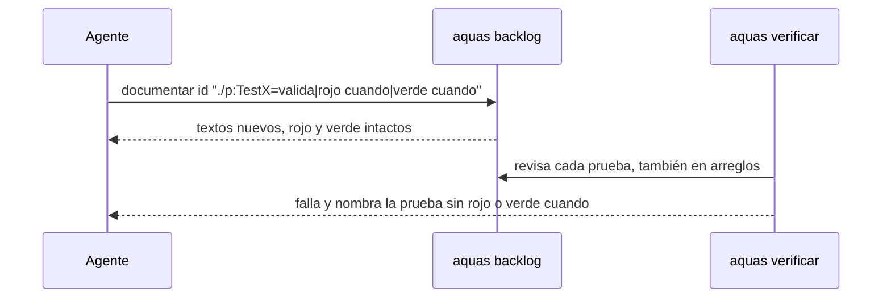

# S007 · Completar la documentación vieja de pruebas y arreglos

[Inicio](../../README.md) › [E001](../README.md) › [F008](README.md) › S007

`aquas backlog documentar` completa los textos de una prueba ya registrada, también dentro de un arreglo, sin borrar su rojo ni su verde. El [gate](../../glosario.md#gate) exige los textos a todas.

## En una frase

Ninguna prueba, vieja o nueva, queda sin decir cuándo cae y cuándo pasa.

## Para qué existe

**El problema.** La regla de «rojo cuando» y «verde cuando» nació solo para pruebas nuevas. Unas 109 pruebas viejas quedaron con «—», y ningún programa lo medía. `aquas backlog pruebas` no sirve: borra rojo y verde, y no toca fichas cerradas.

**La solución.** `documentar` cambia solo los tres textos, en fichas archivadas y en arreglos. Mientras faltaban, el [gate](../../glosario.md#gate) imprimió la deuda (108); saldada, el gate exige los dos campos a toda prueba. Los arreglos viejos se buscaron solo en [commits](../../glosario.md#commit) cuyo mensaje dice que arreglan algo: no hubo ninguno fuera de F008.

Contrato del [slice](../../glosario.md#slice):

| Campo | Valor |
|---|---|
| Objetivo | Cero pruebas sin rojo o verde cuando; arreglos viejos con pista registrados |
| Incluye | `backlog.Documentar` (fichas y arreglos), llenado por paquete, gate sin excepción para pruebas viejas |
| Excluye | Revisar commit por commit sin pista; el control del sello en lote (otro slice) |
| Prueba | `go test ./internal/backlog/ -run 'TestDocumentarNoBorraRojoVerde\|TestGateExigeCuandoATodas'` |

## Analogía

Piensa en **actualizar las etiquetas de un depósito viejo**.

- La regla nueva pide fecha de vencimiento en cada caja.
- Las cajas viejas se etiquetan sin vaciarlas, y un contador dice cuántas faltan.

Límite de la analogía: aquí el contador lo calculó `aquas`, y ahora el gate rechaza toda caja sin etiqueta.

## Diagrama

## Ejemplo de punta a punta

continúa: [EJ-E001-F008](README.md#EJ-E001-F008)

1. Al quitar la excepción, `aquas verificar` falló: la prueba `TestBuildTituloYCompilacionDelHijo` del arreglo E002/F001/S002/X01 no tenía sus textos.
2. Se documentó con `aquas backlog documentar E002/F001/S002/X01 …`; su rojo y su verde siguen.
3. El gate volvió a pasar.

## Paso a paso

1. Validar el texto: valida, rojo cuando y verde cuando, sin vacíos.
2. Buscar la ficha abierta o archivada; la prueba debe existir en ella.
3. Reemplazar solo los textos y guardar en la misma carpeta.
4. En el gate, fallar por cada prueba sin los dos textos, en la ficha o en sus arreglos.

## Cómo se usa

- `aquas backlog documentar <id> "./paquete:TestNombre=valida|rojo cuando|verde cuando"`.
- `aquas backlog documentar E002/F001/S002/X01 "./paquete:TestNombre=…"` documenta la prueba de un arreglo.
- `aquas verificar` falla y nombra la prueba incompleta.

## Contrato y evidencia

<!-- GENERADO por aquas desde trabajo/: no editar a mano; `aquas compilar` lo rehace. -->

| Prueba | Valida | Rojo cuando | Verde cuando | Rojo | Verde |
|---|---|---|---|---|---|
| `TestDocumentarNoBorraRojoVerde` | documentar cambia solo los textos de una prueba, en fichas cerradas y en arreglos | borra rojo o verde, rechaza la ficha cerrada o el ID de un arreglo, o acepta un campo vacío o ajeno | guarda los tres textos en la ficha y en su arreglo y conserva rojo y verde | 2026-10-23 | 2026-10-23 |
| `TestGateExigeCuandoATodas` | el gate exige rojo cuando y verde cuando a toda prueba, vieja o de un arreglo | el gate calla ante una prueba vieja o de arreglo sin los dos textos | el gate da un aviso por prueba incompleta y calla cuando todas están completas | 2026-10-23 | 2026-10-23 |

### Código

| Archivo | Función | Parámetros | Qué hace |
|---|---|---|---|
| [cmd/aquas/main.go](../../../cmd/aquas/main.go) | `main` | `()` | main despacha el subcomando de aquas (compilar, verificar, backlog, hooks…) y sale con su código. |
| [cmd/aquas/main.go](../../../cmd/aquas/main.go) | `hook` | `(raiz string)` | hook: exit 0 = nada que reportar; exit 2 = stderr se muestra a Claude. |
| [cmd/aquas/main.go](../../../cmd/aquas/main.go) | `compilarSettings` | `(w io.Writer)` | compilarSettings regenera .claude/settings.json; sin entorno declarado no inventa uno. |
| [cmd/aquas/main.go](../../../cmd/aquas/main.go) | `reportar` | `(w io.Writer, inf compilador.Informe)` | reportar imprime qué derivados escribió la compilación, o que todo estaba al día. |
| [cmd/aquas/main.go](../../../cmd/aquas/main.go) | `listar` | `(titulo string, problemas []string)` | listar imprime en stderr un título y cada problema en su viñeta. |
| [cmd/aquas/main.go](../../../cmd/aquas/main.go) | `lista` | `(xs []string) string` | lista une los textos con comas, o «—» si no hay ninguno. |
| [cmd/aquas/main.go](../../../cmd/aquas/main.go) | `fallar` | `(codigo int, err error)` | fallar imprime el error en stderr y termina con el código dado. |
| [cmd/aquas/main.go](../../../cmd/aquas/main.go) | `memoriaCLI` | `(raiz string, args []string)` | memoriaCLI: `ver` imprime la memoria; `fijar campo=valor…` la actualiza y la sella. |
| [cmd/aquas/main.go](../../../cmd/aquas/main.go) | `memoriaArchivada` | `(raiz, id string) error` | memoriaArchivada: CERRADO exige el archivo de memoria del slice, apunte o no la memoria a él (E001/F002/S009, X01). |
| [cmd/aquas/main.go](../../../cmd/aquas/main.go) | `focoEnBacklog` | `(raiz string, f memoria.Foco) error` | focoEnBacklog: la memoria solo fija el slice que el backlog tiene en curso (S003). |
| [cmd/aquas/main.go](../../../cmd/aquas/main.go) | `backlogCLI` | `(raiz string, args []string)` | backlogCLI: nuevo \\| ver [id] \\| prioridad \\| estado \\| siguiente \\| pruebas \\| rojo \\| verde. |
| [cmd/aquas/main.go](../../../cmd/aquas/main.go) | `turnoCLI` | `(raiz string, args []string)` | turnoCLI: auditoría de turnos (E001/F002/S001). Lee el JSON del hook por stdin. No imprime nada |
| [cmd/aquas/main.go](../../../cmd/aquas/main.go) | `defectoCLI` | `(raiz string, args []string) error` | defectoCLI: nuevo \\| ocurre \\| ver (E001/F004/S001). |
| [cmd/aquas/main.go](../../../cmd/aquas/main.go) | `versionBinario` | `() string` | versionBinario: versión del módulo con que se compiló el binario (= versión del gobierno embebido). |
| [internal/backlog/arreglo.go](../../../internal/backlog/arreglo.go) | `idArreglo` | `(padre string, n int) string` | idArreglo: ID del n-ésimo arreglo (1, 2…) de padre: padre/X01. |
| [internal/backlog/arreglo.go](../../../internal/backlog/arreglo.go) | `dirDe` | `(archivada bool) string` | dirDe: carpeta de trabajo/ donde vive la ficha, según esté archivada o no. |
| [internal/backlog/arreglo.go](../../../internal/backlog/arreglo.go) | `Arreglar` | `(raiz, padre, titulo, motivo, absorbe string, ahora time.Time) (Arreglo, error)` | Arreglar anota un arreglo en la ficha de su slice o feature, abierta o archivada. |
| [internal/backlog/arreglo.go](../../../internal/backlog/arreglo.go) | `problemasArreglos` | `(rel string, f Ficha) []string` | problemasArreglos: chequeo del gate: IDs en secuencia bajo su ficha, con título y motivo. |
| [internal/backlog/documentar.go](../../../internal/backlog/documentar.go) | `Documentar` | `(raiz, id string, lista []string) (Ficha, error)` | Documentar reescribe valida, rojo cuando y verde cuando de pruebas ya registradas. |
| [internal/backlog/rojo.go](../../../internal/backlog/rojo.go) | `problemaPrueba` | `(p Prueba) string` | problemaPrueba: por qué una prueba de la ficha está mal escrita ("" si está bien). |
| [internal/backlog/rojo.go](../../../internal/backlog/rojo.go) | `listaPruebas` | `(xs []string) ([]Prueba, error)` | listaPruebas convierte "./paquete:TestNombre=intención" en pruebas válidas, sin repetidas. |
| [internal/backlog/rojo.go](../../../internal/backlog/rojo.go) | `corriendo` | `(f Ficha) bool` | corriendo: la ficha está EN_CURSO o VERIFICANDO. |
| [internal/backlog/rojo.go](../../../internal/backlog/rojo.go) | `sliceEnCurso` | `(act map[string]Ficha) (string, bool)` | sliceEnCurso: el primer slice EN_CURSO o VERIFICANDO entre las activas, por id. |
| [internal/backlog/rojo.go](../../../internal/backlog/rojo.go) | `SliceEnCurso` | `(raiz string) (string, bool, error)` | SliceEnCurso: el único slice EN_CURSO o VERIFICANDO, si hay. |
| [internal/backlog/rojo.go](../../../internal/backlog/rojo.go) | `Pruebas` | `(raiz, id string, lista []string) (Ficha, error)` | Pruebas fija las pruebas de la ficha; cambiarlas borra rojo y verde. |
| [internal/backlog/rojo.go](../../../internal/backlog/rojo.go) | `corrible` | `(raiz, id string) (Ficha, error)` | corrible: ficha activa con pruebas; un slice además debe estar en curso. |
| [internal/backlog/rojo.go](../../../internal/backlog/rojo.go) | `Rojo` | `(raiz, id string, ahora time.Time) (Ficha, error)` | Rojo corre cada prueba sola con `go test -json`; exige que cada una falle por sí misma. |
| [internal/backlog/rojo.go](../../../internal/backlog/rojo.go) | `rojoHeredado` | `(raiz string, f Ficha) *Registro` | rojoHeredado (X02): rojo que un slice cerrado de la feature registró para todas sus pruebas |
| [internal/backlog/rojo.go](../../../internal/backlog/rojo.go) | `Verde` | `(raiz, id string, ahora time.Time) (Ficha, error)` | Verde corre las pruebas juntas tras el rojo; exige que todas pasen. |
| [internal/backlog/rojo.go](../../../internal/backlog/rojo.go) | `resultado.motivo` | `(siPasa string) string` | motivo: texto que explica el resultado de una prueba; siPasa se usa cuando pasó. |
| [internal/backlog/rojo.go](../../../internal/backlog/rojo.go) | `correr` | `(raiz string, ps []Prueba) (map[string]resultado, error)` | correr: `go test -json -count=1 -run ^(A\\|B)$ ./paquete` por paquete; resultado por prueba. |
| [internal/backlog/rojo.go](../../../internal/backlog/rojo.go) | `motivoDelFallo` | `(ls []string) string` | motivoDelFallo: la última línea «archivo.go:N: …» (la que hizo fallar); si no hay, la primera. |
| [internal/backlog/rojo.go](../../../internal/backlog/rojo.go) | `head` | `(raiz string) string` | head: commit actual del repo, o "" fuera de Git. |
| [internal/backlog/rojo.go](../../../internal/backlog/rojo.go) | `cierre` | `(raiz string, f Ficha) error` | cierre: CERRADO exige pruebas, rojo, verde y, si el verde trae huella, el mismo código Go. |
| [internal/backlog/rojo.go](../../../internal/backlog/rojo.go) | `problemasRojoVerde` | `(rel string, f Ficha) []string` | problemasRojoVerde: chequeos del gate sobre pruebas, rojo y verde de una ficha. |
| [internal/backlog/rojo.go](../../../internal/backlog/rojo.go) | `Detalle` | `(f Ficha) string` | Detalle: pruebas con su intención, y rojo y verde, para `ver <id>`, `pruebas`, `rojo` y `verde`. |

<!-- /GENERADO -->

Estado: hecho.

## Navegación

- ↑ Subir: [F008 · Documentación verificable de pruebas, código y arreglos](README.md)
