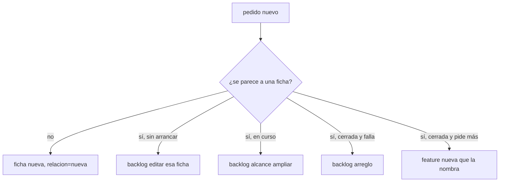
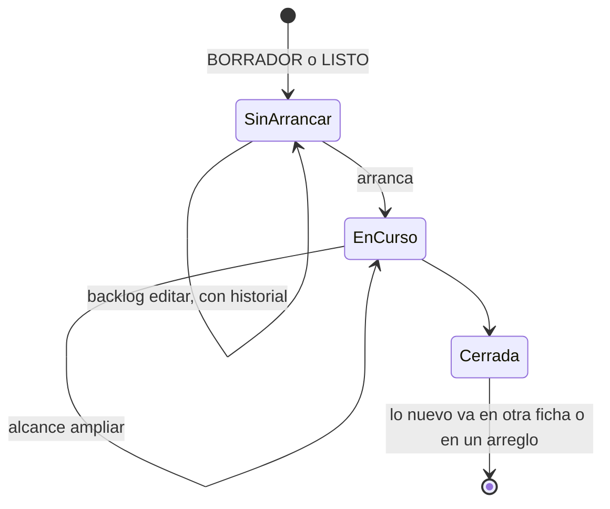

# F009 · Backlog sin fichas repetidas

[Inicio](../../README.md) › [E001](../README.md) › F009

[Feature](../../glosario.md#feature) que frena fichas repetidas y deja corregir las que aún no arrancan.

## En una frase

Antes de crear una ficha, el [backlog](../../glosario.md#backlog) muestra las parecidas y pide declarar la relación.

## Para qué existe

**El problema.** Se creó E001/F008/S002 para una regla que el código ya cumplía. Nada comparó la ficha nueva con lo existente.

**La solución.** Tres [slices](../../glosario.md#slice). `backlog nuevo` lista las parecidas y exige `relacion=`. `defecto nuevo` hace lo mismo con los defectos. `backlog editar` cambia una ficha que aún no arranca y guarda lo anterior.

## Analogía

Piensa en la **recepción de un taller**.

- Antes de abrir una orden nueva, revisan si el carro ya tiene una abierta.
- Si la orden no ha empezado, la corrigen; si ya cerró, abren otra que la nombra.

Límite de la analogía: aquí la revisión la hace `aquas`; nadie busca a mano.

## Diagrama

Estados de una ficha frente a un cambio:

| Slice | Qué entrega |
|---|---|
| S001 backlog nuevo muestra parecidos y exige relación | Lista de parecidas y campo `relacion=` obligatorio |
| S002 defecto nuevo muestra parecidos y exige relación | Lo mismo para los defectos |
| S003 backlog editar cambia una ficha que aún no arranca | Edición con historial, solo en BORRADOR o LISTO |

## Ejemplo de punta a punta

continúa: [EJ-E001](../README.md#EJ-E001)

1. Alguien pide «exportar backlog en CSV» y ya existe «Exportar el backlog a CSV».
2. `backlog nuevo` se niega y nombra la ficha parecida.
3. Con `relacion=amplia:<id>` la ficha nace; ampliar algo cerrado se niega.

## Paso a paso

1. Parecidos y relación al crear fichas (S001).
2. Parecidos y relación al registrar defectos (S002).
3. Edición antes de arrancar (S003).

## Cómo se usa

- `aquas backlog nuevo id=… titulo=… … relacion=nueva|amplia:<id>|corrige:<id>`.

## Contrato y evidencia

**Objetivo.** El backlog frena fichas repetidas. La prueba integral es `TestBacklogSinRepetidos`.

## Navegación

<!-- GENERADO por aquas desde trabajo/: no editar a mano; `aquas compilar` lo rehace. -->

| Hijo | Qué es | Estado |
|---|---|---|
| S001 | backlog nuevo muestra parecidos y exige relacion | Planeado |
| S002 | defecto nuevo muestra parecidos y exige relacion | Planeado |
| S003 | backlog editar cambia una ficha que aún no arranca | Planeado |

<!-- /GENERADO -->

- ↑ Subir: [E001](../README.md)
