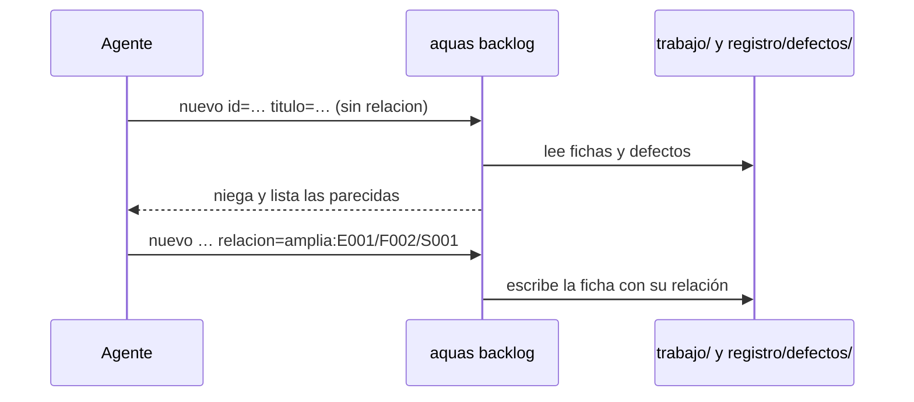

# S001 · backlog nuevo muestra parecidos y exige relación

[Inicio](../../README.md) › [E001](../README.md) › [F009](README.md) › S001

`aquas backlog nuevo` compara la ficha nueva con las existentes antes de crearla.

## En una frase

Ninguna ficha nace sin decir si es nueva, si amplía otra o si corrige otra.

## Para qué existe

**El problema.** E001/F008/S002 pedía algo que el código ya hacía. Se descubrió tarde, al registrar su rojo.

**La solución.** Este [slice](../../glosario.md#slice) exige `relacion=nueva`, `amplia:<id>` o `corrige:<id>`. Sin ella, `backlog nuevo` se niega y lista cinco fichas o defectos parecidos. Ampliar algo cerrado remite a una [feature](../../glosario.md#feature) nueva. Corregir algo cerrado remite a `backlog arreglo`.

Contrato del slice:

| Campo | Valor |
|---|---|
| Objetivo | Toda ficha nueva declara su relación con lo existente |
| Incluye | Campo `relacion`, lista de parecidas, negar ampliar o corregir lo cerrado |
| Excluye | Parecidas en `defecto nuevo` (S002) y `backlog editar` (S003) |
| Prueba | `go test ./internal/backlog/ -run TestNuevoExigeRelacion` |

## Analogía

Piensa en un **buscador de citas médicas**.

- Antes de agendar, muestra las citas parecidas que ya tienes.
- Te pide decir si es una cita nueva o el control de una anterior.

Límite de la analogía: aquí el parecido se mide por palabras en común del título. Puede fallar con sinónimos.

## Diagrama

## Ejemplo de punta a punta

continúa: [EJ-E001-F009](README.md#EJ-E001-F009)

1. Se pidió de nuevo «Prueba integral obligatoria para cerrar el feature», sin `relacion`.
2. `backlog nuevo` se negó y listó primero a E001/F008/S002, la ficha repetida original.
3. También listó los defectos D000023 y D000025, que hablan de lo mismo.
4. No se escribió ninguna ficha.

## Paso a paso

1. Aceptar el campo `relacion` y guardarlo en la ficha.
2. Sin `relacion`, contar palabras en común del título con fichas y defectos.
3. Mostrar las cinco con más palabras en común.
4. Con `amplia` o `corrige`, exigir que el ID exista y no esté cerrado.

## Cómo se usa

- `aquas backlog nuevo id=… titulo=… prioridad=… motivo=… relacion=nueva prueba=…`.
- `relacion=amplia:<id>` si extiende una ficha abierta; `relacion=corrige:<id>` si la corrige.

## Contrato y evidencia

<!-- GENERADO por aquas desde trabajo/: no editar a mano; `aquas compilar` lo rehace. -->

| Prueba | Valida | Rojo cuando | Verde cuando | Rojo | Verde |
|---|---|---|---|---|---|
| `TestNuevoExigeRelacion` | backlog nuevo lista las 5 fichas o defectos con más palabras en común y exige relacion (nueva, amplia:<id> o corrige:<id>); ampliar o corregir algo cerrado se niega y remite a feature nueva o arreglo | crea la ficha sin relacion, acepta ampliar algo cerrado o no muestra parecidos | exige relacion, muestra parecidos y niega ampliar lo cerrado | 2026-10-23 | 2026-10-23 |

### Código

| Archivo | Función | Parámetros | Qué hace |
|---|---|---|---|
| [cmd/aquas/main.go](../../../cmd/aquas/main.go) | `main` | `()` | main despacha el subcomando de aquas (compilar, verificar, backlog, hooks…) y sale con su código. |
| [cmd/aquas/main.go](../../../cmd/aquas/main.go) | `hook` | `(raiz string)` | hook: exit 0 = nada que reportar; exit 2 = stderr se muestra a Claude. |
| [cmd/aquas/main.go](../../../cmd/aquas/main.go) | `compilarSettings` | `(w io.Writer)` | compilarSettings regenera .claude/settings.json; sin entorno declarado no inventa uno. |
| [cmd/aquas/main.go](../../../cmd/aquas/main.go) | `reportar` | `(w io.Writer, inf compilador.Informe)` | reportar imprime qué derivados escribió la compilación, o que todo estaba al día. |
| [cmd/aquas/main.go](../../../cmd/aquas/main.go) | `listar` | `(titulo string, problemas []string)` | listar imprime en stderr un título y cada problema en su viñeta. |
| [cmd/aquas/main.go](../../../cmd/aquas/main.go) | `lista` | `(xs []string) string` | lista une los textos con comas, o «—» si no hay ninguno. |
| [cmd/aquas/main.go](../../../cmd/aquas/main.go) | `fallar` | `(codigo int, err error)` | fallar imprime el error en stderr y termina con el código dado. |
| [cmd/aquas/main.go](../../../cmd/aquas/main.go) | `memoriaCLI` | `(raiz string, args []string)` | memoriaCLI: `ver` imprime la memoria; `fijar campo=valor…` la actualiza y la sella. |
| [cmd/aquas/main.go](../../../cmd/aquas/main.go) | `memoriaArchivada` | `(raiz, id string) error` | memoriaArchivada: CERRADO exige el archivo de memoria del slice, apunte o no la memoria a él (E001/F002/S009, X01). |
| [cmd/aquas/main.go](../../../cmd/aquas/main.go) | `focoEnBacklog` | `(raiz string, f memoria.Foco) error` | focoEnBacklog: la memoria solo fija el slice que el backlog tiene en curso (S003). |
| [cmd/aquas/main.go](../../../cmd/aquas/main.go) | `backlogCLI` | `(raiz string, args []string)` | backlogCLI: nuevo \\| ver [id] \\| prioridad \\| estado \\| siguiente \\| pruebas \\| rojo \\| verde. |
| [cmd/aquas/main.go](../../../cmd/aquas/main.go) | `turnoCLI` | `(raiz string, args []string)` | turnoCLI: auditoría de turnos (E001/F002/S001). Lee el JSON del hook por stdin. No imprime nada |
| [cmd/aquas/main.go](../../../cmd/aquas/main.go) | `defectoCLI` | `(raiz string, args []string) error` | defectoCLI: nuevo \\| ocurre \\| ver (E001/F004/S001). |
| [cmd/aquas/main.go](../../../cmd/aquas/main.go) | `versionBinario` | `() string` | versionBinario: versión del módulo con que se compiló el binario (= versión del gobierno embebido). |
| [internal/backlog/backlog.go](../../../internal/backlog/backlog.go) | `terminal` | `(estado string) bool` | terminal: el estado ya no cambia (CERRADO o CANCELADO). |
| [internal/backlog/backlog.go](../../../internal/backlog/backlog.go) | `esta` | `(xs []string, x string) bool` | esta: x figura en la lista. |
| [internal/backlog/backlog.go](../../../internal/backlog/backlog.go) | `tipoYPadre` | `(id string) (tipo, padre string)` | tipoYPadre deriva del id: E001 → iniciativa; E001/F002 → feature de E001; E001/F002/S002 → slice. |
| [internal/backlog/backlog.go](../../../internal/backlog/backlog.go) | `nombre` | `(id string) string` | nombre: archivo JSON de una ficha, con «/» del ID cambiadas por «-». |
| [internal/backlog/backlog.go](../../../internal/backlog/backlog.go) | `todas` | `(raiz string) (act, arc map[string]Ficha, err error)` | todas lee activo y archivo. Una ficha ilegible es error: Validar la detalla. |
| [internal/backlog/backlog.go](../../../internal/backlog/backlog.go) | `Todas` | `(raiz string) ([]Ficha, error)` | Todas: las fichas de activo y archivo, ordenadas por id. Para quien solo lee (wiki, E001/F002/S010). |
| [internal/backlog/backlog.go](../../../internal/backlog/backlog.go) | `leer` | `(ruta string) (Ficha, error)` | leer carga una ficha desde su archivo JSON. |
| [internal/backlog/backlog.go](../../../internal/backlog/backlog.go) | `escribir` | `(raiz, dir string, f Ficha) error` | escribir guarda la ficha como JSON en trabajo/<dir>/, con listas vacías en vez de null. |
| [internal/backlog/backlog.go](../../../internal/backlog/backlog.go) | `Nuevo` | `(raiz string, campos []string) (Ficha, error)` | Nuevo crea una ficha desde campos id=… titulo=… prioridad=… motivo=… relacion=… [bloqueado_por=A,B]. |
| [internal/backlog/backlog.go](../../../internal/backlog/backlog.go) | `Ver` | `(raiz, id string) (Ficha, bool, error)` | Ver busca la ficha en activo y luego en archivo. |
| [internal/backlog/backlog.go](../../../internal/backlog/backlog.go) | `activa` | `(raiz, id string) (Ficha, error)` | activa: la ficha a cambiar; una archivada no cambia. |
| [internal/backlog/backlog.go](../../../internal/backlog/backlog.go) | `Prioridad` | `(raiz, id, prioridad, motivo string) (Ficha, error)` | Prioridad cambia la prioridad; el motivo es obligatorio. |
| [internal/backlog/backlog.go](../../../internal/backlog/backlog.go) | `Estado` | `(raiz, id, estado string) (Ficha, error)` | Estado cambia el estado. CERRADO o CANCELADO mueve la ficha al archivo. |
| [internal/backlog/backlog.go](../../../internal/backlog/backlog.go) | `sinHijosActivos` | `(act map[string]Ficha, f Ficha) error` | sinHijosActivos: cerrar o cancelar una feature o iniciativa exige sus hijos directos ya archivados. |
| [internal/backlog/backlog.go](../../../internal/backlog/backlog.go) | `ordenar` | `(fs []Ficha, arc map[string]Ficha)` | orden de `siguiente`: en curso → desbloqueado → prioridad → secuencia → id. |
| [internal/backlog/backlog.go](../../../internal/backlog/backlog.go) | `Activas` | `(raiz string) ([]Ficha, error)` | Activas: slices en el orden de `siguiente`; después iniciativas y features por secuencia. |
| [internal/backlog/backlog.go](../../../internal/backlog/backlog.go) | `Siguiente` | `(raiz string) (Ficha, bool, error)` | Siguiente: el primer slice del orden fijo que esté en curso o desbloqueado. |
| [internal/backlog/backlog.go](../../../internal/backlog/backlog.go) | `sinDefinir` | `(act map[string]Ficha) (Ficha, bool)` | sinDefinir (E001/F002/S008, regla del humano 2026-10-21): iniciativa o feature activa sin hijos |
| [internal/backlog/backlog.go](../../../internal/backlog/backlog.go) | `Definir` | `(raiz string, f Ficha) string` | Definir: qué hacer con lo que `siguiente` saca sin definir; "" para un slice. |
| [internal/backlog/backlog.go](../../../internal/backlog/backlog.go) | `libre` | `(f Ficha, arc map[string]Ficha) bool` | libre: no está BLOQUEADO y cada bloqueador ya terminó (archivado: CERRADO o CANCELADO). |
| [internal/backlog/backlog.go](../../../internal/backlog/backlog.go) | `Validar` | `(raiz string) []string` | Validar: problemas de las fichas en disco (gate). Sin carpeta trabajo/ no hay problemas. |
| [internal/backlog/backlog.go](../../../internal/backlog/backlog.go) | `Texto` | `(f Ficha) string` | Texto: una línea por ficha, para el agente. |
| [internal/backlog/relacion.go](../../../internal/backlog/relacion.go) | `palabras` | `(s string) map[string]bool` | palabras: conjunto de palabras de tres o más letras, en minúscula. |
| [internal/backlog/relacion.go](../../../internal/backlog/relacion.go) | `parecidas` | `(raiz, titulo string, fichas ...map[string]Ficha) []parecida` | parecidas: hasta maxParecidas fichas (activas y archivadas) o defectos con más palabras en común con titulo. |
| [internal/backlog/relacion.go](../../../internal/backlog/relacion.go) | `revisarRelacion` | `(raiz, rel, titulo string, act, arc map[string]Ficha) error` | revisarRelacion valida el campo relacion contra las fichas existentes; sin él, lista las parecidas. |
| [internal/backlog/relacion.go](../../../internal/backlog/relacion.go) | `Parecidas` | `(raiz, texto string) ([]string, error)` | Parecidas: líneas «id · texto» de las fichas y defectos con más palabras en común con texto (E001/F009/S002). |

<!-- /GENERADO -->

## Navegación

- ↑ Subir: [F009 · Backlog sin fichas repetidas](README.md)
