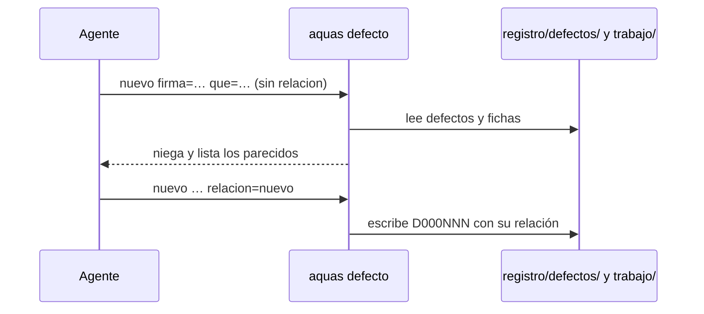

# S002 · defecto nuevo muestra parecidos y exige relación

[Inicio](../../README.md) › [E001](../README.md) › [F009](README.md) › S002

`aquas defecto nuevo` compara el defecto nuevo con los defectos y fichas existentes antes de registrarlo.

## En una frase

Ningún defecto se registra sin decir si es nuevo o a qué ficha pertenece.

## Para qué existe

**El problema.** Un mismo fallo podía registrarse dos veces con firmas distintas. Así se pierde la cuenta de cuántas veces ocurrió.

**La solución.** Este [slice](../../glosario.md#slice) exige `relacion=nuevo` o el ID de una ficha. Sin ella, `defecto nuevo` se niega y lista los cinco defectos o fichas más parecidos. Con `repite:<D>` remite a `aquas defecto ocurre`, que suma la ocurrencia al defecto que ya existe.

Contrato del slice:

| Campo | Valor |
|---|---|
| Objetivo | Todo defecto nuevo declara su relación con lo existente |
| Incluye | Campo `relacion` en el defecto, lista de parecidos, remitir repetidos a `ocurre` |
| Excluye | Parecidas en `backlog nuevo` (S001) |
| Prueba | `go test ./internal/defecto/ -run TestDefectoNuevoExigeRelacion` |

## Analogía

Piensa en la **historia clínica de un paciente**.

- Antes de anotar un síntoma nuevo, el médico revisa si ya estaba anotado.
- Si ya estaba, suma una visita; no abre otra historia.

Límite de la analogía: aquí el parecido se mide por palabras en común. Puede fallar con sinónimos.

## Diagrama

## Ejemplo de punta a punta

continúa: [EJ-E001-F009](README.md#EJ-E001-F009)

1. Se intentó registrar el fallo del heredoc que rompe strings de [Go](../../glosario.md#go), sin `relacion`.
2. `defecto nuevo` se negó y listó D000008 y D000015, sobre temporales y finales de línea.
3. Ninguno era el mismo fallo; se registró con `relacion=nuevo` y salió D000027.

## Paso a paso

1. Aceptar el campo `relacion` y guardarlo en el defecto.
2. Sin `relacion`, listar los parecidos con la búsqueda de S001.
3. Con `repite:<D>`, remitir a `aquas defecto ocurre`.
4. Con el ID de una ficha, exigir que exista.

## Cómo se usa

- `aquas defecto nuevo firma=… que=… causa=… arreglo=… cercioro=… relacion=nuevo`.
- `relacion=E001/F009/S002` si el defecto pertenece a esa ficha.

## Contrato y evidencia

<!-- GENERADO por aquas desde trabajo/: no editar a mano; `aquas compilar` lo rehace. -->

| Prueba | Valida | Rojo cuando | Verde cuando | Rojo | Verde |
|---|---|---|---|---|---|
| `TestDefectoNuevoExigeRelacion` | defecto nuevo lista los defectos y fichas parecidos y exige relacion (nuevo, repite:<D> o el id de una ficha) | registra el defecto sin relacion o sin mostrar parecidos | exige relacion y muestra parecidos | 2026-10-23 | 2026-10-23 |

### Código

| Archivo | Función | Parámetros | Qué hace |
|---|---|---|---|
| [cmd/aquas/main.go](../../../cmd/aquas/main.go) | `main` | `()` | main despacha el subcomando de aquas (compilar, verificar, backlog, hooks…) y sale con su código. |
| [cmd/aquas/main.go](../../../cmd/aquas/main.go) | `hook` | `(raiz string)` | hook: exit 0 = nada que reportar; exit 2 = stderr se muestra a Claude. |
| [cmd/aquas/main.go](../../../cmd/aquas/main.go) | `compilarSettings` | `(w io.Writer)` | compilarSettings regenera .claude/settings.json; sin entorno declarado no inventa uno. |
| [cmd/aquas/main.go](../../../cmd/aquas/main.go) | `reportar` | `(w io.Writer, inf compilador.Informe)` | reportar imprime qué derivados escribió la compilación, o que todo estaba al día. |
| [cmd/aquas/main.go](../../../cmd/aquas/main.go) | `listar` | `(titulo string, problemas []string)` | listar imprime en stderr un título y cada problema en su viñeta. |
| [cmd/aquas/main.go](../../../cmd/aquas/main.go) | `lista` | `(xs []string) string` | lista une los textos con comas, o «—» si no hay ninguno. |
| [cmd/aquas/main.go](../../../cmd/aquas/main.go) | `fallar` | `(codigo int, err error)` | fallar imprime el error en stderr y termina con el código dado. |
| [cmd/aquas/main.go](../../../cmd/aquas/main.go) | `memoriaCLI` | `(raiz string, args []string)` | memoriaCLI: `ver` imprime la memoria; `fijar campo=valor…` la actualiza y la sella. |
| [cmd/aquas/main.go](../../../cmd/aquas/main.go) | `memoriaArchivada` | `(raiz, id string) error` | memoriaArchivada: CERRADO exige el archivo de memoria del slice, apunte o no la memoria a él (E001/F002/S009, X01). |
| [cmd/aquas/main.go](../../../cmd/aquas/main.go) | `focoEnBacklog` | `(raiz string, f memoria.Foco) error` | focoEnBacklog: la memoria solo fija el slice que el backlog tiene en curso (S003). |
| [cmd/aquas/main.go](../../../cmd/aquas/main.go) | `backlogCLI` | `(raiz string, args []string)` | backlogCLI: nuevo \\| ver [id] \\| prioridad \\| estado \\| siguiente \\| pruebas \\| rojo \\| verde. |
| [cmd/aquas/main.go](../../../cmd/aquas/main.go) | `turnoCLI` | `(raiz string, args []string)` | turnoCLI: auditoría de turnos (E001/F002/S001). Lee el JSON del hook por stdin. No imprime nada |
| [cmd/aquas/main.go](../../../cmd/aquas/main.go) | `defectoCLI` | `(raiz string, args []string) error` | defectoCLI: nuevo \\| ocurre \\| ver (E001/F004/S001). |
| [cmd/aquas/main.go](../../../cmd/aquas/main.go) | `versionBinario` | `() string` | versionBinario: versión del módulo con que se compiló el binario (= versión del gobierno embebido). |
| [cmd/aquas/main.go](../../../cmd/aquas/main.go) | `registrarCierre` | `(raiz, tipo, transcript, primera, resultado string)` | registrarCierre (E001/F004/S005, D000068) anota cada llamada del gancho cierre-agente en .tmp/hooks/cierre-agente.jsonl. |
| [internal/backlog/relacion.go](../../../internal/backlog/relacion.go) | `palabras` | `(s string) map[string]bool` | palabras: conjunto de palabras de tres o más letras, en minúscula. |
| [internal/backlog/relacion.go](../../../internal/backlog/relacion.go) | `parecidas` | `(raiz, titulo string, fichas ...map[string]Ficha) []parecida` | parecidas: hasta maxParecidas fichas (activas y archivadas) o defectos con más palabras en común con titulo. |
| [internal/backlog/relacion.go](../../../internal/backlog/relacion.go) | `revisarRelacion` | `(raiz, rel, titulo string, act, arc map[string]Ficha) error` | revisarRelacion valida el campo relacion contra las fichas existentes; sin él, lista las parecidas. |
| [internal/backlog/relacion.go](../../../internal/backlog/relacion.go) | `Parecidas` | `(raiz, texto string) ([]string, error)` | Parecidas: líneas «id · texto» de las fichas y defectos con más palabras en común con texto (E001/F009/S002). |
| [internal/defecto/defecto.go](../../../internal/defecto/defecto.go) | `Nuevo` | `(raiz string, c map[string]string) (Defecto, error)` | Nuevo crea el siguiente D000NNN. Todos los campos son obligatorios; la firma es kebab-case y única. |
| [internal/defecto/defecto.go](../../../internal/defecto/defecto.go) | `Ocurre` | `(raiz, id, turno string) (Defecto, error)` | Ocurre suma un turno T000NNN al defecto; el mismo turno no se cuenta dos veces. |
| [internal/defecto/defecto.go](../../../internal/defecto/defecto.go) | `sliceReincidencia` | `(raiz string, d Defecto) (string, error)` | sliceReincidencia devuelve el slice del defecto: el que ya lleve su título o uno nuevo P1 en Feature. |
| [internal/defecto/defecto.go](../../../internal/defecto/defecto.go) | `Leer` | `(raiz string) ([]Defecto, error)` | Leer devuelve todos los defectos, ordenados por ID. Sin carpeta = registro vacío. |
| [internal/defecto/defecto.go](../../../internal/defecto/defecto.go) | `leerUno` | `(raiz, id string) (Defecto, error)` | leerUno carga el defecto con ese ID; valida el formato D000001. |
| [internal/defecto/defecto.go](../../../internal/defecto/defecto.go) | `escribir` | `(raiz string, d Defecto) error` | escribir guarda el defecto como JSON en su carpeta. |
| [internal/defecto/defecto.go](../../../internal/defecto/defecto.go) | `Texto` | `(d Defecto) string` | Texto: una línea por defecto para `aquas defecto ver`. |
| [internal/defecto/defecto.go](../../../internal/defecto/defecto.go) | `revisarRelacion` | `(raiz, rel, que string, todos []Defecto) error` | revisarRelacion (E001/F009/S002): relacion=nuevo o el id de una ficha; sin ella, lista defectos y fichas parecidos. |
| [internal/propuesta/insight.go](../../../internal/propuesta/insight.go) | `RevisarInsight` | `(msg string) string` | RevisarInsight devuelve "" si pasa; si no, el motivo del freno: insight PROPUESTO sin defecto registrado (E001/F002/S016). |

<!-- /GENERADO -->

## Navegación

- ↑ Subir: [F009 · Backlog sin fichas repetidas](README.md)
