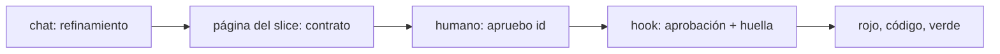
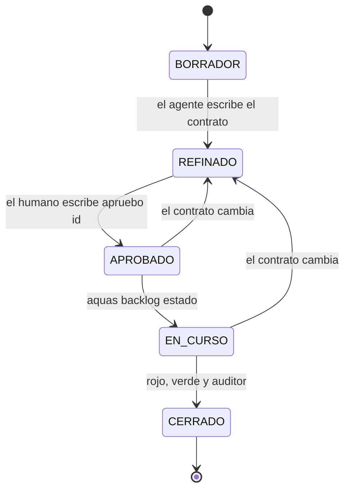

# F010 · Contrato aprobado antes de construir

[Inicio](../../README.md) › [E001](../README.md) › F010

[Feature](../../glosario.md#feature) que obliga a escribir el contrato de cada [slice](../../glosario.md#slice) y a que el humano lo apruebe antes de construir.

## En una frase

Ningún slice registra su rojo hasta que el humano aprueba su contrato escrito, y cambiar el contrato anula esa aprobación.

## Para qué existe

**El problema.** El refinamiento quedaba en el chat. El [agente](../../glosario.md#agente) pasaba solo a construir, y los criterios de aceptación, las pruebas y la estrategia los decidía él. El humano los veía después, en la documentación.

**La solución.** El contrato del slice se escribe en su página antes de construir. Lleva historia, criterios de aceptación, pruebas, estrategia, alcance y lo que queda fuera. El humano lo lee y escribe «apruebo <id>» en el chat. Un [hook](../../glosario.md#hook) registra esa aprobación junto con la huella del contrato. Sin aprobación vigente, el rojo se rechaza; si el contrato cambia después, rojo, verde y cierre también. Protege contra errores y deriva del contrato. No protege contra un agente que quiera engañar: para eso están el auditor y el diff.

Contrato de la feature:

| Campo | Valor |
|---|---|
| Historia | Como humano, quiero aprobar por escrito qué se va a construir antes del rojo, para no descubrir los criterios después |
| Objetivo | Lo construido sale del contrato aprobado, no de la memoria del chat |
| Excluye | Fichas cerradas; slices con rojo registrado antes de F010; la revisión línea por línea del código, que se hace en el diff |
| Prueba integral | TestContratoAprobadoAntesDeConstruir |

## Analogía

Piensa en un **presupuesto de obra firmado**.

- El maestro de obra escribe qué va a hacer, con qué materiales y qué no incluye.
- El dueño lo firma antes de empezar; si el maestro cambia algo, hace falta firmar de nuevo.

Límite de la analogía: aquí la firma queda atada a la huella exacta del texto. Un cambio mínimo también la anula.

## Diagrama

REFINADO y APROBADO son etapas del contrato, no estados de la ficha.

## Ejemplo de punta a punta

continúa: [EJ-E001](../README.md#EJ-E001)

1. El agente escribe el contrato de un slice y pide su rojo: se rechaza porque falta la aprobación.
2. El humano escribe «apruebo» con el id del slice; el hook registra la aprobación con la huella del contrato.
3. El rojo ahora se acepta.
4. El agente cambia un criterio del contrato y pide otro rojo: se rechaza hasta que el humano apruebe de nuevo. Lo mismo vale en EN_CURSO: rojo, verde y cierre se rechazan.

## Paso a paso

1. Contrato, aprobación sellada y definición de terminado común (S001).

## Cómo se usa

- Se usa con el slice S001: el humano escribe «apruebo <id>» en el chat antes del rojo.

## Contrato y evidencia

**Objetivo.** Nada se construye sin contrato aprobado. La prueba integral es `TestContratoAprobadoAntesDeConstruir`.

## Navegación

<!-- GENERADO por aquas desde trabajo/: no editar a mano; `aquas compilar` lo rehace. -->

| Hijo | Qué es | Estado |
|---|---|---|
| [S001](S001.md) | Contrato, aprobación sellada y DoD común | Hecho |

<!-- /GENERADO -->

- ↑ Subir: [E001](../README.md)
- Abajo: [S001 · Contrato, aprobación sellada y DoD común](S001.md)
