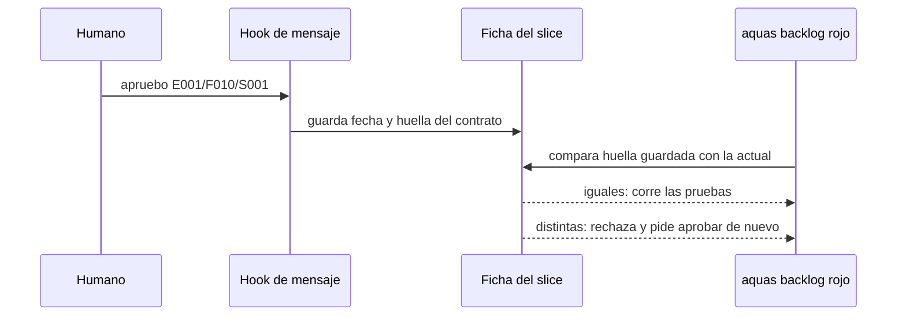

# S001 · Contrato, aprobación sellada y DoD común

[Inicio](../../README.md) › [E001](../README.md) › [F010](README.md) › S001

Este [slice](../../glosario.md#slice) agrega el paso de aprobación humana entre el refinamiento y el rojo. Estado: en curso. El contrato se corrigió tras la auditoría y las decisiones del humano. El humano lo reaprobó el 2026-10-23.

## En una frase

El rojo de un slice exige una aprobación humana vigente, atada a la huella de su contrato.

## Para qué existe

**El problema.** El humano no tenía cómo aceptar los criterios antes de que el [agente](../../glosario.md#agente) construyera. Tras un compactado, el agente trabaja con su propio resumen del chat.

**La solución.** El contrato vive en la página del slice y en su ficha. La aprobación la registra un [hook](../../glosario.md#hook) al leer el mensaje del humano. Así el humano aprueba con una frase y no con un comando.

Contrato del slice:

| Campo | Valor |
|---|---|
| Historia | Como humano, quiero aprobar el contrato de cada slice antes del rojo, para saber qué se va a construir y con qué pruebas |
| Objetivo | Rojo y EN_CURSO exigen aprobación vigente; rojo, verde y cierre comparan la huella; cambiar el contrato la anula |
| Incluye | Registro de aprobación en la ficha, huella del contrato, hook que lee «apruebo <id>» (solo una línea afirmativa), rechazo del rojo y de EN_CURSO sin aprobación desde cualquier estado, rechazo de rojo, verde y cierre si la huella cambió, exención de pruebas previstas en el gate de la wiki, regla de definición de terminado común en un canónico |
| Excluye | Fichas cerradas; slices con rojo registrado antes de F010; medir tokens |
| Límite | Protege contra errores y deriva del contrato, no contra un agente que quiera engañar: para eso, auditor y diff |
| Alcance | `internal/backlog/**`, `cmd/aquas/**`, `internal/wiki/**`, `internal/compilador/**`, `gobierno/canonico/**`, `gobierno/config/**`, `docs/E001/F010/**`, `CLAUDE.md`, `.claude/**` |
| Ampliaciones | `internal/entorno/**` para la prueba del hook en settings; `internal/guardia/**`, usada y revertida, sin cambios finales; `docs/E001/README.md` para quitar «no hay aprobaciones formales» |
| Prueba integral | TestContratoAprobadoAntesDeConstruir |

Criterios de aceptación:

1. Dado un slice sin aprobación, cuando se pide su rojo o EN_CURSO, entonces se rechaza. El mensaje pide «apruebo» con su id.
2. Dado un mensaje humano con «apruebo» y un id, el hook lo lee. Entonces la ficha guarda fecha y huella del contrato.
3. Dado un mensaje con marco de agente, o con apruebo fuera de la primera línea, el hook no registra aprobación.
4. Dado un contrato aprobado, cambian sus pruebas, su alcance o su sección «Para qué existe». Entonces la aprobación deja de valer y el rojo, el verde y el cierre se rechazan, también en EN_CURSO.
5. Dado el alcance ampliado con el comando `aquas backlog alcance` tras aprobar, entonces también hace falta aprobar de nuevo.
6. Dada la regla común de terminado, al compilar llega al [orquestador](../../glosario.md#orquestador). Cada slice solo agrega lo suyo.

Estrategia:

1. La huella es un [SHA-256](../../glosario.md#sha-256) de las pruebas, el alcance y la sección «Para qué existe». Los bloques que genera aquas quedan fuera, porque cambian con cada rojo y verde.
2. El hook de mensaje del humano ya registra el plan de llamadas. Ahora también buscará «apruebo» seguido de un id.
3. El rojo, el verde y el cierre comparan la huella guardada con la actual antes de correr nada.
4. El alcance vigilado de E001/F002/S007 ya bloquea archivos fuera del alcance; se reusa, no se duplica.

## Analogía

Piensa en un **cheque firmado por un monto exacto**.

- El banco paga solo si la firma corresponde a ese cheque.
- Si alguien cambia el monto, la firma ya no vale.

Límite de la analogía: aquí no hay banco; el que compara la firma con el texto es el rojo.

## Diagrama

## Ejemplo de punta a punta

continúa: [EJ-E001-F010](README.md#EJ-E001-F010)

1. Este mismo contrato es el primer caso: el humano lo lee antes de que exista una línea de código.
2. La primera aprobación se anotó a mano en esta página, porque el hook aún no existía.
3. Desde que S001 cierre, toda aprobación la registra el hook.

## Paso a paso

1. El humano lee este contrato y responde «apruebo E001/F010/S001» o pide cambios.
2. Se registra el rojo de la prueba integral y de las pruebas del slice.
3. Se implementa hasta el verde, y el auditor revisa cada criterio de aceptación.

## Cómo se usa

- El humano lee el contrato de la página y escribe «apruebo E001/F010/S001» en el chat.
- El hook `aquas aprobacion` guarda en la ficha la fecha, la huella y el mensaje.
- Después `aquas backlog estado` a EN_CURSO, `aquas backlog rojo`, `verde` y el cierre aceptan el slice.
- Sin aprobación, o con el contrato cambiado, rechazan y piden «apruebo» con el id.
- Cambiar pruebas, alcance o «Para qué existe» obliga a aprobar de nuevo.
- Solo el mensaje del humano aprueba: el texto del agente en una herramienta no cuenta.
- EN_CURSO exige aprobación desde cualquier estado, también desde BLOQUEADO, mientras la ficha no tenga rojo.
- Con aprobación, rojo, verde y cierre piden que la huella siga igual. Quedan exentos los slices con rojo previo y sin aprobación.
- Es una protección contra errores, no contra un agente tramposo: para eso están el auditor y el diff.
- Solo cuenta la primera línea del mensaje, si empieza por «apruebo <id>»; los mensajes de agentes se descartan; «no apruebo…» y las líneas que terminan en «?» no aprueban.
- Las pruebas son `TestRojoExigeAprobacion`, `TestExigenciaPorEstado`, `TestAprobacionAtadaAHuella`, `TestAmpliarAnulaAprobacion`, `TestHookRegistraApruebo`, `TestApruebaSoloLineaAfirmativa`, `TestHookIgnoraMensajeDeAgente`, `TestDerivaEnCursoAnulaAprobacion`, `TestPruebaPrevistaSoloSinRojo`, `TestSettingsRealTraeHookAprobacion` y `TestDoDComunCompilado`.

## Contrato y evidencia

<!-- GENERADO por aquas desde trabajo/: no editar a mano; `aquas compilar` lo rehace. -->

| Prueba | Valida | Rojo cuando | Verde cuando | Rojo | Verde |
|---|---|---|---|---|---|
| `TestRojoExigeAprobacion` | rojo y EN_CURSO exigen aprobación vigente | un slice sin aprobación registra rojo o pasa a EN_CURSO | se rechaza y el mensaje pide apruebo con el id | 2026-10-24 | 2026-10-24 |
| `TestExigenciaPorEstado` | BORRADOR, LISTO y BLOQUEADO piden aprobación para arrancar; el slice con rojo previo queda exento | un slice sin rojo arranca o registra rojo sin aprobación, por BLOQUEADO también, o el de rojo previo la pide | todos esos estados piden apruebo y el slice con rojo previo sigue exento | 2026-10-24 | 2026-10-24 |
| `TestAprobacionAtadaAHuella` | cambiar pruebas, alcance o contrato tras aprobar anula la aprobación | el rojo se acepta con el contrato cambiado | el rojo se rechaza y pide aprobar de nuevo | 2026-10-24 | 2026-10-24 |
| `TestAmpliarAnulaAprobacion` | ampliar el alcance tras aprobar anula la aprobación | ampliar deja vigente la aprobación | EN_CURSO y el rojo se rechazan pidiendo apruebo | 2026-10-24 | 2026-10-24 |
| `TestDerivaEnCursoAnulaAprobacion` | cambiar el contrato en EN_CURSO tras aprobar hace fallar rojo, verde y cierre | rojo, verde o cierre pasan con el contrato cambiado tras aprobar | los tres se rechazan pidiendo apruebo con el id | 2026-10-24 | 2026-10-24 |
| `TestHookRegistraApruebo` | el mensaje del humano registra la aprobación y el texto del agente no | no se registra con el mensaje humano o se registra desde una herramienta | el mensaje humano guarda fecha y huella; la herramienta no guarda nada | 2026-10-24 | 2026-10-24 |
| `TestApruebaSoloLineaAfirmativa` | solo una línea afirmativa que empieza por apruebo aprueba | una negación o una pregunta registran aprobación | solo la línea «apruebo id» sin signo de pregunta guarda la aprobación | 2026-10-24 | 2026-10-24 |
| `TestHookIgnoraMensajeDeAgente` | el hook descarta cada marca de agente sola y solo acepta apruebo en la primera línea | una sola marca de agente, o un apruebo en segunda línea, registra la aprobación | cada marca sola y el apruebo en segunda línea no registran; en la primera línea limpia sí | 2026-10-24 | 2026-10-24 |
| `TestPruebaPrevistaSoloSinRojo` | una prueba inexistente se acepta solo si su ficha no tiene rojo | se acepta con rojo o archivada, o se rechaza sin rojo | sin rojo se acepta; con rojo o archivada se rechaza | — | 2026-10-24 |
| `TestSettingsRealTraeHookAprobacion` | la plantilla de settings trae el hook de aprobación | no hay hook de aprobación en UserPromptSubmit | el settings generado trae la orden de aprobación | 2026-10-24 | 2026-10-24 |
| `TestDoDComunCompilado` | la regla de terminado común llega al orquestador compilado | el bloque de la regla en el compilado no trae sus requisitos | el bloque trae título con versión y sus requisitos | 2026-10-24 | 2026-10-24 |

<!-- /GENERADO -->

**Pruebas previstas.**

- TestRojoExigeAprobacion: el rojo y EN_CURSO sin aprobación se rechazan nombrando el paso faltante.
- TestAprobacionAtadaAHuella: cambiar pruebas, alcance o contrato tras aprobar anula la aprobación.
- TestHookRegistraApruebo: el mensaje del humano registra la aprobación y el texto del agente no.
- TestExigenciaPorEstado: BORRADOR, LISTO y BLOQUEADO piden aprobación para pasar a EN_CURSO; el slice con rojo previo queda exento.
- TestAmpliarAnulaAprobacion: ampliar el alcance tras aprobar anula la aprobación.
- TestApruebaSoloLineaAfirmativa: la línea «apruebo <id>» no termina en «?» y aprueba.
- TestHookIgnoraMensajeDeAgente: el hook descarta cada marca de agente por sí sola y exige «apruebo <id>» en la primera línea.
- TestDerivaEnCursoAnulaAprobacion: tras aprobar y arrancar, cambiar el contrato hace fallar rojo, verde y cierre.
- TestPruebaPrevistaSoloSinRojo: el [gate](../../glosario.md#gate) acepta una prueba inexistente solo si su ficha aún no tiene rojo.
- TestSettingsRealTraeHookAprobacion: la plantilla de settings trae el hook de aprobación.
- TestDoDComunCompilado: la regla de definición de terminado común llega al orquestador compilado, dentro de su bloque.

Aprobación: humano, 2026-10-23, anotada a mano antes del hook. El hook registró la reaprobación a las 23:32:45Z.

## Navegación

- ↑ Subir: [F010 · Contrato aprobado antes de construir](README.md)
