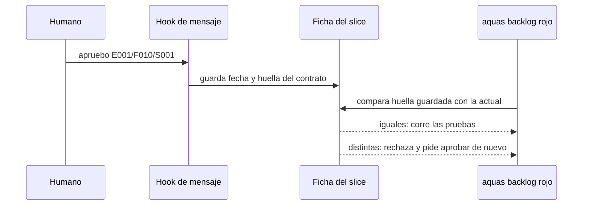

# S001 · Contrato, aprobación sellada y DoD común

[Inicio](../../README.md) › [E001](../README.md) › [F010](README.md) › S001

Este [slice](../../glosario.md#slice) agrega el paso de aprobación humana entre el refinamiento y el rojo. Estado: en curso. El contrato se corrigió tras la auditoría y las decisiones del humano. El humano lo reaprobó el 2026-10-23.

## En una frase

El rojo de un slice exige una aprobación humana vigente, atada a la huella de su contrato.

## Para qué existe

**El problema.** El humano no tenía cómo aceptar los criterios antes de que el [agente](../../glosario.md#agente) construyera. Tras un compactado, el agente trabaja con su propio resumen del chat.

**La solución.** El contrato vive en la página del slice y en su ficha. La aprobación la registra un [hook](../../glosario.md#hook) al leer el mensaje del humano. Así el humano aprueba con una frase y no con un comando.

Contrato del slice:

| Campo | Valor |
|---|---|
| Historia | Como humano, quiero aprobar el contrato de cada slice antes del rojo, para saber qué se va a construir y con qué pruebas |
| Objetivo | Rojo y EN_CURSO exigen aprobación vigente; rojo, verde y cierre comparan la huella; cambiar el contrato la anula |
| Incluye | Registro de aprobación en la ficha, huella del contrato, hook que lee «apruebo <id>» (solo una línea afirmativa), rechazo del rojo y de EN_CURSO sin aprobación desde cualquier estado, rechazo de rojo, verde y cierre si la huella cambió, exención de pruebas previstas en el gate de la wiki, regla de definición de terminado común en un canónico |
| Excluye | Fichas cerradas; slices con rojo registrado antes de F010; medir tokens |
| Límite | Protege contra errores y deriva del contrato, no contra un agente que quiera engañar: para eso, auditor y diff |
| Alcance | `internal/backlog/**`, `cmd/aquas/**`, `internal/wiki/**`, `internal/compilador/**`, `gobierno/canonico/**`, `gobierno/config/**`, `docs/E001/F010/**`, `CLAUDE.md`, `.claude/**` |
| Ampliaciones | `internal/entorno/**` para la prueba del hook en settings; `internal/guardia/**`, usada y revertida, sin cambios finales; `docs/E001/README.md` para quitar «no hay aprobaciones formales» |
| Prueba integral | TestContratoAprobadoAntesDeConstruir |

Criterios de aceptación:

1. Dado un slice sin aprobación, cuando se pide su rojo o EN_CURSO, entonces se rechaza. El mensaje pide «apruebo» con su id.
2. Dado un mensaje humano con «apruebo» y un id, el hook lo lee. Entonces la ficha guarda fecha y huella del contrato.
3. Dado un mensaje con marco de agente, o con apruebo fuera de la primera línea, el hook no registra aprobación.
4. Dado un contrato aprobado, cambian sus pruebas, su alcance o su sección «Para qué existe». Entonces la aprobación deja de valer y el rojo, el verde y el cierre se rechazan, también en EN_CURSO.
5. Dado el alcance ampliado con el comando `aquas backlog alcance` tras aprobar, entonces también hace falta aprobar de nuevo.
6. Dada la regla común de terminado, al compilar llega al [orquestador](../../glosario.md#orquestador). Cada slice solo agrega lo suyo.

Estrategia:

1. La huella es un [SHA-256](../../glosario.md#sha-256) de las pruebas, el alcance y la sección «Para qué existe». Los bloques que genera aquas quedan fuera, porque cambian con cada rojo y verde.
2. El hook de mensaje del humano ya registra el plan de llamadas. Ahora también buscará «apruebo» seguido de un id.
3. El rojo, el verde y el cierre comparan la huella guardada con la actual antes de correr nada.
4. El alcance vigilado de E001/F002/S007 ya bloquea archivos fuera del alcance; se reusa, no se duplica.

## Analogía

Piensa en un **cheque firmado por un monto exacto**.

- El banco paga solo si la firma corresponde a ese cheque.
- Si alguien cambia el monto, la firma ya no vale.

Límite de la analogía: aquí no hay banco; el que compara la firma con el texto es el rojo.

## Diagrama

## Ejemplo de punta a punta

continúa: [EJ-E001-F010](README.md#EJ-E001-F010)

1. Este mismo contrato es el primer caso: el humano lo lee antes de que exista una línea de código.
2. La primera aprobación se anotó a mano en esta página, porque el hook aún no existía.
3. Desde que S001 cierre, toda aprobación la registra el hook.

## Paso a paso

1. El humano lee este contrato y responde «apruebo E001/F010/S001» o pide cambios.
2. Se registra el rojo de la prueba integral y de las pruebas del slice.
3. Se implementa hasta el verde, y el auditor revisa cada criterio de aceptación.

## Cómo se usa

- El humano lee el contrato de la página y escribe «apruebo E001/F010/S001» en el chat.
- El hook `aquas aprobacion` guarda en la ficha la fecha, la huella y el mensaje.
- Después `aquas backlog estado` a EN_CURSO, `aquas backlog rojo`, `verde` y el cierre aceptan el slice.
- Sin aprobación, o con el contrato cambiado, rechazan y piden «apruebo» con el id.
- Cambiar pruebas, alcance o «Para qué existe» obliga a aprobar de nuevo.
- Solo el mensaje del humano aprueba: el texto del agente en una herramienta no cuenta.
- EN_CURSO exige aprobación desde cualquier estado, también desde BLOQUEADO, mientras la ficha no tenga rojo.
- Con aprobación, rojo, verde y cierre piden que la huella siga igual. Quedan exentos los slices con rojo previo y sin aprobación.
- Es una protección contra errores, no contra un agente tramposo: para eso están el auditor y el diff.
- Solo cuenta la primera línea del mensaje, si empieza por «apruebo <id>»; los mensajes de agentes se descartan; «no apruebo…» y las líneas que terminan en «?» no aprueban.
- Las pruebas son `TestRojoExigeAprobacion`, `TestExigenciaPorEstado`, `TestAprobacionAtadaAHuella`, `TestAmpliarAnulaAprobacion`, `TestHookRegistraApruebo`, `TestApruebaSoloLineaAfirmativa`, `TestHookIgnoraMensajeDeAgente`, `TestDerivaEnCursoAnulaAprobacion`, `TestPruebaPrevistaSoloSinRojo`, `TestSettingsRealTraeHookAprobacion` y `TestDoDComunCompilado`.

## Contrato y evidencia

<!-- GENERADO por aquas desde trabajo/: no editar a mano; `aquas compilar` lo rehace. -->

| Prueba | Valida | Rojo cuando | Verde cuando | Rojo | Verde |
|---|---|---|---|---|---|
| `TestRojoExigeAprobacion` | rojo y EN_CURSO exigen aprobación vigente | un slice sin aprobación registra rojo o pasa a EN_CURSO | se rechaza y el mensaje pide apruebo con el id | 2026-10-24 | 2026-10-24 |
| `TestExigenciaPorEstado` | BORRADOR, LISTO y BLOQUEADO piden aprobación para arrancar; el slice con rojo previo queda exento | un slice sin rojo arranca o registra rojo sin aprobación, por BLOQUEADO también, o el de rojo previo la pide | todos esos estados piden apruebo y el slice con rojo previo sigue exento | 2026-10-24 | 2026-10-24 |
| `TestAprobacionAtadaAHuella` | cambiar pruebas, alcance o contrato tras aprobar anula la aprobación | el rojo se acepta con el contrato cambiado | el rojo se rechaza y pide aprobar de nuevo | 2026-10-24 | 2026-10-24 |
| `TestAmpliarAnulaAprobacion` | ampliar el alcance tras aprobar anula la aprobación | ampliar deja vigente la aprobación | EN_CURSO y el rojo se rechazan pidiendo apruebo | 2026-10-24 | 2026-10-24 |
| `TestDerivaEnCursoAnulaAprobacion` | cambiar el contrato en EN_CURSO tras aprobar hace fallar rojo, verde y cierre | rojo, verde o cierre pasan con el contrato cambiado tras aprobar | los tres se rechazan pidiendo apruebo con el id | 2026-10-24 | 2026-10-24 |
| `TestHookRegistraApruebo` | el mensaje del humano registra la aprobación y el texto del agente no | no se registra con el mensaje humano o se registra desde una herramienta | el mensaje humano guarda fecha y huella; la herramienta no guarda nada | 2026-10-24 | 2026-10-24 |
| `TestApruebaSoloLineaAfirmativa` | solo una línea afirmativa que empieza por apruebo aprueba | una negación o una pregunta registran aprobación | solo la línea «apruebo id» sin signo de pregunta guarda la aprobación | 2026-10-24 | 2026-10-24 |
| `TestHookIgnoraMensajeDeAgente` | el hook descarta cada marca de agente sola y solo acepta apruebo en la primera línea | una sola marca de agente, o un apruebo en segunda línea, registra la aprobación | cada marca sola y el apruebo en segunda línea no registran; en la primera línea limpia sí | 2026-10-24 | 2026-10-24 |
| `TestPruebaPrevistaSoloSinRojo` | una prueba inexistente se acepta solo si su ficha no tiene rojo | se acepta con rojo o archivada, o se rechaza sin rojo | sin rojo se acepta; con rojo o archivada se rechaza | — | 2026-10-24 |
| `TestSettingsRealTraeHookAprobacion` | la plantilla de settings trae el hook de aprobación | no hay hook de aprobación en UserPromptSubmit | el settings generado trae la orden de aprobación | 2026-10-24 | 2026-10-24 |
| `TestDoDComunCompilado` | la regla de terminado común llega al orquestador compilado | el bloque de la regla en el compilado no trae sus requisitos | el bloque trae título con versión y sus requisitos | 2026-10-24 | 2026-10-24 |

### Código

| Archivo | Función | Parámetros | Qué hace |
|---|---|---|---|
| [cmd/aquas/aprobacion.go](../../../cmd/aquas/aprobacion.go) | `idAprobado` | `(prompt string) (string, bool)` | idAprobado: id de la PRIMERA línea no vacía si es «apruebo <id>»; una línea que termina en «?» es pregunta. |
| [cmd/aquas/aprobacion.go](../../../cmd/aquas/aprobacion.go) | `aprobacionCLI` | `(raiz string)` | aprobacionCLI: solo un evento UserPromptSubmit cuenta como mensaje del humano. PreToolUse, PostToolUse, |
| [cmd/aquas/main.go](../../../cmd/aquas/main.go) | `main` | `()` | main despacha el subcomando de aquas (compilar, verificar, backlog, hooks…) y sale con su código. |
| [cmd/aquas/main.go](../../../cmd/aquas/main.go) | `hook` | `(raiz string)` | hook: exit 0 = nada que reportar; exit 2 = stderr se muestra a Claude. |
| [cmd/aquas/main.go](../../../cmd/aquas/main.go) | `compilarSettings` | `(w io.Writer)` | compilarSettings regenera .claude/settings.json; sin entorno declarado no inventa uno. |
| [cmd/aquas/main.go](../../../cmd/aquas/main.go) | `reportar` | `(w io.Writer, inf compilador.Informe)` | reportar imprime qué derivados escribió la compilación, o que todo estaba al día. |
| [cmd/aquas/main.go](../../../cmd/aquas/main.go) | `listar` | `(titulo string, problemas []string)` | listar imprime en stderr un título y cada problema en su viñeta. |
| [cmd/aquas/main.go](../../../cmd/aquas/main.go) | `lista` | `(xs []string) string` | lista une los textos con comas, o «—» si no hay ninguno. |
| [cmd/aquas/main.go](../../../cmd/aquas/main.go) | `fallar` | `(codigo int, err error)` | fallar imprime el error en stderr y termina con el código dado. |
| [cmd/aquas/main.go](../../../cmd/aquas/main.go) | `memoriaCLI` | `(raiz string, args []string)` | memoriaCLI: `ver` imprime la memoria; `fijar campo=valor…` la actualiza y la sella. |
| [cmd/aquas/main.go](../../../cmd/aquas/main.go) | `memoriaArchivada` | `(raiz, id string) error` | memoriaArchivada: CERRADO exige el archivo de memoria del slice, apunte o no la memoria a él (E001/F002/S009, X01). |
| [cmd/aquas/main.go](../../../cmd/aquas/main.go) | `focoEnBacklog` | `(raiz string, f memoria.Foco) error` | focoEnBacklog: la memoria solo fija el slice que el backlog tiene en curso (S003). |
| [cmd/aquas/main.go](../../../cmd/aquas/main.go) | `backlogCLI` | `(raiz string, args []string)` | backlogCLI: nuevo \\| ver [id] \\| prioridad \\| estado \\| siguiente \\| pruebas \\| rojo \\| verde. |
| [cmd/aquas/main.go](../../../cmd/aquas/main.go) | `turnoCLI` | `(raiz string, args []string)` | turnoCLI: auditoría de turnos (E001/F002/S001). Lee el JSON del hook por stdin. No imprime nada |
| [cmd/aquas/main.go](../../../cmd/aquas/main.go) | `defectoCLI` | `(raiz string, args []string) error` | defectoCLI: nuevo \\| ocurre \\| ver (E001/F004/S001). |
| [cmd/aquas/main.go](../../../cmd/aquas/main.go) | `versionBinario` | `() string` | versionBinario: versión del módulo con que se compiló el binario (= versión del gobierno embebido). |
| [gobierno/config/agentes.json](../../../gobierno/config/agentes.json) | — | — | — |
| [gobierno/config/claude_settings.json](../../../gobierno/config/claude_settings.json) | — | — | — |
| [internal/backlog/aprobacion.go](../../../internal/backlog/aprobacion.go) | `seccionContrato` | `(texto string) (string, bool)` | seccionContrato: texto de «## Para qué existe» de la página, sin los bloques GENERADO de aquas. |
| [internal/backlog/aprobacion.go](../../../internal/backlog/aprobacion.go) | `Huella` | `(raiz string, f Ficha) (string, error)` | Huella: SHA-256 de las pruebas, el alcance (con sus ampliaciones) y la sección «Para qué existe» de la página. |
| [internal/backlog/aprobacion.go](../../../internal/backlog/aprobacion.go) | `Aprobar` | `(raiz, id, mensaje string, ahora time.Time) (Ficha, error)` | Aprobar registra la aprobación del contrato del slice con la huella actual. Lo llama solo el hook del mensaje del humano. |
| [internal/backlog/aprobacion.go](../../../internal/backlog/aprobacion.go) | `aprobada` | `(raiz string, f Ficha) error` | aprobada: nil si el slice puede avanzar (EN_CURSO, rojo, verde, cierre); si no, el paso que falta. |
| [internal/backlog/backlog.go](../../../internal/backlog/backlog.go) | `terminal` | `(estado string) bool` | terminal: el estado ya no cambia (CERRADO o CANCELADO). |
| [internal/backlog/backlog.go](../../../internal/backlog/backlog.go) | `esta` | `(xs []string, x string) bool` | esta: x figura en la lista. |
| [internal/backlog/backlog.go](../../../internal/backlog/backlog.go) | `tipoYPadre` | `(id string) (tipo, padre string)` | tipoYPadre deriva del id: E001 → iniciativa; E001/F002 → feature de E001; E001/F002/S002 → slice. |
| [internal/backlog/backlog.go](../../../internal/backlog/backlog.go) | `nombre` | `(id string) string` | nombre: archivo JSON de una ficha, con «/» del ID cambiadas por «-». |
| [internal/backlog/backlog.go](../../../internal/backlog/backlog.go) | `todas` | `(raiz string) (act, arc map[string]Ficha, err error)` | todas lee activo y archivo. Una ficha ilegible es error: Validar la detalla. |
| [internal/backlog/backlog.go](../../../internal/backlog/backlog.go) | `Todas` | `(raiz string) ([]Ficha, error)` | Todas: las fichas de activo y archivo, ordenadas por id. Para quien solo lee (wiki, E001/F002/S010). |
| [internal/backlog/backlog.go](../../../internal/backlog/backlog.go) | `leer` | `(ruta string) (Ficha, error)` | leer carga una ficha desde su archivo JSON. |
| [internal/backlog/backlog.go](../../../internal/backlog/backlog.go) | `escribir` | `(raiz, dir string, f Ficha) error` | escribir guarda la ficha como JSON en trabajo/<dir>/, con listas vacías en vez de null. |
| [internal/backlog/backlog.go](../../../internal/backlog/backlog.go) | `Nuevo` | `(raiz string, campos []string) (Ficha, error)` | Nuevo crea una ficha desde campos id=… titulo=… prioridad=… motivo=… relacion=… [bloqueado_por=A,B]. |
| [internal/backlog/backlog.go](../../../internal/backlog/backlog.go) | `Ver` | `(raiz, id string) (Ficha, bool, error)` | Ver busca la ficha en activo y luego en archivo. |
| [internal/backlog/backlog.go](../../../internal/backlog/backlog.go) | `activa` | `(raiz, id string) (Ficha, error)` | activa: la ficha a cambiar; una archivada no cambia. |
| [internal/backlog/backlog.go](../../../internal/backlog/backlog.go) | `Prioridad` | `(raiz, id, prioridad, motivo string) (Ficha, error)` | Prioridad cambia la prioridad; el motivo es obligatorio. |
| [internal/backlog/backlog.go](../../../internal/backlog/backlog.go) | `Estado` | `(raiz, id, estado string) (Ficha, error)` | Estado cambia el estado. CERRADO o CANCELADO mueve la ficha al archivo. |
| [internal/backlog/backlog.go](../../../internal/backlog/backlog.go) | `sinHijosActivos` | `(act map[string]Ficha, f Ficha) error` | sinHijosActivos: cerrar o cancelar una feature o iniciativa exige sus hijos directos ya archivados. |
| [internal/backlog/backlog.go](../../../internal/backlog/backlog.go) | `ordenar` | `(fs []Ficha, arc map[string]Ficha)` | orden de `siguiente`: en curso → desbloqueado → prioridad → secuencia → id. |
| [internal/backlog/backlog.go](../../../internal/backlog/backlog.go) | `Activas` | `(raiz string) ([]Ficha, error)` | Activas: slices en el orden de `siguiente`; después iniciativas y features por secuencia. |
| [internal/backlog/backlog.go](../../../internal/backlog/backlog.go) | `Siguiente` | `(raiz string) (Ficha, bool, error)` | Siguiente: el primer slice del orden fijo que esté en curso o desbloqueado. |
| [internal/backlog/backlog.go](../../../internal/backlog/backlog.go) | `sinDefinir` | `(act map[string]Ficha) (Ficha, bool)` | sinDefinir (E001/F002/S008, regla del humano 2026-10-21): iniciativa o feature activa sin hijos |
| [internal/backlog/backlog.go](../../../internal/backlog/backlog.go) | `Definir` | `(f Ficha) string` | Definir: qué hacer con lo que `siguiente` saca sin definir; "" para un slice. |
| [internal/backlog/backlog.go](../../../internal/backlog/backlog.go) | `libre` | `(f Ficha, arc map[string]Ficha) bool` | libre: no está BLOQUEADO y cada bloqueador ya terminó (archivado: CERRADO o CANCELADO). |
| [internal/backlog/backlog.go](../../../internal/backlog/backlog.go) | `Validar` | `(raiz string) []string` | Validar: problemas de las fichas en disco (gate). Sin carpeta trabajo/ no hay problemas. |
| [internal/backlog/backlog.go](../../../internal/backlog/backlog.go) | `Texto` | `(f Ficha) string` | Texto: una línea por ficha, para el agente. |
| [internal/backlog/rojo.go](../../../internal/backlog/rojo.go) | `problemaPrueba` | `(p Prueba) string` | problemaPrueba: por qué una prueba de la ficha está mal escrita ("" si está bien). |
| [internal/backlog/rojo.go](../../../internal/backlog/rojo.go) | `listaPruebas` | `(xs []string) ([]Prueba, error)` | listaPruebas convierte "./paquete:TestNombre=intención" en pruebas válidas, sin repetidas. |
| [internal/backlog/rojo.go](../../../internal/backlog/rojo.go) | `corriendo` | `(f Ficha) bool` | corriendo: la ficha está EN_CURSO o VERIFICANDO. |
| [internal/backlog/rojo.go](../../../internal/backlog/rojo.go) | `sliceEnCurso` | `(act map[string]Ficha) (string, bool)` | sliceEnCurso: el primer slice EN_CURSO o VERIFICANDO entre las activas, por id. |
| [internal/backlog/rojo.go](../../../internal/backlog/rojo.go) | `SliceEnCurso` | `(raiz string) (string, bool, error)` | SliceEnCurso: el único slice EN_CURSO o VERIFICANDO, si hay. |
| [internal/backlog/rojo.go](../../../internal/backlog/rojo.go) | `Pruebas` | `(raiz, id string, lista []string) (Ficha, error)` | Pruebas fija las pruebas de la ficha; cambiarlas borra rojo y verde. |
| [internal/backlog/rojo.go](../../../internal/backlog/rojo.go) | `corrible` | `(raiz, id string) (Ficha, error)` | corrible: ficha activa con pruebas; un slice además debe estar en curso. |
| [internal/backlog/rojo.go](../../../internal/backlog/rojo.go) | `Rojo` | `(raiz, id string, ahora time.Time) (Ficha, error)` | Rojo corre cada prueba sola con `go test -json`; exige que cada una falle por sí misma. |
| [internal/backlog/rojo.go](../../../internal/backlog/rojo.go) | `rojoHeredado` | `(raiz string, f Ficha) *Registro` | rojoHeredado (X02): rojo que un slice cerrado de la feature registró para todas sus pruebas |
| [internal/backlog/rojo.go](../../../internal/backlog/rojo.go) | `Verde` | `(raiz, id string, ahora time.Time) (Ficha, error)` | Verde corre las pruebas juntas tras el rojo; exige que todas pasen. |
| [internal/backlog/rojo.go](../../../internal/backlog/rojo.go) | `resultado.motivo` | `(siPasa string) string` | motivo: texto que explica el resultado de una prueba; siPasa se usa cuando pasó. |
| [internal/backlog/rojo.go](../../../internal/backlog/rojo.go) | `correr` | `(raiz string, ps []Prueba) (map[string]resultado, error)` | correr: `go test -json -count=1 -run ^(A\\|B)$ ./paquete` por paquete; resultado por prueba. |
| [internal/backlog/rojo.go](../../../internal/backlog/rojo.go) | `motivoDelFallo` | `(ls []string) string` | motivoDelFallo: la última línea «archivo.go:N: …» (la que hizo fallar); si no hay, la primera. |
| [internal/backlog/rojo.go](../../../internal/backlog/rojo.go) | `head` | `(raiz string) string` | head: commit actual del repo, o "" fuera de Git. |
| [internal/backlog/rojo.go](../../../internal/backlog/rojo.go) | `cierre` | `(raiz string, f Ficha) error` | cierre: CERRADO exige pruebas, rojo, verde y, si el verde trae huella, el mismo código Go. |
| [internal/backlog/rojo.go](../../../internal/backlog/rojo.go) | `problemasRojoVerde` | `(rel string, f Ficha) []string` | problemasRojoVerde: chequeos del gate sobre pruebas, rojo y verde de una ficha. |
| [internal/backlog/rojo.go](../../../internal/backlog/rojo.go) | `Detalle` | `(f Ficha) string` | Detalle: pruebas con su intención, y rojo y verde, para `ver <id>`, `pruebas`, `rojo` y `verde`. |
| [internal/wiki/contrato.go](../../../internal/wiki/contrato.go) | `seccionesDe` | `(n nivel) []string` | seccionesDe: orden fijo de secciones según el nivel de la página. |
| [internal/wiki/contrato.go](../../../internal/wiki/contrato.go) | `migasEsperadas` | `(pg *pagina) string` | migasEsperadas: migas «Inicio › E001 › F001», cada nivel con enlace relativo a la página. |
| [internal/wiki/contrato.go](../../../internal/wiki/contrato.go) | `revisarMigas` | `(pg *pagina) []string` | revisarMigas: aviso si las migas de pan no coinciden con la ruta de la página. |
| [internal/wiki/contrato.go](../../../internal/wiki/contrato.go) | `revisarTrazabilidad` | `(raiz string, paginas map[string]*pagina, orden []string) ([]string, error)` | revisarTrazabilidad cruza las pruebas nombradas en los slices con las func Test del repo. |
| [internal/wiki/contrato.go](../../../internal/wiki/contrato.go) | `prevista` | `(raiz, rel, n string) bool` | prevista (E001/F010/S001): la prueba n aún no existe en el código pero la ficha del slice de la página rel |
| [internal/wiki/contrato.go](../../../internal/wiki/contrato.go) | `integralesDe` | `(raiz, rel string) []string` | integralesDe: nombres de las func Test que declara la ficha de la feature de la página rel; ninguno si no hay ficha. |
| [internal/wiki/contrato.go](../../../internal/wiki/contrato.go) | `pruebasDelRepo` | `(raiz string) (map[string]string, error)` | pruebasDelRepo: nombre de cada func Test → archivo; salta carpetas ocultas (.git, .tmp) y testdata. |

<!-- /GENERADO -->

**Pruebas previstas.**

- TestRojoExigeAprobacion: el rojo y EN_CURSO sin aprobación se rechazan nombrando el paso faltante.
- TestAprobacionAtadaAHuella: cambiar pruebas, alcance o contrato tras aprobar anula la aprobación.
- TestHookRegistraApruebo: el mensaje del humano registra la aprobación y el texto del agente no.
- TestExigenciaPorEstado: BORRADOR, LISTO y BLOQUEADO piden aprobación para pasar a EN_CURSO; el slice con rojo previo queda exento.
- TestAmpliarAnulaAprobacion: ampliar el alcance tras aprobar anula la aprobación.
- TestApruebaSoloLineaAfirmativa: la línea «apruebo <id>» no termina en «?» y aprueba.
- TestHookIgnoraMensajeDeAgente: el hook descarta cada marca de agente por sí sola y exige «apruebo <id>» en la primera línea.
- TestDerivaEnCursoAnulaAprobacion: tras aprobar y arrancar, cambiar el contrato hace fallar rojo, verde y cierre.
- TestPruebaPrevistaSoloSinRojo: el [gate](../../glosario.md#gate) acepta una prueba inexistente solo si su ficha aún no tiene rojo.
- TestSettingsRealTraeHookAprobacion: la plantilla de settings trae el hook de aprobación.
- TestDoDComunCompilado: la regla de definición de terminado común llega al orquestador compilado, dentro de su bloque.

Aprobación: humano, 2026-10-23, anotada a mano antes del hook. El hook registró la reaprobación a las 23:32:45Z.

## Navegación

- ↑ Subir: [F010 · Contrato aprobado antes de construir](README.md)
