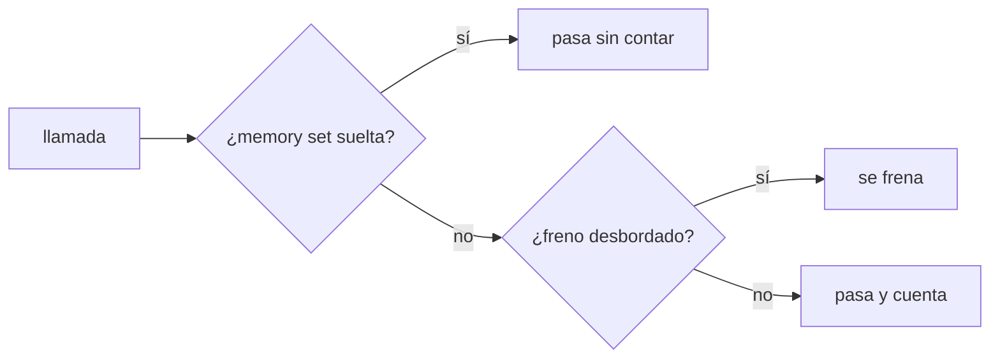
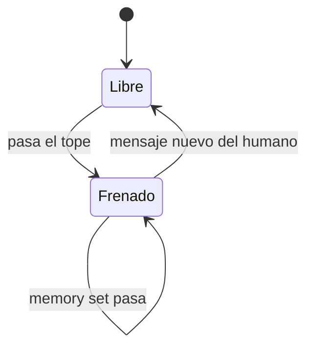

# F011 · Frenos propios del gobierno

[Inicio](../../README.md) › [E001](../README.md) › F011

Esta [feature](../../glosario.md#feature) hace que el freno de llamadas nunca bloquee lo que exige un cierre.

## En una frase

Con el freno activo, `aquas memory set` pasa y todo lo demás se frena.

## Para qué existe

**El problema.** El freno de llamadas bloqueaba `aquas memory set` al desbordar (D000029). El freno global ya cede en este repo, pero `aquas budget` repite la falla.

**Por qué importa.** El [hook](../../glosario.md#hook) de cierre exige la memoria al día. Si el freno la bloquea, el [agente](../../glosario.md#agente) queda atrapado entre los dos.

**La solución.** El freno reconoce `aquas memory set` como orden suelta. La deja pasar sin contarla.

## Analogía

Piensa en **un semáforo con paso para la ambulancia**.

- Los demás esperan en rojo.
- La ambulancia pasa porque su viaje no espera.

Límite de la analogía: solo pasa la orden suelta, sin nada encadenado.

## Diagrama

Estados del turno:

## Ejemplo de punta a punta

continúa: [EJ-E001](../README.md#EJ-E001)

1. El agente pasa las 60 llamadas del turno.
2. El freno detiene el siguiente comando.
3. El agente actualiza la memoria con `aquas memory set` y cierra el turno.

## Paso a paso

1. S001: interruptor de hooks globales. Cancelado: `cede_a` del freno global ya lo cubre.
2. S002: el freno de aquas deja pasar `memory set`.

## Cómo se usa

- Nada que hacer: el freno lo aplica solo.

## Contrato y evidencia

Prueba integral: `TestFrenosPropiosGobernados`.

## Navegación

<!-- GENERADO por aquas desde trabajo/: no editar a mano; `aquas compile` lo rehace. -->

| Hijo | Qué es | Estado |
|---|---|---|
| S001 | Interruptor de hooks globales | Cancelado |
| [S002](S002.md) | el freno de aquas deja pasar memoria fijar | Hecho |

<!-- /GENERADO -->

- ↑ Subir: [E001](../README.md)
