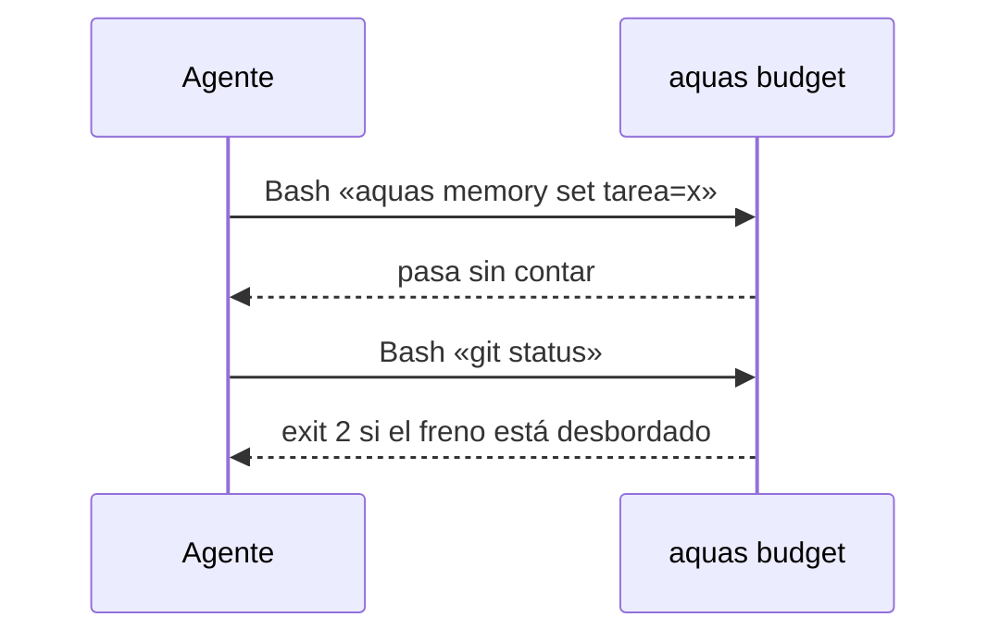

# S002 · el freno de aquas deja pasar memoria fijar

[Inicio](../../README.md) › [E001](../README.md) › [F011](README.md) › S002

Este [slice](../../glosario.md#slice) exenta del freno de llamadas la orden que exige el cierre.

## En una frase

`aquas memory set`, sola, pasa aunque el freno esté desbordado, y no cuenta.

## Para qué existe

**El problema.** `aquas budget` frena toda llamada al pasar su tope (E001/F015/S002). Eso incluye `aquas memory set`.

**Por qué importa.** El [hook](../../glosario.md#hook) de cierre pide la memoria al día. Con el freno activo, el [agente](../../glosario.md#agente) no puede cumplirlo.

**La solución.** Antes de contar, el freno mira el comando. Si es `memory set` suelta, la deja pasar.

**Contrato.**

| Regla | Valor |
|---|---|
| Qué pasa | herramienta Bash cuyo comando entero es `aquas memory set campo=valor…`; desde [E001/F017/S001](../../E001/F017/S001.md) también `aquas defect new\|occur` y un `cd <raíz> &&` delante |
| Binario | `aquas`, `go run ./cmd/aquas` o `./.tmp/aquas.exe`; entre comillas, solo la ruta del `.tmp/` de este repo |
| Cuenta | no suma al turno ni al tope de la feature |
| Cualquier otra cosa | otra orden, redirección, `&`, `$(`, `<(` o un binario ajeno se trata como cualquier comando |
| Otro comando | se cuenta y se frena igual que hoy |

**Casos borde.**

- `aquas memory show` no está exenta.
- Otra herramienta, como Edit, no está exenta.
- El aviso de contexto no cambia; con la orden exenta sale en la llamada siguiente.
- Un valor entre comillas puede llevar `;` o `|`; entre comillas dobles no puede llevar `$`.
- Se prefiere frenar de más. Se frenan una variable delante (`FOO=1 aquas …`) y una ruta absoluta sin comillas.
- También `go run ./cmd/aquas/` con barra final y un acento grave dentro de comillas dobles.
- La ruta del repo al estilo Git Bash (`/d/…`) entre comillas también se frena.
- Límite aceptado: las formas sin ruta absoluta (`aquas`, `./.tmp/aquas.exe`, `go run`) dependen de la carpeta y el PATH del shell.

## Analogía

Piensa en **la salida de emergencia de un cine lleno**.

- Nadie más entra, pero se puede salir.

Límite de la analogía: solo una orden exacta usa esa salida.

## Diagrama

## Ejemplo de punta a punta

continúa: [EJ-E001-F011](README.md#EJ-E001-F011)

1. El turno ya pasó su tope (hoy 1000 llamadas, E001/F019/S004).
2. `./.tmp/aquas.exe memory set tarea=x` pasa.
3. `aquas memory set tarea=x && git push` se frena.

## Paso a paso

1. Rojo de las pruebas, exención en el freno, verde.

## Cómo se usa

- Nada que hacer: el freno lo aplica solo.

## Contrato y evidencia

<!-- GENERADO por aquas desde trabajo/: no editar a mano; `aquas compile` lo rehace. -->

| Prueba | Valida | Rojo cuando | Verde cuando | Rojo | Verde |
|---|---|---|---|---|---|
| `TestFrenoDejaPasarMemoria` | valida que con el freno activo memoria fijar suelta pasa sin contar y lo demás se frena | rojo cuando memoria fijar se frena con el turno o la feature desbordados | verde cuando memoria fijar suelta pasa y encadenada u otro comando se frena | 2026-10-29 | 2026-10-29 |

### Código

| Archivo | Función | Parámetros | Qué hace |
|---|---|---|---|
| [cmd/aquas/presupuesto.go](../../../cmd/aquas/presupuesto.go) | `leerTope` | `(primera string, ap *apruebo)` | leerTope: «tope 25M» o «tope 25 M» → tokens ponderados; «tope 900» solo, o seguido de «con» o «y» → llamadas (el viejo). |
| [cmd/aquas/presupuesto.go](../../../cmd/aquas/presupuesto.go) | `pesoVeinteavos` | `(u usoRespuesta) int64` | pesoVeinteavos: el usage de una respuesta ponderado por precio, en veinteavos de token para no usar decimales. |
| [cmd/aquas/presupuesto.go](../../../cmd/aquas/presupuesto.go) | `millones` | `(n int64) string` | millones: 15000000 → «15M»; 15000001 → «15,0M». |
| [cmd/aquas/presupuesto.go](../../../cmd/aquas/presupuesto.go) | `rutaComparableEn` | `(goos, r string) string` | rutaComparableEn: la ruta limpia con «/»; en Windows la forma Git Bash «/d/…» pasa a «D:/…» (A2.4; sistema dado: E000/F007/S001). |
| [cmd/aquas/presupuesto.go](../../../cmd/aquas/presupuesto.go) | `exentaDelFreno` | `(raiz, herramienta, comando string) bool` | exentaDelFreno: true si el comando Bash entero es `aquas memory set …` o `aquas defect new\\|occur …`. |
| [cmd/aquas/presupuesto.go](../../../cmd/aquas/presupuesto.go) | `rutasIguales` | `(goos, a, b string) bool` | rutasIguales (E000/F007/S001, hallazgos L1 y L2; no confundir con entorno.mismaRuta, que no entiende «/d/…»): misma carpeta según el sistema; mayúsculas iguales solo en Windows. |
| [cmd/aquas/presupuesto.go](../../../cmd/aquas/presupuesto.go) | `exentaDelFrenoEn` | `(goos, raiz, herramienta, comando string) bool` | exentaDelFrenoEn: exentaDelFreno para un sistema dado (E000/F007/S001). |
| [cmd/aquas/presupuesto.go](../../../cmd/aquas/presupuesto.go) | `ordenDeCierre` | `(raiz, herramienta, comando string) bool` | ordenDeCierre (E001/F019/S003): true si el comando Bash entero es una orden de cierre de reCierre. |
| [cmd/aquas/presupuesto.go](../../../cmd/aquas/presupuesto.go) | `ordenEnteraEn` | `(goos, raiz, herramienta, comando string, re *regexp.Regexp) bool` | ordenEnteraEn: el comando Bash entero cumple la lista blanca re; el `cd` solo vale a la raíz y un binario entre |
| [cmd/aquas/presupuesto.go](../../../cmd/aquas/presupuesto.go) | `presupuestoCLI` | `(raiz string, args []string)` | presupuestoCLI: «herramienta» cuenta el gasto en el registro (tokens ponderados o llamadas, E001/F019/S001) y bloquea con exit 2 al pasar un tope. |
| [cmd/aquas/presupuesto.go](../../../cmd/aquas/presupuesto.go) | `marcaDir` | `(raiz string) string` | marcaDir: carpeta de las marcas de aviso; borrarlas repite un aviso, no quita un freno. |
| [cmd/aquas/presupuesto.go](../../../cmd/aquas/presupuesto.go) | `avisarGasto` | `(raiz string, c *cuentaFeature) string` | avisarGasto: aviso al cruzar el 50% o el 80% del tope, una vez por umbral y apruebo. La marca guarda la hora del |
| [cmd/aquas/presupuesto.go](../../../cmd/aquas/presupuesto.go) | `frenar` | `(formato string, a ...any)` | frenar escribe el motivo en stderr y bloquea la llamada. |
| [cmd/aquas/presupuesto.go](../../../cmd/aquas/presupuesto.go) | `avisarContexto` | `(raiz string, e entradaPresupuesto, turno string) string` | avisarContexto pide /compact una vez por turno cuando el contexto medido pasa el umbral; la marca guarda el |
| [cmd/aquas/presupuesto.go](../../../cmd/aquas/presupuesto.go) | `recorrerRegistro` | `(ruta string, f func(pos int64, l lineaLlamadas)) error` | recorrerRegistro abre un registro y entrega cada línea legible con su posición; las rotas se ignoran. |
| [cmd/aquas/presupuesto.go](../../../cmd/aquas/presupuesto.go) | `llamadas` | `(raiz string, l lineaLlamadas) []string` | llamadas: ids de los tool_use de una línea de asistente, sin las llamadas exentas. |
| [cmd/aquas/presupuesto.go](../../../cmd/aquas/presupuesto.go) | `escanear` | `(raiz, ruta string) (escaneo, error)` | escanear lee un registro una vez. D000096: el turno y el apruebo vigente se eligen por hora, no por posición: |
| [cmd/aquas/presupuesto.go](../../../cmd/aquas/presupuesto.go) | `carpetaProyecto` | `(ruta string) string` | carpetaProyecto: la carpeta de las sesiones del proyecto; desde un registro de subagente sube a ella. |
| [cmd/aquas/presupuesto.go](../../../cmd/aquas/presupuesto.go) | `escanearProyecto` | `(raiz, ruta string) (map[string]escaneo, error)` | escanearProyecto lee cada registro de sesión de la carpeta del proyecto; sin registro legible, error. |
| [cmd/aquas/presupuesto.go](../../../cmd/aquas/presupuesto.go) | `featureCerrada` | `(raiz, id string) bool` | featureCerrada (E001/F017/S001, D000091): true solo si la feature y todos sus slices (al menos uno) están en CERRADO. |
| [cmd/aquas/presupuesto.go](../../../cmd/aquas/presupuesto.go) | `frenoFeature` | `(raiz, ruta string, sesiones map[string]escaneo) (msg string, cuenta *cuentaFeature)` | frenoFeature: el último apruebo de feature del humano fija feature, tope y hora; se cuentan los tokens ponderados |
| [cmd/aquas/presupuesto.go](../../../cmd/aquas/presupuesto.go) | `frenoTurno` | `(raiz, ruta string, sesiones map[string]escaneo) string` | frenoTurno (E001/F019/S004): último recurso contra bucles. Suma las llamadas distintas y los tokens ponderados del |
| [cmd/aquas/presupuesto.go](../../../cmd/aquas/presupuesto.go) | `contextoMedido` | `(ruta string) int` | contextoMedido: tokens de entrada de la última llamada del modelo en el transcript; 0 si después |

<!-- /GENERADO -->

Pruebas: `TestFrenoDejaPasarMemoria`.

## Navegación

- ↑ Subir: [F011](README.md)
